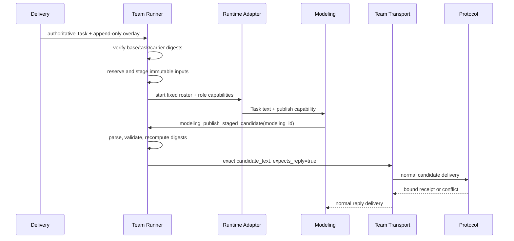

# ADR 0008: Runtime-neutral modeling mechanical spine

- Status: Accepted for R2.3-005 current minimal scope
- Date: 2026-08-06
- Owning requirement: `docs/requirements/requirements-v2.3.md`, R2.3-005
- Related contracts: R2.3-001 Runtime Adapter; R2.3-004 Pi Team Adapter

## Context

R2.3-005 start25 exposed two failures before Protocol could inspect the accepted r3 semantics:

1. Delivery launched a copied continuation Task that had drifted from the authoritative HEAD Task and omitted
   later Prompt A/C/D/E changes.
2. Modeling used a shell command to extract the candidate from an immutable carrier. The private Runtime had no
   `python` executable, and the resulting shell error text was sent through Team Transport as if it were the
   candidate.

Both are deterministic mechanics. They must not depend on model reasoning, shell availability, or a copied Task.
The solution must also remain usable when R2.3-004 replaces Codex with Pi.

## Decision

We separate two planes:

- **Semantic decision plane**: Coordinator, Modeling, Protocol, and Acceptance decide business scope, semantics,
  ontology structure, evidence, validation meaning, retrieval adequacy, and verdicts.
- **Mechanical execution plane**: Runner-owned code loads immutable inputs, validates schemas and digests, preserves
  identities, serializes canonical bytes, publishes role-bound deliveries, and records evidence.

The current minimal implementation adds only two new stable contracts and reuses existing launch, cursor,
candidate-progress, ticket, settlement, and cleanup mechanics.

### 1. Append-only Task input overlay

The formal CLI always receives the authoritative tracked Task as `--task`. A separate optional `--task-overlay`
describes one immutable continuation candidate input. The overlay:

- binds the exact base `task_id` and SHA-256;
- may add one Runner-private candidate publication source, but cannot replace the Task objective, role sources,
  Protocol tools, evidence gates, or any Agent Package;
- uses a repository-relative non-symlink path and binds its SHA-256 before reservation;
- is included in baseline preview, the reservation baseline, and the run-local immutable input manifest;
- is copied separately as `task-overlay.snapshot.yaml`; `task.snapshot.yaml` remains the exact authoritative Task.

A base digest mismatch fails before ledger reservation, scope creation, or Runtime startup. This removes the copied
continuation Task path rather than adding a requirement-specific content checker.

### 2. Typed Modeling candidate publication

When the overlay supplies a candidate carrier, Modeling receives one role-bound operation:
`modeling_publish_staged_candidate`. Modeling decides whether to invoke it. The operation accepts only the fixed
Modeling identity; candidate bytes, path selection, digest calculation, recipient identity, and reply semantics are
not model arguments.

Runner-owned code then:

1. uses only the prevalidated carrier bytes frozen into immutable run-local staging during `prepare`;
2. parses `candidate_text`, verifies that it equals the carrier's parsed `candidate` value;
3. validates the existing five-field formal candidate contract;
4. recomputes candidate and semantic digests and matches the accepted carrier identity;
5. publishes the original `candidate_text` as a Modeling-to-Protocol Team Transport request with
   `expects_reply=true`;
6. returns the delivery identity and candidate identity as a typed receipt.

The Agent never invokes a shell, selects `python` versus `python3`, serializes JSON, copies the outer carrier, or
constructs transport metadata. Existing `FormalCandidateProgress` remains the authority after publication.

### 3. Runtime Adapter boundary

The overlay loader, carrier validator, publication service, and role-capability schemas contain no Codex Session,
thread, rollout, app-server event, or Pi RPC field. They operate on the stable Team Run, role identity, and Team
Transport contracts.

Codex remains a thin loader: it exposes the Runner capability to Modeling through its private MCP config. A later Pi
Adapter may expose the same named operation through Pi-native RPC or an MCP bridge, but must call the same Runner
capability contract and return the same typed receipt. R2.3-004 must not reimplement candidate parsing or transport
publication inside Pi.

The existing Codex platform-tool completion observer used by Prompt E is not redesigned here because it is already
working and is not on the start25 failing path. R2.3-004 must adapt Pi tool-completion events into the existing
Runner-owned artifact registration contract without changing acceptance semantics.

### 4. Existing mechanics retained

- `TeamRunner.prepare` remains the reservation and immutable-baseline gate.
- `protocol_retrieval_mcp.py` remains the deterministic cursor verifier; this change does not create a second pager.
- Protocol still owns candidate translation and all platform calls.
- Prompt E's five-stage artifact and canonical ticket pipeline remains unchanged.
- Cooperative pause/resume, settlement, cleanup, and StartLedger policies remain unchanged.

## Runtime-neutral sequence

## Current minimal scope

- one generic overlay schema;
- one immutable candidate carrier per run;
- one Modeling-only publication operation, exactly once;
- Codex capability projection and Runtime-neutral evidence;
- focused tests plus the complete `modeling_team` regression suite;
- one subsequent real R2.3-005 run as semantic and Acceptance evidence.

## Future productization

The following are deliberately excluded: a generic workflow engine, arbitrary Task patch language, multiple carrier
queues, cross-run continuation, distributed scheduling, UI, backend tables/APIs, automatic semantic retries, and a Pi
Adapter implementation. Pi support is preserved by the contract boundary, not claimed as delivered.

## Acceptance and failure classification

- stale base Task, overlay/path/digest drift, repeated publication, wrong role, carrier/object mismatch, or digest
  mismatch fail before Protocol mutation;
- no invalid call may create a Team Transport delivery or consume a semantic-start budget beyond the already running
  task;
- a valid publication must enter the existing candidate-progress path with an ordinary delivery ID and exact bytes;
- old runs without an overlay expose no Modeling publication capability and behave byte-for-byte as before;
- Codex tests prove current loading; Runtime-neutral unit tests must not depend on Codex event payloads;
- only a live run can establish modeling quality, governed retrieval, or Acceptance PASS.

## Consequences

The high-risk shared symbols are `TeamRunner.prepare` and Codex private config construction. Their changes therefore
remain additive and opt-in, and complete modeling-team regression is mandatory. The new code removes two known
manual failure modes without transferring semantic authority from Agents to Runner.
