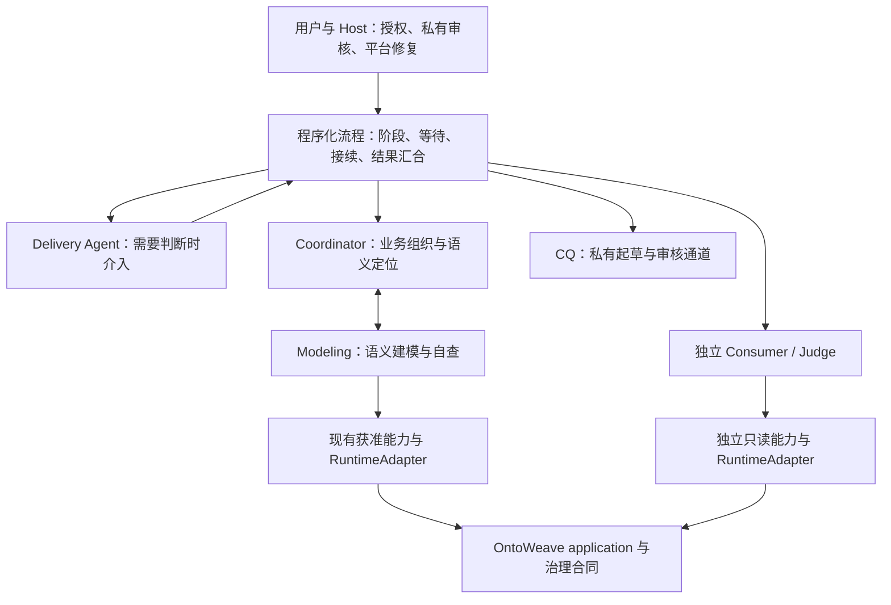

**OntoWeave 建模 Team 架构与第三方编排框架调研报告**

调研日期：2026-10-23。问题：当前 Team 是否属于比较好的架构形态，以及反复出现的协作问题是否应通过第三方 SDK／框架解决。

**结论：角色与权限分层有合理基础，流程控制的工程形态还不够好。应优先收敛确定性流程和状态归属；当前不宜直接整体迁移框架。若评估第三方底座，首选 LangGraph 的局部替换试点，Microsoft Agent Framework 作为备选，Temporal 留给明确的持久执行需求。**

这不是建议继续无限补丁式自研。下一步应以一个现有、已经明确的交接流程为单位，验证第三方底座能否实质删除自研状态和调度逻辑。如果只是给现有 Runner 外面再套一张图，就没有达到引入依赖的目的。两个简单连续动作若用普通 Python 即可清楚完成，也无需先引入框架。

**调研范围与证据口径。** 本报告读取当前工作树（最终核对 HEAD `f3862a5`）、所选 Task／Profile、R4.3-029／030、R4.4-003，以及近期失败与成功运行的保留复盘。调研开始时，Codex 普通工具失败分类修复尚在工作区；最终核对时已提交为 `f3862a5`，不属于本次工作。其他既有文档修改保持原样。对 151612 汇总所引用的 9 份本地来源文件核对 SHA-256，均与保留摘要一致。语义结果引用既有独立报告的复盘结论，本次没有重新担任语义验收者。

外部资料来自各项目官方文档，能力描述按调研当日可访问内容整理；没有安装候选框架、验证精确依赖版本或执行迁移性能测试。下文的适配优先级和迁移成本属于结合本项目的工程判断。GitNexus 索引在采集时落后代码 503 个提交，源码结论使用实际文件和调用点，不宣称完整图谱覆盖。

**一、当前系统实际上是什么架构**

当前默认路径是通用 `unified-modeling` Profile 配合最小安装链 Task。Profile 创建 Coordinator、Modeling、competency-question 三个角色，直接业务通信边是 Coordinator 与 Modeling 双向；Delivery 在宿主侧独立运行，Consumer／Judge 由独立验收路径启动。默认路径已经没有 Protocol Agent，Task 中保留的 protocol 配置兼容字段不能据此解释为实际存在一个 Protocol 进程。来源：[Profile](../../modeling_team/profiles/unified-modeling.yaml)、[Task](../../modeling_team/tasks/r4-3-026-minimal-installation-chain.yaml)。

| 层次 | 当前主要责任 | 实现入口 |
| --- | --- | --- |
| 用户／Host | 业务授权、预算、CQ 私有审核、平台修复 | [Host 操作](../../modeling_team/host_ops.py)、[私有请求与结果](../../modeling_team/delivery_host_actions.py) |
| Delivery Agent | 面向用户交付、需要推理的阶段判断、阻塞定位与升级 | [Delivery 指令](../../modeling_team/agent-packages/delivery/instructions.md) |
| Delivery 程序控制 | 观察、事件分类、队列、分页确认、定期巡检、换线程、恢复 | [delivery.py](../../modeling_team/delivery.py)、[delivery_review.py](../../modeling_team/delivery_review.py) |
| Team 运行与协作 | 冻结输入、启动、消息路由、问题处理、写入准入、交接与资源生命周期 | [TeamRunner](../../modeling_team/runner.py)、[TeamTransportBroker](../../modeling_team/transport_mcp.py) |
| Agent 运行时 | 原生线程／进程、工具调用、输入派发、原生回执、模型用量 | [RuntimeAdapter](../../modeling_team/runtimes/base.py)、[Codex](../../modeling_team/runtimes/codex.py)、[DSH](../../modeling_team/runtimes/dsh.py) |
| 领域执行与独立验收 | 模型变更、原子 application、治理读取、冻结模型上的独立消费与裁决 | [直接模型执行](../../modeling_team/direct_modeling.py)、[验收 Owner](../../modeling_team/evaluation_owner.py)、[验收运行时](../../modeling_team/acceptance_runtime.py) |

因此，它是**分层主管协作，加上自研事件调度、运行适配和领域工作流**。它既有 Agent 自主协作，也有确定性控制，不是简单串行链或所有角色共享上下文的群聊。自研部分已经承担了相当多编排框架的工作，但没有被组织为一套清晰、统一的通用工作流模型。

这里仍有值得保留的基础：Task／Profile／角色包分离，模型运行时存在接口边界，材料与工具权限按角色控制，语义决策与确定性 application 分工，生产与独立验收隔离，未知写入需要原身份对账。这些都是 OntoWeave 的实际约束，不能因引入框架而丢失。历史 [ADR 0008](decisions/0008-runtime-neutral-modeling-mechanical-spine.md) 已提出语义决策与机械执行分离；它可解释设计方向，但其旧 Protocol／dry-run 路径不代表当前默认实现。

**二、为什么现在还不能算一个好的工程形态**

**1. 流程决策和机械执行之间仍有过多模型往返。** 例如完整 CQ 已审核、Delivery 已决定冻结后，冻结、转发公开确认、等待真实接收本来可以由一个有界程序动作继续完成。当前角色指令仍要求 Delivery 分别调用并处理这些步骤。R4.3-030 F4 已明确 `freeze_and_notify` 与 `handoff_and_evaluate` 两种连续动作；本次在 `modeling_team/` 未找到这两个操作或 `continue_delivery` 入口。这个结论只针对两条具名接续能力，不代表当前所有机械步骤都依赖模型。来源：[030 F4](../requirements/requirements-v4.3.md#r4-3-030)、[当前指令](../../modeling_team/agent-packages/delivery/instructions.md)。

**2. 流程状态分布在多个所有者和投影之间。** Delivery 有自己的 session／journal／待送输入，Runner 有 run／CQ／写入准入，Transport 有投递／应答状态，原生运行时有 thread／turn／dispatch，Host 又读取派生待办。分层本身必要，但必须明确每种事实由谁负责、如何收敛。历史上已经出现“底层 issue 已结清，Host 投影仍显示待解决”和“最新 Host 结果排在旧观察后面”。所以问题不只是缺少一个发送消息 API。

**3. 运行时差异进入了上层调度判断。** 当前 `delivery.py`、`delivery_review.py` 需要理解 Codex 的 `item/completed`／MCP 信封，也理解 DSH 事件。普通工具失败与原生回合失败的区分没有完全在运行时边界消化，曾导致两种运行时的唤醒行为不同。`f3862a5` 新增 `codex_tool_result` 等修复，工程记录已有通过结果，但归一化仍位于 Delivery 层，修后真实效果也仍待证。来源：[事件处理](../../modeling_team/delivery.py)、[分类实现](../../modeling_team/delivery_review.py)。

**4. 复杂度集中在少数控制文件中。** 本次工作树物理行数为：`runner.py` 14,239 行、`delivery.py` 4,601 行、Codex adapter 8,757 行、transport 1,857 行。这些数字包含旧模式、注释和领域合同，不能全部视为可删除编排代码；但结合初始化中的大量阶段状态、控制队列和恢复分支，说明当前维护成本已远超一层轻量 glue code。拆文件本身不会消除状态交叉，核心是明确职责和转换关系。

**三、近期协作问题给出的实证**

| 样本与现象 | 最窄已知原因 | 当前状态与对选型的意义 |
| --- | --- | --- |
| 10-21 012852：预算恢复后四个 Consumer 终止，没有有效质量裁决 | 合法新 turn 与验收指标守卫冲突；另有旧观察积压及 issue 投影漂移 | 后续工程修复已收窄守卫、合并观察并修复投影。框架能帮助组织状态与恢复，但不会自动删除错误的应用层守卫。[原复盘](../delivery/modeling-retrospectives/2026-10-21-codex-glm-low-budget-resume-retrospective.md)、[修复记录](../delivery/records/2026-10-21-modeling-resume-repair.md) |
| 10-22 134133：一次读取返回约 162.9 秒，其中进入 Host handler 前约 162.1 秒；独立报告完成后仍需 Host 补做收口 | 原生事件逐条处理与同步观察交错，膨胀 journal 反复全扫；关键阶段提示被大包和旧分页推迟 | `99255a3` 已加入有界排空、journal 增量读取、关键输入前置等修复，当前源码可见。问题在现有事件泵和输入路径，单加图框架不会自动修好。[原复盘](../delivery/modeling-retrospectives/2026-10-22-codex-glm-low-134133-retrospective.md)、[修复记录](../delivery/records/2026-10-22-delivery-latency-input-repair.md) |
| 10-22 151612：普通消息参数、材料接收方、卡片字段错误进入 Delivery 即时输入 | Codex 可自行纠正的失败被当作关键事件；原生调用身份进入诊断变化判断 | 保留运行中有 3 个实际投递反例；现已由 `f3862a5` 修复，工程记录为 721 passed／2 skipped 及四条原事件重放通过，修后真实效果待证。事件语义仍需我们定义，框架不认识这些业务错误码。[主复盘](../delivery/modeling-retrospectives/2026-10-23-codex-glm-low-151612-r44003-retrospective.md)、[工程补记](../delivery/records/2026-10-22-r4-4-003-implementation-test-record.md) |

151612 也有正面证据：Host 结果能在原回合自然结束后及时送达、阶段线程切换两次、正常完成后停止普通推理。既有复盘记载独立非盲完整四题通过，9 条治理复核没有 drift／unavailable。不能将协作缺陷直接归为模型质量差，也不能因此否定整个架构。

但同轮已知 Delivery 用量 **9,549,480 token**，托管全链 **14,737,889 token**，Delivery 占 **64.8%**；完整 10M 子目标已被已知部分超过。统计仍为 PARTIAL，外部 Host 单列且不计任务金额。这个比例足以支持把流程控制列为优先优化对象，不能当作可删除比例，更不能据此承诺换框架节省多少。33 次原生任务正常结束与 79 个生成输入是不同分母；不能把输入包数直接当作计费响应数。来源：[用量与原生证据](../delivery/modeling-retrospectives/2026-10-23-codex-glm-low-151612-r44003-retrospective.md)。

**四、网上有哪些可用方案，与本项目是否匹配**

以下评价针对保留现有 Codex／DSH Agent、平台能力和独立验收的前提，不是框架的通用排名。

| 方案 | 官方提供的相关能力 | 对 OntoWeave 的适配判断 |
| --- | --- | --- |
| **LangGraph** | 低层图式编排，可混合普通函数与 Agent；checkpoint、暂停／恢复及状态持久化；使用 LangGraph 不要求采用 LangChain 的 Agent 架构 | **首选局部试点。** 有机会只替换外层阶段编排，继续调用现有能力与 RuntimeAdapter。接入成本中等：必须定义状态、外部事件唤醒及副作用边界。[概览](https://docs.langchain.com/oss/python/langgraph/overview)、[持久化](https://docs.langchain.com/oss/python/langgraph/persistence) |
| **Microsoft Agent Framework** | 显式 workflow、类型化 executor／消息路由、并发、人工请求响应、checkpoint；提供顺序、handoff 等协作模式 | **有力备选。** 比群聊框架更接近现有结构，但现有运行时和领域合同仍需适配。微软已有从 AutoGen 迁移的指导，新选型应同时看当前框架，不能仅根据早期 AutoGen 示例判断。[工作流](https://learn.microsoft.com/en-us/agent-framework/concepts/workflows/)、[checkpoint](https://learn.microsoft.com/en-us/agent-framework/workflows/checkpoints)、[AutoGen 迁移](https://learn.microsoft.com/en-us/agent-framework/migration-guide/from-autogen/) |
| **Temporal** | 持久工作流、事件历史、活动执行、消息与等待；可以围绕外部 Agent 组织可靠流程 | **强持久执行候选，当前不作为首选。** 需要 Temporal Service／持久化及 Worker，接入成本高于进程内库。若正式目标变成服务重启后自动接续、跨机器执行或长时间人工等待，应优先重评。[Durable AI](https://docs.temporal.io/ai)、[Service](https://docs.temporal.io/temporal-service)、[Activity](https://docs.temporal.io/activities) |
| **OpenAI Agents SDK** | Agent loop、工具、handoff、agents-as-tools、会话与人工审核相关机制 | **适合重建 Agent 执行方式时评估。** 我们当前已有 Codex app-server／DSH 的原生循环；采用 SDK 不会自动接管这些外部线程。官方也把存储和批准决策的责任留给应用。仅为修复外层调度，替换收益不够明确。[SDK](https://developers.openai.com/api/docs/guides/agents/sdk)、[协作模式](https://developers.openai.com/api/docs/guides/agents/orchestration) |
| **CrewAI Flows** | 事件驱动流程、条件分支、状态管理、`@persist`，可以组合代码和 Crew | **可用，但当前优先级较低。** 它并非只有群聊，Flows 可做确定性流程；本项目已有角色、工具和上下文合同，迁移到 Crew 抽象的收益尚不明确。[Flows](https://docs.crewai.com/en/concepts/flows) |
| **Pydantic Graph／Pydantic AI** | `pydantic-graph` 是可单独采用的 Python 异步图与状态机库，不依赖 Pydantic AI；完整 durable execution 另有引擎集成 | **轻量备选。** 若主要诉求是把阶段、分支和转换写清楚，可评估独立 graph；不要把类型化状态机等同于自动跨进程恢复。[Graph](https://pydantic.dev/docs/ai/graph/graph/)、[Durable execution](https://pydantic.dev/docs/ai/capabilities/durable_execution/overview/) |

这里有一个关键差别：**“保存图状态”与“完整恢复外部 Agent 和副作用”是两件事。** LangGraph 暂停后的恢复可能重新运行所在节点，中断前的副作用需要幂等或分离；Temporal Activity 也要求应用处理重复执行的副作用。因此，框架 checkpoint 不能代替现有 Batch／Attempt／资源／receipt 对账，更不能把所有失败改成自动重试。来源：[LangGraph 中断与副作用](https://docs.langchain.com/oss/python/langgraph/interrupts)、[Temporal Activity](https://docs.temporal.io/activities)。

另一个差别是运行托管：LangGraph 库提供状态与执行机制，不自动成为管理本机所有 Codex／DSH 进程的守护服务；恢复触发、原生进程是否仍存活、输入是否实际消费仍须接到现有 Adapter。Microsoft 的 checkpoint 同样只承诺其记录的 workflow／executor 状态，不能据此假设外部进程和平台事务会一并回滚。这是结合本平台外部运行时结构作出的适配判断。[LangGraph 持久化](https://docs.langchain.com/oss/python/langgraph/persistence)、[Microsoft checkpoint](https://learn.microsoft.com/en-us/agent-framework/workflows/checkpoints)。

**五、第三方框架究竟能解决什么**

| 当前问题 | 第三方编排可提供的帮助 | 我们仍必须负责的部分 |
| --- | --- | --- |
| 阶段顺序、分支、并行结果汇合不清楚 | 用显式节点／转换表达，使路径可检查 | 什么条件才算完成、是否允许继续 |
| 等待人工结果、恢复和未完成步骤承接 | checkpoint／interrupt 或持久 workflow | Host 授权、真实请求身份、原生接收回执 |
| 重复逻辑与多处状态推进 | 让选定流程由一个执行者推进 | 明确原账本权威、移除被替代的状态分支 |
| 普通错误反复唤醒、旧快照堆积 | 可承载去重、路由与投影规则 | 正常纠错／关键异常分类及最新状态的合并规则 |
| 原生管道排队、provider 错误、工具 JSON 失败 | 提供外围重试或失败分支 | 当前 Adapter／输入合同的真实缺陷 |
| Ontology 写入与独立语义质量 | 组织调用和结果收集 | 源忠实度、业务含义、授权、原子性、未知写入、盲测与裁决资格 |

这也是不建议立即整体迁移的主要原因：最近最具体的几个问题都发生在框架外仍需保留的边界，或者已经有局部修复。仅迁移 orchestration 的标签，无法消除这些原因；同时重写运行时、材料权限和验收又会显著扩大验证范围。

**六、更适合平台的目标形态**

建议采用“确定性程序负责正常推进，Agent 负责需要推理的决定”的形态，继续保留生产和验收的隔离。Delivery 保留用户沟通、选择已授权路径、异常判断与升级；固定顺序和参数已经明确的成功路径，由程序直接接续。

图中“程序化流程”是职责收敛目标，可以先用现有 Python 实现，也可以在试点成功后由 LangGraph 承担一段；它不意味着再加一个主管 Agent。每个操作只保留一个推进者，其他层消费回执或投影。预算以现有预算账本为准，写入以现有 application 回执为准，语义裁决以独立报告为准，不新建一份全局数据库去争夺这些权威。

适配边界应优先处理已有差异：运行时把原生工具完成／失败、回合完成、派发与消费状态归一化；流程层使用这些事实，避免在多个上层模块重复解释原生信封。这个调整应跟随真实失败逐段实施，不要求先统一全部历史模式。

当前“忙碌时所有输入入队，原生回合自然结束后投递”的合同也必须保持。采用框架的 interrupt 功能不意味着可以强制中断当前模型回合，图的暂停点与外部 Agent 的控制边界需要明确映射。来源：[R4.4-003](../requirements/requirements-v4.4.md#r4-4-003)、[Delivery 指令](../../modeling_team/agent-packages/delivery/instructions.md)。

**七、建议的引入决策与下一步**

**生产依赖决策：本次不建议直接新增全面接管 Team 的第三方框架。架构收敛应成为下一步工作；LangGraph 值得一次有界替换验证。** 当前证据支持“流程控制有改造必要”，尚不足以证明“引入某个库必然更便宜、更可靠”。

建议按以下顺序推进，均属于后续建议，本报告没有实施：

1. **以现有修复后的版本作为比较起点。** 不能用 012852／134133／151612 的已修历史缺陷夸大新框架收益；已提交代码、已有工程结果和修后真实效果分别登记，本次没有重跑这些工程测试。
2. **优先落实 R4.3-030 F4 已定义的窄接续。** 第一段选 `freeze_and_notify`：沿现有 Host 私审和 Delivery 决定，冻结 → 发公开确认 → 等真实消费 → 返回接续结果。前提不满足或出现新判断时回到原反馈通道。简单函数能清楚表达时先采用简单函数。
3. **对同一段评估 LangGraph 替换价值。** 沿现有事件源和稳定身份，把原外部等待映射为可恢复节点；图状态保存必要身份、状态与引用，私有 CQ 正文继续留在原权限边界。只让一种执行路径负责该段推进，保留旧证据读取，不同时让新旧调度器处理同一个副作用。
4. **先复用真实故障样本验证合同。** 覆盖重复／乱序通知、忙碌排队、暂停接续、Host 结果到达、未知写入及完成后静止。用已有运行的原生信封和有界 fixture；不为了选型建设一套新的大规模测试平台。
5. **再在获准真实任务中验证效果。** 使用同一最小链、相同角色模型与 effort、相同预算口径及完整公开／隐藏题范围。记录实际模型响应、Delivery 与全链 token、关键事件延迟、Host 补位、异常恢复和独立质量，失败／重试纳入总量。框架收益必须体现在这些结果或可明确删除的维护逻辑上。

试点的采纳条件应是：所选流程的状态归属更清楚、确实减少自研调度分支或不必要推理、恢复不丢原请求身份，并保持原授权、application、治理读回和独立验收合同。若只增加节点包装、另一份 checkpoint 和双份状态，停止引入。这里是选型判断标准，不是给生产 run 增加新的永久硬门。

Temporal 的重评条件是明确出现跨进程／跨机器可靠接续、长时间人工等待、服务重启后自动继续等当前产品要求；届时可由其承担持久执行，现有 Agent 作为外部活动接入。当前没有必要同时引入 LangGraph、Temporal 和新的 Agent SDK。

报告交付范围：新增本文件，核对来源和文档链接；未修改运行代码、需求或优化台账，未执行模型调用、建模、平台写入或迁移验证。所有框架节省 token／时间的幅度均保持待证。
