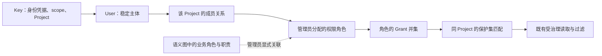

# R4.0-006 业务角色与主体语义访问控制设计

## 1. 状态、目标与基线

- 日期：2026-10-01。
- 状态：需求细化与设计完成；D1／D2 已由用户明确确认：普通用户仅通过 Key 访问，同用户
  同 Project 的 Key 共用角色权限，Key scope 仍独立判断。
  完整决策记录见[权威需求](../../requirements/requirements-v4.0.md#r40-006-业务角色与主体语义访问控制)。
- 本轮只交付文档，不实施、不启动真实建模、不调用外部业务系统。未做独立设计审阅、功能测试或语义验收。
- 静态核对起点：HEAD `3537d3d`；005 正在并行实现，已有后端和 Team 未提交修改，本轮不修改这些文件。
- 依赖：R4.0-002 的业务角色及共享身份、R3.0-004 的保护集和授权读取、既有 Key scope／Project
  边界、R4.0-012 的追溯停用。005 的脚本实现不是本条设计或实施前置。

例：财务职责是模型中的业务角色，成本定义是受保护语义资源。管理员为用户 U 在项目 P
分配权限角色 R，R 包含 `cost-read`，项目 P 的成本保护集允许该 Grant。U 的 Key 先证明身份
和项目范围，再经角色获得 Grant。模型中写入“U 是财务人员”或“财务负责成本审核”不会授予权限。
`cost-read` 只开放相关语义知识，不证明 U 可以直接查询外部数据库成本列或执行付款动作。

## 2. 复用事实与增量

| 当前入口 | 静态核对结果 | 本条增量 |
| --- | --- | --- |
| [身份模型](../../../backend/app/repositories/models.py) `UserModel`／`ApiKeyModel` | users 只有管理员登录用字段；Key 无 user_id，直接保存 semantic_grants | 增加普通用户身份、项目成员关系、Key 所属用户及项目权限角色 |
| [认证](../../../backend/app/security/auth.py) `resolve_api_key`／`resolve_session` | Key 认证返回 key 身份和直接 Grant；所有合法用户 session 都得到全局 admin | 复用 Key 哈希／撤销和 session 签名；普通用户不能沿旧 session 路径获得 admin |
| [认证 API](../../../backend/app/api/auth.py) | Key 创建／更新及 Grant 分配为 admin-only | 管理用户、项目成员、角色及角色分配；项目 Key 改为引用用户，不再直接发 Grant |
| [HTTP 边界](../../../backend/app/security/http.py) | 每次请求解析认证；按 scope 和资源所属项目判定边界 | 注册新增管理入口为 admin-only，识别角色／项目成员路径的所属 Project |
| [MCP runtime](../../../backend/app/mcp/runtime.py) `_authorize_tool` | 每次调用重读 Key，但另行构造 principal 和直接 Grant | HTTP／MCP 共用用户与角色解析，不能只改启动时 authenticate_runtime |
| [语义授权](../../../backend/app/services/semantic_access.py) `SemanticAccessResolver.resolve` | principal.semantic_grants 与保护集 allowed_grants 匹配；多集合／多 Grant 按 OR | 继续消费服务端计算的有效 Grant，不改资源过滤和管理员绕过公式 |
| [Context cursor](../../../backend/app/services/semantic_context_cursor.py) `binding_digest` | 绑定 Key 身份、项目、查询及模型范围，没有绑定 scopes／Grant 集合 | 将当前有效 scope／Grant 的摘要加入原绑定，权限改变后旧 cursor 不能继续旧结果分页 |
| [检查点数据](../../../backend/app/services/checkpoint_data.py) | 项目快照复制保护集，不复制 users／Key | 新增成员和授权分配不自动复制到 fork；新项目重新配置角色和成员 |

以上是代码事实，不是本条已实现或通过测试的证明。前端现无独立 Key／角色管理页面，首版
采用管理 HTTP API，不将新管理 UI、SSO 或组织目录集成纳入本条。

## 3. 方案与责任



- 用户是稳定控制面主体，Key 是可撤销凭据；两者身份分别记录，不把业务角色 IRI 当认证主体。
- Modeling 只生产业务角色定义及职责关系，不持有用户、权限角色或分配 Grant 的管理工具。
- Org Admin 管理全局用户和项目成员；Project Admin 管理本项目角色、成员角色分配及项目 Key。
- 保护集定义／成员维护继续使用 R3.0-004 现有 model scope，不借本条改变其权限边界；
  model scope 本来具有保护配置能力，但不能管理用户、角色分配或 Key Grant。
- 权限角色只提供语义 Grant；不会增加 Key 的 read／model／admin scope，不授予外部业务执行权限。
- 业务角色关联只是管理员保存的解释性对应，授权解析不读取或推理 RDF 中的职责事实。

采用单一角色授权来源。保留 Key 直接 Grant 并与角色 Grant 合并会导致移除角色后旧 Key
仍能读取成本，且当前 v4 已明确不承担历史数据兼容，因此不设计两套授权来源或自动迁移旧 Grant。
原 `api_keys.semantic_grants` 停止作为新角色模式的写入／授权来源；具体删列可随迁移完成，不能
靠留存列值提供隐含兼容。旧接口提交该字段应明确拒绝，而非忽略或继续生效。

## 4. 主体、成员与角色结构

本节名称是交接实施建议，均为 PostgreSQL 控制面对象，不新增 Ontology 资源 kind。

| 结构 | 最小内容与约束 |
| --- | --- |
| users（扩展现有） | 稳定 id、唯一 username、disabled_at；增加明确的 is_org_admin，区分现有管理员与普通主体。Key-only 用户 password_hash 可为空；不创建密码占位或默认密码 |
| api_keys（扩展现有） | 增加 user_id；项目 Key 必须关联用户及该 Project 的成员关系。project_id、scopes、撤销及一次性明文展示沿用；已发 Key 不转移用户／项目 |
| project_user_memberships（新增） | project_id＋user_id 唯一；表示管理员将用户纳入项目，是项目边界，不是一个语义 Grant |
| semantic_access_roles（新增） | id、project_id、项目内唯一 name、description、grants；可选 business_role_iri、business_role_ontology_id，明确映射同项目已确认的业务角色 |
| semantic_access_role_members（新增） | 项目成员与项目角色的多对多关系；同一用户可有多个角色，同一角色可分配多名用户；唯一约束去重并保证同项目 |

成员使用 `(project_id, user_id)` 唯一键，角色具有 `(project_id, id)` 唯一键；角色分配使用
`(project_id, user_id, role_id)` 唯一键并分别关联上述两个同项目键。删除成员／角色级联清除
分配，禁止仅凭全局 user_id 或 role_id 关联而遗漏 Project 边界。

角色 Grant 复用现有字符串规范和保护集 allowed_grants，不另建 Grant 注册表或可执行权限表达式。
管理写入复用 `semantic_protection_set.normalize_grants` 的验证／去重，授权时按保存的字符串
精确匹配，不单方面改变空白或大小写。角色 JSON 数据损坏与正常空列表分别处理，前者返回
依赖／配置错误，不能沿旧 Key `parse_semantic_grants` 的空集合回退路径隐藏问题。
角色无继承、deny、动态职责推导或自动分类匹配；需要多个权限时分配多个明确角色。
一个权限角色首版可关联一个业务角色定义，多个权限角色可关联同一业务角色，关联可省略。
尚无业务角色定义的项目可以配置权限角色，不因缺少语义映射失去管理入口。

全局用户由 Org Admin 创建和禁用；项目成员由 Org Admin 加入／移除。Project Admin 只能
列举本项目成员的最小身份并分配本项目角色，不能浏览其他项目成员或全局用户目录，不能修改
全局用户、组织管理员标志，也不能将跨项目角色分配给本项目成员。普通 Consumer 不读取这些控制面数据。

Key 管理保留原 scope 上限和管理员权限。项目 Key 只引用本项目已加入的用户，用户没有
语义角色仍可用合法 read Key 访问普通资源。组织管理员 bootstrap Key 保留既有特殊管理路径；
不为了套用普通用户链而把组织级 Key 绑定任意 Project。新建有用户归属的组织 admin Key
只允许关联显式组织管理员，不能将普通用户提升为组织管理员。

### 4.1 D1：普通用户仅通过 Key 访问

用户已确认本期普通用户只用 Key，管理员继续沿已有登录流程。普通用户没有密码登录能力，
login 和 resolve_session 必须显式检查 is_org_admin／disabled_at，不再因 users 中存在记录就给 admin。
bootstrap 已配置管理员须保留；迁移仅将现有管理员记录明确标记为管理员，不从 Key 名称猜测归属。

`is_org_admin` 对新普通用户默认 false，不作为普通用户创建／更新 payload 的可写字段。
普通用户网页登录未纳入本期；管理员 session 不采用用户角色 Grant 收窄，保留原管理身份。

### 4.2 D2：同用户的 Key 共用项目角色权限

用户已确认同一用户在同一 Project 的 Key 共用角色 Grant。Key 自身 scope／撤销情况可不同，
用户角色不会写成 Key 的独立副本。首版不提供每 Key 的角色白名单或 Grant 收窄字段；若一个
Key 是 read、另一个是 model，两者可读的语义 Grant 相同，后者仅按既有 scope 多出建模能力。

## 5. 请求解析与权限生效

已确认的请求解析算法如下：

```text
1. 按现有哈希查 Key；不存在／已撤销、scope 非法 → 既有认证失败。
2. 项目 Key：读取所属 user 和该 Project 的成员关系。
   用户缺失／禁用、成员关系缺失 → 既有认证失败，不回退成无用户 Key。
3. 读取成员被分配的同 Project 权限角色；有效 Grant = 各角色 grants 的去重并集。
   正常无角色或空 grants → 空集合；数据库／角色解析失败 → 授权依赖错误，不能返回正常空集合。
4. 生成服务端 principal：保留 Key subject_id、actor、scope 和 project_id，增加 user_id；
   semantic_grants 表示本次计算结果，不是 Key 列的原始值。
5. 既有 HTTP／MCP scope 和 Project 校验通过后，由 SemanticAccessResolver 匹配保护集。
6. 继续沿现有资源过滤、关系过滤、分页／排序及 SPARQL 合同输出获准结果。
```

使用 Key id 作为认证凭据身份有助于保持现有 actor 和 cursor 的凭据绑定，不把两个 Key
当成同一个分页凭据；增加 user_id 表明其共同用户。客户端传入 user_id、role、Grant 或业务职责
不能覆盖该 principal。真实未知或格式错误返回可定位反馈，修正配置后可以重试，不终结建模目标。

HTTP 每次请求、MCP 每次工具调用重新读取用户／成员／角色；抽取共享的“已验证 Key 记录 →
principal”解析入口，替换 MCP 的重复构造。无需角色缓存、授权版本表、消息广播或重启机制。
管理提交完成后开始的新请求／调用应使用新权限；已开始的调用保持该次已解析范围，不承诺
追溯收回已经返回或正在返回的内容，不增加跨请求锁。

Context Query cursor 沿用原签名和错误码，只扩展 binding_digest 的内部材料：user_id、
effective_scopes、排序去重后的有效 semantic_grants。权限变化导致绑定不匹配时返回既有
context_cursor_mismatch，调用方从首页重查；不把 Grant 明文放进 cursor／错误正文。不同角色
组合若产生相同有效权限，不必无故失效。范围发现仍按凭据 Project 边界判断，不增加角色目录信息。

## 6. 管理入口与读回

以下是拟新增／调整的 HTTP 合同，不是当前可用 API。复用现有 router、Pydantic、DB Session
和管理员校验；服务层处理角色／成员关系，接口文档在实际开发时同步生成和说明。

| 拟定入口 | 操作与最小读回 | 管理权限 |
| --- | --- | --- |
| `/api/users`，`/api/users/{user_id}` | POST／GET 登记和读取普通用户；PATCH username／disabled 状态；不开放普通用户自助注册 | Org Admin；is_org_admin 不能经普通用户 payload 修改 |
| `/api/projects/{project_id}/members` | GET 列成员；POST 添加既有 user；DELETE 指定成员 | Org Admin 可维护；Project Admin 只读本项目 |
| `/api/projects/{project_id}/semantic-access-roles`，对应 `/{role_id}` | GET／POST／PATCH／DELETE 角色及 Grant／业务角色关联 | 本 Project Admin 或 Org Admin |
| `/api/projects/{project_id}/members/{user_id}/roles` | GET／PUT 完整角色集合；空列表移除全部角色，不移除项目成员 | 本 Project Admin 或 Org Admin |
| `/api/api-keys`，对应 `/{key_id}` | 创建项目 Key 提交 user_id；读回归属，不返回旧直接 Grant；不再写 semantic_grants，不允许转移归属 | 保留既有管理员 scope 上限和 Project 限制 |

项目用户／角色管理返回 id、名称、Project、角色或 Grant 及显式业务角色引用，仅向获准
管理者开放。语义资源读回不附带谁有权限、角色成员、保护集、Grant 或控制面映射。
请求体不得以角色 Grants 获取 admin scope；相关安全检查复用既有管理认证和 CSRF 合同。

配置处理：已存在用户／成员／角色的重复添加不生成副本；重复 username／项目角色名返回
可定位的冲突。替换角色集合在一个事务中校验并提交，不先清空后分步写入；无效／跨项目
role_id 拒绝整个变更，原集合保持不变。Grant 规范沿用已有可打印、非空、长度和数量上限。

业务角色关联写入时由有权管理员引用同 Project 的可定位资源，并核对其已声明业务角色含义；
平台检查资源和范围，不自行判断职责或同义关系。仅有同名角色不自动关联。修改或删除该 RDF
定义不会增加／撤销权限，管理员可读取映射缺口并修正；授权计算不依赖 RDF 或脚本可用性。
业务角色职责变更引发的引用重审归 007，脚本／说明是否复制受限内容归建模审阅及 005／008。
本条不引入自动敏感文本分析或隐式权限传播。

## 7. 失败、生命周期与边界

- 缺少／无效／撤销 Key、禁用用户或失去项目成员关系：HTTP 使用现有 401 invalid_authentication；
  MCP 使用现有凭据无效失败，不泄露该用户／角色具体状态。
- 有效 Key 的 scope 或 Project 越权：保持现有 forbidden_scope／MCP scope 失败合同。
- 有效主体缺少某资源 Grant：保持精确 404／空结果与不存在不可区分，宽查询在分页、计数、
  排序和 cursor 前过滤；涉及无权 IRI 的关系／映射整体隐藏，SPARQL 继续使用通用 scope 错误。
- 用户／成员／角色依赖查询异常：明确依赖不可用，拒绝该次授权；不得当“无角色”或空结果成功。
  不因一次异常永久撤销 Key 或结束 run；依赖恢复后按原凭据重试。
- 管理接口参数／范围错误：422、冲突 409 或既有管理面权限错误；返回可定位字段／关联问题，
  控制面不存在或不在管理员可见范围的目标使用一致 404，不把管理错误扩散到语义读取响应。
- 禁用用户使其所有 Key 在新调用中失效；再次启用恢复未撤销 Key 的有效性。撤销 Key 本身仍不可逆。
  删除项目成员时同事务撤销其本项目 Key，清除角色分配；重新加入须创建新 Key，避免旧凭据复活。
- 删除角色清除相关分配，其他角色仍生效；移除全部角色仍保留普通资源可读。删除 Project
  级联删除其成员、角色及分配，用户本身保留，其他 Project 不受影响。
- checkpoint fork 继续复制保护集及业务定义，不复制用户成员、Key、角色或授权分配；新 Project
  的普通消费者在重新配置前不能打开已复制的受保护资源。仍由 Org Admin 管理新 Project，
  不通过 fork 自动继承原项目用户权限，不扩建快照／恢复框架。
- 组织／项目管理员继续按既有 scope 绕过对应保护集；组织用户标志只用于明确管理员身份和
  登录资格，不将普通用户的每个 read Key 自动变成管理员 Key。

## 8. 实施交接与验证意图

范围内预计变更：`repositories/models.py` 及一项增量迁移，`security/auth.py`／`security/http.py`、
`api/auth.py` 和小型项目角色管理 service／router、`mcp/runtime.py`、Context cursor 绑定，
相关认证／授权 tests 与 `docs/reference/api.md`。不修改 005 规则字段或语义过滤公式；若相邻开发
改动同文件，实施方只合入本条必要差异。

本轮 D1／D2 已关闭，具体选择已同步身份、Key 和验收合同。文档层选择已足够交接时停止扩展，
不在本轮提前加表、跑产品测试、重启服务或安排独立 Agent；后续实施仍以用户实际授权为准。

验证对应权威需求 A1—A11：

- 身份／Key：同一用户多 Key、不同 scope、跨项目同名角色、禁用／撤销、无成员以及角色为空。
- 角色：多角色 OR、Grant 替换／撤销、删除一角色而其他角色继续生效；HTTP 和持续 MCP 进程
  在同次管理提交后的新调用一致，旧 Context cursor 不混用前后权限。
- 边界：普通／model 主体不能配置角色或 Grant；Project Admin 无权操作其他项目或全局目录；
  普通用户不能经管理员 session 获得全局权限，业务 RDF／自报 role 不能授权。
- 受治理读取：复用现有精确、搜索、关系、映射、Context、SPARQL 与导出反例，验证新主体链
  输入不会改变不可区分和授权子集合同；不重新启用追溯专用验收面。
- 生命周期：成员移除／再加入、Project 删除、fork 后保护仍生效；业务角色关联缺失不改变权限。
- 功能实现后按仓库执行后端全量 pytest、服务重启及健康／受影响端点验证；本期无新 UI，
  不以页面可打开替代主体权限验证。独立功能验收与后续统一真实语义验收分别记录。

本轮自查只建立文档一致性和链接／格式证据，不证明上述场景运行正确。实际执行记录待实施阶段补充。

## 9. 本轮文档检查记录

- 2026-10-01：两份文档的 67 个本地链接、6 个 Markdown 锚点、代码围栏与 31 张表格结构检查通过。
- 006 决策 D1—D10、验收 A1—A11 编号连续且无重复；D1／D2 的用户回答已同步到功能范围、
  数据结构、请求解析和对应验收，不残留待定分支。
- 文档 diff 只包含 006 条目、其状态／索引及本设计；相邻 005 的代码、合同和验证文件未修改。
- `git diff --check` 文档检查通过；无独立设计审阅、产品测试、服务重启或真实语义结果。
