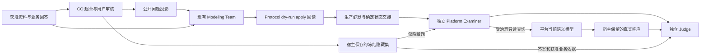

# R4.0-009 多视角真实建模与独立语义验收设计

## 1. 状态与基线

- 权威范围：[R4.0-009](../../requirements/requirements-v4.0.md#r40-009-多视角真实建模与独立语义验收)。
  完整 D1—D8 决策及来源以该条目为主；D1 场景、D2 分段安排待用户决定，本设计对应推荐方案。
- 代码核对基线：`6bd653c`，2026-10-02；开始时工作区干净。本轮仅授权细化与设计，未修改
  运行合同／代码／业务资料，未启动建模或独立 Agent，未运行产品测试、SQL、API 或脚本。
- 继承 [R3.0-011／012](../../requirements/requirements-v3.0.md#r30-011-能力问题驱动建模与批次级语义验收)
  的 CQ 隔离与独立批次验收；追溯义务由 R4.0-012 替代。旧任务、冻结题池和历史报告保持原义。
- 当前 002—008、012 已有功能实现记录，007／008 的独立功能验收仍未执行，所有相关真实语义
  验收仍未授权／未执行。010／011 尚待细化，不能写作映射能力已就绪。核对属于静态阅读，
  不把文档中的历史功能 PASS 当成本轮运行验证。

本设计交付一个可复用现有 Team 的真实验收方案，重点是业务资料、CQ 覆盖、真实读取和独立
裁决。009 不创建平台资源、数据库表、业务路由、语义打分器或新的建模／验收调度框架。

## 2. 主场景、分段和补充资料

### 2.1 场景选择与来源

D1 推荐沿用[工业设备售后服务输入](../../evaluation-scenarios/industrial-service-v3/modeling-input/scenario-brief.md)。
它已具有业务术语、关系型 Schema、样例数据和当前 R4 Task，适合把工单处理与资产、合同、
人员、备件关联。相比重新建场景可减少准备；相比 checkpoint-minimal，两概念小场景不足以
支撑流程、规则、角色及映射的验收目标。现有资料是实验 fixture，不声称客户生产材料。

读取基线显示，[术语表](../../evaluation-scenarios/industrial-service-v3/modeling-input/business-terms.md)
明确标为待访谈；尚无完整 Action／流程脚本或 API 合同。后续应在获准输入中补充下列业务信息，
不从 Schema 的 `closed_at` 等列名推导关闭条件，不从现有期望 SQL 结果反推业务答案。

| 所需信息 | 当前基础／缺口 | 后续确认及覆盖目的 |
| --- | --- | --- |
| 对象、对象关联与分类 | 现有资产、故障、工单、合同等术语，正式含义待访谈 | 明确共享身份、粒度、稳定分类和局部范围，不能为凑类型用例发明子类 |
| 动作与流程 | 有状态／时间列和重新打开等访谈线索，无完整行为合同 | 确认正常、分支回退、重复调用、条件输出与循环的实际业务含义及参数来源 |
| 判断／推导规则与脚本 | 有 SLA、成本等候选业务主题，无获准完整规则脚本 | 确认至少能支撑两类规则的内容，含语言、边界、缺失政策、输出身份和执行约定 |
| 业务职责与读取政策 | 工程师及成本语义可见性待确认 | 分别确认业务负责者和平台语义受众，再由管理面配置普通主体与受保护内容 |
| 共享修订案例 | 007 已有候选／重审合同，无本场景获准变更案例 | 预先确认一个小范围语义修订及理由，先模型生产、再引用重审与应用，最后只读验收 |
| 数据映射 | 有 Schema 与代表行；结构不等于业务真相 | 访谈确认粒度、连接、业务／主键标识、编码和计算口径；第二段取样验证 |
| 接口映射 | 当前四份输入未提供 API 描述或请求响应样例 | 010／011 明确后补充获准 API 资料／标注来源的场景样例，验证与数据库共同业务身份 |

业务材料可以在现有 `docs/evaluation-scenarios/` 约定下增加 v4 补充文件，Task 显式列入
`role_sources`；不改写旧输入 manifest 及历史运行快照。文件具体拆分按内容决定，不预建
一套目录和空模板。业务回答由用户或其明确授权的业务负责人提供；没有授权的 Agent 不能
扮演负责人批准自己编出的语义。当前设计示例均为公开说明，未来不得转作隐藏题真值。

旧场景目录的[信息边界](../../evaluation-scenarios/industrial-service-v3/README.md)继续有效：
生产只挂载获准输入与已批准访谈；`verification/`、冻结答案、验收讨论及既往模型不进入
生产角色。若新增输入与旧 tester-only 预期冲突，保留版本并复核预期，不要求新模型迁就旧答案。

### 2.2 分段建议与可复用证据

D2 推荐第一段验证核心多视角，第二段在 010／011 交付后验证映射。不是先做一轮 mock，
也不要求两次 fresh start；每一段都应产生其声明范围的真实语义证据。用户若选择一次整体验收，
合并执行时机即可，覆盖、隔离和证据分层不变。

第一段按 002—008／012 建模，显式披露映射未交付或未验证；已有 mapping／Operation 可以
受治理读取，但不能由此宣布 010／011 完成。第二段补充映射后检查共享对象、Action 参数及
规则是否受影响，变动部分重新建模／读回／验收；未变证据只有在资料、问题版本、代码、模型
与授权状态仍适用时才复用。两段结果不能拼成一次未曾发生的端到端会话。

009 最终总表列核心、映射、权限专项和相邻条目真实验收引用；所有本条必验项关闭才可标
009 L1 完成。007／008 独立功能验收缺口仍单独保留，不借 009 语义结果补写为已执行。
完整数据库数值与外部动作执行的证据范围另列，L2／L3 不前置。

## 3. 复用入口与最小增量

| 实际入口 | 已有能力 | 009 的处理 |
| --- | --- | --- |
| [R4 活跃 Task](../../../modeling_team/tasks/r4-0-012-tracing-suspension.yaml) | `multi_slice_workflow`、staged、unified graph、CQ、`cq_semantic`、checkpoint；加载 007／012 合同 | 以它为当前基线，后续增加一个明确标识 009 的 Task／输入差异，复用角色和运行链；不回退旧 R3 Task 或重建 Runner |
| [CQ profile](../../../modeling_team/profiles/r3-0-011-competency-question.yaml) | Coordinator、Modeling、Protocol、CQ；CQ 经宿主私有通道 | 复用；模型提供者／effort 随用户真实运行授权决定，不在本设计指定或追加角色 |
| [007 场景地图](../../../modeling_team/references/r4-0-007-scenario-map-contract.json) | 七视角分析状态、稳定语义键、共享维护、引用重审 | 复用原 Schema，不塞验收分数、隐藏题或新覆盖字段 |
| [CQ 合同实现](../../../modeling_team/competency_questions.py)及[合同 reference](../../../modeling_team/references/r3-0-011-competency-question-contract.json) | 审核、公开投影、冻结、四态汇总、曝光记录 | 保持题池 Schema；仅修 D8 的失败组合不一致并验证所有实际加载提示 |
| [host_ops](../../../modeling_team/host_ops.py) | `submit_cq_review`、`freeze_cq`、`complete_cq_handoff`、`complete_cq_acceptance`、状态／事件 | 沿用内容绑定的宿主动作，不以直接改文件替代审批，不新增管理接口 |
| [Runner](../../../modeling_team/runner.py) | CQ 生产交接、写入排空、attempt 唯一报告位置 | 沿用，不把 joint terminal 清单变成 CQ 取证前置，不为分段新增枚举 |
| [cq-acceptance CLI](../../../modeling_team/__main__.py) | 加载 freeze／handoff；读取环境中的获准 read Key；前后实际状态读取、执行批次及裁决 | 每次记录实际 scope／身份／attempt；`--unexecuted-report` 只生成未执行报告，不能当真实验收 |
| [acceptance runtime](../../../modeling_team/acceptance_runtime.py)与[批次 Examiner](../../../modeling_team/agent-packages/v3-acceptance-batch/platform-examiner.md) | 只读代理、可信响应留存、同会话逐题作答、008 查询参数与分页 | 复用已支持的 `semantic_roles`、depth、full／compact，不新建通用 Consumer 或私有检索旁路 |
| [批次 Judge](../../../modeling_team/agent-packages/v3-acceptance-batch/acceptance-judge.md) | 冻结答案／业务依据＋Examiner／实际响应；无平台调用 | 与校验器统一 D8；Judge 不建模、不回读活跃平台、不修被验收 run |
| [Context Query](../../../backend/app/services/semantic_context_query.py) | 明确关系展开、角色筛选、注解、游标与受治理补读 | 009 以真实问题验证，无当前理由新增生产代码；发现缺陷再归属 008 等最窄层 |

后续最小工作是补充并确认业务资料、选择运行输入、生成及审核真实 CQ、开展既有运行和验收，
并修复已定位的失败分类合同接缝。当前没有依据新增 DB／API 连接框架、证据仓库或仪表板。

## 4. 角色边界与执行数据流

1. **确定输入与授权**：Delivery 记录选定场景／段、来源版本、Task／Profile、真实运行授权和
   初始资源归属。只做安全开始必要检查，复用当前运行入口；首次实际 semantic start 与预约
   分开记。没有本轮真实运行授权就停在方案和准备边界。
2. **业务澄清和 CQ**：CQ 使用与 Modeling 同级获准资料，私有草稿先审核；公开投影用于场景
   切片分析，隐藏内容从首次生产输入开始隔离。当前审阅者知道的设计例题全部视为公开；以后
   选择其他问法也不能掩盖答案已暴露的事实。获批切片题、答案及分组冻结后再正式语义建模。
3. **真实模型生产**：Modeling 决定业务表达及合理拓扑；Coordinator 维护场景地图，Protocol
   翻译、dry-run、申请现有批准、apply 并读回。Host 不预写正确 RDF 让 Team 复述，不用相邻
   功能 fixture 当成真实模型。共享修订案例在此期间完成，不在独立验收中做写入。
4. **交接**：按既有生产屏障禁止新写、排空已入场调用，核对回执／Attempt、实际应用范围、
   语义校验和图推理结果。已知未应用内容可披露并允许局部取证；不确定写入不能开始验收。
   `run-root`、freeze、Project／Ontology、模型状态、attempt 和对应 handoff 绑定明确。
5. **独立消费**：Examiner 从隐藏题出发用现有只读代理发现资源，按需筛语义角色、沿真实边
   展开、读完分页或以已读 IRI 补读完整定义；不得直接查原始业务材料、生产候选和宿主地图。
   本批题目可共享已经获准的查询上下文，但每题必须引用相关的实际响应，不拿无关 receipt
   凑证据。参数错误可纠正；单题缺知识不停止整批。
6. **独立裁决**：Host 核验 response／receipt 及前后模型状态后，Judge 比对冻结答案要点、
   获准业务资料和实际响应。逐题判语义等价、未知、错误或未完成，不做字符串命中率评分。
   任一必验题无有效结果、状态漂移或必要响应不可核验时，不给整批 PASS。
7. **归档和后续**：保留旧 attempt、完整题集和失败层，记录相邻条目覆盖及剩余缺口。生产
   修复由获准生产方完成，再生成新的只读 attempt；验收者不解除写屏障或改保留记录。

用户审核等待和可恢复业务未知不等于运行死亡。20 分钟启动要求不授权跳过来源确认或 CQ
冻结；应如实记录必要等待，同时停止额外审计、mock 或 harness 准备。记录语义建模与基础
设施／评审／文档的有效时间；语义时间不足一半时停止扩展工具并报告更短通路。

## 5. 覆盖设计与可判定证据

以下是公开的**覆盖意图**，不是冻结题池或答案。C 编号仅用于宿主文档中的覆盖关系，不进入
平台、CQ Schema 或 Modeling 候选；正式报告将 C／A 条款绑定到真实 CQ ID／专项记录。

| 覆盖 | 需要验证的业务差异 | 实际证据及反例 | 需求验收 |
| --- | --- | --- | --- |
| C1 共享与类型 | 多视角同一含义共享身份；同名异义独立；分类和局部用途不同 | 回读定义及关系；错误副本、无依据子类、类型适用被当执行许可都不能通过 | A2 |
| C2 Action／对象绑定 | 一份 Action 被重复调用，相同类型参数来自不同位置 | 实际调用点、参数、来源和输出链；交换原对象／前步输出即使结构合法仍是语义错误 | A3 |
| C3 控制与值 | 正常、拒绝／回退、条件输出和循环当前项 | 分支条件与来源分别查询；失败分支没有输出不能默认用成功输出，循环体节点不能变业务记录 | A4 |
| C4 规则 | 判断与推导、说明／脚本一致、边界、单位、空值、结果身份 | 完整 rule_definition 与普通关系；例如公开示意的 `>=`／`>` 差异靠语义判断，不能只测 JSON 合法 | A5 |
| C5 共享修订 | 局部限制与共享修改、当前引用重审 | 获准修订前后内容、重审记录和最终平台回答；身份未变不证明旧引用兼容 | A6 |
| C6 关联消费 | 对象—流程—调用—Action—规则—职责跨视角链 | Context 响应、root paths、分页与受治理补读；partial、投影省略、没查到都不能当完整结论 | A7 |
| C7 业务职责／权限 | 负责业务不等于有平台 Grant；不同受众可见范围 | 普通 Key 正反读取及不存在对照、独立政策核对；不向无权会话透露被保护对象存在 | A8 |
| C8 数据映射 | 业务对象与表行粒度、标识、关联基数、编码及计算口径 | 模型读取＋获准代表数据；多表 join 放大计数必须解释，数值题需要实际 SQL 结果比对 | A9 |
| C9 接口映射 | 查询／操作接口、请求／响应与共享对象／Action 对应 | 模型读取＋获准请求响应样例；同名 ID 不当相同身份，多个 Operation 不默认可替换 | A10 |
| C10 边界与来源 | 正确未知、源忠实、无业务行、追溯停用、独立性 | 实际角色输入／提示、写入回执、RDF 读回、冻结依据、逐题裁决与范围汇总 | A1、A11、A12 |

表中反例用于说明判错依据，不要求向真实模型故意注入每一种错误。错误报告和恢复合同可
在独立功能测试中验证；L1 仍须基于实际业务问题及真实模型结果，不靠合成反例取得语义 PASS。

一题可覆盖多个 C；既有 CQ scope 不增加“viewpoint”字段，宿主在原有交付／测试记录中做
映射即可。题量依获批覆盖决定，不另建题库。隐藏题不得要求仅存在于 tester-only 材料中的
业务真相。关键能力没有获准实例时补充资料或如实保留覆盖缺口，不把“未发现问题”当 PASS。

共享修订以事先获准业务变化为输入，优先一个本次实际需要的、影响至少一个引用的最小案例；
若资料中没有该变化，不自行编造成客户事实，先形成待确认补充。所有修订和引用切换都在生产
阶段完成；独立验收只核对保留的旧／新版本与最终实际平台含义。

### 5.1 脚本静态语义核对

独立 Examiner 取得完整脚本、说明、输入输出及引用，然后在题目所需范围解释：业务输入
对应哪一参数、阈值相等时如何判断、缺失／不适用与空值如何区分、输出表示判断还是推导内容。
Judge 据获准材料和已审核样例的预期含义评判。比较语言／版本、文本读回只能证明保存一致；
人工／Agent 静态推演只能证明被分析情形的语义理解，不证明实际解释器执行正确或所有输入
都等价。若脚本复杂到无法可靠静态确认，保留该条不足，另行明确外部执行验证需求与授权。

不运行 Python／JavaScript，不为本条增加沙箱；平台 SHACL／OWL／Rule Run 是另一层验证。
已知说明和脚本冲突不得静默选一方；若业务依据已确定正确方向，错误模型判语义不足；若冻结
答案自身矛盾，则判题目／答案待复核，不能让参考答案凌驾获准资料。

### 5.2 授权专项与 CQ 的衔接

当前 `_cq_execute_batch` 每批只取一个获准 read Key，包中没有逐题主体切换字段。保持这一
合同：主 CQ 批次用能读取该题集所需内容的普通主体；不把管理员结果当普通用户结果。
独立权限专项沿用 006 的 API／MCP 读取方式，由获准测试执行者分别以有权、受限 Key 获取
同一模型的实际响应及不存在对照，交未参与生产的独立验收方结合业务政策判断。

受限 Consumer 的问题只能描述该受众本来可知的业务任务；不能预填秘密 IRI／阈值／规则名
或把全权答案塞进会话再测试“是否泄漏”。精确隐藏 IRI 与不存在 IRI 的对照可由获准专项执行者
在独立上下文完成，仅保留受控记录。凭据只由宿主／代理持有，报告记录主体标识和 scope，
不写明文 Key。语义公开范围不足时，受限答案应说明无法确认，不提示“还有某隐藏规则”。

不同 Key 的响应不拼进同一受限 Examiner 会话。权限专项保留独立输出与判定，不伪装成现有
CQ 报告字段或从题池删题；最终宿主记录同时引用 CQ 结果和权限专项。无须新建多主体编排器，
也不全量重跑 006 已验证的用户／Key 生命周期功能；只验证这次真实模型涉及的政策和内容。

### 5.3 映射段的证据等级

第二段使用 010／011 最终合同机械对齐资源字段、请求响应位置及验收编号，不重新打开已确认
的共享业务身份、外部业务行及不执行边界。

| 证据 | 能证明 | 不能据此声称 |
| --- | --- | --- |
| 实际语义查询 | 保存的对象、粒度、字段、标识、转换、关联和 Action 含义可取得 | 样例对应正确、实时 SQL 结果正确、API 已调用 |
| 获准数据／请求响应样例核对 | 该样例中的对象匹配、编码、粒度、输入输出含义一致 | 外部系统全量一致、接口在线可用或副作用已发生 |
| 获准 SQL 生成、执行与结果比对 | 已授权固定数据范围内的业务数值及映射使用得到验证 | 数据库行权限由语义 Grant 自动保护、API 执行成功 |
| 另行授权的外部调用证据 | 被授权那一次调用的实际结果 | 其他调用／环境同样正确、平台成为执行引擎 |

样例检查是映射段的最低业务证据，现有文档没有 API 样例，必须补齐。若冻结题包含数据库
实时数值，遵循 012 的 `sql-result-outside-cq-scope` 处理；不新增裁决态，不在未执行时
把数值题改成纯口径题。后续外部调用与 SQL 授权不能从本设计或真实建模额度中推导。

## 6. 产物、裁决与真实缺口

### 6.1 沿用产物

- **生产侧**：现有 run 工作区内的输入快照、CQ 公开投影、scenario-map、不可变候选修订、
  分阶段批准、Batch／Attempt 与读回。Modeling 只承担业务模型及未知／冲突表达。
- **宿主侧**：来源／访谈确认、冻结题池／曝光记录、生产交接与状态、只读真实响应、attempt
  报告、授权专项记录及时间／额度记录。复用 `workspaces/modeling-runs/<run-id>/` 等已有
  可读目录和 CLI 决定的唯一报告路径，不建立第二套归档系统。
- **交付记录**：后续沿用 `docs/delivery/tests/` 的单份本需求记录，列 C／A、实际 CQ ID 或
  专项、run／freeze／attempt、模型状态、第一失败层、结论和未验证范围。这里只描述记录
  内容，不创建新 JSON Schema、结果数据库、自动语义评分或 Modeling 补证模板。

R4.0-012 停用平台 Evidence／lineage；宿主真实响应、CQ 获批依据和 Judge 判定理由仍保留。
不要求 Modeling 学习 evidence 字段或为验收重新抄录来源。必须检查实际组装输入及动态反馈，
不能只看一个静态 Skill 或在运行时口头要求忽略仍加载的旧模板。

### 6.2 D8 的具体合同修正

静态证据：活动批次 [acceptance-judge.md](../../../modeling_team/agent-packages/v3-acceptance-batch/acceptance-judge.md)
要求无关／跨题响应使用 `model-recall-insufficient` 与 `collaboration/routing`；但
`competency_questions.py` 的 `CQ_REQUIRED_FAILURE_LAYERS` 仅允许该 verdict 配
`modeling-quality`，`validate_v3_question_verdict` 会拒绝该提交。旧
[acceptance/instructions-v3.md](../../../modeling_team/agent-packages/acceptance/instructions-v3.md)
也保留只允许 modeling-quality 的说明。这里没有执行复现，不声称观察到真实运行死锁。

T0 复核：校验合法失败层有助于可靠报告，但禁止有据可查的路由归因并不保护模型、写入或
授权。直接取消所有状态校验会损害报告完整性，因此只放开必要组合并同步提示；提交错误仍
保持现有可恢复反馈。方案为：

| 实际情况 | verdict | failure_layer |
| --- | --- | --- |
| 平台读取支撑全部要点或有据可查的未知 | `pass` | null |
| 题目／答案歧义、错误或业务材料不足 | `question-answer-review` | 通常 null；不凭此推导模型失败 |
| 成功查询确证模型／召回未满足有效问题 | `model-recall-insufficient` | `modeling-quality` |
| 有关问题的实际读取未完成、无关响应／跨题 receipt 错绑导致取证无效 | `platform-runtime-incomplete` | 按第一失败层选 `collaboration/routing`、`platform-contract` 或 `runtime/infrastructure` |

改动点限定为允许 `platform-runtime-incomplete` 配 `collaboration/routing`、活动及仍可加载
的 v3 Judge 提示／合同解释、相关结构测试。既有四个状态和已合法组合不变；历史 artifact
不重写。对模型缺知识保持 modeling-quality，不能把任意错误答案都改判路由问题。

定向测试应证明：新的路由组合被接受且只计未完成，不计模型错误；真实模型不足仍要求
modeling-quality；pass 不允许失败层；错误组合返回可定位反馈并允许同题更正；批次中其他
题继续，任何未完成题不产生整批 PASS。是否还需调整汇总分组以实际调用点检查为准，禁止
另造一次性语义裁判。这项是实施期必要的小修，不是本轮已经完成的修复。

### 6.3 结论汇总与恢复

L0 只证明实际启动、写入／回读和独立只读链能够完成，L1 还需源忠实、语义正确、获批覆盖
及真实受治理检索。独立 Judge 的 batch PASS 只能代表绑定的题池和模型状态；宿主必须检查
A1—A12 是否都有相应证据，不能把一个 CQ PASS 扩为全部视角／全场景 PASS。

原始报告出现待复核、未执行或缺口时保留 PARTIAL；有独立语义反例时标 REVISE；基础设施、
平台或路由失败按第一失败层保留，不归模型质量。修复只影响相应层和条目；只读重试用新
attempt，旧报告不覆盖。模型生产修改需退出只读阶段、由获准生产方完成并生成新交接；
验收方不得继续、修复 run 或修改保留证据。隐藏题曝光后的同题成功只记回归。

## 7. 实施交接与本轮检查

后续实施按最小差异推进：

1. 按 D1／D2 最终选择准备并确认缺失业务资料，定稿 009 Task 输入和宿主覆盖记录；复用
   007／012、现有 profile、CQ／审批和只读验收链，不加载旧 Evidence 要求。
2. 对 D8 做局部提示／合同修正及相关 CQ 校验／批次恢复测试；变更活跃提示／技能时运行
   适用合同校验。若涉及 backend 代码，按仓库规则补测试、跑后端全量并重启验证；纯资料和
   Task／提示修改不据此启动产品全套测试或服务重启。
3. 未来明确获得真实建模授权后执行最小安全检查、开始实际运行，记录 run ID、额度及时间，
   按既有业务回答、CQ 审核和内容批准流程推进。每次授权默认三次 fresh starts，用户指定
   数量优先；分段、读取 attempt 和模型版本都不能成为自动追加 start 的理由。
4. 生产交接后进行独立 CQ 和权限专项，汇总第一段；010／011 交付后机械对齐映射合同并取证，
   回填全部必验范围。具体语言模型、日期、运行 ID、实际题干和答案由届时授权／审核绑定，
   不是本设计遗漏的产品决策，也不能由当前文档预先批准。

本轮文档自查已通过（2026-10-02）：两份文档的 93 个本地链接／锚点、Markdown 围栏，
F1—F9、D1—D8、A1—A12 连续唯一编号，以及其余 11 个需求条目正文与基线一致性检查；
人工核对 Mermaid 节点／数据流、需求—决策—设计—验收对应，`git diff --check` 通过。
D1／D2 在状态、正文和决策表中均保留待定。检查只证明文档一致性，不是独立设计审阅、
功能验证、真实建模或语义验收。只修改权威需求的 009 及状态／索引和本设计。
