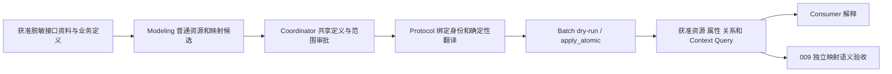

# R4.0-011 接口映射视角与外部 API 关联设计

- 日期：2026-10-02。
- 状态：需求细化与设计完成；D1—D9 无待定关键决策。用户后续授权独立方案审阅至 PASS，
  Round 1 PASS（0 Critical／0 High），无待确认关键假设。实施、功能和真实语义验收均未执行。
  本轮仅修改文档，不启动服务、真实建模或外部接口调用。
- 权威范围和决策主表：[R4.0-011](../../requirements/requirements-v4.0.md#r40-011-接口映射视角与外部-api-关联)。
- 静态代码基线：`3ffb562`，开始时工作树干净。下述“已有”指代码入口存在，不表示本条用例已通过。
- 继承：[术语](../../reference/glossary.md)、[003 Action 合同](../../requirements/requirements-v4.0.md#r40-003-可复用业务-action-与外部能力关联)、
  [004 流程设计](2026-10-01-r4-0-004-process-binding-design.md)、
  [010 数据映射设计](2026-10-02-r4-0-010-relational-data-mapping-design.md)。
  R3.0-010 的映射源登记在本条承接，不改历史 v3 交付结论；历史 Operation 设计中的追溯义务
  以当前 012 为准。

## 1. 最小方案及选择理由

查询工单接口用外部 ID 定位对象，返回业务工单编号；关闭接口可能仅返回“已受理”和任务编号。
Consumer 应能解释字段指向哪个业务对象、输入参数从哪里来、响应究竟承诺什么。平台保存这些
定义和对应关系，调用仍由外部承担。本例不预设真实客户的标识、状态或效果。

采用普通 entity／predicate／relation 和现有 `semantic_definition`。接口、消息、字段及需要
多元关联的映射各有稳定身份，引用共享对象、003 参数、004 调用位置、005 规则和 010 映射。
现有 Operation／Tool Binding 保持原合同，只在真实已有对应时连接到具体绑定。

| 可行方案 | 当前收益与代价 | 选择 |
| --- | --- | --- |
| 扩展 Operation v1，所有接口字段放其 JSON 内 | 集中读取，但需改受控 codec、目标 Class 约束、参数身份、候选、投影及直接编辑；无 Class 查询接口会被强行纳入能力合同 | 本期不采用；当前问题不要求重写 Operation |
| 新建平台 InterfaceMapping 类型与专属 CRUD | 可集中机械校验，却重复普通图的身份、写入与读取；固定接口结构会让模型选择成为平台约束 | 本期不采用 |
| 复用普通图资源和已有注解 | 沿用 002／004 的模型表达，已有中性翻译、授权及跨视角关系；需补清楚建模约定和验证用例 | 采用；没有自动接口结构裁判，语义质量由真实验收证明 |

本方案不增加后端资源类型、注解字段、保留谓词、表或迁移，不新增 MCP／REST 接口。以下角色、
属性和谓词均是可复用建模约定，具体模型先声明其含义，再通过普通写入保存；不硬编码工单或 API
业务规则到平台。已存在同义且同范围的定义优先复用，不因本文示例名字不同重建它们。

## 2. 实际入口与待补交付

| 当前入口 | 已有能力与本条使用方式 | 本条仍需完成 |
| --- | --- | --- |
| [semantic_command_compiler.py](../../../backend/app/services/semantic_command_compiler.py)：`_compile_semantic_definition` | 普通资源接受非枚举 semantic_role、含义、范围和未知；实体可不绑定 Class | 本条采用普通属性和关系，不预定编译器增量 |
| [protocol_mechanics.py](../../../modeling_team/protocol_mechanics.py)：`_translate_entity`、`_translate_predicate`、`_translate_definition_relation`、`_translate_operation` | values→properties，显式 definition_ref，既有 Operation 与映射中性候选 | 补接口映射候选及引用组合用例；不得声称有 Operation 翻译就已交付 011 |
| [staged_decisions.py](../../../modeling_team/staged_decisions.py) | 统一候选可保留 semantic_definition／parameter_definition，身份与关系审批 | 两种活动候选都需有接口／消息／字段示例和审批读回；不新建候选格式 |
| [operation_semantics.py](../../../backend/app/services/operation_semantics.py) | operation-v1、工具绑定、binding_id 唯一性、规范 IRI、秘密字段拒绝；活动 Operation 要求目标 Class | 保持原规则；接口本身不依赖创建 Operation，关联具体绑定由模型声明与重审核对 |
| [modeling_batches.py](../../../backend/app/services/modeling_batches.py) 与现有 canonical write | dry-run／apply、回执、冲突、恢复和受治理引用 | 复用；不为本条新增事务、次数硬门或自动恢复系统 |
| [semantic_read_model.py](../../../backend/app/services/semantic_read_model.py) 与 [semantic_context_query.py](../../../backend/app/services/semantic_context_query.py) | 普通属性／关系、语义角色筛选、精确锚点和有界跨视角展开；Operation 专用投影 | 验证接口字段树、映射上下文与绑定能经已有读面组成答案；不假定单次响应已含全部多跳资源 |
| [semantic_access.py](../../../backend/app/services/semantic_access.py) | 普通图引用及读模型、Context Query、导出过滤 | 所有 IRI 走图边；不在 annotation 字符串里塞依赖，权限过滤不是语义秘密识别 |
| [中性候选合同](../../../modeling_team/references/platform-neutral-candidate-authoring.json) 与 [建模技能](../../../modeling_team/skills/ontology-modeling/SKILL.md) | 003／004 和 010 方法已存在，007 地图允许 interface_mapping | 主要增量：接口分析、定位、身份、样例、未知及变更说明；本轮尚未修改活跃提示 |

采用上述普通图方案无需等待新的公共字段合同。后续开发先用既有路径完成闭环；仅在用例证明
通用翻译／检索有缺口时修改相应最窄入口，仍不得加业务接口特判。静态核对不能证明运行无缺口。

## 3. 模型合同：资源身份、标量与引用

### 3.1 共同约定

- 每个需独立引用的位置用普通 entity，携带 label、`semantic_definition` 的含义／范围／角色。
  身份是候选 item_id／entity_id 经 Protocol 回执绑定的 IRI；不是路径、字段名或具体业务 ID 值。
- 不强制完整节点树。只有当前问题需要区分的消息、字段、对象位置及映射才建节点；已知但未
  展开范围写入 unknowns 或说明，不能因局部建模就宣称覆盖完整接口。
- 标量放 `semantic.values` 的已声明 fact predicate，引用用普通 relation。IRI 不藏入
  semantic_definition；示例角色不成为后端枚举。字段结构既可以关联 Class，也可以关联普通定义。
- 省略代表没有提供；未知在 `unknowns` 或已有注解的 unknown／null 表达；明确无正文／无结果
  要单独声明，不能用没有边代替。冲突保留各方含义及适用范围，不按数组顺序选一种。
- 下列语义约定用于提示、模型核对和验收，不在平台遍历全部普通实体做 API 专属强制校验。

### 3.2 资源角色及局部事实

| 角色示例 | 含义与可用普通标量 |
| --- | --- |
| `interface_mapping` | 一项接口描述；接口种类 `http_api`／`mcp_tool`、作用说明、覆盖范围；独立定位时含非秘密 system、operationIdentifier、interfaceVersion、documentationSource／Version |
| `interface_binding` | 一个具体 Operation Tool Binding 的引用位置；仅 bindingId 为局部标量，Operation 是图边；一个节点只指一个绑定 |
| `api_message` | 一项请求或一种响应；direction=request／response，location、mediaType、协议结果条件、bodyStatus=defined／none／unknown；分页及业务结果说明在 semantic_definition |
| `api_field` | 某消息中的字段或整体正文／集合元素位置；memberName、positionKind=root／member／element；已确认值类型、必填／出现条件和集合含义可复用 parameter_definition |
| `api_field_mapping` | 一项字段与业务位置的对应；mappingDirection=to_interface／from_interface，对应含义及范围；技术字段可只说明协议含义，不强造业务属性 |
| `api_value_mapping`／`identifier_correspondence` | 某字段代码或标识对应；code 的类型由属性声明，标识唯一性范围与转换条件用语义说明；资源本身是定义而非业务值实例 |

`parameter_definition` 用在字段时，direction=input 指请求字段、output 指响应字段；它描述
该字段的值契约，不赋予其 Action 参数身份。业务参数仍为 003 的独立节点。单位／枚举等属性
复用已有注解字段，未确认不填默认值。bodyStatus 是外部协议正文是否存在，不等于 Action 的
output_status：204 无正文仍可能有业务效果，202 有正文也可能未完成业务动作。

已知非秘密协议头可定义字段名和含义；认证材料仅描述所需类别，不保存实例或具体认证头值。
不把真实响应 sample、请求模板、任务号、游标值等写入 values。

### 3.3 接口定位与 Tool Binding 的单一来源

存在合适 Operation 时：接口 → `usesBinding` → binding 节点，binding → `forOperation` →
Operation，binding 上保存 bindingId。定位来自该 Operation 当前 `tool_bindings` 中同 ID 项，
不再在接口节点重复保存系统／路径／版本的权威值。标识是 `(Operation IRI, binding_id)`，
不能只用 binding_id 全局查找。不同 Operation 若对应同一接口，可有多个 binding 节点，但需
先确认系统、标识、版本和业务范围一致；不由文本相等自动合并。

没有合适 Operation 时：接口普通节点自带非秘密定位；保留未确认项。这已能表达查询及操作
接口与业务参数的关系，但不宣称拥有 Operation v1 的完整风险、幂等或凭证类别合同。若后续
补齐能力关联，重审字段和范围，改用具体 binding 作为定位来源，撤掉重复定位事实；不能同时
维护两份可能不一致的权威描述。旧合法 Operation 输入和 IRI 均无需迁移。
独立接口的消息与业务对应可以完整；没有 Operation 不自动构成映射缺口，只有当前问题所需
的能力信息未确认时才报告相应未知。

删除绑定、变更绑定 ID／版本、接口变为 inactive、或找不到对应项时，不自动换另一个绑定。
Modeling／Coordinator 将其列为当前关联缺口，Consumer 不能给出确定的调用解释；沿用 007
变更重审。平台不会仅凭普通 predicate 名称对这一局部 JSON 键引用自动提供引用完整性保证。
需强制局部结构时可用已获准 Shape；不能把该局限隐瞒为已实现自动兼容检查。

### 3.4 消息、字段、嵌套和结果变体

| 普通关系示例 | 方向与约束含义 |
| --- | --- |
| `hasMessage` | 接口 → 消息；每个消息定义说明所属接口、方向、位置和适用结果条件 |
| `hasRootField` | 消息 → 整体正文／根值位置；正文为数组时根字段本身表示 collection |
| `hasField` | 消息 → 该消息直接的命名协议字段，例如 path.id 或 query.id |
| `hasMember` | 对象字段 → 子字段；子字段保留实际 memberName，不把包含点号的名称拆成层级 |
| `hasElement` | 集合字段 → 元素位置定义；表示所有成员的角色，不是第 0 条实际数据 |
| `describesObject` | 字段／元素位置 → 共享业务对象定义；集合元素的对象粒度需说明 |
| `followedByInterface` | 异步受理结果 → 已确认的后续查询接口；不表示自动执行或顺序已经发生 |

例：响应根对象 → `items` 数组字段 → 元素位置 → `id` 字段。另一个响应中的 `id`、请求路径
中的 `id` 和嵌套客户对象的 `id` 各有独立身份。路径字符串仅作显示辅助，父子关系和字段身份
才是映射引用依据；不设计新的 JSONPath、模板或选择表达式语言。

响应按业务相关变体建模，例如“200 且业务状态成功”“200 但业务拒绝”“202 已受理”。它们
有独立说明／字段结构，HTTP 码本身不裁定结果。只知道协议码时保留业务效果未知。
分页说明关联结果集合、总数／后续页控制字段，明确 total 是本页数还是过滤后总数、是否稳定
快照及何时完备；未提供这些资料时保留未知。无后续关系不等于只有一页。

### 3.5 字段到业务定义的映射

| 普通关系示例 | 方向与含义 |
| --- | --- |
| `forField` | 映射 → 具体 API 字段；不是接口名或属性名 |
| `forParameter` | 映射 → 003 业务参数；两个相同对象类型的参数仍是不同资源 |
| `inContext` | 映射 → 003 能力关联或 004 实现上下文／调用步骤；区分一次接口使用的对象位置 |
| `atObjectPosition` + `viaProperty` | 映射 → 参数／004 值引用等对象位置、其共享业务属性；不能只有对象类别而漏掉哪个对象 |
| `usesRule` | 映射 → 005 共享转换／查找规则；各规则输入继续用已有参数／值位置明确，不靠关系顺序绑定 |
| `forField` + `denotesValue` | 编码对应 → 字段、共享业务参考值；不同字段中相同代码允许不同含义 |
| `hasIdentifierMember` | 复合标识对应 → 成员对应；成员明确 API 字段、共享标识属性及可选数据库位置 |
| `forTableMapping` | 标识成员对应 → 010 TableMapping；columnName 为该上下文普通标量，列是否存在需读回核对 |

mappingDirection 规定转换方向：请求为业务值到外部字段，响应为外部字段到业务值；不能把
有损转换自动反向使用。多个输入形成一个字段或一个字段拆成多个结果时，使用共享规则及其
输入／输出位置；缺规则含义不推断字符串拼接、单位换算或主键查找。

API 编码使用普通对应节点，code 只保存参考代码，`denotesValue` 指向已确认共享值定义。
与 010 的 EnumValueMeaning 共用其语义目标，不复用数据库表列身份。若只到自然语言 L1／L2
解释而无共享值资源，保留已知解释和缺口，不制造 L3 引用。同字段／同适用范围的冲突必须
可见；不能用两个看似合法资源代表“任选一个正确”。

TableMapping＋columnName 和 Operation＋bindingId 都是外部合同中的局部定位，不是普通
RDF 资源 IRI；平台通用边校验不能保证列／键存在。对应关系由获准读回、007 重审及 A3／A5／A7
验证。这里不借用 010 针对其受控 mappingDefinition 的平台完整性检查来声称自动覆盖普通节点。

### 3.6 Action 关联与共享身份

003 的 capability association 说明 Action 和接口／Operation 是完整替代、组合的一步或尚未
确认的部分能力。替代关系的适用范围要明确；多个接口一同完成动作时，004 的 implementation
context 和 capability step 负责依赖顺序。011 的映射节点连到该上下文，不把顺序塞进工具绑定
数组，也不把局部参数值写进共享接口。

接口版本改变不自动改 Action；若确认改变业务输入、条件或效果，须按共享定义变更重审。
只改名称、文档勘误通常可保留资源身份；需要两版本同时可用、字段含义破坏性变化时建立新接口／
字段身份。后继关系只说明演变，不等于旧引用自动升级或兼容。

## 4. 示例与确定性写读链

以下是中性候选的局部示意，省略谓词、消息和业务参数等声明，不能直接提交运行；示例身份
仅供理解，不是客户真实材料或平台 IRI。

```json
{
  "item_id": "field-request-ticket-id",
  "item_kind": "entity",
  "semantic": {
    "entity_id": "field-request-ticket-id",
    "values": {"label": "请求路径 id", "memberName": "id", "positionKind": "member"},
    "semantic_definition": {
      "semantic_role": "api_field",
      "business_meaning": "该接口用于定位工单的外部标识字段，不等同于业务编号",
      "applicability": "关闭请求的路径参数",
      "unknowns": ["接口标识与数据库主键的对应尚未确认"]
    },
    "parameter_definition": {
      "direction": "input", "value_kind": "value", "value_type": "string",
      "required": true, "cardinality": "single"
    }
  }
}
```

memberName、positionKind 在完整候选中须先声明 string fact predicate；forField 等先声明
relation predicate 并解释方向，再以 `{definition_ref: item_id}` 关联。另一条 mapping 节点
分别指向该字段、关闭动作的 target 参数及能力关联上下文。这里未知的是 ID 对应，不是
整个字段都未知；获准写入不把它提升为“已经能正确构造请求”。



1. Modeling 使用当前 Task 获准输入，先区分已确认含义和文档线索；选已有共享身份，不按标签
   合并。场景地图登记接口视角及未知，沿用既有共享定义维护。
2. Coordinator 审批完整候选、物理定位／绑定、字段归属和业务含义，检查已知冲突及跨视角
   标识。两种活动候选表达均保留所有标量、注解和关系，审批摘要不能遗漏实际提交内容。
3. Protocol 复用现有定义→实体／Operation→关系阶段及 receipt-backed 既有资源绑定，不根据
   字段名字补关系、不从 Operation 参数数组生成业务参数身份。普通接口不增加专用命令。
4. 通过现有 Batch dry-run 和 apply 后读回真实资源身份／属性／关系。创建、修订、删除均沿用
   当前合同；引用范围、版本冲突或确定性错误按既有可修正反馈处理，不重新创建 fresh run。
5. Consumer 可用 entity 类型和 semantic_roles 筛选接口，再按精确锚点／关联方向取得消息、
   字段、映射及共享定义。普通标量通过属性／fact 读取，不能假定全部已打包进 item.data。
   超出 008 有界深度时对已返回 IRI 继续授权查询；截断、未覆盖和权限过滤遵守当前完整性合同，
   不要求单次调用展开整张图，也不把未返回边解释成缺少映射。
6. Operation 必须走受控投影读取 binding／条件／风险，不通过普通 fact 读取其内部 JSON。
   Consumer 核对明确的 binding_id，组合语义仍由 Agent 理解。整个过程不产生 HTTP 业务调用。

## 5. 失败、授权及验证边界

| 情形 | 反馈及处理 | 负责层 |
| --- | --- | --- |
| 候选引用缺失、未声明谓词、注解类型错、stale | 沿用现有定位到 item／字段的错误，修订后继续；不新设不可恢复硬拒绝 | Protocol／平台 |
| 字段属错消息、两个同类对象绑反、202 被解释为完成、代码含义冲突 | 记录具体受影响定义／关系，业务澄清与模型修订；不是基础设施失败 | Modeling／Coordinator／独立语义验收 |
| bindingId 不存在、数据库列被改名 | 读回明确目标并记录缺口，重审受影响引用；不自动切换接口／列 | 建模协作及 Consumer，沿用 007 |
| 确定性写入失败或状态不明 | 保留原回执／Attempt，按现有恢复读取状态；不换目标试写 | Delivery／平台 |
| 精确读取无权／不存在，宽查询过滤 | 使用既有不可区分合同，不返回受限名称、计数或正文；缺边不能证明没有条件 | 006／008 |
| 静态样例足够，在线未调用 | 仅报告静态语义验证范围；不能报在线可用或业务执行成功 | 009 独立验收 |

输入由宿主提供获准、脱敏的接口文档和样例；真实凭证与报文不送入建模候选。Operation 的
secret-bearing key 检查仍在已有入口拒绝非法内容。普通实体允许文本，不具备识别任意文本秘密
的通用能力；本条不新增扫描平台，也不能宣称其已有此保证。受限含义需保护所在字段／映射／
说明资源，不复制到公开说明后指望隐藏原引用消除泄露。

语义读取权限不授予接口执行权限。样例不包含可用凭证，不作为 RDF 业务行／响应实例导入。
验证输入和只读结果留在既有验收工作区，012 停用逐资源证据链不取消业务资料真实性核对。

## 6. 实施交接与验收分段

| 最小交付工作 | 目标文件／复用位置 | 对应验收 |
| --- | --- | --- |
| 固化接口分析、节点／关系、未知、标识和样例方法 | modeling_team/skills/ontology-modeling/SKILL.md 及必要 references；中性候选合同在现有文件追加 011 部分，统一候选说明同步 | A1—A6 |
| 增加两种候选的合同／翻译／审批组合验证 | modeling_team/tests 中沿用 003／004 的测试形式；示例覆盖无 Class、两系统同名字段及多绑定 | A1—A7、A9 |
| 用隔离平台数据做写入／读回／授权／删除修订的功能往返 | 复用既有测试 fixture、Batch、普通读取、Context Query 及 Operation 投影；不建一次性验收器 | A7—A9 |
| 如闭环暴露通用实现缺口，修复最窄入口 | 表 2 对应真实文件；新增实际行为测试，公共合同变化时同步 api.md／mcp.md | 按发现缺口对应 A 项 |
| 009 映射段对齐本条 A10 | 现有 Task／场景输入／CQ 和验收交接；获准接口文档及脱敏样例，不新增运行框架 | A10 |

功能验收至少包含：

- 无 Class 查询接口，独立接口定位与关联具体 Operation 两条路径；既有 Operation 输入兼容。
- 请求 path.id 与 body.id、响应 items 元素和嵌套对象字段，两个同类参数的正确及错误对应。
- 两 API 同代码不同意义、API 与数据库不同编码但共用参考值、复合标识、已知转换与未知对应。
- 受理／完成／拒绝／部分完成、分页及缺失／null／空集合，反例不能仅做“JSON 合法”断言。
- 两种候选的实际翻译、apply 后读回；跨获准 Ontology 引用、保护集、过滤后分页、深度截断和导出。
- 字段改名、两个版本并存、binding 被删除后 Consumer 报未确认；区分通用引用机械错误和
  需要语义重审的局部标识漂移，不能给平台宣称不存在的自动拦截能力。

A1—A9 功能验证使用隔离 fixture，其中机械断言只证明结构和功能；“建模 Agent 是否正确理解
真实接口资料、Consumer 是否正确解释结果”仍归 A10。A10 在后续真实运行授权下由独立方使用
009 冻结资料和获批 CQ 取证，至少覆盖身份混淆、编码方向、分页和异步受理等高风险问题。
样例只覆盖一部分时逐项标未验证；实际在线可用／执行结果不是静态样例可证明的结论。

后续只改指令／合同则运行相应技能验证器、合同及翻译定向检查；若修改 backend 可执行代码，
按 AGENTS.md 运行后端全量测试后重启服务并核对健康端点；若触及 frontend 则加 build 和
Playwright。功能往返需真实隔离平台依赖，不能用 mock 代替。具体命令、结果和失败轮次在后续
唯一测试记录中保存，不在设计阶段伪造 PASS。

## 7. 文档自查与当前结论

- 需求 F1—F7、D1—D9、A1—A10 与本文的资源、定位、写读、变更及验收边界逐项对齐。
- 仅基于当前代码做局部入口核对；文档工作不执行 GitNexus impact，也不宣称图分析覆盖。
- 本轮本地链接／锚点及 JSON 示意合计 19 项检查通过；Markdown 围栏闭合，F1—F7、D1—D9、
  A1—A10 编号及状态一致，diff 空白检查通过。它们仅证明文档自洽和引用有效；独立方案结论
  另见下节，真实运行尚未执行。
- 无待定关键设计选择；任何未来实现偏离业务／能力分离、外部执行或共享身份边界，须回到
  权威需求明确处理，不能通过代码静默改变本设计。

## 8. 独立方案审阅记录

### Round 1 — 2026-10-02 — PASS

- 授权：用户要求完成设计后调用审阅 Agent 独立审阅，直至方案 PASS。
- 审阅方：独立 `plan_reviewer`，任务 `/root/r4011_plan_review`；审阅基线 `1d07438`，
  审阅期间工作树干净。审阅方未参与本方案编写，也未编辑、测试、启动服务或调用业务 API。
- 范围：R4.0-011 权威需求、本文、术语和适用 AGENTS.md；定向核对普通实体／谓词／关系
  翻译、参数注解、既有资源回执绑定、Operation Tool Binding、受治理 Context Query，以及
  003／004／007／008／010 的职责边界。
- 结论：PASS，0 Critical／0 High，无待主 Agent 或用户确认的关键假设，无阻塞修订项。
  独立接口、多对象、复合标识、响应变体、具体绑定及变更重审均有可实施表达，未将业务模型
  升级为平台专属概念；候选审批、写入和读回的后续验证边界清楚。
- 非阻塞实施注意：现有 `existing_resource_ref` 的部分机械入口／回执使用 R4.0-010 标记，
  支持 Operation 等实际资源种类。实施时需验证这一复用路径；若需适配，按第 2／6 节做
  最窄通用修改。审阅方明确不将此项列为 High，也不据此要求新增资源绑定体系。
- 证据限制：PASS 仅表示独立方案审阅未发现严重实施阻塞；A1—A9 功能验证和 A10 独立真实
  语义验收均未执行。后续实施和真实运行仍需相应授权，本次不将方案 PASS 记作整体交付 PASS。
