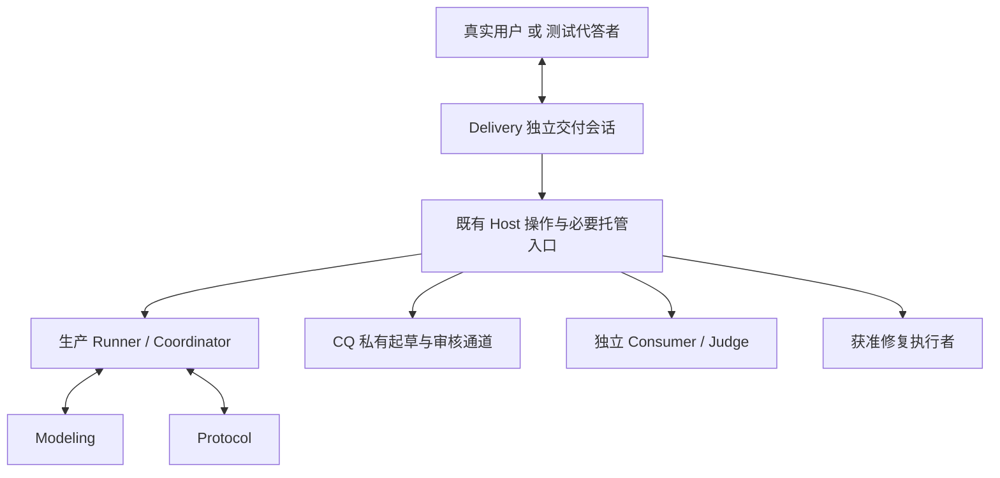

# R4.0-023 独立 Delivery Agent 与统一用户交互设计

## 1. 状态、目标与已确认决定

权威需求：[R4.0-023](../../requirements/requirements-v4.0.md#r40-023-独立-delivery-agent-与统一用户交互)。
需求细化与详细设计完成，独立审阅 Round 1 PASS（0 Critical／0 High，无待确认关键假设）。
设计阶段已按用户要求在独立审阅通过后暂停。用户随后授权实施，当前代码与独立离线功能
验收已完成，详见[交付记录](../records/2026-10-08-r4-0-023-delivery-agent.md)。
真实自主交付 A13、L0 或 L1 尚未验收；以下设计基线与设计审阅记录保留原义。

基线：`6b59a77` 加 2026-10-08 当前工作区。Runner、CLI、运行时和平台有其他任务在途改动，
本轮只拥有本需求与设计及必要相邻文档对齐，不接管这些实现，也不据其未提交改动宣称交付。

用户已确认 D1—D5：Delivery 独立、统一对外、Coordinator 保留内部协同、全程存活、
测试代答分离、按已确认资料组织 CQ 自动审核。完整 D1—D10 及决策来源只在权威需求维护。

目标示例：用户提交退货场景，Delivery 追问“退货金额按退款日还是原销售日冲减”；收到
回答后系统自行协调建模、写入、验收。参数错误或 source_active 由系统处理；确需新权限
或新业务定义时给出具体问题。测试代答者只替代这个业务输入方。

## 2. 已有入口、真实缺口与最小方案

| 已核对入口 | 现有能力／限制 | 本次必要变化 |
| --- | --- | --- |
| [宿主 Skill](../../../skills/modeling-dev-loop/SKILL.md) | 外层 Agent 已负责启动、监督、归因、修复协调、恢复、验收和交付 | 形成独立 Delivery 角色及会话，复用方法，不再依赖测试者执行 |
| [Host 操作层](../../../modeling_team/host_ops.py)与[MCP](../../../modeling_team/host_ops_mcp.py) | 20 项工具覆盖查询、回答、审核、冻结、交接、生命周期和检查点；没有独立验收/修复启动工具 | 复用操作函数与回执；补必要的托管入口及对话适配 |
| `host_ops.answer_question` | `user` 必须带问题绑定，`cq_interview` 单独通道 | 保留原合同；主动补充／内部交付指导另有明确通路 |
| [Runner](../../../modeling_team/runner.py) `receive_outer` | schema-v2 的 `user` 进入 `_release_owner_answer`；没有通用的受绑定 instruction action | 增加窄 instruction 动作，不能用假问题绕过回答释放 |
| [Coordinator 角色](../../../modeling_team/agent-packages/coordinator/instructions.md)及 package | 标为 user-facing，负责唯一外部补充转发；终态后普通投递关闭 | 移交用户入口；保留内部唯一转发和生产终态，不承担跨 run 交付 |
| [CLI](../../../modeling_team/__main__.py) | `cq-acceptance`、`public-feedback`、checkpoint acceptance 已可调用；Host handoff 不自动执行验收 | 托管这些真实入口并观察子进程与报告，不能只创建一份交接文件 |
| [Runtime](../../../modeling_team/runtimes/codex.py) | 每个生产角色独立 app-server/Thread；`start_roster`/`stop` 绑定生产 run 生命周期 | 独立宿主侧 Delivery runtime，复用配置／协议辅助能力，不塞进生产终态集合 |
| [模型路由](../../../modeling_team/model_routing.py) | role universe 封闭，尚无 delivery；旧 profiles 有 Coordinator 明确绑定 | 新增可选 delivery 绑定或显式继承；不改变旧生产 roster 必需项 |
| [修复交接](../../../skills/modeling-dev-loop/references/claude-repair.md) | 有具体任务、执行者、模型、权限和核验方法，目前由外层宿主执行 | 由 Delivery 经有界托管入口派发与观察，保留原授权边界 |

方案：Team 提供一个**宿主侧 Delivery 会话**，它启动并监督现有生产 Runner、公开反馈与
独立验收进程。Delivery 属于产品的 Team，运行上与某次生产 run 分离。第一版只实现本机
一个交付会话及其已授权运行链，不新建后台调度服务、数据库、通用工作流引擎或修复任务平台。

仅添加生产 roster 成员不可满足要求：生产角色终态、S4 源进程停止、检查点创建新 run 都会
跨越它的生命周期。把 Delivery 与 Coordinator 合并则同时扩大生产角色私有材料可见性和
终态职责。保留两层是当前已存在的职责差异，用户已确认该选择。

## 3. 角色、权限与信息流

箭头表示协调或调用，不表示各端可互读上下文。Delivery 的私有会话和内部工具响应不直接
作为用户聊天流或生产消息；用户通道只输出显式的业务问题、决定请求、进度与结果。

| 主体 | 读取／执行 | 不能承担 |
| --- | --- | --- |
| Delivery | 获准材料、用户原文、Host 私有 CQ/报告、真实运行记录；获准 Host 控制与修复交接 | 编造业务事实、编写模型候选、直接 apply、改最终裁决或把隐藏材料转给生产 |
| Coordinator | 公开输入与当前生产消息；内部调度、地图、按既有要求组织审核 | Host 私有 CQ/诊断、宿主生命周期、独立用户窗口 |
| Modeling／Protocol | 既有角色批准的语义输入、写入合同及对应工具 | Delivery 私有历史、代用户决定、隐藏答案 |
| Consumer／Judge | 各自既有冻结／证据 packet；独立只读语义验收 | 生产继续／修复、Delivery 生产总结替代实际语义读取 |
| 修复执行者 | 明确代码归属、通用错误、合法公开复现与权限 | 隐藏题/答案/私有理由、语义建模、擅自重启或扩大生产范围 |
| 测试代答者 | 独立获准业务资料、显式测试补充和业务提问；普通回答入口 | Host、运行日志、代码修复、验收私有目录和授权台账写权限 |

这里的 Delivery 继承可信 Host 权限，不属于受盲测隔离的生产角色；“加入 Team”不能被
实现为将 Host 工具／私有挂载公开到生产 Profile。CQ 自动审核和诊断资格核对属于交付侧
职责；最终独立语义裁判仍是 Judge，Delivery 不自评其组织的生产成果。

## 4. 会话启动、运行与退出

### 4.1 启动与身份

新增本机 `delivery` CLI 入口（位于现有 `python -m modeling_team` 命令族），加载
Delivery package、已部署的 Task/Profile/scope 默认选择、当前用户授权和业务资料引用。
具体参数命名在实现时按现有 parser 统一；这些配置由环境/部署提供，业务用户不必每轮
手写 YAML、run ID 或冻结摘要。自然语言业务目标仍由 Delivery 解释和澄清。

- 新增 `modeling_team/agent-packages/delivery/`，角色方法复用宿主 Skill 中适用内容，
  明确不能扮演业务用户；Skill 指导中有条件的“宿主代答”不进入该角色默认能力。
- 建议新增 `modeling_team/delivery.py` 管理本机会话、对话输入输出和引用，新增
  `modeling_team/runtimes/delivery.py` 承载一个宿主侧原生 Agent 会话。复用现有模型
  binding、provider 会话、Codex 协议与配置辅助函数；为角色生命周期接线，不重写
  `TeamRunner`，也不伪造生产 run 来调用 `start_roster`。
- 程序启动独立 Delivery Thread/进程并记录身份。原生事件循环传入用户消息及新增的
  运行观察，执行该 Agent 发出的结构化工具调用；程序不能代替它决定冻结、修复或阶段切换。
- Delivery 模型采用 session 最新配置；支持可选 `delivery` profile 绑定。未单独配置时
  显式采用所选 Coordinator 的 provider/model/effort，记录继承来源；没有绑定则明确
  报缺失，不从本机 ambient 模型静默猜测。用户指定值优先，service tier 沿 R4.0-019。
- 代答者独立启动，不继承 Delivery 对话或权限；使用同一业务输入口。测试模型选择单独
  记录，本需求不指定固定模型或要求所有角色相同。

复用 gitignored `workspaces/` 中每次交付的可读目录。一个 `delivery-session.json`
只保存必要引用：delivery ID／runtime identity、任务与 scope 引用、配置/授权来源、
关联 run/continuation/验收/修复进程定位、待答交互、最新事件 cursor 和下一动作。
原始 run、CQ、报告和请求回执仍是权威，不复制一套业务状态。业务回答保留原文、来源、
接收者和真实绑定；私有材料留在 Host 私有目录，不写进共享地图或业务来源包。

### 4.2 消息与运行循环

1. Delivery 读取授权与当前实际记录，选择开始或接续；新会话不自动消耗生产额度。
2. 在现有起始材料和 Task 支持范围内准备来源引用／overlay，调用原 validate/baseline
   及 `start_run`。准备只覆盖当前安全启动所需，沿用授权后 20 分钟首次 semantic start
   原则；Task 不适用的实质范围变化先确认，不能自行创造业务事实。
3. 观察待办、事件和实际进程；业务问题经统一入口，技术问题在内部处理。既有任务与
   用户回答持续保留，不把一次模型 turn 结束当作交付结束。
4. 完成 CQ 审核、生产交接、公开反馈、独立验收、必要修复和授权内重验；每个成功返回
   都核对其实际消费/执行依据，submitted 不等于已处理。
5. 获准目标完成、用户暂停/取消/到期，或无法继续时说明成果、缺口、资源及后续状态。
   对话汇报不自动清理仍服务于明确后续任务的资源。

事件循环复用增量 cursor 和有界等待；有用户输入或状态变化时唤醒，不循环喂全量历史。
没有活动可等待；保持工具返回控制权和停用操作可达，不引入固定步数/角色数终止门。

### 4.3 停止与接续

- 生产 Runner 的 stop/cleanup 只处理该生产运行，不销毁 Delivery Thread。
- live `cq-acceptance` 保持源 Runner 存活且生产静默；S4 接续则先核对 handoff、写入排空，
  经原通道停止源进程并确认退出，再启动验收；同源公开/隐藏 continuation 按当前锁串行。
- Delivery 正常暂停/取消时通过已有 Host 动作处理其关联子进程，保留原始证据；未知写入
  维持原对账边界。不能让语义摘要或宿主会话状态直接解除写门。
- Delivery 异常退出不假装持续监管，也不新增常驻重启守护；宿主事件循环保留可取得的
  退出事实及子进程定位。接续时先检查存活进程与未决请求再绑定已有生产；只有需要
  新生产 run 时才按原规则计 fresh start。原生 Thread 不支持恢复则新建 Delivery
  上下文读取保留记录，不能声称恢复了旧模型会话或自动重启生产。
- 用户显式取消可经对话或本机退出控制触发。原生模型不可用时，本机中止入口仍可按
  既有 stop 通道停止受管运行；成功提交后还要记录退出/写入事实，不声称强制中止已在途写入。

## 5. 业务入口与必要 Host 接线

### 5.1 问题回答和主动输入

复用 `get_pending_actions` 获取 `question_delivery_id`、CQ 窗口与 issue 等绑定。Delivery
可合并展示相关业务问题，但会话层须保存每项原问题与绑定。只有一个待答时普通回答可直接
关联；多个待答且无法确定指向时只询问必要消歧，不凭语义猜测把答案写入任意问题。

外部问题用业务语言呈现，内部保留原文。答复通过原 `answer_question` 逐项提交；用户
原文不得被 Delivery 增添业务条件。复用既有确认时保留来源，明确属于引用已有决定。

主动补充/纠正和 Delivery 的运行指导用新增窄 `submit_instruction` 通路（建议名）：

- 输入：run ID、`user_supplement` 或 `delivery_guidance`、原文、来源/授权引用、request ID。
- 底层新增对应 outer action，复用 FIFO、回执和 Runner 的同 run 投递；与现有 `user`
  answer 路径并列，不伪造 owner question，不改变已存在的回答释放合同。
- `user_supplement` 是明确用户/代答者补充；`delivery_guidance` 是系统控制说明，例如
  “当前冻结已完成，请按获准公开投影继续”，不能冒称用户新业务定义。
- Coordinator 按既有唯一转发职责将相关原文送到生产角色一次，标明来源；Delivery 不再
  绕过它重复群发。CQ 访谈仍走私有 `cq_interview`，不经 Coordinator。
- 已终态角色不重开；保留尚未应用的补充并说明可在后续获准生产处理。输入被拒绝时返回
  精确绑定/阶段原因并允许修正，不因一次坏消息杀死整个交付。

部署提供项目/scope 访问配置；Delivery 自行维护内部 ID。缺访问条件时向用户提出可理解
的访问请求，不要求业务用户构造内部协议。密钥经现有宿主环境注入，不进入模型提示或回答。

### 5.2 原有与新增工具职责

保留 R3.0-016 已有 20 项 Host 工具的语义；下列名称为本需求计划新增的窄接线，不是当前
已经可调用的接口。实现可合并共用内部进程辅助函数，不建立通用任务/作业系统。

| 接线 | 输入／执行 | 输出及完成依据 |
| --- | --- | --- |
| `submit_instruction` | §5.1 的绑定和来源，既有 FIFO / Runner | 原 request receipt 及实际投递；拒绝可定位 |
| `start_evaluation` | 当前 run/冻结/交接，模式 `cq-acceptance` 或 `public-feedback`、已批准题集选择、模型配置；包装现有 CLI | 托管 PID/命令引用/日志位置；启动不等于验收完成 |
| `get_evaluation_status` | 本次托管调用引用 | 进程退出、对应新报告、冻结/模型绑定、已执行及有效裁决数；不重算语义裁决 |
| `start_repair` | 既有 repair-task 文件、指定执行者/模型、代码归属、已授权操作和原 issue 定位 | 独立修复会话／PID 与日志位置；不把任务正文拼进 shell |
| `get_repair_status` | 本次修复调用引用 | 实际进展、结果、diff/测试定位与是否需主调度处理；文字完成不当成修复已生效 |

验收封装直接采用现有 CLI 参数：`cq-acceptance --run-root --freeze-id --model-handoff
--question-visibility --model-profile --session-timeout`；早期反馈使用 `public-feedback`
既有 checkpoint 和 question ID 参数。不得发明现有 CLI 不支持的字段，也不能以
`--unexecuted-report` 生成未执行报告替代真正启动。S4 路径优先复用现成
`resume_from_checkpoint(mode=acceptance)`，不重复启动同源 source。

封装必须保存调用与**该次新生成报告**的绑定，重试不能把旧报告存在当本次成功。托管记录
复用已有进程启动/退出/日志模式，置于交付私有目录；阶段切换由 Delivery 决定，封装只执行
明确动作。只读状态函数不隐式启动、drain 或修复。

当前 MCP 的 `start_run`/`resume_from_checkpoint` wrapper 未暴露底层已有的
`host_session_ref` 时，补透传该引用；它是配置和记录关联，不授予额外权限或替代 semantic
start 证据。原请求、传递、实际生效分别记录。

### 5.3 Delivery 私有读取与未知写入

Delivery 可以读取本次交付获准来源和 Host 私有运行产物，用于 CQ 审核、诊断资格及技术
状态核对；这是原宿主已有的权限边界，不将通用读文件工具提供给业务用户或生产角色。
读范围限本次交付及已有恢复链；不能用任意目录搜索将其他 run 内容补成当前证据。

`get_run_events` 当前读取整个 `evidence/*.jsonl`，可能包含私有材料。因此内部原始响应
及完整 Delivery 会话只保留在私有宿主侧。业务输入适配器不能直通工具响应、stdout、stderr
或文件内容；只显示 Delivery 显式提交给用户的消息。隐私验收同时检查消息与实际可见文件。

未知写入沿现有 Batch／Attempt／资源／receipt 核对方式，由 Delivery 组织已有只读平台
调用或受限对账修复任务完成，严格绑定 run/project/batch。独立 Delivery 需要具备这条
实际执行通路；若角色配置只开放 Host 20 工具却没有平台只读核对入口，就不满足 A6。
实现优先复用平台现有只读工具并按本轮 scope 配置，不能给 Delivery `apply`／删除写权限，
不能以本地日志声称确认持久化结果。原有恢复机制负责写门，Delivery 只提交有根据的处理。

## 6. CQ 自动审核与隐藏材料

Delivery 使用现有 CQ 私有草稿/审核 snapshot、获准资料、访谈确认和 R4.0-013 的审核方法。
CQ 起草者继续自查；Delivery 负责委托范围内的最终审核提交，不新增常驻审核 Agent。

1. 核对当前 review ID、题目版本、内容 digest 和 revision。
2. 逐点确认来源、题意范围及业务影响；充分者提交 approve；需题目修订时按原 modify/
   supplement 合同，不能只在 note 改题。资料不能支持的业务结论保持未知。
3. 有实质业务歧义或范围变化时形成来源明确的业务问题；回答前该项保留待定，其他可独立
   审核项继续。不能由测试代答者审核隐藏题或读取标准答案。
4. `submit_cq_review.note` 记录“Delivery 受委托自动审核”、本次授权来源、实际依据和
   检查理由；既有 decision schema 与内容绑定复用。Runner 的“记录用户决定”在此表示
   有明确用户委托的 Agent 决定，不能把权限检查降为“Delivery 名称天然可批准”。
5. 当前版本全部必要决定齐备后调用原 `freeze_cq`，核对实际冻结，再通过系统 instruction
   通知 Coordinator 使用 Runner 发布的公开投影，隐藏内容保持私有。

后续 Task 引用的 R3 CQ 合同、CQ 角色提示和宿主 runbook 需同步“业务用户／受委托 Delivery”
术语。既有手动运行不强制改变；旧冻结不回填、不撤销、不自动重审。本条是对先前“有授权
才可代审”的一次明确设计确认，不使工具自身成为自动语义审批器。

**边界实例**：Delivery 在隐藏审核中发现资料对退货日期存在冲突，可以基于两处已获准
原文询问统一业务定义，不能复制隐藏题的情境、参数和期望答案。隐藏失败也不能直接变成
“请增加恰好能答这道题的关系”。附上公开来源不自动洗去隐藏内容；生产修复需独立成立
的公开缺陷、其模型定位及依据。不能成立时保留失败和限制，不要求业务用户技术排查。

## 7. 故障定位、修复与最终验收

保留四层失败与第一阻塞。Delivery 处理可见技术错误和流程协调；Judge 的语义诊断仍按
方案 A，只用已有证据。Delivery 核对引用、同批次/模型状态、evidence_recheck 和漂移，
不得新增根因平台补查或改写旧裁决。正常生产读回、未知写入对账与原请求稳定性重放按各自
既有目的继续，不借这些入口做隐藏题补查。

| 情况 | Delivery 下一动作 |
| --- | --- |
| 输入字段、工具调用或绑定错误 | 向原角色返回准确反馈，修正当前输入，观察实际消费 |
| 运行/平台/提示缺陷，且当前授权覆盖修复 | 按已选执行者派发窄任务；核验适用 diff、测试和部署生效，沿原 issue 恢复 |
| 公开证据证明模型表达缺陷 | 经 Coordinator 交 Modeling，Protocol 按原审核/dry-run/apply/readback 执行；之后独立重验 |
| 只有隐藏诊断或证据不充分 | 私有保留裁决和资格限制；无独立公开依据就不定向修模，继续其他获准任务并如实报告 |
| 用户尚未决定的业务定义、范围、兼容性或新权限/额度 | 完成独立工作，向用户提出具体决定及影响，等待有效回答 |

修复执行者模型、权限和文件归属沿当前 session 记录。首次使用自动修复须在运行授权中已有
明确的修复范围；未授予代码修改/服务切换权时只能准备任务并说明所缺授权，不拿“统一入口”
当作无限部署许可。已获准的常规修复无需逐次请求用户批准。

Delivery 不直接担任最终 Judge，也不代 Consumer 作答。交付前核对获准公开/隐藏全范围、
有效裁决、冻结、模型绑定、原始报告与缺口。修复后新报告另留；失败原件、完整分母和未知
不得被后续成功覆盖。功能修复、运行恢复和独立语义 PASS 分别证明。

## 8. 实施归属与分段

以下是后续实施计划，本轮不执行。路径不存在者是建议新增文件，不伪装为已有入口。

| 文件／范围 | 必要工作 |
| --- | --- |
| 新 `agent-packages/delivery/`、`delivery.py`、`runtimes/delivery.py` | 独立角色、宿主侧原生会话、统一业务输入输出和全程生命周期 |
| `host_ops.py`、`host_ops_mcp.py`；可将交付专属封装放新 `delivery_ops.py` | 复用20工具，补 instruction、验收/修复托管、session 引用；不复制整个 Host 实现 |
| `__main__.py`、`runner.py`、`outer_input.py` 及真实动作集合 | delivery 入口及明确 instruction admission/来源/回执；保留 owner answer 合同 |
| `runtimes/codex.py`、`model_routing.py` | 复用必要原生会话/配置辅助函数；可选 delivery 绑定，不改生产终态规则 |
| Coordinator package/instructions、CQ 角色及当前 Task 引用合同 | 对外入口与内部唯一转发对齐；有委托自动审核与手动审批并存 |
| `skills/modeling-dev-loop/`、Team skills README | 宿主技术职责归 Delivery、测试代答外置；明确可信私有层与生产层 |
| 针对上述入口的既有测试＋新 Delivery 测试 | 独立角色实际调用、生命周期、正确来源/绑定与无外层补位 |
| v4.1 相关展示 | 仅引用本需求的职责/结果；本次不实现新页面或聊天后端 |

先实现独立会话与业务入口，再接通 CQ/交接/验收及修复/恢复，最后开展获准真实流程。
前段功能可单独验证，但不能标整需求完成。实现前根据当时工作区核对在途修改，适用时
做 GitNexus impact；本轮仅文档设计，已用已知入口定向阅读，不声称做过图谱影响分析。

## 9. 验证计划与完成门

权威 A1—A13 为主记录。后续实现须区分：

- 确定性/功能验证：使用既有 host/runner/runtime 测试，覆盖多待答与主动输入、错误绑定、
  CQ 自动审核和修订、source_active/进程退出、submitted/accepted/consumed 区别、未知
  写入、模型配置、真实操作者身份、取消与 Delivery 退出。断言实际副作用和收件端，
  不只检查提示中出现关键词。
- 独立功能验收：验证者不修被测实现；检查模拟用户工具目录/可见输入和实际对话，业务
  用户端不出现技术操作要求。私有材料放可识别标记，核对转发/摘要/日志/修复包未泄露，
  并检查修复依据的业务独立性，不能仅以字符串未出现认定语义隔离通过。
- 获准真实 L0：独立 Delivery 实际起动、处理业务答复、组织 CQ 审核、跨生产终态进入
  独立验收并交付；测试代答者无技术权限。用原生 tool call、Host receipt、PID/exit、
  freeze/report 绑定证明工作由谁完成。测试框架只做部署准备、提供业务输入和记录；
  若旁路脚本、外层 Codex 或人工执行阶段推进，该条标为未达并披露，不能事后删去补位。
- L1：继续由独立 Consumer/Judge 证明业务语义质量。Delivery 的交互完成不等于 L1。
  L2 重复性与 L3 UI/部署产品化另列，不前置阻塞首次 L0/L1 取证。

真实运行额度以当次用户授权为准，设计/功能测试不自动取得额度。测试代答无法确认业务事实
时应返回未知，不为追求闭环补答案。首次真实流程结束即按已授权范围判断，不追加控制框架。

## 10. 独立设计审阅记录

| 轮次 | 审阅者与范围 | 结论／处置 |
| --- | --- | --- |
| Round 1（2026-10-08） | 独立 `plan_reviewer`，任务 `/root/review_delivery_design`；只读核对 R4.0-023 F1—F8、D1—D10、A1—A13、设计全文及 R4.1-011／映射行，并定向检查 Host、Runner、Codex runtime、模型路由和 Coordinator 合同 | PASS，0 Critical／0 High，无待确认关键假设；无需语义方案修订 |

审阅确认独立宿主会话与生产生命周期分离，覆盖终态、live 验收、S4 接续及退出恢复；
实际接线缺口已列入计划，包括独立 runtime、instruction、验收/修复托管、session 引用
与平台只读对账。委托 CQ 审核保留版本绑定和授权，隐藏隔离、测试代答、Protocol 写入和
独立 Judge 边界一致；实际调用／消费／进程／新报告及禁止外层技术补位的验收要求明确。

审阅未编辑文件、运行测试、启动服务或建模。通过后仅补记状态与本记录，没有修改被审阅的
功能、决策、验收或方案内容，不需要以重复审阅替代已取得的有效结论。

已检查本轮新增/修改范围的本地链接与锚点、Markdown 围栏、条款编号及 diff 格式。
本轮仅文档交付，不运行产品套件或重启服务；设计 PASS 不证明功能、L0 或 L1。
按用户要求在记录、核对并提交本轮归属文档后暂停，不继续开发或真实运行。
