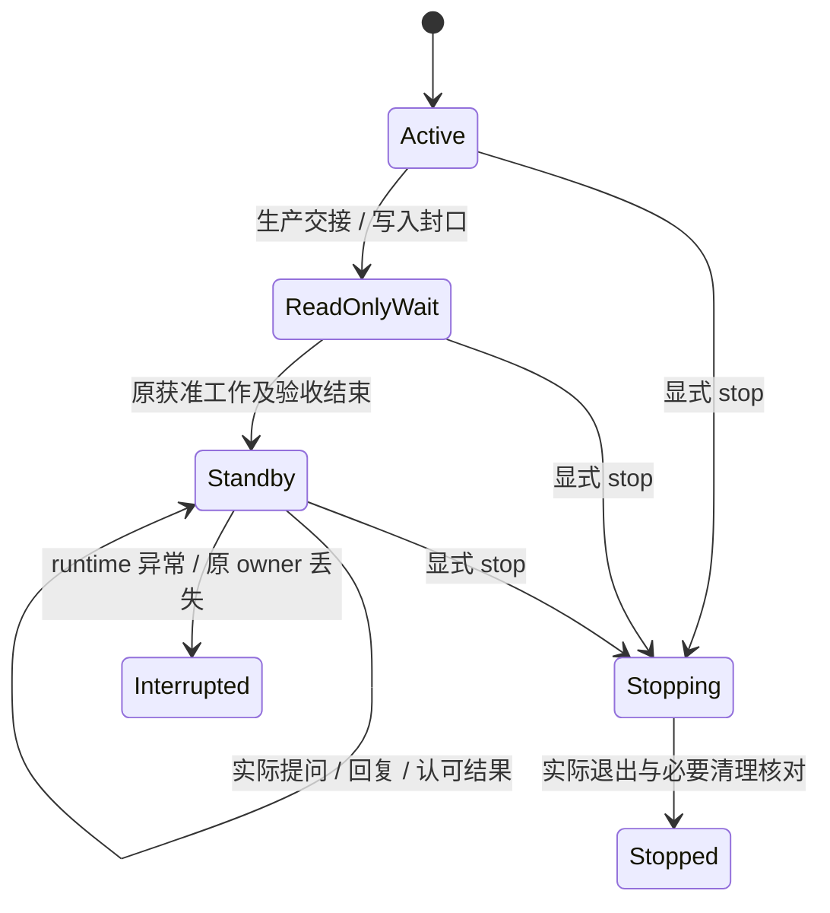

# R4.0-028 建模 Team 原地待命与显式停止详细设计

## 1. 授权、范围与状态

- 权威需求：[R4.0-028](../../requirements/requirements-v4.0.md#r40-028-建模-team-原地待命与显式停止)。
  用户要求完成细化与设计；不授权开发、部署或真实建模。
- 2026-10-10 用户补充：“如果consumer此时已经正在运行，则保留consumer，如果还没到
  验收阶段则不管”。本设计保留已运行的 Consumer，不为了待命提前创建尚未启动的 Consumer。
- 代码基线 `main@1ffd4aa`，静态核对 Delivery、Runner、Codex adapter、CQ 验收、Host
  操作、PlatformScope、checkpoint recovery 及宿主合同。代码没有在本轮改变。
  收尾时另有并行生产引用相关代码改动，其 diff 未改变上述生命周期依据；不纳入本轮提交。
- 初版独立设计审阅 PASS（0 Critical／0 High）；组合方案因 008 的硬暂停接线为 REVISE。
  用户随后明确将暂停／恢复改为 Agent 消息协作。
- `3dd2774` 消息协作版独立复审：两方案均 REVISE，共 1 High（Consumer 阶段消息目标
  与等待封口遗漏）。本轮补齐 Consumer／Judge 等待与真实完成区分，再交独立复审；
  无实现或功能验收，不回填历史 PASS，不宣称真实 L0／L1 通过。

例：生产成员已经报告完成，独立 Consumer／Judge 正在验收。生产线程先进入只读等待，
继续保留；已启动 Consumer 完成原题集后保留原会话。最终汇报及用户说“认可”都不销毁。
用户追问通过 Delivery 沿原上下文处理；用户或宿主明确 stop 后，才销毁这些受管会话。

本条调整生命周期及其必要验收接线。网页、统一消息历史、来源展示、消息投递去重和临时
暂停语义分别复用 [R4.2-008 设计](2026-10-10-r4-2-008-delivery-conversation-design.md)。
保活不是新增生产授权，也不要求保留全局所有旧 run、已结束的历史线程或一次性修复工具。

## 2. 当前行为与缺口

| 位置 | 当前事实 | 必须调整的行为 |
| --- | --- | --- |
| [Delivery](../../../modeling_team/delivery.py) 的 finish_delivery／finally | 设置 finished、退出循环、关闭 native／provider；stdin EOF 可结束监督 | 工作结论落盘后保持原 Delivery，显式 stop 才进行正常最终销毁 |
| [Runner](../../../modeling_team/runner.py) 的 _capture_coordinator_final | 写 TERMINAL_REPORT_COMPLETE；运行结果与生命周期未分开 | 结论不可变，另记只读等待／待命；后续问答不覆盖原最终消息 |
| [CLI](../../../modeling_team/__main__.py) 的 _foreground_event_loop／cleanup_once | terminal report 后返回，finally cleanup；源正常结束即停止全部角色 | 保留原 event loop、FIFO 和 native thread，不把业务完成作为进程退出条件 |
| Runner.cleanup／[PlatformScope.cleanup](../../../modeling_team/platform_scope.py) | 停 adapter、验收资源、transport、只读入口并撤销密钥；清理／保留平台资源 | 工作写入封口与最终进程销毁拆开，待命期间保留必要原会话，stop 执行真实最终清理 |
| Runner._receive_outer_instruction | Coordinator 已 terminal 时拒绝新 instruction | 保留生产指令合同，增加只读追问路径，不能让追问重新打开 terminal／写入门 |
| [Codex adapter](../../../modeling_team/runtimes/codex.py) 的 run_v3_acceptance_child | finally destroy child，停报告／read proxy／provider，记录全销毁回执 | 已启动 Consumer 正常完成后转受管只读待命，不伪报 child_destroyed |
| CLI._cq_cleanup_acceptance_resources／get_evaluation_status | 报告 full_pass 要求 children_destroyed；进程运行与工作结果分离不足 | 区分任务封口、Consumer 受管保留、真正销毁；结果发布不等于 owner 进程退出 |
| [S4 recovery](../../../modeling_team/checkpoint_recovery.py)／CLI._run_checkpoint_resume_acceptance | source writer 必须退出；acceptance 与 production resume 共用 root lock | 只对只读验收增加可核实的 live-source 分支；生产恢复仍保留原 writer 退出门 |

既有 staged handoff 已有 `CQWriteAdmission` 的 open → quiescing → read-only、in-flight
排空和实际写入核对，可直接复用；保留进程无需重建 Team、native thread 或运行框架。
非 staged 的直接平台写入凭据也必须封口，不能只给模型一句“不要写”。

## 3. 决策表

Q1（Consumer 范围）已按用户补充关闭。其余技术选择按本轮设计授权采用，理由明确超过
85% 主观把握；这不是用户逐项批准或实测结果。

| 编号 | 采用方案与必要取舍 | 来源／依据 |
| --- | --- | --- |
| D1 | Delivery 与当前交付中已启动的冻结 Profile 常驻成员保持原进程／thread；保留已运行 Consumer，不预建未运行角色 | 常驻 Team 沿用用户原目标，Consumer 沿用本轮 Q1；不复活已结束历史会话。一次性 Judge、修复／检查 worker 保留既有收尾，不新增保活 |
| D2 | 复用既有 write admission、排空、实际读回和密钥撤回形成不可逆的只读封口；工作完成与进程存活分开 | 按授权采用；直接保护模型及独立验收，避免用杀进程代替已具备的写入边界 |
| D3 | S4 接受“已退出 writer”或“存活且可信封口的源”；生产恢复不放宽。只读验收任务使用单独同源 acceptance 文件锁 | 按授权采用；原 root lock 继续由存活生产持有，不删锁、不伪造退出，也不做通用读写锁平台 |
| D4 | Consumer 原验收任务封口，原报告固定；原 native／私有上下文由原 owner 保留。任务资源回执与最终销毁回执分开 | 用户 Q1；按授权采用接线。保留会话不算资源泄漏，但必须具备 owner、实际存活及范围依据 |
| D5 | 新只读 consult 外层动作复用 FIFO、request ledger、RuntimeDelivery 与 Team Transport；不复用 terminal 被拒的生产 instruction | 按授权采用；原 report_task_result、候选、写入及裁决不被重开，原两种 instruction kind 不增加第三种 |
| D6 | 显式 stop 覆盖绑定 run、保留 Consumer 的 owner、相关操作及 Delivery；最后才关闭 Delivery，保留模型／历史／证据 | 沿用用户确认，具体顺序按授权采用；结果认可、EOF、浏览器关闭和自然完成都不等于 stop |
| D7 | 暂停／继续经 Delivery 消息转达 Coordinator／Consumer／Judge，由 Agent 自行等待／恢复；与到期、撤回及待命分开，无输入不推理、不扩权 | 用户后续明确覆盖硬暂停；复用 R4.2-008 Q2 及原额度／授权边界 |

## 4. 保留对象、生命周期与证据

### 4.1 保留边界

常驻对象是当前 Delivery 绑定的 run 中实际启动的 Profile 成员，不按预设角色数量校验。
Coordinator／Modeling／Protocol 及选定的其他常驻角色全部保留；不存在的角色不创建。
有多个 run 时，保留仍属该交付且尚未显式停止的对象，不重建此前因失败或 stop 已退出的
成员；任何缺失都明示“Team 部分存活”，不能用新 thread 冒充完整 Team 原地待命。

Consumer 的选择时点为其原 owner 完成该验收调用、执行正常资源收尾之前：若它实际已
启动并仍存活，保留同一 runtime／thread，完成原验收后进入只读待命；若原生产工作结束
时还没到验收，则只保留现有 Team，不为显示待命创建 Consumer。后续原授权真的启动
Consumer 时应用同一规则。启动失败／已退出的不复活，失败分类和证据不被覆盖。

一次性 Judge 维持原独立判定及销毁合同；若冻结 Profile 本身配置了常驻验收成员，则它
属于常驻 Team，仍保留。这是按用户 Consumer 补充、复用现有其他一次性资源合同采用的
范围，不把 Judge 的材料或答案扩散给保留的生产／Consumer 成员。

### 4.2 工作状态与资源状态

在原 session.json、run state.json、operation 记录中增加最小生命周期投影，不建新状态库：

| 维度 | 语义 |
| --- | --- |
| work_state | working／completed／blocked／cancelled；从实际任务、交接、报告及待办取得 |
| lifecycle | active／read_only_wait／standby／stopping／stopped／interrupted |
| write_phase | 原 admission 的 open／quiescing／read-only；直接写路径补充其真实凭据封口结果 |
| retained_members | 实际 agent/runtime/thread 身份、owner run／operation、存活状态和依据；无密钥／私有正文 |
| updated_at／evidence_refs | 原生命周期事件、Host request receipt、报告与退出记录引用 |

原 `TERMINAL_REPORT_COMPLETE` 表达工作最终汇报事实，不能继续作为“必须退出”的唯一条件。
可保留对应历史事件，并在 state.json 用生命周期当前状态和 work_state 分开呈现。
`read_only_wait` 表示生产已封口、还有授权内验收／其他待办；`standby` 表示本轮已完成
或无当前可推进工作，等待真实输入，不代表业务语义 PASS。暂停单独记录 Agent 等待
指示及确认依据，不作为全局执行开关；消息协作方式见 008 §8。
现有调用方若依赖 terminal／进程退出触发成果提取，须按工作完成及实际封口回执提取，
正常销毁核对留到 stop；当前入口配置了 foreground monitor 时，同步其 phase 读取，
不能让保活阻塞原报告交接，也不能伪造 cleanup_pending／已退出来解锁读者。

进入待命前记录每个保留成员的原 thread 与 runtime 身份，在
`evidence/team-lifecycle.jsonl` 追加阶段、原控制引用及实际存活观测。只读状态查询复用
get_run_status／get_evaluation_status；PID 存在不能单独证明原 thread 可用。
保留 owner 按既有 runtime 通知、thread 身份和受管进程观测返回当前依据，无需靠新的
推理 heartbeat 证明存活。成员失效时状态降为部分存活／interrupted，不偷偷补建。

## 5. 写入封口与独立验收

### 5.1 T0 防御复核

| T0 问题 | 本次答案 |
| --- | --- |
| source_active 防御必要吗？ | 禁止独立验收与可写生产并行必要；要求所有源进程退出只是当前实现手段 |
| 是否对可控状态硬拒绝？ | 已 read-only、写入排空的 live 源仍因存活／持锁拒绝，会迫使销毁整个 Team |
| 直接删除的后果？ | 会允许未排空或未知写入下验收，损害模型状态与证据，不能直接删除整个保护 |
| 如何可控修正？ | 保留写入硬门，只对经过原 owner 实际证明封口的 live 源开放只读验收；缺证据可重试 |
| 已有高层覆盖？ | admission、Batch／Attempt／receipt、实际 model revision、冻结摘要及独立只读验收覆盖写入／漂移风险 |

因此收窄“源进程必须死”的硬拒绝，不建设新治理机制，也不全局放宽生产 checkpoint 恢复。

### 5.2 封口步骤

1. 复用原 production readiness：生产交接真实就绪，待处理业务／写入阻塞准确披露。
   不使用 CQ handoff 的已完成任务按其现有工作结果与写入终态核对，不强制它们新建 CQ／
   checkpoint；S4 分支才要求相应完整交接及检查点。
2. `CQWriteAdmission.begin_quiescing` 阻止新写，排空已接收动作；逐个核对 Batch、Attempt、
   资源及回执，写入成员的未决工具 RPC 也必须核对；unknown／applying／recovering 未
   解决时保持 quiescing，不能仅凭 Agent idle 宣布封口成功。
3. 对直接持有 model 凭据的旧入口，撤回本 run 的实际写凭据并核实回执；仅 source 内
   admission 不能证明这些外部调用无写能力。复用 PlatformScope 的 owned key 撤回方法，
   不调用其删除平台资源／关闭全部角色的完整 cleanup，不改用户或项目的其他凭据。
4. 核对该源涉及的 Build Session／Lease 已按既有正常终态排空，封存实际模型修订和
   production_handoff／freeze／checkpoint 摘要。没有已完成写入时也保留可核实状态。
5. 在原 owner 写出只读封口事件／回执，状态进入 read_only_wait。后续 consult、pause、
   resume 都不能把这个已发布交接的写门改回 open。

必要只读入口与既有 scope 可保留，不能自动扩大到写权限或延长有效期；撤销的 key 不复活。
角色没有在线读取能力时可基于原上下文解释，由 Delivery 沿已有获准只读工具补读；不能
为统一所有角色能力新增权限框架。平台原子性、dry-run/apply 和受治理读取边界保持不变。

### 5.3 S4 新 live-source 分支

原退出源路径继续适用。对于保留源，通过原 FIFO 的 `standby` 动作核对／取得新回执，
其语义是“完成写入封口并保留进程”，不是 stop；Host 接收后按 get_request_result 读回。
回执至少绑定 source_run_id、root_run_id、owner 实例／launch 身份、当前生命周期、
write_phase、排空结果、未知写列表、写凭据撤回证据、模型修订和交接／冻结摘要。

S4 入口必须核对这个实际请求回执和当前源身份、实际平台读回、完整 checkpoint，以及
原 source／chain write tail 的完整性。不仅信任一个 STANDBY 字符串或落盘布尔值。
新状态 READ_ONLY_WAIT／STANDBY 仍纳入旧生产恢复的可能 live writer 集合，防止旧谓词
因不认识状态而误放行。新增的 `source_safe_for_acceptance` 只服务 S4，只允许以下两种：

- 原 writer 已退出且满足既有证据；或
- 原 writer 存活且本次实际封口证据完整、没有 pending／unknown 写入、摘要及模型修订一致。

生产恢复的 `source_writer_settles_recovery`、旧 settle-source 的退出含义不改变。所有
拒绝返回可定位对象和下一步；缺证据可由 Host 核对／修正后重试，不把 run 永久判死。

同源 acceptance 使用 `.recovery-locks/<root_run_id>.acceptance.lock`，只保证一项同源
只读验收任务在执行，不固定 public／hidden 顺序。存活源继续持有原生产 root lock；
live-source 验收不抢占／释放它。fresh 源本来没有恢复 root lock，不伪造其持锁事实；
其只读封口同样必须核实。已退出源路径还需原 root lock 保护，避免与生产恢复竞争。
这是两个明确用途的现有文件锁，不是通用调度或分布式锁。

验收工作发布完整报告且任务资源封口后释放 acceptance lock；若其 Consumer owner 留下
待命，下一批不用等待该 owner 退出。仍在判定或报告／范围未封口的前一任务保持互斥。
源 snapshot、handoff、freeze 和旧报告保持只读，新 attempt／报告仍在新输出目录，
生产 semantic start 消耗为 0。live 路径完成报告通过 Delivery 的既有完成交接接口传回
存活源，S4 任务只生产独立验收证据，不创建／继续／修复生产 run；原正常阶段推进由
Delivery 承担。模型修订漂移仍按原独立验收失效规则处理。

## 6. Consumer 任务结束与会话保留

### 6.1 正常完成的资源处理

当前 CQ 的业务 Consumer 位于 platform examiner 批次路径，不把所有 legacy Examiner
child 都推广为常驻成员。对原已实际启动且仍健康的 Consumer：

1. 原冻结题集按原 Consumer 输入／真实检索／Judge 独立裁决执行；有效处理超时、未完成
   题数和 failure layer 保留；已确认用户等待单独计时，不续期原授权或制造 PASS。
2. 在原验收任务真正完成／有效处理超时后固定回答、响应及报告身份，封闭原 report sink 和本轮
   task capability。迟到回调不能继续追加回答、覆盖 Judge 或改变冻结 evidence。
3. 保留原 native process／thread、隔离私有 home、只读上下文及必要 provider 会话，由
   原 owner 管理；既有 scoped read proxy 可保留在原 scope／有效期内，不能进入生产通道。
   read key 到期后只报告不可补读，不静默延期或更换模型／thread。
4. 原 owner 记录 Consumer 的真实保留身份／存活与已关闭任务能力，转为等待控制的循环。
   它仍是原评价操作的 owner，不把孤儿 PID 交给 Delivery 管理，也不新增保活 worker。

一次性 Judge 正常销毁；Consumer 任务失败／超时而进程仍可安全保留时，先停止该推理
并固定未完成证据，再保留为 blocked／只读会话，不宣称健康验收完成。已退出或不可安全
保留时仍沿必要故障清理，不复活、不掩盖坏进程或隐瞒首个失败。

用户在验收中要求暂停时，Delivery 按 008 §8 经原评价 owner 通知实际在办对象：
Consumer 检索／作答阶段通知 Consumer，此时 Judge 尚未启动；Judge 判定阶段才通知
Judge。各 Agent 停止继续自身任务、说明当前阶段及未完工作并等待；阶段交接中没有
在办 Agent 时如实反馈，由 Delivery 自行暂缓下一阶段，不为暂停预建 Judge。

Consumer／Judge 的明确等待确认与任务正式完成分开。owner 将等待确认关联原暂停
消息和任务身份，在 turn 暂时结束后继续原消息等待循环；不因等待报 batch-incomplete，
不封闭未完成任务的 report sink／task capability，不自动补交报告、推进 Judge 或销毁。
保留原 thread、只读 proxy、未完成题目及原报告身份；原已提交回答／裁决保持固定，
等待回复不补成正式答案。明确继续后由同一 Agent 在原上下文完成剩余工作，不创建
新批次／thread 或把恢复当作 consultation。已确认等待不计有效工作时长，实际推理／
费用仍记账；绝对授权／read key 到期仍反馈限制，不自动续期。无等待确认的未完成
结束仍保留原失败合同，正式任务完成或有效处理超时才执行上述任务封口。
判定真正结束后 Judge 沿原一次性合同收尾，Consumer 按本条受管待命；暂停中两者
均还属于未完任务，不能提前套用 retained_idle／task_resources_closed 作为 full_pass
证据。消息和等待接线归 008，正常任务封口与最终生命周期归 028，不增加硬暂停开关。

### 6.2 回执与 full_pass 边界

原 `children_destroyed=true` 只在真的销毁时使用。新增 Consumer 正常收尾回执：
`disposition=retained_idle`、retained_session_ref、owner_ref、原报告／输入／thread 绑定、
`acceptance_turn_settled`、`report_sink_closed`、`task_capability_closed`、原只读 scope
及实际存活依据。不得把保留的 private_root 伪报为 removed，也不得伪报 provider 已关闭。
Consumer 仍需使用的原 read forwarder／proxy／provider 随其原 owner 受管保留，不在批次
cleanup 中提前关闭；只属于 Judge／已结束任务的对象正常清理，最终 stop 再关闭保留对象。

报告追加 `task_resources_closed`、`retained_resources_managed` 与各对象 disposition；
原 children_destroyed 字段继续准确反映事实。当前 full_pass 中“所有 child 销毁”的必要
条件在本条的 Consumer 范围调整为“任务能力已封口，Consumer 受管且不可改原证据，
其他本轮一次性资源实际正常清理”。完整题集、回答／平台证据、独立 Judge 裁决、模型
修订／冻结一致性等语义门全部保留；未知 owner、活跃旧 report sink 或清理失败仍不通过。

先执行并固定 Judge／报告证据，再把 Consumer 的后续对话作为独立 consultation 记录，
不写回原 Consumer responses、Judge inputs 或 batch-report。原历史报告仍按其旧真实
清理字段读取，不将历史 destroyed 改成 retained，也不把先前失败补写为成功。

`get_evaluation_status` 增加 work_state、resource_state 和保留引用：报告完成可返回
work_state=completed、resource_state=standby、exit_code=null；这不等于语义 PASS。
Delivery 依据实际当前报告／分母／裁决和工作状态推进，不等待待命 owner 退出，也不由
PID／exit_code 推断验收通过。既有 request/report 精确绑定继续适用。

standalone CQ／S4 入口若保留 Consumer，报告后继续原进程的控制循环；同步等待“进程
退出”的旧调用方需切换到现有 report／Host 状态核对。CLI stdout 可输出一次工作完成
摘要，但明确进程仍待命；无 Consumer 被创建／保留时按原一次性操作正常退出。

## 7. 原线程追问与按需唤醒

Delivery 可直接根据公开结果及其获准上下文回答。需要原 Team 解释时新增窄 Host 工具
`consult_team(run_id, text, source_reference, authorization_reference, request_id)`，
它沿原 FIFO 发送 `action=consult` 给该 run 的原 Coordinator；Coordinator 仍按原
Profile 的 Team Transport 路由请求 Modeling／Protocol 等协助。无需用户填写角色 ID。
Tool 只做消息传递与回执，不能改变业务结论或代替成员解释。

当前 production instruction 只有 user_supplement／delivery_guidance 的合同保持不变；
终态后它仍不能重开生产。consult 是新的只读外层动作，允许向已报告 terminal 但仍存活
的原 Coordinator 投递 RuntimeDelivery，不清除 terminal result 或重跑 settlement。
Runner 在 read_only_wait／standby 中执行专用只读 drain：仅处理实际 consultation、
相关普通协作、runtime 状态及控制；不执行候选推进、闲置催促、CQ 冻结或写入。

保留 Consumer 的 consultation 沿其原 owner 的 control FIFO，使用相同原 native thread。
原已完成批次的报告合同保持；新的 turn 标记为 consultation，与原报告 latch
和 watchdog 分开，不打开旧 report sink。若需要只读工具，只使用其现有授权 scope；
不注入 Judge 答案／hidden answer points。回到 Delivery 的内部回答仍私有，Delivery
仅发布获准对外内容，不把隐藏题及参考答案转发给生产或测试代答者。

沿现有 request_id／submit ledger 去重并核对 accepted／delivered／reply，网络未知
不重放；与 R4.2-008 已设计的稳定消息 ID 对应。consultation 记录独立于冻结验收证据，
读取消息或状态不启动新模型 turn。只有实际追问触发必要角色推理，回复结束后原会话待命。
待命 drain 不运行闲置催促／候选进度超时，不因原工作截止时间已过再次杀死空闲线程；
原验收有效推理时长、真实咨询的有界处理和授权到期仍适用；用户暂停等待按 008
单独记时，不重置实际费用／额度或延长授权绝对期限，不能借保活延长工作授权。

暂停／继续按 008 的消息协作合同，由负责人及参与成员自行等待／恢复，支持对话；
等待状态不作为调度硬门，原只读封口不会被 resume 解除。用户纠正业务信息先如实记录，
Delivery 判断影响并按原授权流程安排实际修订／重验，不能由一句追问自动扩大范围、
刷新旧报告 PASS 或重开 write admission。需要新的生产 run／thread 时按原 fresh-start
口径消耗额度，保留老 Team 不赋予额外额度；普通咨询本身不是新的 semantic start。

## 8. 显式 stop、取消与异常

只有用户或 modeling-dev-loop 宿主明确发出的 stop 进入正常全 Team 销毁路径；用户与
Host 能力相同，不设置来源优先级或冲突仲裁。认可、final、工作结束、stdin EOF、网页
关闭、授权到期或预算用尽都不自动转换为 stop。权限／预算撤回仍限制工作，不复活凭据。

显式停止顺序：

1. Delivery 持久记录原 stop message／request，立刻关闭新工作／consult 接收；状态 stopping。
2. 沿现有 stop_run、stop_delivery_operation、verification 通道停止绑定且未退出的对象。
   保留 Consumer 的原 owner 优先收 stop，关闭其原 read proxy／报告端点、runtime 及
   provider，然后原 owner 退出。原停止回执不能只表示一条信号已发送。
3. Runner 停止常驻 adapter、transport 及必要读代理，复用已有清理／密钥撤回方法；
   在封口阶段已经撤回的 key 不重复签发，动作重试核对原 request_id。
4. 用受管 launch/exit、原进程／thread 和残留资源回执逐项核对；每次等待 ≤60 秒。
   一个对象失败不省略其他可安全停止对象。保留准确 partial／unknown 及下一步，不
   扫描或杀死不属于当前交付的进程，不删锁／伪改状态绕过限制。
5. 最终公开停止／清理结果和限制落盘，最后关闭 Delivery runtime／入口及 provider。
   stopped 由真实退出证据取得，历史仍可读；不能仅关 socket 就报告全 Team 已销毁。

正常停工保留已写模型、项目、Ontology、冻结、报告、历史及必要证据，不执行业务模型
删除。当前 owned 空测试主体等临时资源按既有明确归属合同处理；未知写入不删除／重放，
允许先止住进程并保留现场，报告“进程已退出、写入状态未核实／清理未完成”，不能报整体
停止清理成功。原写入完整性和 Batch／Attempt／receipt 对账要求不减弱。

cancel／revoke_budget 继续沿 R4.2-008 已确认语义撤回相应推进能力、停止当前工作；
取消对应工作可能终止其进程，须真实展示部分存活，不能报完整待命；不自动停止 Delivery
或未取消的保留会话，不伪报为认可后的全 Team stop，普通继续不恢复被撤回授权。不可恢复 runtime
故障、宿主系统退出或失控资源仍允许现有必要故障清理，记录 interrupted／对应首失败层，
不把异常退出说成正常待命成功。本条不实现跨机器保活、自动重建或 watchdog 新平台。

## 9. 接入合同与实施归属

接口是后续拟实施合同，不是本轮已上线能力。standby／consult 使用现有 Host request
ledger，新增 envelope 字段需要同步原 schema 校验与公开 API／工具文档：

| 入口 | 合同增量 |
| --- | --- |
| standby_run(run_id, request_id) | 现有生命周期 FIFO 的 action=standby；进入／核对只读封口，返回真实 receipt；重复请求不再清理或销毁 |
| consult_team | action=consult；给原 Coordinator，只读消息；原 source／authorization／request_id 保留 |
| 原评价 owner 控制 | 复用输出 run 的 OuterInputFifo，支持 status／consult／stop；无需生成新的 TeamRunner 或生产 start |
| get_run_status／get_evaluation_status | 工作、资源、封口与保留身份分开；必要依据引用，不返回私有正文／credentials |
| finish_delivery | 发布当前交付结论并进入待命；不置 finished 退出。真正停止由明确 stop 控制触发 |
| R4.2-008 对话投影 | 消费实际 standby／stopping／stopped 和逐对象 stop 回执，保留在线／离线与工作结果区分 |

| 文件范围 | 拟修改责任 |
| --- | --- |
| modeling_team/delivery.py | finish 待命、按工作结果推进、stop 全绑定对象、EOF 与授权状态；复用 008 消息适配 |
| modeling_team/runner.py、__main__.py | read-only wait／standby 主循环、专用 consult、terminal 与退出分离；正常 final 不进入完整 cleanup |
| modeling_team/monitor_handoff.py、foreground_monitor.py | 当前配置使用监控交接的入口同步 work／resource phase，成果提取不等待正常 stop；旧历史结论不重写 |
| modeling_team/host_ops.py、host_ops_mcp.py | 窄 standby／consult 动作、准确查询／回执与 stop 接线，不承担语义判断 |
| modeling_team/runtimes/codex.py | 原常驻 thread 保活、Consumer 正常收尾与最终 destroy 拆开、consultation 与原报告边界分开 |
| modeling_team/platform_scope.py | 提取必要只读封口／工作资源结算，复用 owned key 撤回与实际读回；不改无关 scope 生命周期 |
| modeling_team/checkpoint_recovery.py、__main__.py S4 | live-source 只读验收分支及窄 acceptance lock；原生产恢复退出门保持 |
| modeling_team/__main__.py CQ、delivery_ops.py | Consumer 受管保留、task closure 报告／full_pass 清理条件及 work/resource 状态，不改旧证据 |
| 活跃角色及宿主提示 | delivery instructions／Skill、相关 Coordinator／Consumer 指令、modeling-dev-loop 与 team-runbook／progress-report 对应段；需持久同步，再启动下一真实 run |
| docs/reference/api.md 及相关工具文档 | 同步实际新工具／状态合同；网页改动归 008，028 不新增独立管理页面 |

优先按当前真实 CQ 路径实施：Runner 封口／待命 → Host 状态与 consult → Consumer 原
owner 保留 → S4 live-source 接线 → Delivery 显式全停止 → 提示与 008 联调。旧独立
carrier 的 source/platform 一次性 Examiner 不因本条被改成 Consumer；若冻结 Profile
已有常驻 acceptance 成员，则通过常驻 adapter 保留它，仍不改变一次性子验收独立性。

## 10. 验证交接与设计完成门

所有下列验证尚未执行，不以文档或 fake runtime 宣称原地待命功能 PASS。

| 需求条款 | 验证内容与反例 |
| --- | --- |
| A1 | 正常最终汇报／用户认可后 Delivery 和全部实际常驻成员原进程、thread 不变；尚未验收不新增 Consumer；已有 Consumer 原会话保留；缺失成员不能报完整待命 |
| A2 | Delivery 追问经原 Coordinator／必要成员及已保留 Consumer 实际回复；新咨询不覆盖原 terminal、freeze、回答、Judge／batch-report；隐藏材料哨兵不进入生产／公开消息 |
| A3 | 认可、EOF、浏览器关闭、状态轮询、预算到期不自动 stop；无输入的观测窗口内 native turn／fresh-start 计数不增长，不为证明存活发推理 heartbeat |
| A4 | 用户／Host 各发显式 stop，受管对象全部实际退出、读／报告／provider 资源关闭；重复请求不重复副作用，单对象失败／未知写清理准确保留 partial |
| A5 | 生产／Consumer 在办且 Judge 未启动／Judge 判定分别转达实际对象；Consumer／Judge 明确等待后的 turn 结束不报 batch-incomplete、不关闭未完任务 sink 或假报完成／销毁，继续原 thread 完成剩余题目且不重做已提交响应。未确认保持原失败判定，等待有效计时及到期正确，无全局暂停开关／强制 interrupt；原权限／额度不重置，封口 run 不重新开放写门 |
| A6 | staged 排空与 direct key 撤回均有实际证据；pending／unknown／未撤回 write key 拒绝 live-source 验收且反馈可修正，不能靠 STANDBY 文案过门 |
| A7 | S4 live 源不停止／释放生产 root lock；同源两批验收按任务封口串行，第一 Consumer owner 待命仍可启动第二批；原退出源路径及生产恢复 source_active 门不退化 |
| A8 | Consumer closure 准确 retained_idle，Judge 正常 destroyed；旧 sink 关闭、原证据固定、owner 明确；保留对象失联或 closure 不完整不发布 full_pass；已有报告不回填 |
| A9 | 待命成员／owner 故障不重建、不掩盖首失败；写入／报告漂移保持原验收失效；真正 stop 后 008 离线只读，不由网页唤醒 |

开发验证覆盖上述状态、消息、报告及锁的确定性合同，复用现有 Team／Host／checkpoint／
CQ 测试。后续需要独立功能验收，并用真实原 runtime 身份、进程退出、平台写入读回与
咨询回执证明 L0；保留 Consumer 和 Team 的 fixture 不能代替真实进程保活。对话功能与
L0 PASS 也不能代替独立业务语义 L1 PASS，真实建模仍须另有用户额度授权。

后续可执行代码／活跃提示修改应按仓库要求做相关影响检查、合同／Skill 校验、Team
回归与必要后端／前端测试、运行重启及受影响端点核对。本轮只改文档，检查本地链接／
锚点、围栏、需求—决策—验收对应及 diff，不运行产品套件、不启动服务或模型。

Q1 已按用户 Consumer 补充关闭；其余设计取舍已记录，没有待用户确认的业务选择。
R4.2-008 与本条仍待实现，最终整个 Team 待命与显式 stop 的 A5 联测不能仅凭两份
设计文档宣称完成；状态为“初版已独立审阅；协作式暂停修订完成，修订版待独立复审；
未实现／验收”。
