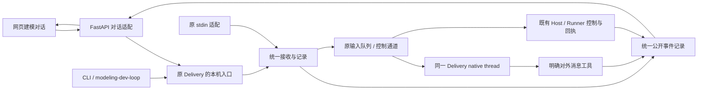

# R4.2-008 Delivery 建模对话与统一历史详细设计

## 1. 设计状态与边界

- 权威范围：[R4.2-008](../../requirements/requirements-v4.2.md#r42-008-delivery-建模对话与统一历史)。
  Q1—Q5 已由用户确认；2026-10-10 用户要求继续完成详细设计。本文件不授权开发或运行。
- 代码基线：`main@bd42416`，2026-10-10 静态核对；此前五 Tab 的功能 PASS 不覆盖对话。
- 本轮结果：详细设计完成，需求与设计一致性自查完成；尚未独立审阅、实现或功能验收，
  没有服务变更、真实模型调用或 semantic start。
- 复用 [R4.0-023](../../requirements/requirements-v4.0.md#r40-023-独立-delivery-agent-与统一用户交互)
  的 Delivery、Host 操作、授权及私有材料边界，复用
  [R4.3-005](../../requirements/requirements-v4.3.md#r43-005-delivery-按需唤醒与及时阶段推进)
  的按需唤醒。整个 Team 完成后原地待命和显式销毁归
  [R4.0-028](../../requirements/requirements-v4.0.md#r40-028-建模-team-原地待命与显式停止)，
  本文定义所需接入合同，不设计其完整 Runner 生命周期调整。

例如用户在网页补充“退货要冲减销售额”，宿主随后询问验收进度：两条输入由同一个
Delivery 接收，保存各自原文和来源，Delivery 的明确对外回复进入同一时间线。
页面能证明输入何时被接收、是否已投递，不能仅凭回复证明模型已经修改或验收通过。

首版只连接已有 Delivery 会话；真正离线时只读历史，需经原 Host 入口接续后再提问。
不增加网页启动、上传材料、离线代发、消息冲突仲裁或权限管理。

## 2. 现有入口与必要增量

| 当前入口 | 已有行为 | 本次增量／实际缺口 |
| --- | --- | --- |
| [delivery.py](../../../modeling_team/delivery.py) 的 `run_delivery`／`_run_delivery` | 每会话 supervisor 文件锁；stdin 队列；忙时 steer、空闲时 start；程序观察 | 为原进程增加本机消息入口、统一元数据与持久回执；stdin 共用该接收路径 |
| `DeliverySession.accept_user_input`／`emit_user_message` | 分别追加 user-input 与 public-messages；输入 source_reference | 新统一历史不从旧文件拼接；对外工具返回稳定 message_id，保存真实问题和答复关联 |
| [runtimes/delivery.py](../../../modeling_team/runtimes/delivery.py) | 同一 thread 的 turn/start、turn/steer、turn/interrupt；内部输出不公开 | RPC 错误须区分明确拒绝与结果未知；公开输出去重需取得原 tool-call 身份 |
| `apply_user_control` | 暂停、取消、撤回预算均撤回启动权限；控制不依赖模型理解 | 暂停改为临时门，继续不扩权；控制回执区分提交与实际生效 |
| `finish_delivery`／stdin EOF | 完成后退出并关闭 runtime；EOF 可退出监督 | 正常完成后的全 Team 待命由 028 实现；EOF 不再因浏览器／CLI 脱离而销毁在线消息服务 |
| [modeling_workbench.py](../../../backend/app/api/modeling_workbench.py) | 公开运行投影；访问需要管理员 | 只参考目录和投影方式，不复用其管理员守卫或公开隐藏题题干的接口 |
| [App.tsx](../../../frontend/src/App.tsx)／workspaceApi | 五 Tab、项目上下文、登录与 JSON／CSRF 请求 | 增加 conversation Tab、对话 DTO 和页面；原页面布局及项目选择规则沿用 |

不把 FastAPI 变成 Delivery 监督者，不通过网页请求创建 native runtime。读取历史只读文件，
查询在线状态只探测原 supervisor，不调用模型。保持一个会话一个 supervisor 的现有锁。

## 3. 实施决策主表

下面 D1—D7 沿用需求中的编号，将已确认复用方向具体化。技术细节按本轮设计授权采用，
主观把握均明确超过 85%；这不是用户逐项批准、统计概率或运行验证结果。
Q1—Q5 的用户决定仍以权威需求记录为准，不重新评分。

| 编号 | 具体方案与取舍 | 依据／来源 |
| --- | --- | --- |
| D1 | Host 显式绑定 project_id 与 Delivery 会话；目录枚举项目会话，一个会话关联多个 run，不按名称或最近 run 猜项目 | 沿用已确认项目会话方向；绑定字段按授权采用。当前 config／session 未固定项目身份 |
| D2 | 原 supervisor 提供 Unix socket 消息入口；网页后端和 CLI／宿主使用相同 envelope，stdin 作为适配器；不建第二运行链 | 沿用统一入口及 Q3；本机 socket 按授权采用。相比共享文件队列，可以即时确认原进程存活和接收结果，无新增数据库／worker |
| D3 | 原会话目录新增单一追加式 conversation-events.jsonl；supervisor 串行写入，后端只读并分页投影 | 沿用 D3 和 Q4；格式按授权采用。相比两份旧日志合并，顺序明确；相比新消息数据库，同机现阶段改动更小 |
| D4 | 客户端稳定 message_id、服务端 event_seq、UTC 时间、来源及入口；保存 dispatch 和 control 回执；问题关联真实对外消息 | 沿用 D4／Q3；回执细节按授权采用。超时未知不自动重放，不能声称端到端 exactly-once |
| D5 | 概览后新增建模对话 Tab；会话选择、状态、时间线、待答问题与输入；增量轮询，不用模型刷新进度 | 沿用页面方向；布局／轮询按授权采用，复用现有视觉和项目切换规则 |
| D6 | 独立 conversation 路由复用现有登录、read scope、项目绑定及 CSRF；消息 POST 不继承默认 model／workbench admin 门 | Q5 用户确认暂不细化权限；窄路由映射按授权采用，不创建权限种类或角色分级，现有权限缺口不在本轮解决 |
| D7 | 只接入已有会话；离线只读；临时暂停保留授权；完成后的全 Team 待命消费 028 实际状态 | Q1／Q2 和首版范围沿用用户确认；不以保留 Delivery 一个进程代替全 Team 待命 |

## 4. 责任及数据流



- FastAPI：校验 HTTP 结构及所选项目／会话，转发消息，读取公开记录，返回在线探测。
  不持有生产权限或直接调用 pause／stop_run，也不读取私有日志生成回答。
- supervisor：唯一逻辑写入者，分配顺序、持久接收、去重、排队、调用原 runtime 和 Host。
  socket 接收线程与主循环共用追加锁，不能各自计算序号。文件锁仍防止第二 supervisor。
- Delivery：解释业务输入、判断问题是否回答充分，通过明确对外工具发布内容；来源不能
  决定消息能力。原运行授权控制实际生产／验收／修复行为。
- Runner／Host：提供真实运行与控制回执；独立验收角色仍独立于证据生产。
- 浏览器：展示、提交、轮询；关闭、刷新、重连均不管理 Team 生命周期。

## 5. 项目绑定、接入与在线状态

### 5.1 项目绑定

在现有 Delivery config 和 session.json 增加 `project_id`，由 Host 的已选项目上下文
提供，启动／接续时核对项目存在，并与已有 run 的 `platform_binding.project_id` 及
readback_scope 一致。未有 run 的会话也可显式绑定；新增 run 后继续核对同一项目。
首次启用统一入口时固定该绑定，后续接续不能静默修改。跨项目交付不在本期范围。

旧会话没有绑定时，Host 可在明确接续配置中补充并核对，不通过名称、材料路径、mtime
或最近 run 自动推断。网页不要求用户填写 run ID；不展示未绑定会话，也不把它们移到
当前项目。项目会话枚举返回完整性，损坏的绑定记录明确报告“会话列表读取不完整”。

新增可选 `authorization_valid_until`，仅复制原授权中确实存在的截止时间，使用 UTC
RFC3339，并随会话保存；接续不延长。原授权没有截止日期时不伪造期限。原权限集合、
授权引用及已有额度记录继续生效，不建立新授权管理系统。

### 5.2 本机入口

在获得现有 supervisor 锁并启动原 native runtime 后，开放本机 Unix stream socket。
socket 固定使用 `$XDG_RUNTIME_DIR/ontology-delivery/<repo及会话摘要>.sock`，摘要取
SHA-256 前 32 位；无 XDG_RUNTIME_DIR 时使用系统临时目录下同 UID 的私有目录。
地址短且包含仓库／会话身份，避免原会话 ID 最长 128 字符导致 Unix socket 路径超限。
实际地址保存在原 session 描述中供本机客户端使用，不作为网页字段返回。
目录与 socket 沿用同机私有文件模式；HTTP 不接收用户指定 socket 地址或任意文件路径。

协议为一行一个 JSON 请求与响应，连接结束不结束 Delivery。只暴露 `ping` 与 `submit`；
历史由统一文件读取。`submit` 请求包含项目、delivery_session_id 和第 6 节 envelope；
响应包含相同消息 ID、接收事件序号及当前投递／控制状态。`ping` 返回绑定身份、
supervisor_instance_id、native 可用性、当前会话状态及更新时间。

同一原进程内部 stdin 输入也调用统一接收方法。在现有 `python -m modeling_team`
CLI 增加独立 `delivery-conversation send|status|history` 子入口，保留原
`delivery --config ... [--resume]` 启动入口不变；会话读取／发送必须显式传入 project_id
和 delivery_session_id。send 接收结构化消息文件或文本及来源参数，支持保留 message_id；
宿主技能用该客户端，不另写输入文件、直写 FIFO
或启动 Delivery。旧 stdin 文本用客户端适配生成 ID 和真实来源；只有明确保留同一 ID
的重试才具备跨连接去重，重复输入相同文本是两个新消息。

socket 接收线程负责完成结构校验、持久接收及排队后立即应答，不等待 LLM 回复。
runtime 和 Host 控制调用仍由原主循环执行，避免多线程并发读写 native RPC。
stdin EOF 仅表示该输入适配器断开；已开放统一入口时，不再独自触发监督退出。

### 5.3 在线与工作状态分开

| 字段 | 值及含义 |
| --- | --- |
| connection | online：ping 身份一致且原 native 可用；offline：当前无可用端点；unknown：探测超时或状态无法核实 |
| activity | active／pause_pending／paused／standby／stopping／stopped／interrupted；来自实际 supervisor／028 生命周期记录 |
| delivery_result | 当前公开交付结果和限制；独立于 connection 和 activity，不由 final 消息自动转换 |
| observed_at／basis | 状态观测时间及公开回执／状态事件引用；离线时只展示最后可核实值及其时点 |

不能仅凭 supervisor_pid、session 的旧 state 或“验收完成”文字宣称在线、全 Team 待命
或退出成功。ping 超时显示“连接状态未核实”，暂停输入并保留草稿；后端同样在投递前
再次核对端点，不依赖前端按钮状态。stopping 期间只核对已有消息／回执，不接收新普通输入。

## 6. 统一消息与公开历史合同

### 6.1 客户端 envelope

下面是结构示例，不是可直接提交运行的代码；示例 ID 无业务含义。

```json
{
  "message_id": "f1c48cf6-e0e3-4b12-8b3d-1834ac7d9385",
  "kind": "message",
  "text": "退货要冲减销售额。",
  "sender": {"kind": "user", "reference": "current-user"},
  "entrypoint": "web",
  "submitted_by": {"kind": "user", "reference": "current-user"},
  "reply_to_message_id": null,
  "source_reference": null
}
```

- message_id：客户端在首次发送前生成的 UUID，网络重试保持不变；作用域为一个会话。
- kind：`message`、`answer`、`control`；message 是主动输入，answer 必须引用本会话
  实际 `business_question`／`decision_request` 的 message_id。普通补充不伪造问题引用。
- control：额外 `action=pause|resume|cancel|revoke_budget|stop`。按钮和 Host 均可发；
  原 stdin 精确命令“暂停／继续／取消／撤回预算／停止”适配为对应结构化控制。
  普通业务句子中的这些词不由平台猜测为控制。
- text：保留原文，只用去空白结果判断是否为空，不修改原字符串。首版单条 UTF-8 内容
  上限 64 KiB，超限返回明确错误；不加入文件／富媒体或任意工具调用。
- sender.kind：user／host_agent／test_answerer；Delivery 输出为 delivery。entrypoint
  为 web／cli／modeling_dev_loop／stdin，submitted_by 描述实际递交方。
  Host 转交用户原话时 sender=user、submitted_by=host_agent，保存原 source_reference；
  Host 自行提问是 host_agent，测试代答仍是 test_answerer。
- 网页由现有 principal 填实际递交者、固定 entrypoint=web；不开放伪造来源的网页控件。
  可信 Host 客户端显式传入原始来源。此处为记录准确性，不形成能力分级或新身份认证。

Delivery 的 runtime 输入继续携带 authorization_reference 和既有 source_reference，
新增 message_id、来源、入口及问题引用；测试代答沿用 test-answerer 的业务输入合同，
不能转换为真实用户确认。两端相同消息类型具有相同能力，按接收顺序处理，不做冲突仲裁。

### 6.2 文件及事件

在 `workspaces/delivery-sessions/<id>/` 新增 `conversation-events.jsonl`，旧输入／输出／
私有日志保留原件。统一入口首次启用时写入 `history_started`，包含 schema_version=1、
project_id、delivery_session_id、history_started_at；后续接续不能重置起点或导入旧记录。
session.json 仅增加当前公开对话摘要；统一事件文件是消息和回执的事实源。

每个事件包含 `schema_version`、`event_seq`（从 1 单调递增）、`event_type`、
`recorded_at`（服务端 UTC）、project_id、delivery_session_id，以及相关 message_id。
典型事件：

| event_type | 内容及意义 |
| --- | --- |
| history_started | 新历史起点，说明旧记录未导入 |
| message_received | 原始 envelope、稳定 payload 摘要；该输入已持久接收 |
| dispatch_started | dispatch_attempt_id、native thread／turn 关联；调用前记录 |
| dispatch_result | accepted_by_native／rejected／unknown 与可操作原因；只证明 native 接收状态 |
| delivery_message | 明确对外 kind、text、message_id、reply_to_message_ids、question_delivery_id（若实际存在） |
| question_resolved | Delivery 明确确认哪些实际问题已解决；保留确认消息引用 |
| control_result | 控制 action、pending／effective／failed／unknown、实际 Host 请求及回执引用 |
| session_state | 公开状态及依据；不写入私有工具结果或完整运行配置 |

统一追加函数加锁分配序号并写一整行，flush／fsync 成功后才返回已接收／已发布。
GET 只读完整行，不把正在追加的末行当作历史事件。接续在现有独占锁内重建去重索引；
若崩溃留下不完整尾行，保留其原始字节为局部损坏证据，再截去无完整提交的尾部，记录
恢复事件后继续。中间损坏或序号断裂明确报告历史不完整，不猜消息、不丢原件、不宣布完整。
该处理只保护当前消息记录，不建设通用恢复平台。

消息时间线投影按 message_received／delivery_message 的 event_seq 排序；后续投递与
控制事件更新原消息卡片，不新增重复气泡。seq 是记录顺序，不代表并发动作实际完成顺序。
最新公开业务进展只引用 Delivery 的 status／final 及其时点；模型写入与验收结论需实际
公开回执依据，缺失则显示待核实。

### 6.3 对外回复与问题

扩展原 `emit_user_message`，保留 kind=status／business_question／decision_request／final
和 text，增加可选 reply_to_message_ids 与 resolved_question_ids；返回实际 message_id。
由 supervisor 分配该 ID，runtime 将 `(native_thread_id, tool-call 请求身份)` 交给记录层，
同一调用重送返回原 ID，不再追加。请求身份按原 native 协议获取，不按文本相同去重。
新 thread 的新工具调用是新消息。

问题的对话身份就是其实际 Delivery 输出 message_id；已有 question_delivery_id 原样
保留，不能用新 UUID 冒充上游业务问题 ID。回答进入队列时传真实引用及原问题内容，
Delivery 可以继续追问。问题收到答案后显示“答复已接收／已投递”，直到 Delivery 明确
resolved 才移出待答列表；收到输入不自动表示业务问题已解决。一个问题允许多次补充。

页面只读取上述明确公开字段；内部 transcript、推理、工具日志、隐藏验收材料／答案
不进入事件文件或 HTTP 投影。对外工具维持原公开材料边界，不能把原生报错／内部结果
直接转为对外消息；必要错误只返回公开 code、位置与下一步。旧日志不用于补齐历史。

## 7. 投递、重试与接续

1. 所有入口先校验 envelope；同 ID 重试先只读核对已接收记录，包括离线时。新消息才
   核对已在线的绑定 supervisor 和问题引用，不在离线时接受新输入。
2. 在统一锁内按 message_id 查已接收记录：相同内容返回原回执；同 ID 不同内容返回
   `message_identity_conflict`，原消息保持不变。摘要包括原文、kind、来源和问题／控制引用，
   不包括重试时间、连接身份或服务器生成字段。
3. 首次接收持久写 message_received，入原内存队列，返回接收序号；不等待模型。
   记录后、入队前崩溃的消息仍可从日志核对。
4. 原循环在调用前写 dispatch_started；忙时沿原 turn/steer，空闲时沿原 turn/start。
   成功确认后写 accepted_by_native；此状态不等于模型已回答、业务已落实或控制已生效。
5. 确认 stale expectedTurnId／未发出请求等明确未接收情况，记录 rejected 和原因，
   留队等待原 turn 结束，再用新 attempt 投递。现有 runtime 只给泛化异常，需补最小
   结构化结果，不能把所有 DeliveryRuntimeError 都当作可重发的 stale。
6. 超时、写出后连接断开、已写 dispatch_started 却缺结果等情况记 unknown；同 ID 重试
   仅查回执，不再发送。核对 native 可确认的回执和现有动作记录后才能继续；无法确认时
   保留未知，交给 Host／Delivery 说明并按原恢复规则处理，不把换 ID 当作自动重试。

每个接收记录只有一个当前投递状态，可有明确拒绝后的多次 attempt。GET 查询和 HTTP
重发不会增加 native 投递。追加失败不返回“已接收”；输出记录失败不返回“已发布”。
这解决重复提交和可核实投递，不承诺跨崩溃的模型副作用 exactly-once。

Host 显式接续既有会话时，已接收且从未 dispatch_started 的在线遗留消息可重新入队；
unknown 消息不能自动重放。公开对话可作为带状态的上下文读取，但必须标出未知投递
且禁止把它当待执行指令。原生接续保留现有授权／模型绑定检查，不把读取历史变成启动。
离线期间新消息直接拒绝，不保存离线队列；旧消息状态核对仍可只读执行。

## 8. 控制语义与生命周期接线

控制与普通输入共用身份和记录，实际控制由原 Host 通道完成，不等待模型把自然语言
转换为操作。接收线程先设置暂停／取消等启动门，原主循环优先执行控制并按需要 interrupt。
native RPC 仍只由原循环持有；控制已接收但尚到安全执行点时明确为 pending，不能宣称
实时生效。已发生原子写入按现有完整性规则完成或核对，不能为即时反馈破坏原子性。

每个目标的 Host request_id 由会话、message_id、action 与目标 ID 确定性生成，在调用前
写入 pending 控制事件，复用现有 Host 提交账本和 get_request_result。HTTP 重试查询同一
控制记录；缺少结果时先核对原 request_id，不重复生成控制动作。只有全部目标均有实际
生效依据才报告全会话 effective；部分失败或未知保留逐目标结果及准确限制。

| action | 原会话行为 | 对外生效依据 |
| --- | --- | --- |
| pause | 设置临时 paused 门，不删除 allowed_operations；禁止新生产／验收／修复及自动阶段推进；活跃 run 用 pause_run | 提交不等于生效，沿 get_request_result／运行状态核对；全会话暂停仍有未排空操作时为 pause_pending |
| resume | 只解除临时门，核对原授权有效期、未撤回权限及剩余实际额度；已暂停且仍活着的 run 用 resume_live_run | 原 run 恢复回执；终态 run 不假装同线程恢复，不因继续创建 fresh start |
| cancel | 沿既有取消通道停止当前获准工作并保留证据，撤回当前推进能力；不等于用户明确销毁全 Team | 各受控动作的真实终止／清理结果；普通继续不恢复被撤回权限 |
| revoke_budget | 保留既有预算撤回行为和证据核对，撤回对应启动能力 | 实际动作结果及撤回记录；继续不新增额度或恢复权限 |
| stop | 调用 028 的显式全 Team 停止／销毁通道；完成报告／结果认可不能代替此指令 | 所有关联成员／进程退出和必要清理证据，最后更新 stopped；不能只关闭 socket 就报成功 |

原评价／修复／本地 verification 子进程没有通用暂停接口：本期不能用 stop 冒充 pause，
也不新增 OS 冻结机制。暂停立即阻止后续阶段启动，正在执行的不可暂停操作完成当前安全
单元后不推进，期间显示 pause_pending、未暂停对象和依据；排空后显示 paused。其副作用
仍按既有原子性及实际读回规则核对。继续不会重置费用／额度或原截止时间。

Delivery 对话、公开读取与状态核对在 paused 时可用；临时门不能阻止纠正输入或必要恢复
核对。工具启动检查不能仅靠给模型一段暂停提示；取消／预算撤回的权限集合仍持久保存。
授权到期时允许解释状态，禁止继续启动原授权已到期的操作，返回准确限制，不自动续期。

### R4.0-028 接入要求与未交付依赖

本设计需要 028 提供以下可观察合同，精确适配到其后续拥有的现有接口，不要求另造框架：

- 工作全部结束后返回 `standby` 和实际 Team 存活／上下文保留依据，保留原 Delivery 入口；
  `finish_delivery` 不再自动关闭全会话。没有新输入时不持续调用模型。
- 用户或宿主的显式 stop 可关联统一 message_id，返回实际全 Team 停止／清理回执；
  原 supervisor 在最后回执落盘后关闭端点，历史继续可读。
- 与现有 S4 “停止源 writer”验收合同协调：独立验收、写入排空和材料隔离保留；
  不能用当前退出机制把全 Team 待命缩成只留下 Delivery。

028 尚未详细设计或实施。对话的项目绑定、历史、网页及普通消息通道可独立实施和验证；
完成后追问／显式全 Team stop 的端到端 A5 必须等该依赖交付并联测，不能用 mock 或页面
标签宣称通过。本文未替 028 决定 Runner 保活、writer 排空或独立验收锁的内部方案。

## 9. HTTP 与页面合同

路径相对于既有 `/api`，命名使用 `delivery_session_id`，避免现有安全层将 `session_id`
当作数据库 BuildSession 的归属键。新增 API 和 service 仅读取固定会话目录的公开文件，
校验安全会话 ID 和实际 project_id；后端客户端用标准库，不导入 native runtime／模型 SDK。

| 方法与路径 | 返回／行为 |
| --- | --- |
| GET /projects/{project_id}/delivery-conversations | items：绑定会话 ID、历史起点、最后更新时间、公开结果摘要；enumeration_complete 与读取问题；不默认猜唯一当前会话 |
| GET /projects/{project_id}/delivery-conversations/{delivery_session_id} | connection、activity、observed_at、basis、公开状态、history_started_at、pending_questions、latest_event_seq；探测不唤醒模型 |
| GET …/{delivery_session_id}/events?after_seq=0&limit=100 | 升序事件、next_after_seq、has_more、history_complete、读取错误；limit=1—200，基于最后完整事件 seq 续读 |
| POST …/{delivery_session_id}/messages | envelope；首次接收 HTTP 202，返回 message_id、received_seq、dispatch／control 状态；同 ID 同内容重试 HTTP 200 返回原记录，离线也可只读核对；新消息离线拒绝 |
| GET …/{delivery_session_id}/messages/{message_id} | 从公开事件聚合的输入及最新回执，离线可查；无记录 404，读取不完整时不能把“未找到”当作确认未接收 |

FastAPI `required_scope` 对上述 namespace 的 GET 与消息 POST 明确返回现有 read scope，
保留当前登录、CSRF、现有 principal 项目上下文和通用请求校验。路由核对项目存在及
session 绑定，不能调用 require_project 的管理员限制；不改变其他 POST／workbench 的
权限映射，不新增对话 scope、Grant、成员分级或权限 UI。Q5 延后的是权限治理设计，
不是绕过已有登录或建立新的管理员前置。原运行权限与额度由 supervisor／Host 检查。

明确错误：invalid_message／invalid_question_reference（422）、message_identity_conflict
（409）、conversation_not_found／message_not_found（404）、delivery_offline（409）、
delivery_status_unknown（503）、history_incomplete、message_receipt_unknown 和
conversation_write_failed。返回 code、对象与下一步；网络超时不等于失败未接收。
错误不能泄露文件绝对路径、credentials、内部 transcript 或隐藏验收内容。

### 页面组织与交互

- 导航顺序为“概览、建模对话、模型浏览、召回测试、成员权限、设置”，Tab key 为
  conversation。项目切换仍只在概览；本页显示当前项目名及 Delivery 会话选择器。
  无会话明确空态；多个会话不自动混合，记忆上次实际存在的选择，否则请用户选择。
- 顶部状态卡展示连接、工作状态、最近公开业务进展及其时点；保留运行／读回／独立
  验收证据区别。没有状态依据时显示未知，不由消息情绪、run 数或 final 自动判定 PASS。
- 主体时间线显示原文、sender 与递交入口、服务端时间、消息接收／投递／未知状态；
  系统控制回执在原卡片中更新。历史起点固定可见，标明更早记录未纳入。
- 待答问题卡可选一条实际问题，输入变为 answer 并显示引用；取消选择回到主动补充。
  多个问题各自保留；Delivery 明确解决后移出，已投递答案可继续补充。
- 输入为多行文本和发送按钮；Enter 换行、Ctrl／Cmd+Enter 发送。控制按钮分别为暂停、
  继续、取消工作、撤回预算、停止 Team，禁用／提示由实际状态决定，来源不影响能力。
  Stop 本身是明确指令，不额外设计逐级审批；显示停止处理中的真实回执。
- 在线且可接收时发送；离线仅展示接续提示、保留未发送草稿，不开离线代发。接口超时
  先按原 message_id 查询；确认同一 ID 可重发时复用 envelope，unknown 不换 ID 自动重放。
- 初次和“更早消息”通过 events 页读取，增量使用实际游标。页面可见时每 2 秒轮询
  新事件／状态，隐藏时暂停、恢复可见时立即补读；这只是程序读取，不触发模型。
  has_more 时继续现有分页，不能因一页结束宣称全历史完整。
- 按 project／delivery_session_id 重置状态，取消旧请求或忽略过期响应；关闭页面清除
  浏览器轮询，不停止 Delivery。样式沿用 panel、状态提示及现有中英文翻译，窄屏纵排。

## 10. 实施归属与顺序

此清单用于后续授权实施，当前不修改这些可执行文件或活跃提示。

| 范围 | 拟改位置与责任 |
| --- | --- |
| 消息记录／本机协议 | 新 modeling_team/delivery_conversation.py：事件追加、去重、投影、socket／客户端；不含模型调用、运行编排或语义裁判 |
| 原进程接线与控制 | modeling_team/delivery.py、modeling_team/runtimes/delivery.py：统一入口、原输入队列、回执、临时暂停和最小 RPC 分类；原 Host 操作优先复用 |
| CLI 接入 | modeling_team/__main__.py：增加 delivery-conversation 子入口，send／status／history 均不启动 runtime；原 delivery 启动／接续行为保留 |
| 后端适配 | 新 backend/app/api/delivery_conversations.py 与 services/delivery_conversations.py，api/routes.py 注册，security/http.py 窄 namespace scope 映射；同步 docs/reference/api.md 的实际接口章节 |
| 前端 | 新 frontend/src/pages/DeliveryConversationPage.tsx；App.tsx、workspaceApi.ts、workspaceTypes.ts、styles.css、i18n/translations.ts 和 i18n/zh.ts |
| 活跃合同同步 | modeling_team/agent-packages/delivery/instructions.md、modeling_team/skills/delivery/SKILL.md、skills/modeling-dev-loop/SKILL.md 中对应消息／控制段；不得把隐藏答案带入新入口 |
| 验证 | modeling_team/tests 的 Delivery 测试、backend/tests 对话 API 测试、frontend/tests 页面功能测试；028 生命周期验证由其拥有范围承担并在 A5 联测 |

实施先完成统一事件／ID 与接收入口，再接原 loop 的投递和临时控制，再提供 HTTP 与页面。
最后联调 028 待命／停止合同；普通收发开发不必前置全 Team 生命周期重写。接口、提示、
DTO 与测试使用同一状态词，避免后端回 accepted、页面显示“业务已处理”。

后续代码修改依仓库规则做影响检查、对应测试和重启健康；本轮文档不需要 GitNexus
符号分析、后端／前端套件或服务重启。不存在迁移旧对话数据或新建数据库表的步骤。

## 11. 验证交接与完成标准

下列是验收设计，尚未执行。开发测试、独立功能验收与真实业务语义验收分别记录；
本设计自查不构成独立设计审阅 PASS。

| 权威条款 | 必须覆盖的具体检查与证据 |
| --- | --- |
| A1 | 无会话、多个会话、单会话多 run、未绑定和损坏绑定；项目切换后不混消息，不把终态 run 隐藏整项会话 |
| A2 | 网页和真实 Host 客户端向同一在线进程提交；忙时实际 steer，空闲实际 start；统一事件及 native 接收回执一致，刷新不调用模型 |
| A3 | 多待答问题、真实引用、主动补充、同 ID 相同／不同 payload；stale 明确拒绝后重试、投递前／后崩溃、超时 unknown 不重放；模拟只能证明合同，实际通道需联测 |
| A4 | 暂停不改权限／额度／期限；活 run 暂停回执、不可暂停操作 pause_pending、继续原 thread；取消／预算撤回后继续不扩权；明确到期的授权不能启动新操作 |
| A5 | 依赖 028 的真实全 Team 完成后待命、追问、认可但未 stop、用户／Host 显式 stop；实际所有成员存活／退出及保留证据，不能只测 Delivery 或 mock |
| A6 | 真离线与 ping unknown、断线前后提交状态、关闭 stdin／网页、刷新／多窗口；无网页启动、离线队列或第二 supervisor，历史仍可读 |
| A7 | 两端各发送普通输入、回答及相同控制；来源／转交／测试代答显示准确，能力相同；不要求冲突仲裁 |
| A8 | 原旧文件哈希不变，启用后历史起点固定，接续不重置；多页读完、增量更新、切换会话、末行追加和损坏记录；不完整明确披露 |
| A9 | 对外消息正常显示；私有 transcript／工具／隐藏材料哨兵未进入事件或 HTTP；API 只读固定公开文件，无任意路径读取 |
| A10 | 现有登录和 read scope 可读并发送，消息 POST 无新增 model／admin 限定；原 CSRF 与项目绑定继续适用，不增权限分级或 Grant |

后续实施需执行 Team 相关回归（在 backend 下使用 `env -u DEEPSEEK_API_KEY PYTHONPATH=..`）、
后端 `uv run pytest`、前端 `npm run build` 和 `npx playwright test`，并按仓库要求重启
`ontology-platform.service`、核对后端／前端健康及受影响接口。文档检查不替代这些结果。

本轮文档检查包括本地链接／需求锚点、Markdown 围栏、JSON 示例解析、D1—D7／Q1—Q5
与 A1—A10 对应及 diff；检查通过仅证明设计文档可读且合同自洽。无待用户确认的业务选择，
028 接入细节待其设计交付后机械对齐；A5 依赖未交付及当前暂停实现缺口保持明确披露。
