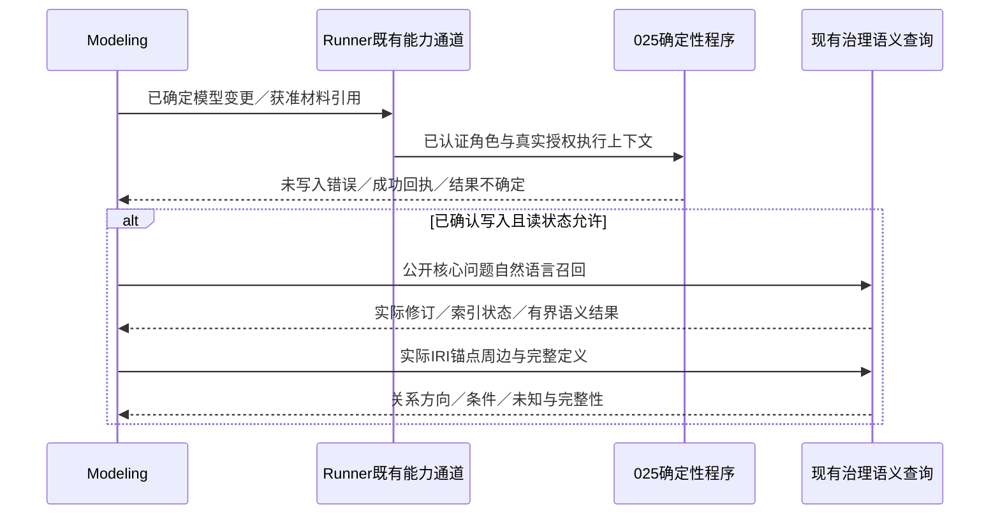

# R4.3-024 Modeling直接修改与即时语义自查设计

## 1. 范围与当前基线

权威条目：[R4.3-024](../../requirements/requirements-v4.3.md#r4-3-024)。用户本轮要求
细化、设计并通过独立验收；交付深度是独立设计验收，不实施代码／活跃提示，不调用
建模provider，不恢复生产或追加额度。D1—D7主记录在权威条目，不复制理由表。
代码基线：`e19aac58131e9b9d555f3381c623243d8af267fb`。开始时只有无关未跟踪
`docs/presentations/`与`slide-deck/`，本条不纳入。

024负责“谁实际提交、哪些旧入口退役、如何自查与交接”；[025](../../requirements/requirements-v4.3.md#r4-3-025)
负责“当前模型变更如何编译、填执行上下文、原子应用及返回错误／结果”。025仍待
细化／实施，这是已知工程依赖，不假定已有转换器可用；本设计的流程可实施方向确定，
025接口名称、准确JSON结构和转换规则需随其权威设计机械对齐。若025改变当前统一图
输入能力、结果状态或原子边界，应回到两条需求核对，不能用“机械对齐”改变业务决定。

具体例子：Modeling确定工单关联故障、需要保留源外键／非空声明和客户基数未知，直接
提交当前统一图候选／变更。成功后用公开问题召回相关定义，再以实际工单IRI展开入向／
出向关系并读取完整说明。发现模型没表达源声明则修模；hybrid降级为空不能直接判漏项。
不生成SQL映射，不用平台代码决定客户关系基数，也不导入工单业务行。

## 2. 查到的入口与真正缺口

| 文件／符号 | 当前事实 | 024后续接入／退役落点 |
| --- | --- | --- |
| `backend/app/api/schemas.py::ModelingBatchSubmit`、`api/modeling_batches.py::submit_modeling_batch` | 共享POST `/build-sessions/{session_id}/modeling-batches`的mode允许dry_run／apply_atomic／apply_partial | 新提交schema撤dry_run，apply路径和GET历史读取保留；不是删除整个共享路由 |
| `backend/app/mcp/tools/modeling_batches.py::submit_modeling_batch` | mode字符串默认apply_atomic，说明仍为Dry-run or apply | 同步工具schema／说明／服务拒绝，新调用不得执行dry_run |
| `backend/app/services/modeling_batches.py::submit` | 现有compile／findings后，apply_atomic遇blocking错误即validation_failed，不执行；已有原子执行与恢复 | 保留此请求内校验，删除新dry_run执行分支；不把_compile重命名为隐藏dry-run、不多提交Attempt |
| `modeling_team/runner.py::_handle_execute_approved_plans` | 名称虽是execute，内部仍查dry proof、必要时提交dry_run，再apply；lease由Agent参数传入 | 退掉内部双执行及dry_only；024新Modeling能力直接调用025，不能套壳此旧执行入口 |
| `runner.py::_handle_staged_submit_modeling_batch`、`staged_decisions.py::unified_dry_run_proof_issue` | apply依赖Coordinator翻译approval及Runner记录的同内容dry-run proof | 移除两种旧前置门；保留实际授权、语义范围、身份绑定、版本和未对账写入保护 |
| `capability_mcp.py`、`acceptance.py::call_capability` | 统一图提交／按计划执行／关联检查能力限定Protocol；Modeling仅有publish_staged_candidate | 扩展既有broker的固定Modeling能力集合、身份校验及dispatch；对直接路径禁用Protocol写入／翻译门，不只改工具标签 |
| `runtimes/codex.py`的工具集合、MCP配置与调用校验 | 普通Modeling没有语义读取；仅R2.3-003分支绑定MODELING_READ_TOOLS／read proxy | 给新直接路径实际配置读代理与025提交能力，工具目录、调用验证、baseline须一致 |
| `modeling_readonly.py::ModelingReadProxy` | 现有三个工具，绑定一个P/O；不接受expansion_strategy／context_order，旧上下文门绑定候选发布 | 复用授权转发／回执，支持本run实际获准Ontology集合及现行查询参数；不复用旧单O候选门阻止修模后读取 |
| `backend/app/mcp/tools/semantic.py::query_semantic_context`、`services/semantic_context_query.py` | 支持自然语言及query=绝对IRI锚点、full／compact／preview、分页、模型修订／索引与授权快照 | 原工具用于召回和核心节点周边，无新增业务路由／新预览图 |
| `protocol_mechanics.py::translate_candidate_to_batches`、统一图reference | 旧转换不覆盖当前统一图；统一图reference仍要求Protocol手写plan | 025交付转换器；024同步消费提示和移除手写要求，不以旧转换器作为依赖完成证据 |

这是文档设计，只做定向源码／调用检查，未作GitNexus图影响分析，不宣称图覆盖。
实现涉及Runner、broker及Runtime跨模块入口时，依AGENTS先做影响分析；图不可用时用
聚焦call-site检查，不能为文档设计前置重建索引或运行全套测试。

## 3. 直接提交与职责

### 3.1 最小接入合同

复用现有Runner私有capability broker；增加固定的Modeling“提交模型变更”能力，传递
已确定语义对象或R4.3-013已获准材料引用。暂用**逻辑能力名**描述，准确工具拼写／参数
由025接口设计确定，本文不是可执行工具schema。对本run获准Modeling身份认证后，
Runner调用025处理；MCP返回直接给Modeling，不需等Protocol消息转述。

Agent负责现有业务local identity、candidate revision／item等语义定位、已确定操作、
既有资源选择及未知。当前统一图的完整不可变候选继续为语义对象；更新／删除使用当前
已支持模型变更及真实资源绑定，不擅自给closed candidate添加patch／技术字段。程序
负责Session、lease、expected_model_revision、task_id、幂等身份、Batch／命令及回执
输出绑定；Agent无需重新抄写这些可知信息。程序不能根据local名称猜既有资源身份。
引用通道仍按原角色可读材料范围，不能读取Host全仓或隐藏验收答案。

复用现有session／lease服务、Runner scope和授权转发；025负责从这些真实上下文获取
执行字段。第一次提交前缺所需Session／lease时，沿已有资源创建／取得工具由程序完成
必要准备并反馈，不让Modeling手填；权限或必要业务拓扑未确定仍向Coordinator／Delivery
澄清。具体生命周期调用由025对齐既有入口，不新建Session框架。

### 3.2 角色与门

Modeling负责语义修改与自查；Coordinator负责范围、共享语义依赖、地图及公开阶段
协调；Delivery保留用户授权、资源生命周期监督、清理／异常处置和独立验收交接。
Protocol即使存在于选定Profile，也不拥有本路径必经转换、提交或读取转述；不为024
强行删除其他必要职责／Agent。新路径不能因没有Protocol消息或terminal结果卡住Modeling
提交、自查或production_handoff；原等待、terminal dependencies与receipt生成中相关
依赖一并删除／改用程序实际结果。只换Agent名称、授权标签不能算能力交付。

范围／拓扑／来源业务确认继续使用既有决定及沟通，语义对象应绑定获准范围；不得把
旧plan translation approvals挪成另一份逐命令审批。普通格式错误返回可恢复反馈，
不以角色数量、失败次数或审批往返成为run硬拒绝。实际新增范围／权限仍经原授权方。
025不可用时准确报告依赖缺口；不让Modeling兼任Protocol手写命令来绕过。

多Ontology按业务已确定依赖调用，**原子性是每次底层apply_atomic的Batch**。阶段1
成功、阶段2失败时，成功资源保持，回执和缺口清楚标示；不能谎称整候选全局回滚，
也不新增跨批事务。025决定确定性排序及技术批次，本条只消费真实阶段结果。

### 3.3 结果消费与修正

以下是**消费语义，不是新增返回字段schema**；025将映射现有结果／回执：

| 程序结果 | Modeling／Runner行为 |
| --- | --- |
| 明确未写入，原提交格式／引用错误 | 读取原item／字段错误，修正语义载体后提交；普通错误不终止run |
| 明确未写入，版本／租约冲突 | 程序刷新真实上下文；Modeling核对仍适用的原变更，按既有授权继续 |
| 权限／业务范围拒绝 | 不写入，不绕过scope；可继续获准部分，范围扩大请求原授权 |
| 已确认写入，检索就绪 | 信任绑定回执，使用实际身份与修订进入业务自查，无逐条机械重读 |
| 已确认写入，索引未就绪／失败 | 保留成功状态，按现有索引处理；可用词面／IRI时声明降级，只保留其有界结论 |
| 结果不确定／applying／recovering | 保留原身份，沿原Batch／Attempt／资源／恢复证据对账，不换幂等身份重放 |
| 多批部分完成 | 保留成功阶段，处理未写入阶段，交接显式缺口；不重跑全部候选 |

技术纠错与实质修模分开记录。自查后开始新的实质修模属于新建模轮次，即使同run；
依AGENTS／modeling-dev-loop登记消耗，不因直接提交工具而绕过额度。格式纠错、分批
落地或只读自查不重复扣轮次。无运行授权时只完成本设计，不以此消耗已有暂停额度。

## 4. dry-run退役矩阵与兼容性

| 面 | 后续目标与保留内容 |
| --- | --- |
| REST／MCP新模型Batch提交 | 从可执行mode中移除dry_run；REST非法mode返回422，MCP通过同一schema／服务反馈明确不支持；其他合法apply入口保留 |
| 服务直接调用／内部adapter | 进入ModelingBatchService.submit即明确拒绝新dry_run，无compile／write；保留apply内compile、权限／版本校验与原子执行 |
| Runner能力目录与dispatch | 不再公布模型dry_only或新dry_run提交选项；直接调用旧模型dry_run分支明确拒绝且不转发；退役隐藏双执行 |
| 成功证明与翻译审核 | 删除unified_dry_run_proof_issue及translation approval在新模型提交／交接中的前置依赖；成功证据用真实apply/Attempt／revision |
| 活跃Task／角色／Skill／reference | 同步“Protocol唯一调用者”“先dry-run后翻译审核”“readback gate”和related terminal依赖；不能把整份Protocol机械说明搬给Modeling |
| 历史Batch／Attempt／Finding／receipt／旧run | GET及离线解释保留原mode／finding；repository DB历史mode约束不删、不迁移成apply；checkpoint归档等读取仍可辨历史dry_run |
| 暂停旧run | 保留旧freeze／baseline／额度／事件，不原地热切提示；既有不确定apply只原身份对账／恢复。需要新路径时按原授权明确接续，不能自动semantic start |
| 其他dry-run／preview | api.schemas的semantic migration／projection等模式不退役；已应用模型context_detail=preview只是摘要，继续允许；不建候选预览图 |
| 历史测试／证据 | 历史断言与裁决保留原义；活跃目标测试改为新模型dry-run拒绝与无隐藏调用，旧专属fixture可离线验证历史读取，不能因此保留可调用执行分支 |

没有独立的模型dry-run REST路由可以整体删除：当前是共享POST的mode。未来实现可保留
内部历史解析函数，但它不得被新运行当成“开关可恢复”的live dry-run；恢复由用户另定。
apply_partial是已有外部模型Batch能力，本条不扩展／删除它，Modeling直接路径仅atomic，
不悄悄把原子提交失败改为部分应用。

## 5. 实际召回与节点自查

### 5.1 工具与范围

Modeling可用现有`get_modeling_context`、`get_ontology_read_model`、
`query_semantic_context`，通过已认证、项目范围限定的读取代理转发。三者不授予模型
管理或权限管理工具。扩大旧单O代理到**本run获准O集合**，仍显式scope_mode=ontologies；
不能用scope_mode=project自动扫描项目所有资源。所有scope及保护过滤由现有查询服务
按当前权限执行，不在外部代理复制语义授权裁判。更新代理可接受现行expansion_strategy、
context_order及必要分页参数，不继续拿落后的allowlist拒绝现有工具。

周边展开直接使用query=<绝对IRI>的现有锚点模式；full读必要定义，compact摘要适合
初看，preview不能替代条件／计算公式全文。IRI必须来自实际获准回执／召回，不编造。
相关度排序、自适应扩展继续沿017／018现有行为；不新建邻居API或业务专用排序。

R4.0-024最终关联自查需要完整受治理asserted图扫描与现有
`inspect_model_associations`确定性辅助：在现有程序读取／扫描入口消耗真实分页引用，
返回给Modeling进行业务处置，Coordinator核对；迁移原Protocol调用／转述依赖，不改
其判断算法和首项范围。需要完整扫描时由程序用既有semantic_sparql_query按获准图读取，
不为日常Modeling开放任意数据库／图操作。阶段自查不重复每批全范围关联扫描。

### 5.2 修订、索引与完整性

每个自查阶段保留实际各O model_revision与提交／查询引用。API现有查询快照／游标
绑定修订和索引，不新增第二套版本token。R4.0-027写入推进修订；修改后旧游标必须
按既有反馈重开查询。并行写入导致结果比该apply更新时，明确采用新的实际修订重新
检查，不能把后续状态冒称提交时状态；不永久锁run读取。

索引就绪由025回执及查询实际返回的index／recall／warnings表达。hybrid向量未就绪
可降级词面；IRI锚点可不依赖向量。只声明已经观察的内容，未完整命中不得判模型不存在
或覆盖完成。模型scope本身not_ready与索引降级分开：前者按现有状态恢复，后者可作
有界自查。索引处理只用已有机制，不新建自动重试框架、等待次数硬门或质量阈值。

Modeling结合获准公开问题进行自然语言召回，选择业务核心节点展开入向／出向及
必要依赖，核对：关系方向、条件／例外、计算口径与客户未知。分页、truncation、
权限限制、缺少范围或节点不能完全读到都保留局部结论／待查范围。读取全并不自动
证明源忠实；源缺口用023已有事实位置核对与业务澄清，不从库schema推导业务真相。

阶段检查与首链公开反馈沿015；Coordinator保留现有materialization_progress、freeze_id
和公开题选择；Delivery从真实checkpoint／状态触发反馈，不要求Protocol生产消息。
最终handoff沿原合同，从程序真实提交及治理读取引用生成，不要求旧dry-run证明／
Protocol terminal握手。不得把未应用候选或只观察局部写成全部完成。

## 6. 实施交接与验收分层

后续最小实施顺序（须另有开发授权）：

1. 025先形成／交付当前格式提交与结果合同，024接入消费；可并行准备退役测试，但
   不能在025不可用时宣称合法直接写入PASS。若联合实施，同一集成证据分别归属。
2. 后端Batch新提交schema／MCP／service退役dry_run；apply内compile保留，历史读取
   不变。共用REST／MCP及API文档必须同步，schema响应保留历史mode。
3. Runner／capability／acceptance broker接Modeling身份，retire原必经翻译、dry proof、
   staged execute双执行与terminal依赖；保留现有恢复与生命周期服务及资源记录。
4. Runtime实际MCP配置、工具白名单、身份认证与调用验证接新能力及获准读范围；
   当前Task／Profile、角色／Skill、表示与执行reference、AGENTS和宿主
   modeling-dev-loop说明一起对齐。保留023源事实／未知及CQ隔离，不扩充角色清单。
5. API／MCP文档、README当前流程及现有相关测试同步。当前frontend/src未检出模型
   dry_run调用；实现若发现实际调用者再最小对齐，不预设UI重做。

A1—A9以权威表为准。工程应复用`test_modeling_batches`系列、Team统一图／plan ref
capability／Runtime工具隔离测试、`test_r4024_model_check.py`、现有查询及modeling读代理
测试。需覆盖真实catalog与转发轨迹，纯提示关键词断言不能证明没有隐藏dry-run。
025错误定位／原子性测试本体归025，本条验证Modeling消费与同目标修正行为。

后端执行代码修改须按AGENTS跑backend全量pytest；Team变化从backend运行
`env -u DEEPSEEK_API_KEY PYTHONPATH=.. uv run pytest ../modeling_team/tests`；活跃Skill
运行已有validator。后端／前端或共享运行配置变更遵循服务重启及端点健康要求。
本轮只改文档，执行相关链接／锚点、表格／围栏、编号、diff和独立设计检查即可。

设计独立验收须完整读取当前权威条目、设计及必要代码，验证退役范围、角色真实接入、
025依赖边界、历史恢复、读权限／完整性及可实施性；只报告有证据的Critical／High和
关键未决假设。结果是设计PASS或REVISE，不是A1—A9的运行PASS。

工程调用轨迹、实际Modeling有界采用、真实自查质量、最终独立语义和同条件提速各自
记账。A8／A9必须另有真实运行授权；独立最终验收不参与生产证据生成或修复，隐藏题
和答案不可回流。达到设计PASS且文档检查通过即停止，不启动服务、模型调用或再添治理。

## 7. 本轮验收状态

需求／设计完成，D1—D7关闭；独立设计验收**Round 1 PASS，0 Critical／High、无未决
关键假设**。输入SHA256、Reviewer及源码核对依据见
[验收记录](../records/2026-10-15-r4-3-024-design-review-record.md)。
A1—A9均未执行；025尚未交付。PASS后仅同步状态与记录，不改变设计第1—6节、
需求F1—F6／D1—D7／A1—A9，不需要无新增问题的重复审阅。

文档检查通过：本地链接／锚点、围栏／表格、条款编号、源码路径、024修改归属及
`git diff --check`。没有活跃指令或代码变化，无产品测试／服务重启；机械检查不证明
实际角色调用、建模质量或真实效果。
