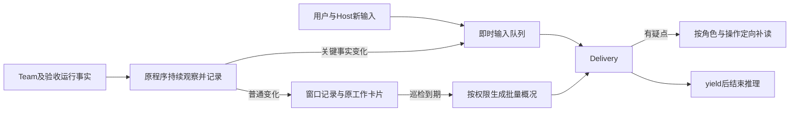

# R4.4-003 Delivery 关键事件即时处理与普通状态定期批量巡检设计

> 2026-10-22 用户更新：全部新输入及控制入队，目标当前原生 turn/activity 自然结束后
> 再投递，不在忙碌时 steer／interrupt。金额按回合边界近似控制，已开始回合的工具后续
> 和用量回执自然完成，允许并记录尾差；新回合仍沿原预算准入。此最新口径覆盖本文原
> 即时打断／逐请求截断的历史决策，不追加预算或自动恢复已有任务。权威范围见
> [R4.4-002／003](../../requirements/requirements-v4.4.md#r4-4-003)。

## 1. 范围与事实基线

- [权威需求及D1—D10决策主表](../../requirements/requirements-v4.4.md#r4-4-003)。
- 日期：2026-10-22；源码基线：`e4bcf4716ad84d54326461776a9f8cf7abacef4e`。
- 授权：登记需求、细化、设计及独立设计审阅。未授权本轮实现、收费模型调用、启动／
  恢复真实建模或独立语义验收。独立设计Round 1 PASS，0 Critical／0 High，无关键
  未决假设，见[审阅记录](../records/2026-10-22-r4-4-003-design-review-record.md)；工程与真实效果均未验证。
- 现有README、v4.3／v4.4验证补记、复盘台账、历史设计和演示材料存在未提交工作；
  本轮仅修改003需求、对应设计／审阅记录和文档导航，不接管相邻实现或改写原件。

例子：三分钟内两个生产角色更新多次卡片并自行纠正一次参数错误。程序保留原件，到期
把各角色最新工作、变化和重试结果一次交给Delivery。第40秒收到用户追加业务说明或
Host审核结果时，立即通过原输入通道送达；该结果不因“恰好也写在状态日志里”降为
普通变化。Delivery发现某角色同类失败仍未恢复，再只读该角色的请求和实际回执。

| 已有入口 | 已有事实与本次缺口 |
| --- | --- |
| `delivery.py::observe/_run_delivery` | 约2秒程序观察，busy时也观察；目前摘要变化即可入决策队列并send／steer，尚非窗口批量 |
| `_decision_events/_diagnostic_state` | 保留原件、诊断状态及已知噪声过滤；普通warning和部分工具完成仍可能推进事件链 |
| `record_observation/_model_observation/_page_view` | v2最小视图、冻结decision-view及分页已存在；需要区分普通记录与真正唤醒、增加窗口概况 |
| `work_board.py::WorkBoard.read/read_team_work_board` | 有current／history／version、record_seq、固定source_ref及权限分页；没有after_record_seq增量筛选 |
| `host_ops.py::get_team_work_board`及MCP入口 | Delivery调用强制`_projection=delivery`；可复用，不需新HTTP路由或另一份展台 |
| `sourced_packet/accept_user_input`、conversation及send／steer | 原文、来源、投递和控制已独立处理；必须保持即时优先，不并入巡检 |
| `yield_delivery`、native接收记录及阶段线程 | 已有等待、有效决定和可靠承接；缺“无新事实时下次复查”的显式时点 |
| `host_wait.py` | Host等待工具已有180秒兜底；仅供周期取值参考，不承接Delivery计时或生产控制 |

最新最小链本机保留原件
`workspaces/delivery-sessions/minimal-chain-20261022-codex-glm-low-3cny-001010/`及对应
Host目录用量快照记录85个决策包、29个仅events变化、三Delivery线程合计7,245,302 token，占已知托管
链64.90%。本轮定向读取的卡片原件只有5次更新（Modeling 4次、Coordinator 1次），
不能仅凭卡片判断所有角色是否推进。这些是必要性证据，不是本设计已实现的降幅。
GitNexus未收录当前关键Delivery方法，以上基线采用实际源码／调用点检查，不宣称图覆盖。

## 2. 方案与责任

选择“关键即时＋普通定时批量”，而不是继续仅扩充逐事件噪声名单，也不是把全部事件
延后。前者仍随事件数量增长；后者会延误业务答复、审核、阶段推进和授权控制。
不另建告警平台、跨进程调度器、诊断Agent或LLM摘要服务。

- 程序负责来源识别、控制、计时、序号窗口、字段投影／计数和送达，不判业务是否正确、
  不从自然语言猜测进展、不把报告完成自动当应用或验收PASS。
- Delivery读概况、判断疑点并通过现有工具推进；语义问题交原Coordinator／Modeling，
  代码／配置修复交Host；独立Consumer／Judge仍只读裁决，不参与修复被验收run。
- 原Team维持有意义变化时更新卡片的合同，不增加定时填卡、逐工具填卡或重复进度报告。

## 3. 即时通道

### 3.1 来源与事件映射

| 来源或事实 | 分类与处理 |
| --- | --- |
| 用户／Host经原conversation、stdin或原正式私有通道的新输入 | 全部即时，含普通补充、纠正和业务答复；不能因无状态变化／同文／消息短而忽略 |
| `host_action_result`、业务询问、CQ待审核技术绑定 | 即时交Delivery；私审结果仍只读`review_complete/selected_scope_complete/remaining_stage/receipts`等获准技术字段，不带审核正文 |
| 真实生产终态／交接依赖满足、验收报告或失败结果 | 改变当前下一动作时即时；按原request／operation及实际回执核验，自报／submitted不能冒充ready |
| 预算或用户控制、授权到期、未知写入／请求 | 程序先维持原保护，再即时提供事实；不等待周期或模型判定才关闭新消耗 |
| 原生失败、关键owner退出、不可读／损坏证据导致观察缺口、明确外部阻塞 | 首次及真实状态改变即时；恢复／复发重新送达，相同状态只记次数 |
| 普通卡片／内部请求进度、成功通知、心跳、同态警告、可自行纠正的失败／重试 | 进入窗口，不直接send／steer；最终未恢复或不能推进由原角色升级，定时巡检仍可主动发现 |
| 首次无法确认是否影响安全／流程的异常形状 | 有界即时诊断一次，保留来源与缺口；程序不猜为无害，也不把每条未知非异常日志都当关键事件 |

原角色`terminal_report_accepted`若是当前交接等待的依赖，就属于关键变化，即使没有
整个run的终态。`cq_production_pending`拒绝结束本次请求，继续等待原角色真实结清；
新就绪后用新请求ID重试，不靠重复查询未变状态探测ready。

去重沿用事件／请求身份和当前问题状态，不以日志位置、时间或重试计数变化制造新关键
事项。授权、控制epoch、未知写入、审核版本和结果绑定变化不能折叠。独立用户／Host
同文消息保留各自message_id；同一消息重投才按原送达／控制回执处理。

### 3.2 即时的可观察含义

“立即”指到达后在原程序下一可执行循环优先进入原生输入，不等待180秒、批次收集或
旧普通页排空，不承诺provider完成推理的固定秒数。程序原观察粒度约2秒，不为本条
放宽该粒度；同步Host调用、原生服务不可用及实际投递竞态如实记录延迟与原因。

- 空闲用send；busy用原生steer。同一活跃活动不新起并行Delivery线程，不中断在途
  写入。turn已完成的拒绝保留原packet，下一空闲send；unknown先按原账本对账。
- 用户控制先由`apply_user_control`及预算控制通路执行，优先于普通概况。预算暂停仍
  维持输入接收和程序通知；允许的有限控制调用沿原合同，不把任意业务消息当控制豁免。
  无法合法启动推理时保留原消息并准确回告限制，待同一预算的真实恢复后处理。
- 原生接收、模型turn完成、业务决定、请求消费和实际写入分别记事实。不能因进入即时
  队列就宣称已回答、已审核或已执行；停止／暂停是否生效仍读原真实控制回执。

## 4. 普通巡检的计时与输入

### 4.1 周期与忙闲

新增Host配置`status_review_interval_seconds`，缺省180，正整数。配置非法时返回具体
字段及可修正反馈，不默默退回逐事件唤醒或永久终止run。它控制Delivery普通巡检，
不改变2秒程序观察、预算监视、Host工具等待或各角色自己的工具timeout。

1. 首次bootstrap提供当前必要事实并设置下一到期；普通状态变化只更新当前事实及未交付
   窗口。巡检时钟不随普通更新重置。
2. 到期且idle，生成一次巡检概况；busy只置一个`review_due`，不把普通变化steer进活动。
   到可用时按最新固定来源前缀汇总，错过多个周期也只补一次，不等待事件流安静。
3. 默认到期查看一次，包括卡片无更新但工作未完的静默情况。若上一实际Delivery决定在
   yield设置`next_review_at`且没有新事实，可暂不推理；原程序继续检查。新卡片／事实
   的下一普通巡检、关键事件及授权／操作期限不受该延期影响。
4. 正式输入保持用户／Host即时优先；同一窗口不排多个普通概况。紧急决定可以显式附带
   当前小型概况，只有被覆盖并确认接收的范围才推进普通概况位置。
5. 恢复时若到期只安排一次最新检查，不逐个补发离线周期。原`work_result`和真实请求／
   资源已收口后停止普通定时推理；保留owner不是待完成工作，后续新输入仍走即时通道。

yield新增可选`next_review_at`（带时区时间），仅延期相同事实下的重复复查；无此值按
下一常规周期。过期值只触发一次复查，成功yield／当前原生turn结束后由新决定覆盖，
不能每2秒因同一时点反复唤醒。格式错误给出明确字段反馈；不新增独立时间调度服务。

### 4.2 模型收到的概况

在原`delivery-decision-input/v2`增加触发原因和有界`periodic_review`部分，仍使用原
core、unresolved、evidence、coverage及分页。下面为字段语义，不是已实现API：

| 字段／内容 | 必须表达的事实 |
| --- | --- |
| `trigger` | `initial/recovery/external_input/critical_event/periodic_review/followup_due`及对应原身份；不把全量fingerprint当触发原因 |
| `review_id/window` | session内稳定窗口身份、上次已确认概况位置、本次固定前缀上界及精确引用；时间仅展示，不单靠时间筛增量 |
| `roles` | 每角色最新获准卡片原文／缺卡、报告时间和序号；窗口变化字段、数量及关键等待／成果转换的原始短记录 |
| `activity/retries` | 可核实的最后活动／在途事实、按actor＋operation＋错误状态归组的次数、首次／末次及最新结果引用；缺计数则unknown |
| `pending/coverage` | 当前必要未决身份、窗口总量／返回量／未展开详情、观察缺口和精确续读入口，不混入全部历史回执集合 |

最新卡片与概况只是一层概览，不替代完整版本；例如窗口经历“失败→重试→恢复”，
不能只保留恢复后的最新卡而隐藏前面循环。程序只按真实字段筛选、计数和取原文，
不自动写业务结论、补造缺卡、用token增长表示有效进展或调用LLM再压缩一次。
主体沿现有约31.8KB直返／12KB页机制，超长时续读同一冻结视图；一般角色的全部中间
版本留引用，不能强迫Delivery为了继续等待读完整原始journal。

## 5. 增量、确认和恢复

### 5.1 窗口来源

在原工作卡history查询补可选`after_record_seq`（非负整数，仅history），语义为同run
中`record_seq > after_record_seq`且位于本次固定`source_ref`前缀内；`record_seq`
现有指定version语义不改。新参数进入原查询selection和cursor，跨run／viewer／selection
不混用，next_cursor继续原冻结上界；从上次上界到新上界读下一窗口。MCP／Host工具、
CLI、Delivery及接口文档在实现时同步，不新增read路由或历史表。

非卡片的活动、请求、关键结果和失败计数复用原run事件cursor与请求／operation账本。
窗口记录各来源的位置，不把work-board序号当全系统序号。序号／原件缺失或坏页明确
给覆盖缺口，保留旧位置并定向补查；不按“当前时间差不多”推进或伪造空窗口。

### 5.2 接收语义与优先级

沿原session journal新增小型巡检记录：当前窗口／来源上界、已确认概况位置、下一到期
与最新复查时点。未送普通变化可合并为最新概况，原始更新仍保留；已部分送达或unknown
输入保留身份和未确认范围，不改写旧输入，也不把原件全部标已读。

概况来源上界仅在该冻结概况必要页面连续送达且收到原生正常turn完成后确认；yield
成功或工具补读本身不足。模型已经收到“本窗口20次更新的概况”只证明概况接收，
不证明20份原文均读过、问题已关闭或动作已执行。失败／中断／unknown保持未确认，
恢复读最新真实状态及原接收记录，必要时有界重送，不盲重放Host写操作。

关键输入单独排队，不被普通页队头阻塞。已知未送普通页可等下次概况或随阶段承接，
旧页原身份保留；原生attempted／unknown须通过既有投递账本对账，不为关键优先伪造
旧确认或开第二个活动线程。实际用户／Host输入不能因该未知状态消失，处理限制明确。

阶段换线程承接原窗口位置、未决问题、当前控制和`next_review_at`；不新开生产run或
重置金额／任务起点。已确认的关键事件不在每次巡检重发，但结果变更／复发仍需处理。

### 5.3 新默认与历史恢复

实现后新启动Delivery默认采用本策略，配置仅调整周期，不新增长期逐事件／批量双模式。
已活跃进程不热替换，也不为了装载策略停止生产；用户另行授权的显式恢复才加载新实现。
旧journal无巡检位置时，先bootstrap当前事实并保留所有未确认关键输入；原已知未送普通
观察映射进首次批量概况，部分接收和unknown范围继续原对账，不能伪造“历史已消费”。
完整约束、预算和身份无法核实时先给准确缺口，安全工作可继续，不强迫fresh start。

## 6. 定位、权限与实现交接

巡检发现异常后，Delivery先检查相关卡片／等待／真实活动及错误摘要，再按角色、request、
operation及区间读取必要原文。例如卡片四分钟未变但provider调用仍在途，不直接催办；
同一操作连续同码失败、结果未变，可读首末请求差异和反馈，判断是否输入纠错、依赖等待
或需Host技术处理。不存在当前证据的循环／失活只记疑点，不自动修模、重启或扩大授权。

原`get_team_work_board`强制Delivery权限投影保持。CQ与独立验收私有正文不进入卡片
概况；Host审核结果只有原流程字段，详细权限不随即时通道扩大。金额阈值由原程序处理，
外部Host消耗单列不扣预算；源忠实、应用原子性、未知写入及独立验收不由卡片取代。

| 实施责任面 | 必要改动／验证焦点 |
| --- | --- |
| `modeling_team/delivery.py` | 分离记录与唤醒、关键分类、计时／窗口投影、yield复查时点、普通页与即时优先、journal恢复及完成静止；不另建Runner |
| `work_board.py`、`host_ops.py`、`host_ops_mcp.py`及`__main__.py::work-board` | after_record_seq与固定前缀增量，仍按原权限和分页；复用现有CLI调用点 |
| `runtimes/delivery.py`、`runtimes/dsh_delivery.py` | 优先复用原send／steer和正常完成确认；按两运行时实际接线验证，不为了同名合同重写adapter |
| Delivery实际`instructions.md`与`skills/delivery/SKILL.md` | 对齐周期查看、用户／Host优先、定向诊断／复查及按来源确认；删除相冲突的禁止周期查看表述，避免在两处继续追加重复补丁 |
| 既有事件／Host待办、预算与用量工具 | 原语义和来源保留；仅缺失必要类型／定位时补最窄字段，不增加消息总线、控制DSL或新统计主账 |
| `docs/reference`现有接口文档及Delivery指南 | 实现时按既有同步脚本更新实际参数与行为；设计阶段不提前宣传接口已可用 |

实施前对真实跨模块改动做GitNexus impact／detect_changes或明确的调用点替代检查。
最小交付可一次覆盖当前共用Delivery合同与两adapter的相关路径，不把无关前后端、
新管理界面或F4机械连续动作带入。只有实际代码影响应用服务时才依仓库规则重启，
本次文档设计没有服务重启或工程测试。

## 7. 验证与停止边界

权威验收为需求A1—A12。后续实施优先在现有Delivery、decision_input、wakeups、
token_reduction、phase_threads、paged_phase_handoff、work_board及两runtime测试中
加入真实反例；不建只匹配本轮输出的一次性语义验收器。

- 工程：模拟时钟／原生事件验证普通100次更新一个窗口、busy多周期合并、用户／Host
  同文不同ID、即时输入越过旧普通页、额度控制及恢复、静默／重复错误、分页追加／
  序号边界、旧session接续与真实完成后静止；失败和unknown均不伪造确认。
- 对应两种runtime验证模型真实活动结束后才确认、活跃时关键steer和普通不steer；
  保护现有授权、幂等、实际装载及应用／验收入口，范围按最终代码影响决定回归。
- 获准真实验证：复用最小链完整公开1题／隐藏3题与同样质量边界；分别统计程序观察、
  巡检／关键输入、原生响应、补读、卡片维护、Delivery及全链token、时间／延迟和Host
  介入。缺同条件对照只报告采用与结果，不声称纯因果降幅；不删难题、不换统计分母。
- 关键输入被延误／遗漏、异常无法发现或质量退步时按原证据修最窄责任面，保留失败／
  费用／输入原件；不用更多定期写卡、宿主轮询或额外角色掩盖Delivery成本转移。

本轮完成门：需求／设计一致、所有实质决策关闭、文档检查通过及独立设计审阅PASS。
设计PASS不表示A1—A12已执行；工程、真实降耗、完整任务10M及独立语义结果保持未验证。
不因设计形成自动进入实施或启动任何付费运行。
