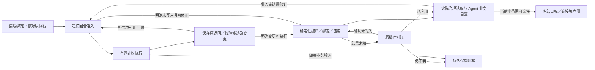

# v5 整体架构与 P1.1 最小建模流程设计

- 日期：2026-10-28；源码基线：`b4bc433`。
- 权威范围：[v5.0 需求](../../requirements/requirements-v5.0.md)，重点为 R5.0-001／002／004／006／007；阶段范围为[改造计划 P1.1](../implementation-plans/2026-10-28-v5-langgraph-codex-migration-plan.md#p1-1)。
- 方法依据：[语义工作空间与分层认知方法](2026-10-26-ontoweave-modeling-methodology-design.md) §3—4、§11、§17。
- 本轮授权：先完成整体架构搭建设计与独立审阅。**设计独立审阅 Round 1 PASS，0 Critical／0 High；P1.1 尚未实现、运行或验收。** 见[独立审阅记录](../records/2026-10-28-v5-p1-1-architecture-design-review.md)。
- P0 的 47 项开发测试、主要真实集成及小目标 6/6 仅按[原记录](../test-docs/2026-10-28-v5-codex-p0-validation.md)复用；完整计量仍为 PARTIAL，不因本设计升级。

## 1. 设计结论与交付范围

例如，一份获准材料描述设备安装和验收之间的业务条件。建模 Agent 读取材料，形成候选图和明确变更意图；程序在获准资源内应用；Agent 通过平台实际查询核对；独立评价侧使用事先冻结的依据与题集读取同一实际模型。中途暂停时保存已形成的候选，应用回执丢失时先查原操作，而不是重新建一份模型。

采用一个独立 v5 Python 包、一张有界工作单元执行图、一个窄 Host 桥以及现有语义平台。LangGraph 管理执行位置，Codex 负责有界推理，PostgreSQL 保存可定位工作内容与引用，平台负责实际模型，独立侧负责语义裁决。机械推进不经过常驻 Delivery LLM。

整体架构说明 P1.2—P4 的承接位置；**本次实施设计只细化 P1.1**：

| P1.1 必须交付 | 后续阶段负责 |
| --- | --- |
| 显式 v5 入口、锁定配置、一个有界工作单元、真实建模／应用／治理读回／独立评价 | P1.2 项目级共享内容、发现查询及跨会话业务记忆消费 |
| 最小来源、工作、候选、执行、应用与交接引用持久化 | P1.3 动态 HITL 的呈现、答复适用性、主动纠正及完整等待接续 |
| 回合准入、基础暂停／停止、可纠正产物错误、未知写入对账 | P1.4 完整 S0—S5／S7、C1／Q／R 的方法采用与反例收口 |
| 同范围的冻结目标、独立只读评价与真实身份绑定 | P1.5 联合持久接续、授权模式和计量集成；P2 并行递归；P3 增量／总览；P4 默认切换 |

业务缺失时必须记录准确的待输入范围；不能为了跑完小链填入默认业务含义。P1.1 可以持久停在 `waiting_input`，不将它称为已经实现动态 HITL。后续接入请求／答复节点，不重新定义候选、平台操作或执行身份。

## 2. 已核对的实现基线与缺口

| 实际入口 | 可复用能力 | P1.1 必要增量 |
| --- | --- | --- |
| [v5 独立包](../../../modeling_team/v5/pyproject.toml)、[CodexAgent](../../../modeling_team/v5/src/ontoweave_modeling/codex_agent.py) | 锁定依赖、namespace 隔离、显式模型绑定、MCP 工具白名单、自然工具回合及事件 | 将探针配置改为任务绑定输入；执行登记、查询原 turn、最终返回持久化与恢复分流 |
| [结果校验](../../../modeling_team/v5/src/ontoweave_modeling/results.py) | 自然 JSON／单 JSON 块解析、程序 schema 校验、评价索引与修订核对 | 通用建模结果、工作单元／来源绑定和多 Ontology 修订映射；保持格式错误可纠正 |
| [WorkspaceRepository](../../../modeling_team/v5/src/ontoweave_modeling/workspace.py) | `task_ref` 隔离、版本读写、冲突反馈、操作回执、PostgreSQL checkpointer | 最小记录合同、Host-only 执行记录、工作空间与 checkpoint 分 schema；不提前开发项目搜索 |
| [TaskControl](../../../modeling_team/v5/src/ontoweave_modeling/control.py) | 输入队列、原生回合准入、自然结束后控制生效 | CLI 与执行登记连接；调度前检查待生效控制，故障时不误清 active／消费确认 |
| [材料及读取 MCP](../../../modeling_team/v5/src/ontoweave_modeling/material_tools.py) | manifest 范围／哈希、分页、固定范围治理读取及冻结修订核对 | 读取配置投影、真实读取回执；不向生产开放隐藏评价材料 |
| [P0 Host 接入](../../../modeling_team/v5/scripts/host_support.py)、[平台探针](../../../modeling_team/v5/scripts/platform_case.py)、[故障探针](../../../modeling_team/v5/scripts/platform_graph_case.py) | 真实 provider 路由、确定性应用、生命周期与故障对账实证 | 迁出 P0 固定任务／授权／模型常量和场景专用 `concepts/relationships` 转换，成为生产桥调用 |
| [确定性编译](../../../modeling_team/direct_modeling.py)、[依赖绑定](../../../modeling_team/direct_binding.py)、[执行器](../../../modeling_team/direct_execution.py) | 通用候选及明确变更、跨批绑定、持久提交意图／回执、租约／会话与实际资源身份 | 以受控 Host 上下文调用；保留原分批及原操作身份，不重写编译器和幂等机制 |
| [独立评价探针](../../../modeling_team/v5/scripts/acceptance_case.py) | 独立上下文、只读权限、冻结目标、必需读取与报告绑定 | 独立生产入口与评价入口、通用冻结包和公开反馈投影；不照搬固定 6 题裁决器 |

本地独立环境锁定 `langgraph==1.2.18`、`langgraph-checkpoint-postgres==3.2.0`、`openai-codex==0.163.0`、`psycopg==3.3.6`；P0 的运行 Python 为 3.12，包声明仍为 `>=3.11`，不能据此声称全部 Python 版本通过。SDK 绑定 CLI 0.163.0，不与全局 CLI 0.165.0 混用。

`modeling_team/__init__.py` 当前立即导入 `TeamRunner`；`platform_case.py` 还从旧 `__main__` 导入 `_bootstrap_helpers`。因此“只导入一个旧模块”并不等于新路径已经脱离旧 Runner。P1.1 采用 §4 的窄拆分，不能把整个旧 Runner 放进一个图节点。

本轮为文档设计，使用已知文件及调用点核对，没有修改代码；不声称完成 GitNexus 图影响覆盖。实施涉及公共导出或跨模块调用前，按仓库要求补影响分析。

## 3. 整体责任与数据流

```mermaid
flowchart TB
    U[用户／Host 的结构化任务与控制] --> C[v5 CLI 与程序应用层]
    C --> G[LangGraph 有界工作单元图]
    G --> A[CodexAgent：材料理解与语义判断]
    A --> M[获准材料与治理读取 MCP]
    A -->|自然回合结果| G
    G --> W[PostgreSQL：版本化内容与 Host 执行引用]
    G --> K[独立 schema：LangGraph checkpoint]
    G --> B[Host 桥：编译、绑定、应用、对账、资源收尾]
    B --> P[现有 FastAPI／MCP 与实际语义模型]
    P --> M
    G --> F[冻结实际目标／公开交接引用]
    F --> E[独立入口：独立依据、上下文与只读工具]
    P --> E
    E --> H[独立私有报告]
    H -->|获准公开投影| C
    C -. P1.3 直接请求／答复 .-> Q[HITL 业务记录及独立等待节点]
    Q -. 原单元接续 .-> G
    W -. P1.2 查询／P3 总览 .-> V[按权限的内容定位与派生视图]
```

实线为 P1.1 的数据流；虚线标明后续落点，不代表本期实现。评价从独立入口运行，生产图只输出交接并接收允许公开的反馈；不在生产节点中运行评价推理，也不让独立侧恢复或修复生产图。

| 层 | 责任及允许依赖 |
| --- | --- |
| CLI／应用层 | 装载当次授权、任务配置和准确引用；推进、状态、控制、接续及资源收尾；调用图和窄服务 |
| 工作单元图 | 确定性路由、执行位置、依赖等待与结果引用；调用 Agent、仓储、Host 桥，不判断业务等价性或自动编造拓扑 |
| Codex 执行 | 一个明确目标及获准工具；返回候选、未知、缺口或业务自查；不管理项目调度与预算主账 |
| 内容仓储 | 版本化来源、工作、候选及结果引用；机械执行记录仅 Host 可写；不维护第二份可编辑的已应用本体 |
| Host 桥 | 隐藏高权限凭据和既有运行依赖，调用已验收的 provider、编译／应用／对账及生命周期能力；不作语义翻译 |
| 平台 | 授权、真实资源、原子应用边界与受治理查询；不因小场景增加领域专属 API |
| 独立评价 | 自己的冻结依据、上下文及只读目标，作独立语义裁决；只公开获准结论 |

不新增微服务部署、调度后台、通用 workflow DSL、事件总线、存储插件或备用 Agent 框架。需要增长时，在对应业务合同已出现后扩展现有模块。

## 4. 最小模块布局与旧依赖处理

以下是实施目标路径，尚未存在的文件不作为已交付链接：

```text
modeling_team/v5/src/ontoweave_modeling/
  __main__.py / cli.py     显式入口、状态与基础控制
  contracts.py            任务绑定、工作结果、引用与错误合同
  flow.py                 一个工作单元的 LangGraph 节点和路由
  execution.py            原生执行登记、结果复用与故障核对
  codex_agent.py          复用现有 SDK 接入，不加入业务调度
  workspace.py            复用版本仓储，checkpointer 可指定独立 schema
  control.py              复用自然回合控制
  material_tools.py       获准原文与实际治理读取
  results.py              程序结构校验
  host_bridge.py          调用固定 Host worker，收发窄 JSON 合同
  acceptance.py           独立交接与报告合同；独立命令执行
modeling_team/v5/host/
  worker.py               backend 环境执行的 Host-only 桥
modeling_team/
  platform_bootstrap.py   从旧 __main__ 提取现有本机凭据创建／撤销帮助函数
```

文件划分按已有职责演进；短小合同可以放在已有模块中，不要求为凑目录先建空层。`execution.py` 只解决已发生的 graph 重入与 native turn 身份问题，不建设通用恢复框架。

Host worker 使用现有 backend Python 环境，v5 核心继续使用自己的锁定环境：

1. `host_bridge` 通过固定解释器和固定 worker 路径启动 Host 子进程，以结构化 JSON 收发已知操作。调用包括作用域准备、编译／应用或对账、会话收尾、只读凭据准备及撤销；不接收任意 Python、shell、工具名或任意文件路径。
2. provider 沿已有 `ResponsesProviderSession` 启动本地代理；worker 的 provider 模式保活该代理，返回临时本地地址，退出时收尾。P0 的固定 GLM 校验改为当次 Profile 中精确的 provider／model／effort，不静默回退。只支持已核对路由，不建设 provider 插件。
3. 平台调用仍用 `compile_model_changes` → `execute_bound_model_changes` → `DirectModelExecutor`，及既有 canonical MCP forwarder／`PlatformScope`；v5 核心不导入旧 Runner、Delivery 或旧 CLI。worker 不调用 `TeamRunner`。
4. 将 `_bootstrap_helpers` 原逻辑提取到小模块，旧 CLI 改为转调。包根导出改为保持现有公开名称的惰性导出，避免导入机械模块时加载 Runner。只做这两处必要解耦，不搬迁整个旧包或复制编译器；实施须验证旧 `from modeling_team import TeamRunner` 及 CLI 合同。
5. Host 凭据不进入 prompt／返回文本；原生工具继续关闭 shell、任意文件读取、网络和未授权 Skills。材料 MCP 只挂获准 manifest。治理读取工具只获得对应角色的 scoped read 配置，不获得应用／admin 凭据；P1.1 不给生产 Agent 直连 PostgreSQL 的配置，工作内容由程序保存。

该进程边界复用 P0 已验证的“双环境＋Host 侧平台调用”，将探针改为可复用入口；它不是新的远程服务。旧模块位置暂时保留不等于保留旧编排依赖；未来退役在 P4 按实际调用清单处理。

## 5. 输入、身份及最小持久记录

### 5.1 任务绑定

每个 v5 任务保存不可变的启动绑定：`schema_version`、`workflow_version`、`task_ref`、`run_id`、获准业务 `scope_ref`／目标、材料 manifest 与内容摘要、Profile／角色包摘要、provider／model／effort、授权引用及实际资源归属。重试／接续读取原绑定，不重新推断默认值。稳定 `budget_ref` 与任务关联；本任务的 `usage_only` 沿原明确授权记录，历史预算不删除。

P1.1 只开放本次获准 `usage_only` 任务的显式 v5 入口。正常金额／次数任务保留原入口和原门，直到对应授权适配及计量在 P1.5／P4 验证；新入口遇到尚未接入的授权模式返回可定位的能力未交付说明，不自动改成 `usage_only`、创建预算或借新 run 清零。每次真实运行仍须有适用的材料、模型、资源和独立评价授权。

### 5.2 身份和权威

| 身份／内容 | 归属及保存规则 |
| --- | --- |
| `task_ref`／授权／`budget_ref` | 跨同任务 run 稳定；由 Host 绑定，不由 Agent 返回更改 |
| `work_unit_id` | 业务目标身份；P1.1 一个有界单元，不等于 Ontology 或原生会话 |
| `run_id`／LangGraph `thread_id`／`workflow_version` | 绑定本次执行图；恢复沿原 thread，不能用新 thread 伪装原 checkpoint 接续 |
| `execution_id` | 一次有界 Agent 调用身份；登记目的、角色、输入版本、原生 thread／turn、状态、原返回引用及用量引用 |
| 来源／候选 `object_id + revision + digest` | 在工作空间保存精确版本；Agent 源定位与程序 manifest 对照；不靠名称匹配版本 |
| 平台 `operation_ref` | 在调用前绑定候选版本、变更摘要、可信 scope、冻结分批及 executor 目录；引用原 Session／Batch／Attempt／幂等键／资源回执 |
| `handoff_id`／`evaluation_id` | 绑定准确 scope、模型修订映射、来源和冻结题集版本、读取条件及时点；报告只由独立侧写入 |

同一 work 可有多个执行、候选和操作；业务修订产生新版本，技术重试不随意生成新的效果身份。候选的 `candidate_id/revision` 与工作空间引用一并保存，不混同数据库记录 revision。新修模轮次与 semantic-start 按原授权口径如实记录，不由 graph 节点次数代替。

### 5.3 存储增量

继续使用 `WorkspaceRepository` 的 `business_objects`／`business_versions` 和乐观版本反馈，不新增通用对象数据库。P1.1 记录以下最小内容：

- 获准来源 manifest／定位引用、业务目标与工作状态；原文保持不可变材料修订，不复制全项目历史。
- 候选及明确变更意图、所基于来源／实际模型版本、待输入项／未交付范围。
- Host-only 执行绑定、控制记录、操作与原回执的索引、自查结果、交接及独立公开结论引用。

技术记录与候选业务内容用明确 `kind` 和 Host 写入入口区分；生产 MCP 不开放控制、执行、平台回执或独立报告写权限。P1.2 再补通用命题／决定／定义对象、项目与获准任务绑定及发现查询，不把扫描其他 `task_ref` 当项目共享。

业务内容使用 `ontoweave_v5_workspace` schema；checkpointer 使用 `ontoweave_v5_checkpoints` schema。两者可在同一 PostgreSQL，分别建表并设置 search path。checkpoint 只保存版本与记录引用、下一活动和阻塞信息，不保存整份聊天／来源／候选。原生事件、原返回及 executor 原意图／回执保存在 Host 自有、gitignored 的 run 目录，数据库保存不可变引用及摘要；索引落后时回读原件和平台修复索引，不以索引覆盖原回执。

来源、候选、工作状态、实际应用、自查和独立验收分别保存；`execution completed`、`apply completed`、`self_check pass` 均不能自动写成 `semantic_acceptance PASS`。业务记录、checkpoint、原生执行及 RDF 不构成全局事务。

### 5.4 Agent 输入与返回

程序提供当前有界目标、材料身份／版本、必要基线与约束、获准工具、角色方法和明确结果合同。模型配置从任务绑定读回并与实际配置核对。生产不继承宿主完整仓库、全局记忆或独立评价聊天。

建模返回包含：本次执行结果 `proposed | waiting_input | recoverable_issue`、来源引用、候选／明确变更、未知或准确缺口、所基于版本、必要理由及已消费输入 ID。`proposed` 采用已有 `r3-0-009-unified-graph/v2` 候选和 `r4-3-025-model-changes/v1` 变更合同，不新建 `concepts/relationships` 场景专用简化模型；仅用 fields 的合法定义变更按现有编译器处理，不强制伪造空候选。

自然回合结束后，程序调用现有 `decode_json_result` 和通用合同验证。格式、字段、引用、候选与编译错误给出路径和可操作反馈，原返回保留，再经下一回合准入纠正。模型未返回消费确认不能被程序猜为 consumed。原生 `outputSchema` 保持关闭，不重走 P0 已失败路径。

## 6. P1.1 执行图、控制与恢复

### 6.1 正常路径及精确退回



自查的推理也经回合准入，带真实治理读取工具及实际模型引用；不把程序一次 HTTP 200 当业务自查。生产 Agent 可核对必要来源，答案必须由实际模型读取支撑；查询分页／范围不完整时保留准确缺口，不以候选笔记补答案。

需要修订时保留旧候选和原应用，依据实际资源绑定形成新候选／明确变更，不能把已应用 create 原样当新建。正常模型传输重试由 harness 承担，图不对同一错误叠加整段自动重试；格式纠正是新有界回合，必须再次准入。没有固定“三次失败即永久终止”的运行守卫。平台写入沿原 executor 对账；读回缺口先区分捕获、理解、表达和检索层。

### 6.2 基础控制

CLI 目标命令为 `start`、`status`、`pause`、`stop`、`resume`、`evaluate`、`cleanup`；具体参数围绕任务／run 引用，不产生平行任务体系。状态读取不调用模型。

所有控制先登记稳定消息身份；**每次调度新原生回合前主动检查待生效控制**，不能因上一成员尚未结束而允许其他新成员开始。`TaskControl.begin_turn/finish_turn` 沿原逻辑接入；对输入仅在模型明确返回匹配消费 ID 后标记 consumed。P1.1 不开放尚未实现的动态澄清答复消费，待输入仅可查，P1.3 再接入完整请求／答复。

暂停／停止不对 busy Codex 调用 steer／interrupt；当前 turn 内的工具、重试、压缩和已获准应用自然完成。候选返回后若控制要求停稳，尚未开始的程序应用保存为待执行；已经发出的平台操作必须收集回执或进入对账。所有在途 Agent／平台操作可核对停稳后才报告 settled；异常断链保留 unknown，不能在 `finally` 中伪造自然完成或清空 active。

`stop` 停止继续调度并完成必要对账／资源收尾；`resume` 用于获准暂停的原执行，不能把 stop 静默变回 running。若需继续已停止目标，显式检查原授权与待办并创建新的执行绑定，保留原任务／预算／应用身份。

### 6.3 重入的最小安全规则

| 实际窗口 | 恢复处理 |
| --- | --- |
| 执行登记后、原生 turn 尚未确认启动 | 查原进程／原生 thread 与事件；能证实未启动才开始，身份不明时等待核对 |
| 原生 turn 运行中或启动响应丢失 | 查询原绑定、原 app-server／进程和持久历史；仍运行则连接或等待，不因节点重入另起同目标 turn |
| 原生已完成、graph checkpoint 未写入 | 从原事件／原返回恢复结果并校验，登记结果引用；不再次推理或应用 |
| 业务内容已保存、checkpoint 较旧 | 读精确历史及当前版本，冲突重读／语义合并；不将 checkpoint 中旧正文倒写业务内容 |
| 应用成功、响应或 checkpoint 丢失 | 用原 scope、executor 目录、冻结分批与操作身份读 Batch／Attempt／实际资源；复用成功回执 |
| 明确未写入／部分成功 | 保留成功项和原失败结果；明确未写入可按原合同重试，需改意图则形成新修订，不改变分批重带已成功项 |
| 读取不到平台／结果仍未知 | 保留 `uncertain` 与第一阻塞层，仅等待相关资源核对；不能按超时断言未写入 |
| 自查完成／冻结交接后重入 | 复用绑定仍适用的自查及交接；模型修订变化则保留原结论，转为待重读／重新交接 |

执行登记与最终返回必须先于相应节点完成落盘，数据库索引可据原记录补齐。原生历史缺少可靠完成证明时保留 `reconciliation_required`，不承诺所有断链都能自动无损接续。P1.1 验证本链新增窗口；完整联合重建仍在 P1.5，不把“后续才验收恢复”当重复副作用的许可。

已核对锁定 SDK 的 `thread_read(thread_id, include_turns=...)` 与 `thread_resume` 可用；[OpenAI 官方 app-server 文档](https://learn.chatgpt.com/docs/app-server)区分读取和恢复。在线文档随版本变化，恢复实现以锁定 SDK／CLI 字段和实际运行证据为准，不直接依赖最新分页接口。

LangGraph checkpoint 不能保证外部副作用恰好一次；本方案依靠原 native 执行记录和现有平台幂等／对账。后续 HITL 独立等待节点只读取已持久请求；[LangGraph 官方说明](https://docs.langchain.com/oss/python/langgraph/interrupts)明确恢复会重入等待节点，故不能在该节点前部重新启动 Agent 或应用。[持久化职责说明](https://docs.langchain.com/oss/python/langgraph/persistence)用于解释边界，本期仍复用已有仓储，不另建 Store。

## 7. 独立交接、权限与资源收尾

### 7.1 两次冻结及评价入口

1. **生产前冻结评价依据。** 独立侧依据获准业务范围与原材料准备题集，保存版本和摘要；生产只获得公开范围，不获得题目、答案或私有诊断。复用既有冻结方法，不引入新的固定审批。
2. **自查后冻结实际目标。** 记录项目／Ontology 身份及每个模型修订、源修订、范围、治理读取条件与时点、独立题集引用。存在未知写入或未交付范围时准确保留，不能产生完整 PASS 交接。
3. **独立入口只读评价。** `evaluate` 使用自己的材料 manifest、原生上下文及 scoped read 凭据；没有生产 workspace 写入、应用工具、生产原生 thread 或生产图恢复入口。生产可以调用公开交接命令，但不能替独立侧生成裁决。
4. **报告绑定与公开。** 程序检查题集覆盖／唯一索引、准确模型修订映射、必需来源与实际成功读取、范围及报告一致性；实际语义由独立侧判断。只发生工具调用或返回错误不计为成功读取。目标变化返回 `frozen_target_changed`，保留旧报告并另行交接，不在评价中修模。

公开反馈只包含获准 verdict、范围、目标引用、缺口定位及允许公开的说明；隐藏题、答案、私有推理不流入工作空间或日志投影。已有基准若对研发可见，如实称已知基准回归，独立执行不使它成为盲测。

### 7.2 资源与失败边界

scope 创建或绑定由 Host 决定，Agent 不提供 admin／租约／Session／幂等字段。只清理由本任务明确拥有的临时资源和凭据；已有业务资源、未知写入及非空实际模型按原生命周期合同保留或显式处置，不能为得到干净状态删证据。评价期间保留目标与只读访问，结束后撤销临时凭据并保存回执；凭据撤销失败独立记录为资源收尾缺口，不改写语义 verdict。

失败按 `modeling-quality`、`platform-contract`、`collaboration/routing`、`runtime/infrastructure` 归类并保存第一阻塞层。格式错误、版本冲突、参数缺失及临时外部失败返回准确可修正信息；只阻止当前不安全／不完整写入，不永久杀死业务目标。平台校验不替 Agent 决定业务含义、Ontology 数或跨单元语义。

原始用量、provider／模型／effort 和执行身份沿原来源保存，事件／重连去重；缺测保持 unknown／PARTIAL。本任务不以前置重建旧费用主账阻塞，外部 Host 单列、不计任务金额。正常任务预算与完整净成本证明仍归相应阶段，不以 prompt 字节或缓存率代替收益。

## 8. 实施交接与验证矩阵

按最小依赖顺序实施：先合同及最小记录，继而 Host 依赖窄拆分与桥调用，再组装单工作图／基础控制，最后接真实自查与独立交接。每步复用未变化的 P0 测试；不先建设后续阶段模块。涉及旧导出、编译／调用路径时先检查影响，HIGH／CRITICAL 先报告。

| 编号 | 验证与关键反例 | 证据及完成边界 |
| --- | --- | --- |
| A1 | 显式入口、锁定环境／模型、旧包机械模块不加载 Runner，旧公开导出仍可用；新路径不导入旧 CLI／探针 | 导入／配置合同与调用点检查；不能只看目录名判架构完成 |
| A2 | 通用候选和明确变更经已有编译／跨批绑定应用；格式、引用和参数错误可在同目标纠正 | v5 用例及旧编译／执行关键回归；程序不补语义，不恢复 dry-run／Protocol 审批 |
| A3 | 真 PostgreSQL 来源／候选／工作／执行／操作引用；旧 checkpoint 不覆盖新业务版本；同身份重复登记复用原结果 | 真实持久化工程测试；不以 SQLite／内存替代最终生产接入 |
| A4 | pause／stop 忙碌时入队、自然完成、下一回合被阻止；未确认输入不标 consumed；断链 active 不误清 | 控制及执行登记工程证据，停止与暂停语义分别检查 |
| A5 | Agent 完成而 checkpoint 丢失；平台成功而响应丢失；部分批成功后恢复；未知结果不重起副作用 | 新桥／新图的故障窗口工程验证；复用未变 P0 证据但补覆盖改变的调用边界 |
| A6 | 生产只能读获准材料／scope；无隐藏题／宿主记忆／任意 shell；scope 和只读凭据只由 Host 绑定 | 隔离与越权反例；候选／技术记录／私有报告权限分开 |
| A7 | 评价读取真实模型，准确绑定题集和修订；错误工具回执、漏题、重复索引、模型漂移不能发布 PASS | 通用报告／冻结合同工程测试；不写场景专用自动语义评分器 |
| A8 | 当前小目标真实 Agent 建模 → 实际应用 → 治理读取与业务自查 → 独立只读评价；实际源、资源、模型配置及报告可追踪 | 同范围 L0／L1 分开报告；真实评价 PASS 才关闭 P1.1 的相应语义范围 |
| A9 | 缺失业务事实停在 waiting_input；准确未知可被评价，已知未表达不伪称未知；资源收尾只影响自有范围 | 结构测试与有界真实语义证据分开，未实现 HITL／完整方法保持待交付 |

实现后运行 v5 自有测试及变更影响到的旧机械模块／关键调用回归。对公共包初始化等共享核心变更，按仓库条件运行受影响组件完整回归一次，不能用单测替代真实小链。仅设计文档无需运行产品测试或重启；未来若改 backend／frontend 或共享运行配置，按仓库规则测试、重启并核对受影响端点。

**P1.1 完成条件**是上述必要工程行为和获准小目标真实独立结果成立、没有本链未知写入或未披露缺口；不关闭整个 P1、R5.0-001—008 或 v5。P1.2—P1.5 的每段完成门仍用原计划，P4 才切默认入口。真实建模一经获准，沿仓库 20 分钟启动要求执行，不将本设计变成新一轮全面审计。

## 9. 实质架构决策

本表只记录本设计新增或具体化的决定；改造计划 D1—D11 及用户已确认的 LangGraph、暂定 Codex、直接 HITL、自然回合控制继续沿用，不重复请求批准。把握为设计判断，非测试结论；以下新增选择均明确超过技能默认 85% 阈值，无待用户补定的业务选择。

| 编号 | 采用方案与主要取舍 | 来源／依据及状态 |
| --- | --- | --- |
| P11-D1 | 独立 v5 包＋一个工作单元图，后续记忆／HITL／递归按原阶段接入；不先建通用运行框架 | 沿用用户选型与 P1 细拆；本期模块和单图范围按授权采用，直接满足首次小链 |
| P11-D2 | 两个现有 Python 环境之间用窄 Host worker 复用 provider、编译／应用／对账与生命周期；仅提取 bootstrap 和惰性包导出 | 按授权采用；已有双环境探针与包根副作用是实际依据，避免依赖冲突及整体迁移 |
| P11-D3 | 业务版本和 Host 执行引用复用现有 PostgreSQL 对象仓储，checkpointer 独立 schema；原生／executor 原件保持自身权威 | 沿用四类状态权威；最小记录及命名空间按授权采用，不新建副作用或费用主账 |
| P11-D4 | 自然 JSON＋程序校验，复用统一图／明确变更合同；参数及产物问题经新准入回合修正 | 沿用用户确认与既有应用合同；不使用已失败的强制 outputSchema，不复制简化模型 |
| P11-D5 | 每个 Agent 调用先登记原身份，重入查原执行；应用复用冻结分批和原回执，未知先对账 | 沿用 R5.0-001／004；登记与路由切分按授权采用，解决已实测的重复效果窗口 |
| P11-D6 | 程序直接接控制，原生回合自然结束后停稳；P1.1 只保留准确 waiting_input，P1.3 接完整动态 HITL | 沿用用户控制及 HITL 决策；不经 Delivery LLM 转交、不引入固定审批 |
| P11-D7 | 生产图只交接；独立命令用独立输入／只读凭据评价两个冻结绑定，公开投影单向返回 | 沿用独立语义验收；入口和通用绑定检查按授权采用，不以自查替代独立评价 |
| P11-D8 | 当前新入口限本次获准 usage_only 路径；保留身份／原始用量，常规授权和完整计量按 P1.5／P4 收口 | 沿用本任务取消额度门的确认及迁移边界；不把例外扩给其他任务、不重建统计作前置 |

## 10. 审阅与检查状态

独立 Reviewer `/root/v5_p11_architecture_review` 已只读核对整体责任边界、P1.1 可实施性及关键源码，结论为 **Round 1 PASS，0 Critical／0 High，无待确认的关键假设**。具体输入摘要、源码核对范围与结论见[独立审阅记录](../records/2026-10-28-v5-p1-1-architecture-design-review.md)。审阅后仅同步结论和链接，没有变更方案、合同、权限或验收范围。

设计检查只证明链接、格式、合同引用与范围一致。实现、产品测试、真实建模、独立业务验收及净降耗均未由本轮证明。
