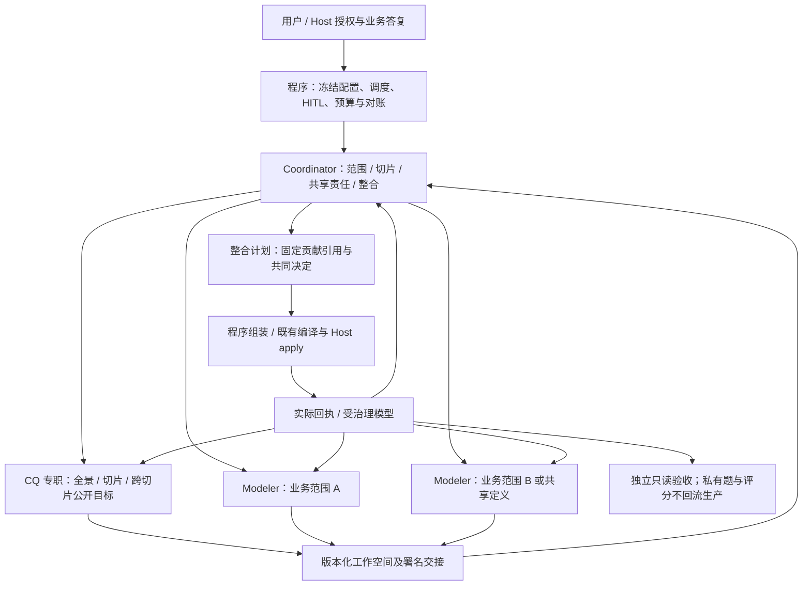

# R5.0-012 专职多 Agent 建模团队设计

日期：2026-11-03。状态：**需求与设计独立审阅 Round 2 PASS（0 Critical/0 High）；后续工程实现、受影响回归及独立工程测试 PASS，真实职责采用／独立 L1/L2 尚未执行，整体仍为 PARTIAL**。
权威范围：[R5.0-012](../../requirements/requirements-v5.0.md#r5-0-012)。
审阅及修订只记录在[独立审阅记录](../records/2026-11-03-r5-0-012-design-review.md)。
实质决策 D1—D9 以权威需求的表为准，本设计展开执行合同，不另造第二份决策真相。
下文保留原设计轮的授权及审阅时状态；后续“实现并通过测试”的授权与工程结果见
[交付记录](../test-docs/2026-11-03-r5-0-012-delivery.md)，不以原设计 PASS 充作实现或真实语义通过。

## 1. 缺口、事实基线与替换范围

用户要求：v5 必须沿用 v4 多 Agent 分别承担自己任务的架构，将本缺口作为复杂子需求完成
设计和审阅。本轮不包括产品实现、服务/依赖变更、预算创建/追加或付费建模。

核对基线 `88e9f3a`；依据包括：

- [v4 通用 Profile](../../../modeling_team/profiles/unified-modeling.yaml) 启用 Coordinator、
  Modeling、Competency Question；[Coordinator 提示](../../../modeling_team/agent-packages/coordinator/instructions.md)
  负责范围、切片、共享协调与整合，[CQ 提示](../../../modeling_team/agent-packages/competency-question/instructions.md)
  负责全景/切片制作、审核/冻结和公开/隐藏隔离。
- [R4.0-007](../../requirements/requirements-v4.0.md) 不要求一视角一 Agent；
  [R4.3-024/025](../../requirements/requirements-v4.3.md) 已移除 Protocol LLM 翻译/技术审批和模型 dry-run。
  不能以“恢复 v4”为由恢复这些已退役职责。
- 当前 `TaskBinding.prepare` 只冻结 modeling/acceptance，`CodexInvocation.__call__` 将其他用途
  都路由到 modeling；`for_unit` 仍拼接完整建模提示。`WorkPlan.delegate` 没有 role/work_kind，
  `MultiUnitFlow` 将根身份硬编码为 modeling，`WorkUnitFlow._model` 仍要求根重写完整候选。
  因此现状是通用建模者可选递归，不是专职团队的默认实际运行。
- [本轮 Demo](../../research/2026-11-03-demo-high-agent-evaluation.md) 的 units={}、concurrency=1；
  多个建模/自查上下文均属单根职责。独立 36/36 不证明切片/CQ/Modeling 已分工。
- [先前协同核对](../../research/2026-11-03-v5-v4-multi-agent-design-integration.md) 和
  [D7 实测](../test-docs/2026-10-30-v5-follow-up-validation.md)证明可复用的工作树、原单元检查与
  局部重入子集，不覆盖本次新专职默认合同。GitNexus 索引落后 598 提交，本设计依据当前源码。

本条明确覆盖旧方法 §12“少量 Agent 可合并这些核心生产职责”的新默认选择；保留
[工作空间方法](2026-10-26-ontoweave-modeling-methodology-design.md)的双向完整范围、递归、
正交状态和最小共同父级协调。工作内容仍是权威，角色定义负责谁实际处理，不以角色数
替代业务正确性，也不把数量/固定调用顺序变成平台不可恢复拒绝。

## 2. 方案选择

| 方案 | 能解决的问题 | 本次决定 |
| --- | --- | --- |
| 给通用根增加“请先委派”的提示 | 改动小，但仍可能无委派，所有子级沿用同一生产专业合同；不能保证 CQ 专职制作 | 不采用为完成方案 |
| 将旧 TeamRunner、完整角色包及旧审批链原样搬回 | 名称/交互习惯接近旧版，但混入旧 FIFO/Delivery 路由、私有 CQ 能力和退役技术审批 | 不采用 |
| 在现有 v5 工作树/执行器增加版本化职责及类型化交接 | 复用可用框架，正常新任务由程序实际激活专职角色，保留语义权威与独立边界 | 采用；不是新建第二套团队框架 |

这里的“默认”是正式入口准备的新任务合同，不是示例 YAML 或一个可选开关。预设最小实例
为一名 Coordinator、一名公共 CQ 专职、一名或多名 Modeler；Modeler intake 也属于此
专业身份，不额外制造常驻准备角色。工作按需唤醒，不启动常驻空转
LLM。单切片也由专职 Modeler 完成；已有题由 CQ 专职真实复核/复用，不需要重新凑题。

## 3. 责任、上下文与数据流



| 身份 | 实际工作及输入 | 产物/可做的决定 | 不能冒领的职责 |
| --- | --- | --- | --- |
| Coordinator | 获准目标/原文导航、已有模型范围、用户答复、CQ 公共成果及 Modeler 贡献 | 范围/切片计划、分派、共享维护方、冲突处置/业务澄清、整合计划、本层整体检查 | 不包办 CQ 成果或新写 Modeler 业务正文；不能替用户确认未知，不能下独立验收结论 |
| CQ public | 获准业务原文、公开种子/项目题、确定切片身份及公开答复 | 全景/切片/跨切片问题、来源依据、可选参考答案和 criteria_status、覆盖/未知、稳定题目 ID 与版本 | 不建本体、直接 apply、读隐藏题或过程/最终私有评分；制作 CQ 不等于评分 |
| Modeler | 分配范围原文、实际相关模型、公共 CQ、共享定义决定与真实回执 | 有来源候选/显式变更、共享引用/冲突、已表达/未交付/未知、本责任范围实际读回自查 | 不改别人的语义正文或代 Coordinator 改目标/拓扑；不自生隐藏题或自判独立 PASS |
| Host/程序 | 真实授权、固定成果、现有执行能力 | 创建已获准角色工作、技术 ID/租约/Batch、组合/编译/apply、队列/版本/计量/收尾 | 不根据名称、图连通、数量或依赖自动决定业务含义/完成 |
| 私有 CQ 准备、过程评分、独立验收 | 各自明确批准的独立输入及用途 | 各自的准备/评分/判断；沿原隔离入口发布允许的投影 | 不成为上述生产角色的替身；私有内容不进入生产共享空间 |

同一模型可服务所有角色，独立性由实际身份、上下文、工具及输入用途保证。稳定 actor
不要求永久常驻原生会话；换会话必须仍有同一责任、原成果和工作版本，不将全新会话称为
同一 native turn。生产自查归原生产责任者，不能因另起上下文改称独立验收。

## 4. 最小配置、身份及冻结合同

### 4.1 新默认和旧绑定

新增明确合同选择 `team_contract: role-team/v1`。新 `start` 未填该项时由正常入口解析并
显式写入冻结 binding；不是让 Agent 自行选模式。旧已存在 binding 不含此合同，继续原
workflow_version/根 modeling 路径。用户如显式选择其它支持模式，运行状态必须显示该
选择；不存在“出错自动转单根”或“看目录存在便迁移旧 checkpoint”。

模型继续从当次 model_profile 逐角色读取：coordinator、competency-question、modeling、
acceptance；不复制 modeling 绑定冒充其它配置。私有 CQ 准备可复用 competency-question
模型配置，但必须是不同 actor、purpose、上下文和输入权限，不加入生产通信名单。
原有 GLM provider 能力边界保持，不为此需求新增 provider 适配。

以下仅为新 Task 的增量示意，不能独立当成可运行授权文件：

```yaml
team_contract: role-team/v1
model_profile: /absolute/path/glm-flash-high.yaml
unit_concurrency: 2  # 也可配置为 1：调度串行，但不合并专业身份
```

prepare 冻结角色合同/方法片段/工具集及哈希、角色模型实效、当次材料、目标与预算；不直接
把 v4 完整 instructions.md 串给新角色。复用 v4 的专业方法，替换旧 Runner 路由、冻结能力、
Protocol/Delivery 调用和旧字段；新 v5 专用提示存放在现有 v5 instructions 目录并版本化。
缺角色模型、未知专业合同、无权材料等返回原任务可修正的具体配置问题；修复后显式继续，
不假称已经启动对应角色，也不靠硬编码“人数不足”永久终止 run。

### 4.2 角色、工作与范围不是一个 ID

在现有 WorkPlan 的工作条目增量登记 `role_id`、`actor_id`、`work_kind`、`scope_ref`；
保留已有 unit_id、parent_id、dependencies、generation 和状态。这里 scope_ref 指工作空间
范围对象精确引用，不是新 Ontology，也不以 CQ 工作条目数量统计业务切片。

| 概念 | 示例 | 约束 |
| --- | --- | --- |
| role_id | coordinator / competency-question / modeling | 专业提示、工具和模型配置选择；agent 返回不能自行提升 |
| actor_id | coordinator / cq-public / modeling-credentials | 当前团队内稳定责任身份，署名消息、成果、活动和计量 |
| unit_id | integration / cq-public / credentials-model | 有限工作/检查点；CQ 条目可覆盖全景多个业务切片 |
| work_kind | coordination / cq_public / slice_modeling | 决定结果合同和调度；self_check 是原角色活动，不是另一个角色 |
| scope_ref | 某版全景/切片范围记录 | 业务范围、共享义务与未分配内容；多个工作可覆盖同一范围 |
| 原生执行 | actor + generation + purpose + 执行身份 | 同一 actor 的多次执行不能凑成多角色，未知执行沿原身份对账 |

新合同 parent_id 指父工作条目，根 identity 由冻结配置解析，不再到处假定字符串 modeling。
旧对象 ID 和 actor 意义不重写；兼容选择只在冻结版本边界，不增加一套泛化兼容服务。
初版可一个 actor 对应一个生产工作条目，保留上述字段区别即可，不建设 actor 池。

Coordinator 可在已冻结 role 范围内分派。Modeler/CQ 可以在自身获分配范围内继续拆分同专业
子任务；不能自行变成另一角色或扩大来源/预算。需要跨切片、多专业中间层时由 Coordinator
分派有界协调条目；根始终保留未分配范围和整体责任，不强制固定递归深度/额外角色数量。

## 5. 成果合同与分派路径

### 5.1 共用信封、按专业约束内容

所有专业结果沿现有 ExecutionManager、版本仓储和材料交接保存。共用身份由程序核对，
不能信任模型自报 actor/role。使用版本化 `role-work-result/v1`，含：

- 程序绑定的 work_kind、actor/role、unit/generation；purpose/阶段和实际原生执行引用。
- status（沿用 proposed/no_change、waiting_input/children/peer、recoverable_issue 等有界结果）。
- basis：来源版本、消费的范围计划/CQ/共享定义引用、实际模型修订、已处理输入 IDs。
- 分专业 artifact_refs、未决/影响、原 HITL/已消费输入字段。文档中“有引用”不代表内容已读。

专业内容存入现有对象/版本材料，结果只带精确引用；不把所有内容变成新的 RDF 业务类型，
也不为这些工作产物新增平台业务 API、表族或通用角色插件框架。

| 工作 | 结果内容及完成语义 |
| --- | --- |
| coordination: plan | `scope-plan/v1`：完整获准范围导航、切片身份/边界与分派、共享维护/引用、依赖、尚未分派和确认点、后续整合义务；暂定/待业务确认保留状态 |
| cq_public | `public-cq-set/v1`：全景/切片/跨切片题目与稳定 ID、来源、可选答案及其主体/状态、复用/修订/新增/未知、覆盖到 scope 的对应；ready 仅表示当前任务公共目标可消费，不等于业务确认或隐藏标准通过 |
| slice_modeling: source_intake | 原始获准范围内真正的材料分析、业务命题/语义假设与未知引用；不带可 apply 的 candidate/changes，不表示完整建模已完成 |
| slice_modeling: propose | 现有完整候选与 R4.3-025 显式变更（或有依据 no_change），加责任范围、实际引用、共享冲突/未物化依赖、公开 CQ 处置和检查义务；不得退回只有自由文本让 Coordinator 重写 |
| coordination: integrate | `integration-plan/v1`：固定贡献引用、共享身份决定、可安全应用部分、暂缓/退回理由、Ontology 放置及阶段依赖；不能在该载体塞入自己重写的叶子业务正文 |
| 原责任 self_check | 实际应用回执/治理正文、适用模型版本、检查结论和缺口；原专业继续处理，相同基线复用有效证明 |

公共记录可按现有 semantic_record 类型保存命题、决定、覆盖、开放项；上述角色成果的结构
类型位于现有版本材料/结果信封，不扩展一套重复“已应用本体”。真实模型仍由平台保有。

### 5.2 正常启动到写入

1. 程序按当次授权冻结新默认配置和已有获准来源/验收绑定，建立 Coordinator、公共 CQ
   和专职 Modeler intake。第一份 intake 只绑定原始 Task 目标/获准材料范围（程序逐字保留
   授权范围，不按表数猜切片），phase=source_intake；做真正来源分析、业务命题提取和
   未知定位，不能输出可 apply 的 candidate/changes 或宣称完整交付。
2. 调度先保证首个真实 Modeler intake 已准入启动，再允许 Coordinator/CQ 占用全部槽位。
   unit_concurrency=1 时先执行 intake，再排协调/CQ；>1 可让 Coordinator 同时开始，CQ
   在可用槽位启动。该优先顺序不依赖模型半回合结果，也不用 steer/interrupt 抢占已忙
   回合。按 Host 保留的真实授权收取时点核对 20 分钟，不用 prepare 时间重置授权时钟；
   外部不可用造成无法启动时保留原因/实际时点，不能以 thread 创建/preflight/空调用报达标。
3. Coordinator 尽快提交第一版来源支持的范围计划；CQ 可复核全景/已有题，不等待所有
   切片细化。方案就绪后显式将 intake 的原工作更新为某个已分配建模范围/新 generation
   （或将其成果交接给对应 Modeler），保留同一 role 和既有来源/命题版本；不能悄改旧
   assignment 的历史范围、把初步命题当当前切片完整候选或用 intake 替代最终 Modeler。
4. CQ 与 Modeler 并行补充各自成果。CQ 未完成时 Modeler 结果显式注明公共目标基线
   为已有种子或 pending；可以做安全来源分析/提案，不能据此宣布完整交付。intake
   的命题/材料读取按适用来源版本复用，不能为满足启动时限再增加一个无效暖身调用。
5. CQ 新版及 Modeler 完成以精确材料入队；Coordinator 按真正依赖处理。先由明确输入
   支撑的安全范围可应用，不能因无关 CQ/单元未完成停住所有工作。必要业务决定未知时
   只延后其影响范围。已消费公共 CQ 改变时进入第 8 节的版本处理。
6. Coordinator 选择贡献及整体处置，程序形成确定性组合，校验授权/基线/引用后沿原 Host
   应用并记录回执。多个贡献可一次整合/分依赖批次执行，不新增每批 Protocol 技术审批。
7. 回执派回原 Modeler；本地实际检查、公共 CQ 处置及 Coordinator 整体检查依次按必要
   依赖完成。最终 handoff 之后才沿独立冻结目标启动正式验收；评分支路仍可关闭且不放行。

已分派但尚无结果的必需专业责任是准确 pending，不能让程序/Coordinator 代写“已完成”。
普通心跳、同一版本卡片刷新或无新输入的等待不会触发角色再推理。

## 6. 公共 CQ、私有准备、业务答复及评价

承接 v4 的 CQ 专业职责，不沿用“生产 CQ 可以持有全部私有草稿再参与共享讨论”的输入形态。
以隔离上下文承接不同用途，不能靠一句“别泄露”代替输入/工具限制：

| 用途 | 输入与输出路径 | 对生产可见什么 |
| --- | --- | --- |
| 公共 CQ 制作/维护 | 原业务来源、R5.0-010 公开题库/种子、scope-plan、业务答复；工作空间固定版本成果 | 本次全部公开题、draft/确认口径、来源及显式未知 |
| 私有验收标准准备/审核/冻结（任务明确需要时） | Host 受控独立上下文、获准原文/私有种子、现有冻结包 manifest；不接生产候选或私有运行诊断去倒改标准 | 仅已经批准为 public 的投影及允许的冻结身份/状态；隐藏 ID/题目/答案/数量提示不随协作泄露 |
| CQ 过程评分 | R5.0-011 冻结的公开阶段成果与来源 | 仅获准 Host/复盘侧，默认不回生产；不会生成或批准生产 CQ |
| 最终独立验收 | R5.0-006 冻结原来源、题集和实际只读模型 | 沿现有公开反馈；不变成共同出题/生产修模者 |

已有 Task.evaluation 的冻结标准是独立基线。公共 CQ 制作不会重写该文件、题量、答案或
旧 verdict；真实目标/标准变化由获准 Host 走新冻结/修订绑定，保留原结果，不借“本轮新增
几题”改变旧分母。R5.0-010 项目题库原确认状态保留，CQ 的任务 draft 不自动回写为 confirmed；
如要发布/修改项目题库，由现有获准 Host/用户入口按原版本与授权执行，不新增 CQ 管理 API。

CQ 可提出问题和来源支持的参考答案，但二者不能互证业务事实；用户/获准测试代答沿 HITL
保留真实 author、来源、授权与适用范围，未答/部分答复不视作同意。相同未决含义通过已定位
open item 和明确 request 关联复用；程序不按文字相似度自动合并问题或扩大确认。

既有 v4 CQ 私有审核/冻结合同的不可变版本、全景/切片身份连续性及“暴露后不得称隐藏”保持。
不恢复旧完整 CQ 结束才允许任何准备的死锁顺序；真正需要的业务确认/授权/正式冻结仍是
其所保护动作的条件。私有准备不是默认额外常驻角色，也不因本设计获得一次付费调用授权。

## 7. 跨候选组合、语义所有权与唯一写入

### 7.1 精确贡献与 ID 限域

integration-plan 固定：scope-plan/CQ/共享决定的引用；每项 Modeler result/candidate/changes
的 object_id/revision/digest、owner unit/generation；选择的 change 集合及退回/延后理由；
显式 ontology_targets 和应用依赖。组装前持久化此输入及完整组合输出/别名映射，再调用 Host。

来自两个候选的 `class-model` 或 `create-1` 是不同局部 ID，不能直接拼接。程序把引用限定
在 owner unit + 贡献 object_id + local ID 的命名空间，生成符合现有合同的组合 item/change ID，并持久保存
双向对应；内部 definition_ref 和当前可解析的 existing_resource_ref 同步映射。这里贡献 object_id 区分同一单元先后提交的不同候选，revision/digest 固定本次选中版本；
同名局部 create-1 不会因作者相同而碰撞。原生资源连续性由真实 target_ref/共享身份决定，
不能由组合别名推断。仅改候选 item/change ID 及其合同引用，不改 source_key、物理列名、
业务标识或含义。技术 ID
重命名不修改 business_meaning、条件、方向、列映射或 other semantic fields；语义正文
与原贡献字段逐项保持，差异返回责任方，不让 Coordinator/脚本自由修文。

共享同义需要已有明确身份决定和维护方；不能把同名两个对象自动折叠，也不能对同一
原生资源两份冲突更新按列表顺序覆盖。真正新/改语义回原 Modeler 产新不可变版本；共享
定义可交有界共享 Modeler 工作。Coordinator 自己需要补的未分配含义也走这一路径，
不是填到 integration-plan 中免除 Modeler 作者。

integration-plan/v1 的必需字段约定如下；由程序核对具体引用/角色/版本，语义理由仍归
Coordinator。结果 schema 关闭额外业务正文槽，不接受候选内容作为 integration-plan 的任意字段。

| 字段 | 含义 |
| --- | --- |
| plan_id、basis | 当前协调计划身份；源、scope、消费的 CQ/共享决定和实际模型版本；缺失的非前置公共目标明确 pending |
| contributions | 每项含 owner_work_id、generation、result_ref、candidate_ref（fields-only 可空）、changes_ref 和 selected_change_ids；所有 ref 使用 object_id/revision/digest，change ID 在源贡献内解释 |
| shared_decision_refs | 共享维护/身份与冲突处置的原决定引用，不是复制一份可编辑共享定义 |
| deferred | 未选/未就绪部分、原责任方、具体原因和所依赖的真实工作/回执；不能遗漏原完整范围 |
| ontology_targets | 以程序生成的限定 change 身份对应明确获准本体；原贡献 placement 与协调决定冲突须返回解决，不静默迁移 |
| check_units | 被整合贡献的原 Modeler 检查义务；所选直接/间接责任及已有 proof 可定位，CQ 用本专业覆盖检查 |

首期候选只使用当前合同支持的本候选 definition_ref 或实际 existing_resource_ref。
不同贡献之间尚未物化的共享对象不允许用自由文本局部 ID 跨引用；按下一节取得回执后
由原 Modeler 提交。程序选择贡献子集时核对引用闭合，不能切掉被选内容的必要定义再
宣称候选完整。不同来源的选择/名称冲突与同一源重复投递分开，后者按原成果/操作身份复用。

### 7.2 不能提前解析的依赖及分批

本期不新增任意 JSON patch/模板或未来资源绑定语言。只适配现有候选/编译器声明的引用槽。
未应用的 fields-only Class 等依赖仍保持“待实际回执”的工作依赖，不能把 change_id 当
native ID 或合法 existing_resource_ref。先执行独立安全部分，将真实绑定反馈给原 Modeler，
自动续派其后继贡献，再进行有界整合；这可属于原计划初建而非新实质修模轮。

本轮 Demo 已实际出现 Class→relation_type→映射三次有序提交，保留这条已验证安全路径，
不以本需求顺带建设跨全部 Batch 的事务/未来引用引擎。现有 compiler 支持的同候选引用
则正常组合，不人为强制额外批次。跨 Ontology 放置仍是明确业务决定，创建许可来自当次
scope，不能按切片数量自动建本体；原生资源身份只取实读/回执。

### 7.3 Host 单写、对账和读回回路

生产角色不持平台写密钥。根级统一控制可应用计划；程序/Host 使用已有授权、租约、Batch/
Attempt、幂等身份、原子 apply 和读回能力执行，不增加 Protocol LLM 或翻译审批。
coordination 的整合是业务范围/组合决定，不是重新手译 Modeler 字段或每批技术审核。

应用回执沿别名映射定位每个源贡献和真实原生 ID，生成该作者可用的 applied-bindings 精确
引用与实际模型修订；不能只把根级合并结果交回、不告诉成员自己的语义是否已应用。
Root/Modeler 不能将原回执位置猜成候选路径或从 IRI 后缀猜资源 ID。

不确定写入先用原操作身份对账，锁住重放同一写入/冲突依赖，允许安全只读及无关准备。
进程重启、Coordinator 新回合、计划新版本均不能绕过原未知状态；已确定成功的部分不
因重新组装新计划而再次创建。确认 not_written 的具体错误反馈原作者，保留原 Attempt。

## 8. 共享变更、并发和基线变化

每份成果/已消费工作记录其来源 manifest、scope/CQ/共享定义引用、工作 generation 和
实际模型基线。版本进度不是业务批准，通知不是内容变化；同一不可变成果重复送达复用
既有状态，不重复唤醒/应用。正文读取必须有相应来源/交接权限，摘要不能代替必需原文。

| 发生的变化 | 程序处理 | 谁作业务判断 |
| --- | --- | --- |
| 来源修订/撤回或业务答复 | 复用 SourceRevisions/HITL 的显式范围与依赖候选；busy 回合结束后呈现差异 | 原角色判断适用，Coordinator 确认跨单元影响；撤回不自动判旧事实为假 |
| 公共 CQ 新/改问题 | 绑定新 CQ 版本和受影响范围，保留旧消费记录；不改私有 freeze | CQ 解释变化，Coordinator 判断目标/分派，原 Modeler 查表达与必要补模 |
| 共享含义变更/冲突 | 沿既有责任方和引用单元定位；不得 last-write-wins 或造同义副本 | 维护 Modeler 提修订，Coordinator 协调兼容/共同修改，必要业务决定走 HITL |
| 旧提案在新版范围后返回 | 保存为旧 generation 的成果，不能直接释放新计划或覆盖新结果 | 原责任者对差异继续；无变化部分精确复用 |
| 无关兄弟写入导致整体 revision 变化 | Host 先按原应用/实际目标核对；不假定“全局变化=所有语义都错” | 按责任范围有界复核，保持候选/未变兄弟代次，不以旧全局修订冒称当前读回 |
| 更新依赖导致环/相互等待 | 返回具体环、责任与可修正工作计划；不无限循环或自动删依赖 | Coordinator 修订分派/共享决策，未知保持 pending |

依赖只定位影响候选，不能根据没有声明的边或一次不完整查询宣布“无影响”。整个模型
revision 变化后需要当前治理证据；原候选可复用，原自查不能自动改写 model_basis。原责任
Modeler 只复核其范围/共享依赖，不重做无关完整候选；同模型修订、同来源/成果基线的有效
检查直接复用。父级自身负责跨子级条件、共享规则及未分配内容，不只是求交接数量。

允许叶子 Modeler 内部继续委派同专业子任务，父级明确整合其子结果和检查义务；跨专业
中间 Coordinator 仍不得把业务正文改成自己版本。既有 review_units 路径按工作类型筛选，
不能对 CQ 的非候选结果套用 model candidate/self_check 模式。

## 9. 完成状态、HITL、可观察性与活性

- `proposed` 仅是专业成果可整合；CQ `ready` 仅是本版本公共目标就绪。scope-plan 暂定、
  材料未审阅、表达未完成、已应用、生产自查和独立 verdict 分别可见。
- 所需角色由程序依工作类型激活，不靠 Coordinator 第一次聊天有没有记得发消息。工作
  初步就绪即可并行，program wait 没有新事件就落盘静止；不新建常驻 LLM 调度者。
- 缺本专业结果/角色暂不可用时准确记录 pending/blocked_step，继续无关安全工作。
  返回可行动反馈，允许同目标修正，不因数量、额外角色或固定尝试数永久拒绝整个 run。
  不能凭“角色不在线”让 Coordinator 冒用作者或自动跳过本次专职职责。
- HITL 直接显示原角色/单元的问题、版本/理由和影响，答复关联原请求；Coordinator 可
  组织共同问题，但不必充当每次转发中介。部分答复、未知和新版本未确认继续保留。
- status/work-tree/board 至少区分 role、actor、工作类型/阶段、输入版本、下一依赖、当前
  原生执行及待办。展示“根包办”与“真实分工”差异，不用多个 execution 数冒充多个角色。
- 整体 handoff 需 Coordinator 对完整 scope、角色成果处置、Modeler 实际检查、公共 CQ
  处置及未决明确判断。未完成内容不能隐藏到“以后再做”；真实未知可依冻结业务目标
  保留，不将低 CQ 分数或无关角色数量作为新写入硬门。

本地工具错误/超时先核对请求、权限、实际内容及分页/降级。检索无命中不证明模型不存在；
可使用已有精确读取继续；不能把运行故障归为建模质量，不能无变化反复调用工具/模型。

## 10. 暂停、恢复、预算及收尾

继续使用当前 TaskControl、ExecutionManager、检查点、原预算账本和自然回合控制。
实际 role_id/actor_id/purpose 必须进入执行意图、原生绑定、provider 请求、用量及报告；
不能出现 coordinator/cq 名义、实际仍按 modeling 路由/计量的假拆分。

用户/预算暂停即时登记，等待所有当前 role/native activity 自然结束，下一回合不准入；
同一已开始原生回合内的工具/压缩/后续请求和获准应用照原规则自然完成。报告覆盖并发
角色、私有准备、评分/验收和辅助调用，外部 Host 单列；未知不补零、在途尾差如实显示。
显式追加/恢复只沿真实授权；新角色/actor/线程不能重置 task_ref/budget_ref。

恢复先核对冻结合同、原 execution、成果引用/版本、待答问题和原 apply/Attempt。完整原
结果复用，原生完成回执丢失从 retained terminal turn 核对，仍未知则停在对应责任，不
猜测未执行重发。工作条目 retire/重分派也不能在未知执行仍在途时启用第二个同责任写方。
任务新控制输入和业务变化沿自然边界呈现，禁止把同一旧上下文换 role 包后继续。

最终收尾核对所有在途成员及 Host 操作、临时 read/protocol/admin 能力；角色专属临时
能力和记录有归属，不能只清旧 modeling 目录。实际模型/失败/报告保留。稳定的角色工作
身份不表示要新增常驻进程或复活旧已停止任务。

## 11. 权限和实际复用边界

复用现有获准 Project/Ontology/来源边界、工具隔离和材料授权，不建设通用权限框架。
role 工具/结果限制直接保护当前真实职责及隐藏信息：

- Coordinator 可读获准来源/必要实际模型，维护自己的范围/协调记录、分派和整合引用；
  没有 Modeler 正文提交或平台写工具。Modeler 可读其获准来源、已有公开信息和显式交接，
  只提交自己/明确同专业子任务的候选，引用别人保持作者/版本。
- CQ public 只有公开制作所需的来源/问题/工作空间/HITL工具，不加载候选变更工具、私有
  CQ 能力或 acceptance 输入。独立验收/评分不拿 Team 工具或生产记忆写权限。
- 共享工作空间不扩大来源授权。material_ids/材料引用不能越过任务及角色的实际可读
  范围；生产可见数据与独立私有数据始终分包，工具返回不通过引用暗漏隐藏内容。
- role/profile/capability 来源于 Host 冻结，Agent 不能仅靠修改 role_id、自报 authorship、
  写别人的 object_id 或发消息扩大能力。错误返回给原调用者，可修正而非全 run 死亡。

这是本次专职运行和现有独立隔离的必要边界，不增加客户本体专用 routes/fields 或“平台
自动懂业务”的控制分支。

## 12. 改动面与实施交接

只在后续获得实现授权后执行下表。优先扩展现有具体组件，避免平行 RoleTeamRunner/
第二套调度器或泛化插件注册中心；模块拆分如无当前重复/耦合证据不先实施。

| 实际模块 | 最小必要变化 | 必须保留 |
| --- | --- | --- |
| `contracts.py`、`preflight.py`、v5 instructions | 新默认合同解析；逐角色模型与专业提示/工具冻结；类型化输出选择，旧 binding 分流 | 既有来源哈希/模型精确绑定、原 API/候选语义合同 |
| `work_plan.py`、`multi_unit.py` | role/actor/work_kind/scope 的工作条目；根解析、按专业依赖自动派发、递归/局部重入 | 一个工作树、独立 checkpoint、无无变化模型轮询、兄弟复用 |
| `flow.py`、`results.py` | 角色/阶段结果分派；scope/CQ/Modeler/整合结果不混成一个 modeling result；从固定贡献确定性组合 | 现有编译/执行安全、partial/unknown 精确反馈，不增语义裁判 |
| `execution.py`、工具挂载/`material_tools.py`、`team.py` | 实际 role 模型路由及专业工具；作者/成果可读边界，固定材料投递/消费 | 原 native turn 身份、受限环境、现有持久队列/卡片 |
| `semantic_workspace.py`、`revisions.py`、`memory.py` | 角色产物/依赖导航及范围基线；按变更回责任方，不覆盖其他作者 | 版本冲突、自查/应用/验收分态，已应用模型不复制成另一份真相 |
| `host/worker.py`、既有组合/编译适配点 | 固定计划→候选/变更，限域 ID 映射，回执回到贡献作者；若现有 adapter 足够则只复用 | scope/原生 ID、Batch/Attempt、幂等/租约/原子 apply、明确 not_written/unknown |
| `unit_checks.py` | 按工作类型安排原 Modeler 有界读回及父级整体检查，CQ 返回不强套候选结果 | 既有 proof/basis/generation 和真实治理材料，不能 Host 代查冒充 |
| `custom_cq.py`、`acceptance.py`、`process_evaluation.py` | 公共制作成果与已有题目标绑定；生产作者和私有用途分离，阶段引用/真实角色报告 | 原冻结/完整分母/独立者/只读输入，不泄露私有评分 |
| `budget.py`、`control.py`、Host 计量及 `cli.py` | 全角色 role/purpose 对账和在途控制；新默认准备/进度/显式模式；旧入口继续旧合同 | 稳定原预算、自然回合及在途尾差；不得为本需求恢复逐请求截断 |
| v5 README、Host runbook、角色说明/任务模板 | 默认入口、职责、配置与实际加载同时更新，注明 legacy 和适用方法片段 | 不修改旧冻结包，不更新与本需求无关的业务需求/文档 |

## 13. 分段交付与验收计划

本表只是设计的实施分解，不启动开发，不以分段工程 PASS 提前宣布子需求整体交付。

1. **合同及专业执行**：冻结默认团队/模型/提示与专业工具，类型化结果和角色身份贯穿
   真实执行；新/旧绑定选择及脚手架级可恢复错误。原 v5 单根默认的历史实证不继承为新 PASS。
2. **完整协同闭环**：Coordinator 计划→程序派发 CQ/Modeler→版本交接/整合→实际应用→
   责任读回/公开 CQ 处置/整体 handoff，接入共享冲突、局部变化、控制/恢复/计量/清理。
   默认不能停在“有三个名字但根仍做全部业务”的半交付。
3. **独立工程与真实采用**：针对 A1—A16 跑受影响模块及调用路径；公共核心/影响边界
   涉及多模块，交付时按仓库规则做 v5 组件全回归及旧绑定相关回归，避免无关平台全量。
   独立工程测试、真实角色采用及独立语义验收分别记录，真实付费运行另有当次授权/预算。

| 验收组 | 关键设计反例及证据 | 对应要求 |
| --- | --- | --- |
| 默认职责 | 未填 team_contract 新任务、已有 CQ、小业务；并发=1且首协调回合超过20分钟，仍优先以获准来源开展真实Modeler intake并按真实授权时点计时；intake无apply且后续范围接续保留原件；Modeler 不能由根代做，CQ 评分不能当 CQ 制作；同模型也核对 role/actor/native context/产物 | A1/A2/A4/A14 |
| 基线与调度 | 无手工 delegate；全景/切片迟到，CQ 等范围/Coordinator 等 CQ 的环，单元 HITL 时兄弟继续；并发=1 仍专职，>1 有实际重叠 | A3/A6/A9/A11 |
| 共享/组合 | 不同候选同局部 ID、同名异义、共享原生 ID 冲突更新、Class→relation→映射回执依赖、多本体显式放置；Coordinator 随手改字段须被定位并退回 | A7/A8 |
| 变更/重入 | 旧 generation 晚到、全局 revision 变化、公开 CQ 新版本和私有 freeze 不变、来源撤回、未变兄弟候选复用；没有“全部 ready 就完整” | A3/A5/A9/A10 |
| 原责任读回 | 每份被整合贡献有适用检查依据；局部错误交原 Modeler；父级验证全局规则；读取截断、旧 proof 或 Host 代查均不能当当前原责任验证 | A10/A15 |
| 生命周期 | 部分答复/未知、格式纠正、依赖环、重启/重复消息、已完成 native 结果重用、未知 apply 不重放，停止成员没有遗漏 | A6/A11/A12/A13 |
| 独立性 | 生产 CQ 输入不含隐藏题/答案/统计、工具不能借 role 字段越权；私有准备不接产物倒改标准，旧报告不混作新范围 PASS | A4/A5/A15 |
| 真实 Demo | 同业务原始来源、公开九题、预先冻结独立标准；本轮必须见到真实专职分工及完整模型结果，保存全部失败、Host 介入和成本 | A1/A15/A16 |
| 更复杂有界场景 | 至少两个关联切片、共享定义、父级整体规则、一次局部澄清/来源变化和原责任回路；独立评价不能只平均子级结果 | A3/A8/A9/A15/A16 |

真实首次运行不前置全面审计/一次性 harness，复用已验证 fixture、授权/预算、模型与读取
方式。新增的职责采用判据由真实执行+源成果+固定版本交接证明，不新写只匹配本次输出的
语义打分器。正式独立标准在生产前/相应新范围验证前冻结，不按角色产物倒改标准。

L0 验证角色激活、工具、路由、交接、应用与回执；L1 再证明完整业务语义及真实职责采用。
L2 需同条件独立重复，L3 不成为前置。角色数、消息数、局部分数上涨或本轮与旧单根的
缓存差异都不能证明效率改善；全任务角色/纠错/私有及 Host 成本分开测量，纯有效时间
不完整继续 unknown。整体 R5.0-012 通过至少需要正式默认路径的工程闭环、真实角色采用
和独立 L1；未满足则准确保留 PARTIAL/BLOCKED，而不是只把配置默认打开。

## 14. 当前设计结论及尚未执行部分

需求 D1—D9 的实质选择均已在本次设计授权及既有约束下关闭，没有等待用户补充的业务
真值或权限决定；具体角色包/结果 schema/状态投影作为上述合同的实现细化，不允许重新
打开“根包办也算多 Agent”的目标。若实施发现会改变这些边界的真实限制，回到本需求
记录差异并裁决，不根据当前代码暗改需求。

独立审阅首轮 REVISE（0 Critical/1 High）：Modeler 先等协调方案可能违约启动时限。
本次修订为 prepare 注册及优先准入真实 Modeler intake，单并发槽也不等 Coordinator/CQ；
补明确后续范围接续和反例。独立 Round 2 已 PASS（0 Critical/0 High），无待定关键假设。
审阅结论只覆盖需求与设计；未实现、未做工程/真实语义验收或新付费调用。
