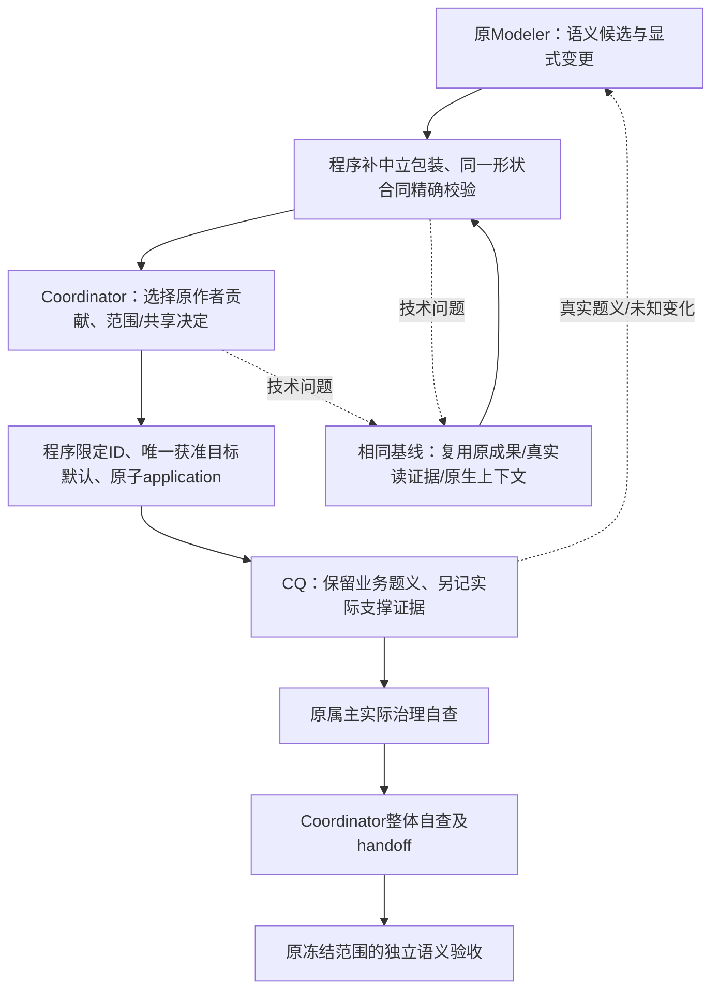

# R5.0-012 建模交付、技术纠错与自查接续修订

日期：2026-11-04。用户授权：调整建模流程设计并修复[本轮复盘](../../research/2026-11-04-demo-role-high-flow-retrospective.md)暴露的问题。归属为R5.0-012 F5/F7—F10、R4.3-025 F5；沿用原角色分工、授权和独立验收，不新增业务范围或付费运行授权。
状态：独立只读有界工程复核R2 PASS，无未解决Critical/High；实现及工程验证完成，见[验证记录](../test-docs/2026-11-04-role-team-flow-repair.md)。本状态不表示真实运行L0/L1/L2通过。

本文件修订[原设计](2026-11-03-r5-0-012-role-based-modeling-team-design.md)的交付/局部重入/自查合同；原设计审阅和历史运行证据保留。本次不以工程验证替代真实L0闭环、36题独立L1或L2。原Demo保持暂停。

## 1. 调整后的最短链

恢复粒度按问题所在层决定；普通技术错误不重做业务切片、不重建候选、不另建运行。真正来源/范围/CQ业务口径/共享定义/模型修订变化仍交原责任方重评。

## 2. 候选与机械字段

- 在Modeler成果被正式接纳前，复用现有统一图形状校验。不是增加dry-run或另一套语义裁判。
- 缺失的`relation_endpoints`、`shared_scope`可按合同补`null`；原值、实际端点/共享标签、空值、item/change ID和业务正文均不改。实际关系所需端点仍由后续表示/编译校验，不能由程序猜造。
- business_meaning/value/slice_ids/unknowns等真实必需字段不补业务默认。缺失/多余字段反馈同时列出item位置、item_id、缺失/多余key和原错误码。
- 单个已授权Ontology继续使用已有空ontology_targets默认投影；多目标仍要求明确放置。Coordinator使用原结果的程序qualified IDs，不重新算hash；未知placement key反馈准确坏key。
- no_change贡献保留owner/result/generation，空changes不是空责任；给Coordinator当前可直接选用的精确贡献导航。本人冗余review声明沿3d481c3处理，不重复递归本人。

## 3. 同一基线的技术纠错

允许复用的证据必须来自该角色/工作单元的真实执行，按source_manifest_digest、scope/CQ/shared引用、实际model_revisions、generation、phase及业务答复绑定。答复状态的已送达/消费变动不伪装成新业务含义；仅明示host-technical且未回答业务request的技术输入不改业务答复基线。

1. 当前回合失败时保留真实execution引用及最后可解析artifact。下一次仅在上述基线相同、且是平台合同技术纠错时提供复用导航。
2. consumed_refs可包含该纠错链中已完整读过的相同object/revision/digest；source_refs必须仍匹配当前获准源及真实读取记录。未完整读取、失败读取或不同摘要不算证明。
3. 同基线的“仅缺来源/消费字段”等修正可返回程序提供的最后自身artifact_ref，避免重交业务正文。引用只允许本工作保留的精确artifact；不接受任意同伴/过期artifact，不提供通用JSON patch语言。确需改业务正文时仍交新artifact。
4. 原生调用已completed且有真实线程绑定时，复用现有Codex resume能力进行下一技术纠错turn。沿既有native usage baseline差分计费；缺失基线不能计零或绕过预算。它是新turn，不谎称原turn未结束，不计作新的业务修模。
5. 无可复用原生绑定或使用确定性测试actor时，仍可按真实工作空间证据纠错；不能伪造同一线程。来源、scope、CQ、共享、model修订或generation改变时丢弃自动复用资格，要求责任重评。

新业务答复即使未改变文件版本也使旧artifact复用失效。程序另检查实际准入投递的答复，避免prompt构建与准入之间新到的业务输入沿旧body直接交付。纯合同validator按需导入，不在v5普通导入时加载旧包或Runner；启动隔离证明在独立进程验证，和后续正常调用纯校验函数分开。

初次只交进度文字的结果仍拒绝；反馈明确需要完整专业JSON。保存原输出，使用同上下文纠错，不将卡片/完成宣告当候选。上游是否截断无证据时保持未知，不擅改模型/effort。

## 4. CQ证据刷新与自查

公开CQ保留原questions、unknowns、coverage_gaps的业务含义。新增可选`model_support`记录实际模型的支撑说明，业务题义/真实未知不得藏入此证据槽。

- `model_support`是按cq_id组织的证据/状态说明，实际读回修订沿角色basis及程序public_cq_review_basis绑定；不让文本替代真实治理读取。
- 比较公开CQ语义投影时，只有model_support不参与；questions、来源/状态/参考答案、unknowns及coverage_gaps等仍参与。不能靠忽略unknowns变化来压低重入次数。
- 语义投影不变的review只给原Modeler排phase=self_check输入，原proposal_ready、generation、候选及已应用绑定保留，原属主专用检查消费新版证据。
- 真实语义投影变化仍投普通模型输入，由责任Modeler判断影响；no_change仍保留其精确贡献和检查责任。
- 旧CQ artifact不含model_support仍可读；旧artifact在unknowns中改了文字时按真实字段变化通知，不用启发式把历史文字改成“纯证据”。原冻结材料/产物不回写。

## 5. 工具合同与轻微可恢复错误

卡片可写字段、semantic record依赖、已绑定source引用在MCP schema中体现现有类型。reported_at由程序实际盖章，兼容读取后带回的冗余时间戳，不让其阻断生产。身份/未知业务字段、材料ref混作record依赖、错误源摘要仍准确反馈。

源摘要已在Host manifest绑定时，语义记录可省略sha256由原有逻辑回填；显式错误摘要不能静默替换。保持task/project scope、真实依赖、授权和原作者边界。

## 6. T0及兼容边界

中立字段补全、忽略输入reported_at和自身review去重不会扩大业务含义；高层仍有真实端点/引用、来源、授权、编译/application和独立验收。精确版本读取证明可在同一技术纠错链复用，不再强迫相同正文每turn重读；它不赋予新材料读取权，不让未读变已读。

不新增固定角色数/回合数硬拒绝、任意patch框架、私有评分回灌或跨批全局事务。旧run按其冻结来源/提示继续，程序新增字段向后可读；若旧提示仍重交正文也按原语义正常接纳。修复生效依赖新的CLI加载；本次不恢复预算关闭的Demo，不改其冻结材料。

## 7. 验证矩阵

| 失败原型 | 正向证明 | 必须保留的反例 |
| --- | --- | --- |
| 143项缺中立字段 | 不改原对象、补null后由同一validator接纳，真实共享标签不丢 | 缺真实业务字段、额外字段、错误端点仍准确拒绝 |
| placement错一字符 | 返回准确坏key；单获准目标空映射成功 | 非法多目标/错误授权不能默认选择 |
| 来源/贡献消费局部纠错 | 同actor/同版本真实读证明复用，未重交artifact可接纳 | 分页缺口/错误digest/失败读取/基线改变不能复用 |
| 初次进度无JSON | 原输出保留、准确反馈、原生resume及预算差分 | 无线程/无usage基线不能伪造同turn或零成本 |
| CQ仅证据刷新 | 完整角色链一次application后进入原属主/整体自查，不追加propose | 真正题义/未知变化仍通知原责任、产生必要重评 |
| no_change及自身review | 原责任检查保留、无重复create、本人只查一次 | 未授权子级及陈旧证明仍拒绝 |
| 工具元数据错误 | 真实MCP schema/调用接受正确形状、程序盖时间/绑定摘要 | 身份/来源/依赖错误不能偷偷矫正为成功 |

本轮先做实际失败形状的定向RED/GREEN，后跑正确目录的v5完整回归与受影响旧校验测试；使用真实PostgreSQL但确定性actor，不调用付费模型。工程通过后更新需求/原优化台账；真实剩余链及独立质量仍待获准运行，不能承诺将历史返工分钟等额省掉。
