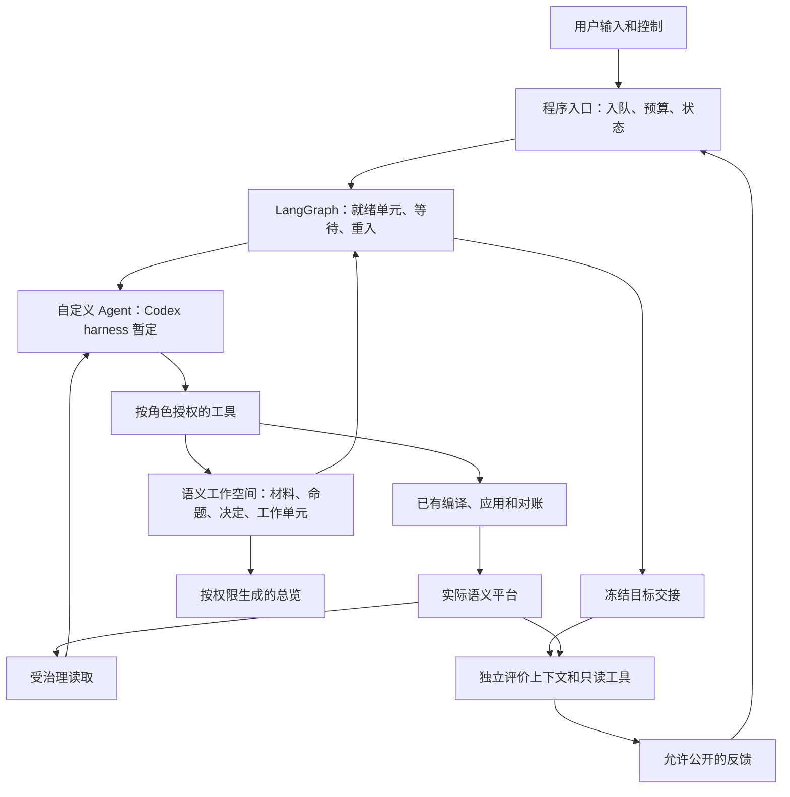

# v5 建模 Team 改造计划：LangGraph＋自定义 Agent

日期：2026-10-28。归属：[v5.0 需求 R5.0-001—008](../../requirements/requirements-v5.0.md)；001—007 为改造主线，008 为记忆专项研究。

**状态：47 项开发测试、独立工程复测及主要 P0 真实链路已有证据；冻结平台小目标独立评价为 6/6 PASS。Codex 暂定方案的主要功能风险已验证，完整计量覆盖仍为 PARTIAL，未宣称完整 P0／v5 验收。用户已确认自然工具回合与程序结构校验，并取消本任务额度门，旧统计不成为本任务前置硬门；用户已要求继续，追加的共享记忆有界验证已完成。P1—P4 生产实现及默认切换尚未完成。** 详见[验证记录](../test-docs/2026-10-28-v5-codex-p0-validation.md)和[独立工程记录](../test-docs/2026-10-28-v5-codex-p0-independent-functional-test.md)。本文与 v5 需求共同定义交付顺序和放行条件；行为范围以需求为准，业务方法沿用[建模方法设计](../designs/2026-10-26-ontoweave-modeling-methodology-design.md)。原方法的独立 PASS 不覆盖本次运行、存储和迁移设计。

编写计划时的授权不包含启动模型、创建预算、迁移任务或切换服务。2026-10-28 用户追加要求按计划开始底座技术切换，采用尽可能优雅的架构实现现有功能，遇到需知晓或决策的事项暂停；据此从 P0 开始实施。真实运行仍绑定当次获准范围与稳定 `budget_ref`；同目标的验证、失败、恢复及验收不得靠换 run 清零。新建模任务的默认模型与金额沿仓库现行约定，实际创建仍由 Host／用户授权。本计划本身不额外授予收费调用。

本任务后续授权已明确无需考虑额度消耗，原 3 元仅保留为历史记录，不再作为当前准入上限。
真实用量和身份继续记录，旧统计组件不成为本次实施的前置硬门；通用额度功能仍按适用授权
实现及验证，后续统计实现允许重写。已确认的业务、权限、自然回合控制和独立验收边界继续适用。

2026-10-28 用户另行确认 [R5.0-008 记忆专项研究](../../requirements/requirements-v5.0.md#r5-0-008)，输入为[长短期记忆初步调研](../../research/2026-10-28-modeling-team-memory-options.md)。专项研究记忆分层、业务保真、按需召回和完整任务成本；不把完整专项结论前置为 P0／P1 的新增门。既定持久工作空间和基础补读沿原计划实现；具体增强方案选定后更新所属阶段，不据此新增收费运行或预算授权。

## 1. 目标与实施原则

让程序明确控制“哪个工作单元可以推进、在等什么、何时接续”，让 Agent 专注材料理解、语义建模、共享含义判断和业务核对。业务知识保存在可定位的语义工作空间，更换 Agent 或执行进程后可继续；应用和独立验收继续以实际平台结果为准。

“自定义 Agent”指本项目定制目标、角色提示、Skills、获准上下文、工具和返回合同，底层先复用 Codex harness 的模型／工具循环与上下文能力。不从零实现通用 Agent，不把旧 Runner 整体包装成一个 LangGraph 节点，也不预先分叉 Codex 核心。S0—S9 是方法活动，允许一次有界执行完成多项活动。

采用 **先验证关键能力，再完成最小业务闭环，随后补齐规模与增量能力，最后切换入口** 的顺序。前期要发现会推翻选型的问题，但不能保证之后没有缺陷；每阶段仍须验证自己的真实业务效果。放行条件约束研发与发布，不给生产 run 增加固定角色数、尝试数或不可恢复的新守卫。

## 2. 基线、复用与替换

本轮源码基线为 `7f512d6f6910fdff397e4639650eb1d2559283d0`。只读核对现有入口与研究记录，未运行旧 Team；下表是实施责任划分，不是对旧能力新增验收结论。

| 范围与现有入口 | v5 的处理 |
| --- | --- |
| [runner.py](../../../modeling_team/runner.py)、[delivery.py](../../../modeling_team/delivery.py)、[__main__.py](../../../modeling_team/__main__.py) | 用显式工作单元执行图及程序调度替换新任务的机械推进；自然语言协调按需调用有界助手。旧入口在过渡期只服务明确绑定的旧任务。 |
| [runtimes/codex.py](../../../modeling_team/runtimes/codex.py)、[runtimes/delivery.py](../../../modeling_team/runtimes/delivery.py) | 复用已有隔离、模型配置与出站检查经验，重做小范围执行接入；优先官方 Python Codex SDK，缺少必需控制时使用其 app-server 协议，不搬入旧角色编排。SDK 与实际 CLI 版本须一起锁定。 |
| [direct_modeling.py](../../../modeling_team/direct_modeling.py)、[direct_binding.py](../../../modeling_team/direct_binding.py)、[direct_execution.py](../../../modeling_team/direct_execution.py) | 复用确定性编译、可信绑定、应用、回执与对账；从旧 Runner 拆出必要调用依赖，不另建写入框架。 |
| [task_budget.py](../../../modeling_team/task_budget.py)、[usage_capture.py](../../../modeling_team/usage_capture.py)、[usage_report.py](../../../modeling_team/usage_report.py) | 沿用任务预算与用量唯一主账，接入新执行身份；Codex 事件只提供来源数据，不建立第二套费用总账。 |
| [work_board.py](../../../modeling_team/work_board.py)、[scenario_map.py](../../../modeling_team/scenario_map.py)、[checkpoints.py](../../../modeling_team/checkpoints.py) | 复用观察和历史证据入口；新增方法所需的持久业务内容，卡片／地图转为引用与投影。业务证据 checkpoint 不与 LangGraph 执行 checkpoint 混用。 |
| [统一 Profile](../../../modeling_team/profiles/unified-modeling.yaml)、[角色包](../../../modeling_team/agent-packages/)、[Team Skills](../../../modeling_team/skills/) | 为 v5 同步方法、输入、工具权限和输出；不把旧固定 roster、Protocol 审批或旧提示中的覆盖规则带入新路径。生产与独立评价始终隔离。 |
| [modeling_batches.py](../../../backend/app/services/modeling_batches.py)、[semantic_context_query.py](../../../backend/app/services/semantic_context_query.py) | 保留平台的授权、原子应用、实际资源身份和受治理读取；只补本次集成已证明必要的通用缺口。 |

已有证据可直接复用：2026-10-27 的 [9 项独立机制测试](../test-docs/2026-10-27-v5-langgraph-risk-validation.md)覆盖动态并行、独立单元交接、局部等待与磁盘接续，以及写后崩溃负对照和同身份效果对账。它使用确定性 Agent、SQLite 和隔离应用账本；**真实 Codex、真实平台、PostgreSQL、超时图完整接续及语义质量仍待验证**。本机 `0.165.0` 协议字段检查见 [Codex 评估](../../research/2026-10-28-v5-codex-harness-assessment.md)，不视为 SDK 或当前模型的功能通过。

## 3. 目标责任边界

### 3.1 四类状态各有权威

| 位置 | 保存什么 | 不承担什么 |
| --- | --- | --- |
| 语义工作空间 | 稳定身份、修订及基线；材料审阅范围、命题去向、决定、候选／实际定义引用、父子责任、依赖、共同未决项。 | 不复制一份可任意编辑的已应用本体；不以工作完成替代验收。 |
| LangGraph checkpoint | 流程版本、执行位置、工作单元／内容版本引用、等待项、执行与未决操作引用。 | 不承载全项目材料与聊天，不覆盖较新的业务修订。 |
| Codex thread／turn 与事件 | 某次有界执行的局部历史、运行身份、结果及用量来源。 | 不成为长期业务状态、任务预算或项目调度的权威。 |
| 平台与冻结证据 | 实际模型修订、操作／Batch／Attempt 结果、冻结题集和独立报告。 | 不因 graph 返回成功或摘要自述而自动提升状态。 |

工作空间优先使用现有 PostgreSQL，LangGraph checkpoint 使用独立命名空间；具体表和 SDK 版本在 P0／P1 据真实集成确定，不先建设通用存储插件。业务写入、执行 checkpoint、RDF 应用与远端推理不假设属于同一事务。

### 3.2 最小执行合同

以下是必须保留的含义，不是已经冻结的字段 schema：

- 输入：原任务／授权／预算引用、工作单元及本次目标、获准材料与内容版本、必要父层约束、角色／Skill／工具范围、明确的 provider／model／effort。
- 身份：业务工作单元、一次执行尝试、LangGraph thread、Codex thread／turn 和平台操作分别可关联。一次工作单元可经历多个原生回合；技术重试不自动成为新建模轮次。
- 结果：完成本次工作、等待澄清、发现可恢复问题或运行失败；同时给出产物引用、所基于版本、准确缺口及必要理由。“本次执行完成”不证明业务范围完整。
- 事件：开始、实际运行、输入入队／送达、工具与应用结果、用量观察、自然回合结束、控制生效和首阻塞。接收、送达、消费与效果分别记录。

在已验证的公开接口范围内接入，暂不制作可同时支持五个执行器的抽象框架。Codex 内部子 Agent 不是首版前提；若启用，其权限、身份、用量和停止状态必须纳入同一任务。跨单元长期协作由 LangGraph 与工作空间承接。

每类失败明确一个自动重试责任方：模型传输复用 harness 的可观察重试策略，外层图不在同一失败上叠加整段推理重试；平台写入沿原幂等及对账路径处理。原执行结果不明时先核对，避免 SDK、Agent 和流程各自重试造成调用倍增。

### 3.3 控制与恢复口径

沿用 [R4.4-002／003 于 2026-10-22 确认的规则](../../requirements/requirements-v4.4.md#r4-4-002)：

1. 所有输入即时登记；目标忙碌时排队，当前原生 turn/activity 自然结束后再处理。暂停、停止、撤回和预算控制也如此，正常路径不对 busy turn 调用 steer／interrupt。
2. 在下一原生回合开始前检查任务控制及预算；一个已开始回合内的工具后续、重试、压缩及获准应用允许自然完成并照实计量。不得把整个建模任务视为一个不可检查的回合，也不能以金额监视 tick 强行截断在途回合。
3. 收到暂停后不再调度新的工作回合；所有已运行成员分别结束后才可报告任务已停稳。等待澄清只挂起相关单元；预算／用户暂停按任务控制范围处理。UI／CLI 区分“已排队／等待回合结束／已停稳”，无回执时保留未知，不承诺即时停止或零尾差。
4. 原生 interrupt 是可单独验证的技术能力，不是当前产品默认暂停语义，也不是首版选型必须采用的功能。进程故障、强制退出及未来另行授权的紧急控制按真实中断证据处理，不伪装成自然完成。
5. 恢复先核对工作空间版本、原执行状态、应用回执和预算。应用未知先对账；仍在运行的原 turn 先重连／查询，不能因 graph 节点重执行就启动另一份有副作用的工作。无法判明时准确等待核对，无关安全单元可以继续。

Codex 的累计 token 事件和用量快照不能重复累加为多次费用；重连、重复事件和迟到数据沿原账本去重／补记。缺失值保持 unknown／partial，外部 Host 用量只单列展示、不计任务金额。需要比较完整成本时同时披露未接入主账的辅助成本，不用转移调用制造降耗。

## 4. 阶段总表与依赖

| 阶段 | 工作和交付物 | 进入下一阶段的依据 | 当前状态 |
| --- | --- | --- | --- |
| **P0 选型功能验证** | 锁定候选环境；完成第 5 节最小验证；给出 Codex 可采用、需窄修或不适配的证据。 | 必需能力有真实集成证据，没有被 mock、schema 或人工代做遮住的选型阻塞。 | 47 开发测试、独立工程 PASS、主要真实链路和冻结目标 6/6；完整计量仍 PARTIAL。已按用户确认采用自然工具回合与程序校验，旧统计不作本任务准入门；后续已继续共享记忆验证，见[验证记录](../test-docs/2026-10-28-v5-codex-p0-validation.md)。 |
| **P1 最小业务闭环** | 最小工作空间、执行图、Codex 接入、直接应用／读取、独立验收、程序控制与账本接通。 | 同一获准小业务范围从输入到独立验收完成，能自然暂停并从持久状态接续。 | 待开发及验证。 |
| **P2 大型业务与并行协作** | 独立工作单元调度、递归责任、共享定义与共同澄清、父级整合和分层评价。 | 真实相互消费和局部等待成立；规模机制与代表性语义证据分别记录。 | 待 P1。 |
| **P3 增量与分层总览** | S9 变化处理、来源撤回、受影响重审、摘要生成／刷新与授权视图。 | 真实变化保留有效成果；关键例外、未知、当前版本和权限边界准确。 | 基于 P1 开发；跨单元验收依赖 P2。 |
| **P4 迁移与默认入口切换** | 按任务绑定新旧路径、历史读取／导入、恢复兼容、重复性与效果比较、操作说明及旧路径退役清单。 | 第 7 节切换条件满足；只为新任务切换默认入口，旧任务按明确路径收口。 | 待 P1—P3 对应范围通过。 |

P0 有结论后直接推进 P1，不再同时给五种候选建设完整实现。P1 可以独立形成小范围交付，P2／P3 的完整性不能倒置为首次小业务运行的前置。每阶段只补本阶段的实现／测试细节，不先为全版本建设调度后台、可视化工作流编辑器或通用恢复平台。

## 5. P0：在全面改造前验证什么

### 5.1 有界环境与顺序

优先使用一个小型获准材料场景、两个生产执行单元及独立只读评价上下文；它们是验证所需的实例，不是产品固定角色数。真实平台操作使用明确归属的隔离测试资源，保留操作和清理／留存证据，不对现有业务资源做故障注入。

先完成版本／配置和单 Agent 工具循环，再接并行、控制、持久化及真实应用窗口。复用 `scripts/v5_langgraph_risks/` 的判据和现有平台／用量测试，不重复证明相同版本下已验收的框架特性。新实验放入既有测试体系及 gitignored 证据目录，不写只匹配本次答案的一次性验收器。

环境记录包括 Python、LangGraph、checkpointer、Python Codex SDK 及其实际启动的 CLI、PostgreSQL、模型路由和工具合同版本。本机全局 CLI 与 SDK 绑定 CLI 可能不同，不能交叉借用通过结论。模型默认沿 [glm-flash-low](../../../modeling_team/model-profiles/glm-flash-low.yaml)，但实际执行以当次授权为准；失败时不得静默换模型或忽略 effort。

下面标为“必需”的项目决定是否可用该组合进入 P1；最终实现变动后仍须在对应阶段补验。通过代表性实验不是无限规模保证。

### 5.2 验证矩阵

| 编号／优先级 | 验证与反例 | 最少证据与通过条件 | 不通过时的处理 |
| --- | --- | --- | --- |
| **V1 必需：SDK、模型与工具循环** | 锁定版本，用实际模型读材料、调用获准 MCP 工具、处理一次类型化工具错误、返回结构化结果；包含流式错误路径。 | 记录真实启动版本、provider／model／effort、出站工具集合、调用／返回和最终结果；无静默换模型，错误可修正，schema 合法不代替语义正确。 | 先修最小配置／协议差异；所需模型或工具行为不能支持则停止 Codex 依赖开发。 |
| **V2 必需：输入与权限隔离** | 生产与评价分开上下文／目录／工具；尝试读取越权材料、隐藏题及调用写工具；核对自动加载的 AGENTS、Skills、记忆、插件和原生工具。 | 出站提示／工具与实际拒绝证据相符；评价只读，生产无法取得隐藏内容。不能只凭 allowlist 配置或 RPC 成功判通过。 | 复用现有隔离和逐能力裁剪；公开配置无法满足当前边界时记录选型阻塞，不用提示代替权限。 |
| **V3 必需：token、金额与身份** | 连续多个回合、并发成员、压缩／重试、重复事件、重连与迟到 usage；正常数值和缺失值各有反例。 | 原任务、成员、thread／turn、provider／model 可关联；原生累计值不重复计费，命中／未命中／输出及未知覆盖准确；原账本包含恢复成本，Host 单列，控制状态可观察。 | 修适配映射或既有计量接线；缺测不补零，不把只显示总 token 当任务预算通过。 |
| **V4 必需：回合边界控制** | 两成员忙碌时依次输入补充、用户暂停／停止及预算耗尽；等待后恢复，再检查新回合准入。 | 入队与生效时间分开；busy 回合未被 steer／interrupt，已开始回合正常结束，下一回合不越过控制，所有成员状态及尾差可核对；恢复不清零或重放输入。 | 修队列与边界映射；不能靠杀进程证明自然暂停，也不能以一个成员已停替代全任务停稳。 |
| **V5 必需：上下文处理** | 一次超出常规上下文的工具结果与一次真实压缩，关键业务条件位于需补读的内容；压缩后继续判断并回查来源。 | 说明实际使用本地／远端哪条压缩路径、额外调用与用量、被裁剪范围和补读行为；关键条件可定位并被正确使用。 | 若公开配置加已有材料读取即可满足，采用该最小方案；必须深改 harness 才能正确完成当前任务则重新评估执行层。 |
| **V6 必需：并行与持久接续** | 两个真实 Agent 执行区间重叠；A 等澄清时 B 跨步骤完成且成果被 A 消费；重建进程后接回原工作。 | 使用拟部署 PostgreSQL checkpointer 及最小业务记录；保留重叠、等待、消费内容和输入变化导致结果变化的证据。重启不倒写业务版本、不并发重复启动原 turn。 | 按已证实的独立 thread 边界修接入，不退回一个整体 barrier，也不把固定答案替身算真实协作。 |
| **V7 必需：真实平台应用与故障窗口** | 先正常应用及受治理读回；再覆盖应用成功但节点／checkpoint 未保存、超时结果未知、确认未写入，以及跨批部分成功。 | 沿原操作／Batch／Attempt 身份对账；重启后成功效果不重复，未知时不盲重放；能确认的超时路径接续到完成。另验证业务内容提交而 checkpoint 未保存时不倒写。 | 只修实际失败层；无法安全对账的路径保留阻塞，不以隔离账本的既有 PASS 替代平台证据。 |
| **V8 必需：独立交接与公开反馈** | 用最小冻结目标交给独立只读上下文，返回公开结论；尝试反向读取私有诊断和修复生产目标。 | 目标、范围、题集和依据绑定准确；不能从生产 thread fork 后冒称独立；评价无生产修复权限，反馈不泄漏隐藏内容。 | 先修隔离／交接，不能推迟到完整 Team 写完再处理。P0 只证明接线；真实业务质量在 P1 独立判断。 |
| **V9 条件项：原生即时中断** | 仅在需要验证该能力且获准的测试中调用 interrupt，观察远端响应、工具状态和用量。 | 真实记录中断、未知副作用及计费尾差；不承诺远端立即停止。 | 当前自然回合边界暂停不依赖本项；单项未通过不能据此否定整个方案或擅改暂停产品语义。 |

V1—V8 可以组合在少量场景中，不要求八次独立收费任务。机制故障注入可确定性执行，语义行为必须由真实 Agent 产生；两种证据分别标识。正式语义建模仍须先有独立冻结题集，获准后按仓库 20 分钟启动规则推进，不用扩大 P0 来推迟已经授权的 semantic start。

### 5.3 选型放行与退出

- **采用**：V1—V8 对当前需要的能力通过，SDK／公开协议与最小接入足够；将锁定版本、实际模型、限制和证据写回 R5.0-001，Codex 从“暂定”变为首版采用。
- **窄修后复验**：问题属于可定位的配置、输入合同或小范围适配；只修相关路径并复跑受影响项，已有无变化证据继续有效。
- **停止依赖该方案的开发**：核心模型／权限／控制／持久接续／应用合同无法满足，或必须分叉核心才能满足本轮需要。保留失败证据，针对实际缺口比较 Deep Agents 或 OpenAI Agents SDK，并更新 v5 决策；不把“以后再补”带入全面重写，也不同时实现多个备用执行器。

单次普通工具错误、可修正结果或暂时基础设施故障不等于选型失败。先按 `modeling-quality`、`platform-contract`、`collaboration/routing`、`runtime/infrastructure` 保留首阻塞并定位；不得通过新增硬守卫让可恢复 run 永久死亡。

## 6. P1—P3：从一条业务链逐步交付方法

### P1：最小业务闭环

以[最小安装链 Task](../../../modeling_team/tasks/r4-3-026-minimal-installation-chain.yaml)的获准业务范围为首个基准，复用其材料与独立题集准备方式；转换旧控制配置，不向生产注入私有答案。若材料或真实授权变化，冻结对应新版本。保持“小范围完整”，不以减少业务条件换取链路通过。

实施顺序：

1. 将 P0 的可用接入整理为 v5 专用入口及依赖锁定，提供一次有界执行、事件、队列与原生回合结束处理。确定性节点直接使用 Python，不要求每节点有 Agent。
2. 建立最小持久工作空间服务／仓储与迁移：先满足材料及审阅范围、命题及去向、决定／定义引用、工作单元／未决项及版本。按真实并发更新返回冲突和可重读内容；不先完成所有总览界面。
3. 编排 S0→S1→S2—S5→S6→S7→S8 及必要 Q／R 回路。参数错误和不完整产物返回准确反馈；结果未知先 R。程序不裁定业务含义或按枚举硬凑角色。
4. 同步 v5 角色包、工具范围、Skill 和 Task 装配；机械调度、预算检查、普通观察由程序承担，实质语义协调才调用模型。
5. 完成实际应用、受治理业务自查、独立冻结交接与评价，以及一次回合边界暂停／恢复和进程接续；记录首阻塞、费用／缺测及剩余范围。

**完成条件**：P1 的工程用例与真实最小链分别通过；真实模型回答依据平台实际读取，独立侧报告绑定冻结目标；任务重启无需完整聊天、不会重复应用。只可声明本小范围的 L0／L1 结论，不关闭整个 R5.0-002／003／006。已有语义基准若对研发可见，报告为已知基准回归；独立执行本身不使其成为盲测。

### P2：并行协作与大型业务

- 为需要独立等待的工作单元分配独立 LangGraph 执行身份；调度器按就绪依赖启动，并以任务配置限制并发。短时局部汇合可复用子图，不让所有业务单元受同一 superstep 等待阻塞。
- 共享定义、回答和修改通过有版本的业务记录协作；发布与消费保留实际引用。共同问题合并须有语义依据和责任者，程序不能只按相似文本合并不同业务口径。
- 递归父级只承担本层目标、直接子级组合、未分配范围及整体规则；生产与独立评价均按相同范围原则有界分工。工作单元不预决定 Ontology 数量。
- 用至少两个相互依赖单元验证共享定义、局部等待和一次真实成果交接；用方法 A19／A21 类场景验证跨单元合计规则与有限适用答复。父级必须从获准原始依据发现整体约束，不能只汇总子单元 PASS。
- 复用方法 A18 的四部分、每部分 30 切片作为**确定性的规模与接续测试**，记录每层输入引用、必要下钻及上下文大小；再对获准的多层代表性范围进行真实建模和分层独立评价。前者不证明 120 切片真实语义全通过，代表性范围也不得外推成全量大型业务已验收。

**完成条件**：真实协作会影响后续语义行为；局部等待不阻塞无关单元；无单个长期 Agent 默认吞入全部底层细节；已知未表达、父级未分配范围与必要组合失败仍显式阻止对应范围“完整”的结论。大小业务使用同一方法和可复用执行图，不为小任务强加多角色和多层拆分。

### P3：增量变化与分层总览

- 对新增、修订、撤回材料及外部模型修改，程序提供真实变化和影响候选，由 Agent 判断语义影响，沿 S9 回到捕获、解释、表达、应用或自查。未变化的有效内容复用；撤回来源不直接等于业务事实为假。
- 主题、摘要和导航引用工作空间／实际模型的明确版本；优先现有业务结构，不以社区发现算法作为交付前置。关键例外、未知、冲突和未完成范围可展开到来源。
- 相关定义、工作、验收及权限变化使对应摘要待刷新；按需合并刷新，不逐工具重生成全树。生成中版本变化保留历史结果，不冒称当前。
- 分开生产、用户、消费者和独立评价视图；先授权再生成。模型直接消费与摘要辅助消费分别评价；后者不能补成实际模型没有的含义。

**完成条件**：材料变化、共享修改、来源撤回、孤立内容、生成中变更及权限变化的核心反例通过；含否定、例外、模态和临界值的业务语义经独立读取核对。摘要缺失不阻止安全的直接建模，但 R5.0-005 未完成时不能宣布完整 v5 交付。

## 7. P4：迁移、重复性与入口切换

### 7.1 切换顺序

1. **并存验证**：新增显式 v5 启动选择。每个任务／run 绑定执行路径和版本；同一工作与资源不会由两套调度器同时推进。不在旧活跃进程中热加载新配置。
2. **历史读取与有据导入**：保留旧 run、候选、地图、预算和冻结证据原件。只导入有明确身份／版本／实际对应的业务内容；缺失来源和命题记录列为缺口。不要把旧聊天自动转换成已确认业务事实。
3. **旧任务接续**：能按原版本安全完成的继续旧路径；需要转到 v5 时在自然边界停稳，核对在途请求与写入，再以获准业务记录创建新执行绑定。保留原任务、预算和应用身份关联，不承诺原生会话热迁；仍有未知结果则先解决相应资源的对账。
4. **切换新任务默认入口**：通过下述条件后才改默认启动路径，并同步用户入口、Host 操作说明、活跃角色包、Skills、Profile 和部署依赖。现有 CLI／结构化状态先满足观察与控制，必要时适配当前界面，不新建管理产品。
5. **退出旧主写路径**：切换后的地图／卡片只引用新业务权威，不长期双写。列出仍服务旧任务的代码及退出条件；旧活跃／挂起任务妥善收口后停用旧启动与调度，保留历史读取和必要对账能力，不为删代码而删证据。

### 7.2 默认切换条件与回退

- P0 必需项在最终候选环境中有效；P1—P3 与本次默认开放范围相应的功能和独立语义证据完成，不能用旧原型结果关闭新集成缺口。
- 在获准范围及预算内，至少两次独立完整运行达到同一冻结业务标准，包含一次持久接续；分别报告 L1 与 L2。重复次数是验收证据要求，不成为生产平台尝试数守卫，也不是 L0 首次运行的前置。
- 新旧任务路由、历史读取、无双写、暂停停稳、预算累计以及原操作对账可核对。流程／checkpoint 版本不兼容时明确保留旧执行环境或选择有据业务接续，不以新代码盲读旧 pending 节点。
- 对相同范围、材料、模型配置和评价标准记录调用往返、累计上下文、总 token、各方成本、墙钟、语义有效时间、宿主介入和质量；同条件旧证据不足就保留净收益未验证。用实际增加一种可恢复结果／修改一个重入点的演练，检查改动是否局部，不以总代码行数宣布维护性改善。

发现新入口问题时可以停止其新任务准入、恢复旧入口接收符合旧合同的新任务；已经产生 v5 状态的任务仍绑定原版本，暂停或沿 v5 记录修复。**回退默认入口不回滚已应用模型、不删除 v5 记录、不让旧 Runner 接管无法理解的新 checkpoint。** 已写入资源沿原平台应用／对账合同处理，不倒退数据库结构破坏新证据。

完整 v5 发布需 R5.0-001—007 的必需行为有对应证据，以及 R5.0-008 的专项研究交付；008 选定的落地范围更新到相应主线阶段，不要求实现全部候选方案。L3 后续产品化能力不前置；性能或净成本若尚未证明，准确标注收益未验证，不编造降耗比例，也不以此掩盖语义质量或授权失败。

## 8. 验证、记录与开发交接

| 需求 | 首次落地 | 完整范围的主要补齐／验证 |
| --- | --- | --- |
| R5.0-001 编排与 Agent | P0／P1 | P2 并行及局部等待，P4 接续版本与默认控制。 |
| R5.0-002 工作空间 | P1 | P2 共享并发，P3 来源与状态变化，P4 历史导入。 |
| R5.0-003 完整建模循环 | P1 小范围 | P2 递归／组合，P3 增量，方法 A1—A4、A17—A22。 |
| R5.0-004 应用与读回 | P0／P1 | P2 共享基线冲突，P3 外部变化，P4 接续与跨批结果。 |
| R5.0-005 分层总览 | P3 | 方法 A9—A12，真实辅助消费与直接消费分开报告。 |
| R5.0-006 独立验收 | P0 隔离／P1 语义 | P2 分层评价，P3／P4 新目标与遗漏覆盖追加，方法 A16、A23。 |
| R5.0-007 迁移与效果 | P1 起持续记录 | P4 迁移、重复性、维护性与成本证据。 |
| [R5.0-008 记忆专项研究](../../requirements/requirements-v5.0.md#r5-0-008) | 已有初步调研；[精确 ID 共享记忆子集](../test-docs/2026-10-28-v5-shared-memory-validation.md)独立 6/6 | 复用 P0 V5 及 P1—P3 的相关证据，补齐矛盾来源、修订／撤回、检索、刷新和净成本验证；选定的增强范围再更新所属主线。 |

工程测试、真实生产自查、独立功能测试与独立业务语义验收分开记录。独立评价者不参与被验收 run 的创建、继续、修复或证据改写；同范围遗漏题由独立侧按原始依据追加并先冻结，不能倒改原题或用旧 PASS 覆盖新缺口。真实运行采用四类失败归因，保留第一阻塞层和原失败证据。

实施时沿仓库要求执行相关模块测试；共享核心变化、影响不清或合并／发布前执行受影响组件全套回归。后端行为修改配相应测试；HTTP／MCP 合同变化同步接口文档。改后端／前端或共享运行配置后，完成测试再重启 `ontology-platform.service` 并核对健康及受影响入口。纯文档工作只做链接、锚点、格式和合同一致性检查。

每阶段记录实际代码／依赖／模型／材料版本、执行命令、证据位置、结果、未覆盖范围与成本来源。有效输入未变则复用通过证据；新变化只补受影响项。不另建全量审计框架或一次性评分器。

后续实施按顺序领取 P0，再按放行结论进入 P1。各阶段的表结构、具体 API、事件字段及模块切分在该阶段开发前据最小验证结果细化；这属于实现交接，不重新打开已确认的业务范围、自然回合控制、隔离与应用边界。

## 9. 实质决策主表

以下是本轮计划的主决策记录；“按授权采用”表示在编写计划范围内作出的方案选择，不表示已获真实运行授权。把握是设计判断，不是测试通过概率。

| 编号 | 采用方案与取舍 | 依据／把握 | 来源与状态 |
| --- | --- | --- | --- |
| D1 | LangGraph 负责工作单元流程；机械 Delivery 控制移到程序，语义协调按需执行。 | LangGraph 已确认；沿用 R5.0-001 的职责目标。 | 沿用用户确认与既有需求。 |
| D2 | 自定义角色／Skill／工具／上下文，底层暂定 Codex harness；优先 Python SDK＋必要 app-server 接入。 | 用户明确暂定 Codex；公开接口与已有接入使该最小路径明确超过 85%，最终能力待 P0。 | 本轮用户确认方向；接入顺序按授权采用。 |
| D3 | 先 P0 验证必需能力，再小链、规模／增量和切换；失败只针对实际缺口评估备选。 | 用户明确要求前期功能验证；渐进顺序与已有风险证据一致。 | 本轮用户确认目标；阶段安排按授权采用，明确超过 85%。 |
| D4 | 工作空间、执行 checkpoint、原生会话与实际模型分工；优先现有 PostgreSQL，执行状态主要保存引用。 | 方法与 R5.0-002／004 已要求独立权威；存储路径复用现有基础，明确超过 85%。 | 沿用既有要求；最小存储选择按授权采用。 |
| D5 | 新输入入队，暂停／停止和预算在原生回合边界生效；原账本计尾差，Host 单列。 | R4.4-002／003 的 2026-10-22 最新用户确认优先于研究中的旧表述。 | 沿用既有确认；即时 interrupt 仅为条件性技术验证。 |
| D6 | 长等待单元使用独立执行身份；共享业务记录协作，父级与评价按层负责，不固定 Agent 数。 | 已有 P2—P4 机制实验与方法 §5.3／18；真实采用仍待 P0／P2。 | 沿用方法与证据；执行边界按授权采用，明确超过 85%。 |
| D7 | 新入口先并存验证、再切新任务；旧任务有据接续、无热迁与长期双写，回退不回滚业务数据。 | R5.0-007 已定迁移边界；显式版本绑定是当前在途任务的必要保护，明确超过 85%。 | 沿用既有要求；切换顺序按授权采用。 |

本轮没有需要用户补定才能完成计划的业务决策。Codex 最终采用、具体依赖版本、真实用量覆盖和效果不是凭主观信心关闭的事项，按 P0 及后续证据处理。

## 10. 本轮文档检查

2026-10-28 已自查需求、计划及相关研究的选择状态与控制语义；保留 R5.0-001—007 编号，核对 F 条款、P0—P4 阶段、V1—V9 验证及 D1—D7 决策序列。七份相关 Markdown 的 134 个本地链接、19 个锚点及围栏／空白检查通过。检查只证明文档结构与引用一致，不构成独立设计审阅、功能验证或真实语义验收；没有运行后端／前端测试或重启服务。

2026-10-28 记忆专项登记补记：新增 R5.0-008，关联初步调研、主线职责和研究交付边界；三个相关文档的 75 个本地链接、17 个锚点、编号／F 条款、表格、围栏及空白检查通过。本次为需求登记及研究归档，不据此确认选型、工程或真实效果通过。
