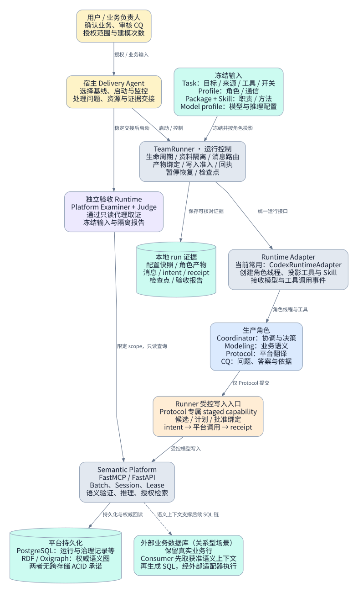
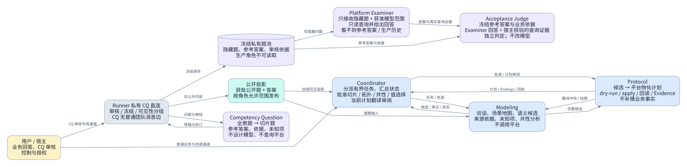
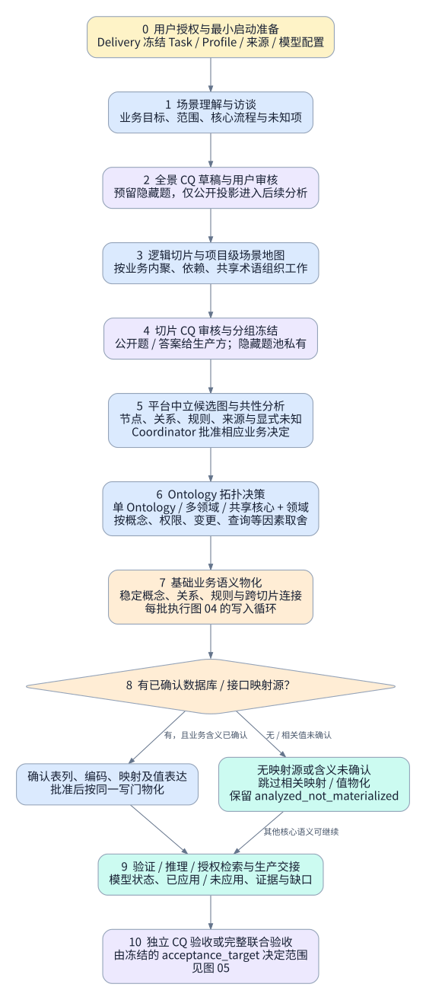
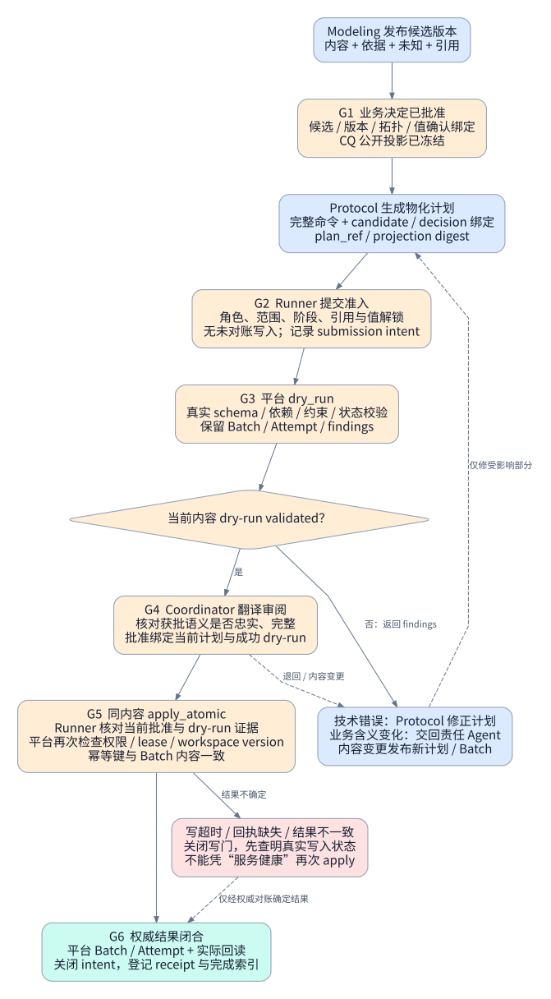
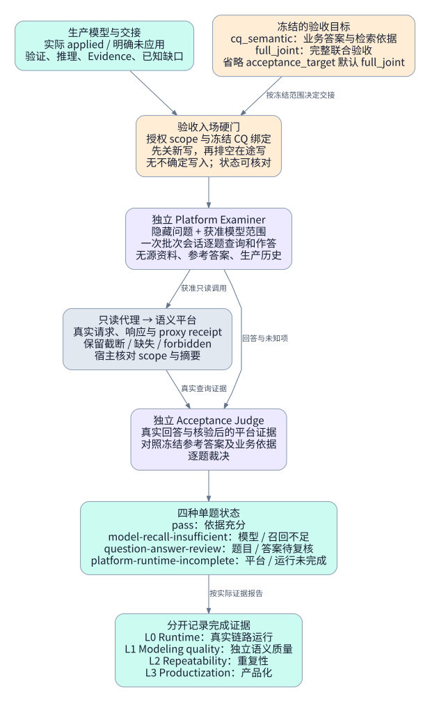
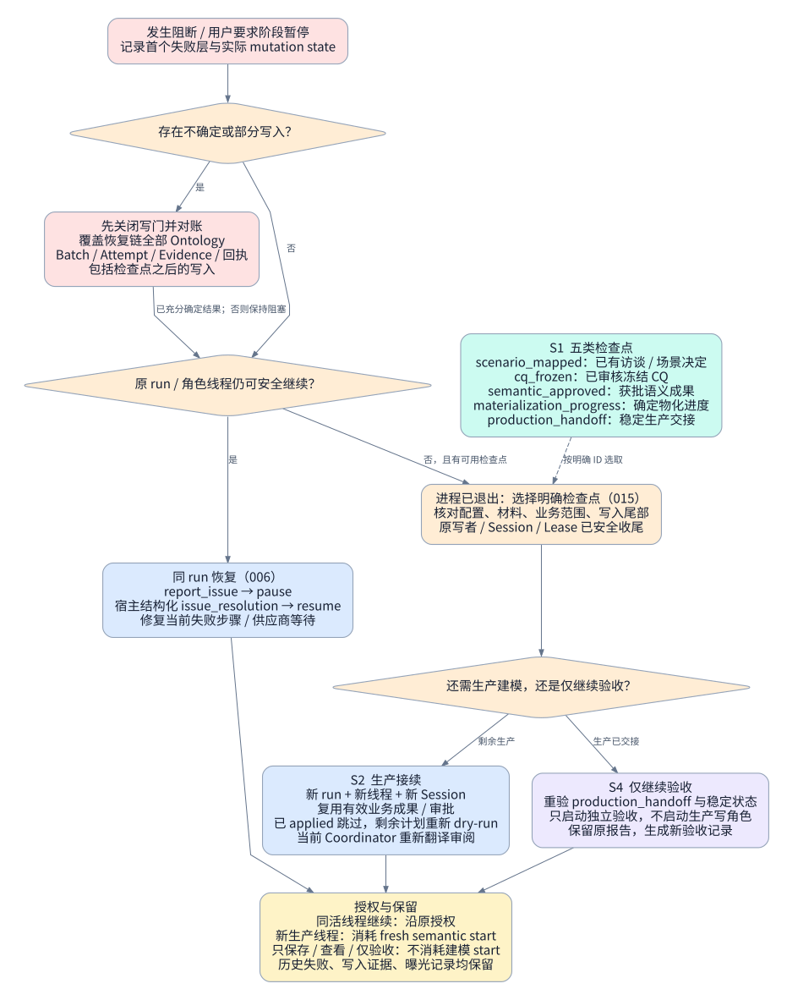

# Modeling Team 六图指南

当前代码读取基线：`08fe766`，2026-09-17。以 v3 staged / unified / CQ 路径为主；能力是否启用以冻结 Task / Profile 为准。本文件解释机制，不授予建模启动，也不声明真实运行 PASS。

[打开可缩放图解](index.html) · [六页 draw.io 可编辑文件](modeling-team-guide.drawio)

推荐按 01 → 06 阅读。图中的门禁编号 G1–G6 是本说明的导航编号，不是新增平台错误码。

## 01 · 系统架构：谁思考，谁执行，事实存在哪里

以当前 v3 staged / unified / CQ 路径为主；具体启用能力由冻结的 Task / Profile 决定。

- Runner 检查可观察的合同与写入事实；业务含义、拓扑选择和语义裁决由相应 Agent / 用户负责。
- 图中的写门针对 staged 模型与 Evidence 写入；Protocol 还通过获准平台工具管理 Session / Lease 与验证、推理等操作。
- 业务行留在外部关系库，平台语义图保存概念、规则和映射。示意箭头不表示平台自动执行 SQL。

来源：[TeamRunner 与写入准入](../../../modeling_team/runner.py)；[Runtime Adapter 接口](../../../modeling_team/runtimes/base.py)；[Codex 实现](../../../modeling_team/runtimes/codex.py)；[平台与持久化边界](../../../docs/architecture/overview.md)

## 02 · 角色关系与信息边界

三个生产角色经 Team Transport 协作；CQ 走 Runner 私有直连；独立验收另行启动。

- 这里描述当前 v3 任务合同。共享角色包还包含旧模式说明；不能脱离所选 Task / Profile 把旧角色数量或旧职责套到所有运行。
- 专业 Skill：Modeling 加载 ontology-modeling；CQ 加载 competency-question-authoring。Coordinator / Protocol 依靠角色提示和参考合同。
- 例：公开题可以问“设备安装在哪类地点”；隐藏题检验其他获批关系。把隐藏答案交给生产方后，相应题只能作为非盲测回归。

来源：[四角色 roster 和通信边](../../../modeling_team/profiles/r3-0-011-competency-question.yaml)；[当前角色 / Skill 对应](../../../modeling_team/skills/README.md)；[隔离验收输入](../../../modeling_team/acceptance_runtime.py)；[R3.0-008B / 009 / 011 职责](../../../docs/requirements/requirements-v3.0.md)

## 03 · 从业务资料到可检验的语义模型

先明确业务，再决定切片与拓扑；物化循环按获批范围逐批推进。

- 逻辑切片是工作组织，Ontology 是模型范围与治理边界，两者不要求一一对应。数据库表数量不能直接决定任何一种划分。
- 例如先确认“设备安装在服务站”，再表达设备、服务站及安装关系。表名、列名和样例值只能帮助映射，不能自行证明业务含义。
- 阶段允许修订受影响内容；新证据改变已批准业务或拓扑时，要显式重新确认。未知值不会阻止不依赖该值的核心语义继续。
- 默认授权含三次 fresh semantic starts，除非用户另定；授权后应在 20 分钟内开始真实语义工作。该规则约束宿主推进，不是平台内固定次数死门。

来源：[R3.0-008B 分阶段流程、009、011](../../../docs/requirements/requirements-v3.0.md)；[完整主线 Task](../../../modeling_team/tasks/r3-0-006-real-full.yaml)；[场景与拓扑产物合同](../../../modeling_team/scenario_map.py)

## 04 · 一个批次如何通过写入门禁

R3.0-014 的当前顺序：先 dry-run，再审阅平台翻译，最后 apply。

- dry-run 不应用正式模型资源，但会留下 Batch / Attempt 等执行证据。validated 只证明校验时点通过，不等于 applied 或语义质量 PASS。
- 不同的业务命令内容必须使用新计划与新 Batch；不能拿旧批准或相同幂等键掩盖内容变化。apply 前仍要检查当前运行状态。
- 纯 workspace version 漂移：重新 dry-run；若内容、决定和审批人不变，可按合同复用翻译批准。业务语义改变则重审受影响决定。
- 图中展示应保护的合同。当前代码仍存在对不闭合 intent / receipt 的 kill-switch；不是所有拒绝都已能自动恢复。遇到此类阻断需按 T0 检查必要性并报告首个失败层，不能把它判为模型质量失败。

来源：[R3.0-014 与 008B / 009](../../../docs/requirements/requirements-v3.0.md)；[提交入口与 G4 / G5 绑定](../../../modeling_team/runner.py)；[批准 / dry-run / intent / receipt 校验](../../../modeling_team/staged_decisions.py)；[真实平台调用与回读](../../../modeling_team/staged_batch_write_forwarder.py)

## 05 · 独立验收：模型能否真正支持业务问题

CQ 阶段验收可先产生语义证据；结论必须限定在启动时冻结的范围。

- cq_semantic 允许已知部分交付以及联合清单 pending，只要稳定读取、授权、业务依据与写入完整性门满足。已知未应用内容必须披露，不能缩减获批隐藏题分母。
- 完整 CQ PASS 需要覆盖获批题集。题目/答案待复核不是模型错误；平台调用未完成也不能推导模型质量结论。单题失败尽可能继续其余题。
- 知道指标公式、连接路径和映射，不等于验证数据库实际数值。真实 SQL 生成、执行与结果比对仍是独立证据链。
- 验收期间生产方不能修改模型。发现状态漂移或资料泄漏时，保留报告并取消相应完整 PASS / 盲测资格；修模由生产方承担，另记验收批次。
- completed 只说明某角色结束。恢复成功、测试通过、CQ PASS 和 full_joint PASS 分别表达不同事实。

来源：[R3.0-011 / 012 与 006](../../../docs/requirements/requirements-v3.0.md)；[批量验收、只读证据与角色隔离](../../../modeling_team/acceptance_runtime.py)；[四态裁决](../../../modeling_team/competency_questions.py)；[CQWriteAdmission 与交接](../../../modeling_team/runner.py)

## 06 · 失败后怎么继续：活线程、检查点与写入对账

先识别真实失败层，再恢复同一业务目标；检查点保存成果，不回滚数据库。

- 四类根因：modeling-quality、platform-contract、collaboration/routing、runtime/infrastructure。普通等待或格式错误应返回可操作反馈，不能自动等同整个 run 死亡。
- 当前 015 交付范围为 S1 + S2 + S4；S3 翻译批准自动迁移延后，因此新生产 run 走正常翻译审阅回退。不能声称所有审批均自动继承。
- 没有可用检查点或必要资源已丢失时，不能伪造恢复。代码 / 提示修复需要新进程时，可在记录新执行基线后按检查点合同接续。
- 保存检查点失败不应终止正常建模，也不要求所有切片均完成才保存。检查点不同于平台 Build Session checkpoint；前者交接阶段成果，后者属于平台会话生命周期。
- 图是当前机制说明，并非任何一次真实 L0 / L1 已通过的证明。本次只读取代码与文档、生成图解，没有启动建模或改动运行资源。

来源：[R3.0-006 / 015](../../../docs/requirements/requirements-v3.0.md)；[检查点保存与 inspect](../../../modeling_team/checkpoints.py)；[生产 / 验收接续与对账](../../../modeling_team/checkpoint_recovery.py)；[存活运行恢复与准入](../../../modeling_team/runner.py)

## 范围与验证

- 图解根据当前权威需求与实现核对；没有启动真实 modeling start、平台写入或独立验收。
- 006、008B、009、011、012、014、015 的需求状态和历史运行证据各自独立，不以本图解推导交付 PASS。
- Graphviz 生成 SVG / PNG；draw.io 文件是含六页的原生 XML，可通过 diagrams.net 导入编辑。
- 当前默认关系型场景中的业务行保留在关系库；RDF 保存业务语义及映射。
- 旧版 R2.3 单题 Source / Platform / Acceptance Examiner 路径仍有代码，但不是图中 v3 批量验收主线。
- 本次文档验证：XML 解析、draw.io 节点 / 边引用、PNG / SVG 渲染、相对链接及浏览器布局检查。不是平台功能测试或语义验收。
