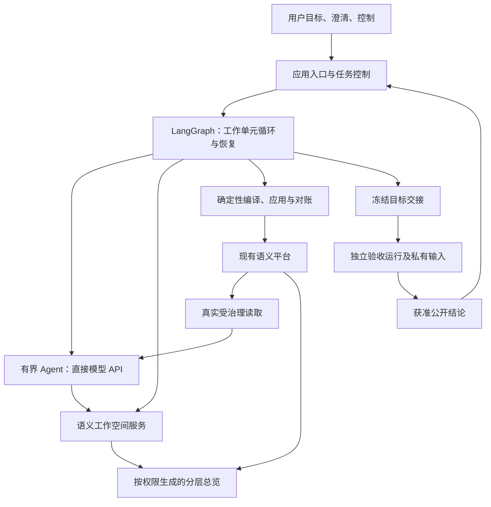

# v5 建模 Team 编排与执行层选型：LangGraph 与替代方案

日期：2026-10-27。状态：**源码核对与官方资料调研完成，形成选型建议；未做框架原型、性能对照或真实建模验证，未经过本轮独立设计审阅。**

本轮依据是用户要求评估 LangGraph、调研替代实现，并启动以建模 Team 重写和方法调整为主要目标的 v5。用户随后明确：**允许一并替换 Codex／DSH，优先更简单、可控的执行方式。** 这允许重新设计执行层，不等于已选定某个框架、模型或新运行预算。

方法依据：[语义工作空间与分层认知驱动的建模流程](../delivery/designs/2026-10-26-ontoweave-modeling-methodology-design.md)，特别是 §3、§5.3、§11—12、§17—18。版本范围登记在 [v5.0 需求](../requirements/requirements-v5.0.md)。原方法设计的独立 PASS 不自动覆盖本次技术选型。

## 1. 结论

**建议以 LangGraph 作为 v5 首选编排框架，Agent 直接调用模型 API；业务认知放在独立的语义工作空间，继续复用现有模型应用和受治理读取能力。**

首选组合是：LangGraph `StateGraph` 表达业务工作单元的循环；确实需要工具循环的节点使用 LangChain 的最小 `create_agent` 能力；Pydantic 定义边界输入输出；PostgreSQL 保存业务工作空间及独立命名空间中的流程检查点。简单确定性节点直接用 Python 函数。LangGraph 本身不要求使用 LangChain；这里选择其现成 Agent 循环，是为了避免再自行维护一套模型／工具循环。[LangGraph 定位](https://docs.langchain.com/oss/python/langgraph/overview)、[Agent 循环与结构化输出](https://docs.langchain.com/oss/python/langchain/agents)。

这个推荐针对本项目当前目标，不是通用框架排名，也不是已经测出的维护成本或降耗效果。关键收益来自职责调整：程序承担已明确的调度、等待与控制，模型承担有边界的语义判断，跨会话状态来自业务记录。仅更换框架不能保证这些收益。

**最值得保留的备选是 PydanticAI＋DBOS。** 若后续验证表明主要复杂性是异步任务队列、持久通知和普通 Python 接续，而显式执行图带来的价值有限，该组合可能更合适。当前更偏向 LangGraph，是因为目标设计已有明确的循环、重入点和隔离边界，适合直接成为可检查的流程代码。

## 2. 当前实现说明了哪些问题

源码基线：`5310cd21296fd022eceea7c9be27ce0d48325928`。本轮没有运行旧 Team。GitNexus 报告其索引落后 HEAD 512 个提交，因此以下以当前源码与调用点为依据，不声称完成了图索引影响覆盖。

| 当前入口 | 本轮核对到的事实 | v5 的处理建议 |
| --- | --- | --- |
| [runner.py](../../modeling_team/runner.py) | 14,239 行；`prepare`、`start`、`receive_outer`、`_drain_current_work` 等同时涉及角色启动、消息派发、CQ 依赖、预算、暂停、候选、应用、问题处理和收尾。 | 拆清业务工作、流程运行、模型调用、平台操作；不要把完整 Runner 塞进一个图节点。 |
| [Codex adapter](../../modeling_team/runtimes/codex.py)、[RuntimeAdapter](../../modeling_team/runtimes/base.py) | Codex 适配器 8,757 行；公共合同包含 native 身份、start／steer／enqueue、派发状态和进程控制。 | v5 的主执行合同直接围绕一次有界 Agent 工作及其工具结果设计；原生会话兼容不再是必需条件。 |
| [统一 Profile](../../modeling_team/profiles/unified-modeling.yaml)、[Coordinator 指令](../../modeling_team/agent-packages/coordinator/instructions.md) | 当前 Profile 固定启用 Coordinator、Modeling、CQ；指令同时包含统一图新路径和被其覆盖的旧执行要求。 | 将方法、工具权限和执行计划分别配置，减少靠长提示解释“旧规则在什么情况下失效”。 |
| [直接编译](../../modeling_team/direct_modeling.py)、[直接执行](../../modeling_team/direct_execution.py) | 已有明确变更编译、实际绑定、稳定提交身份、应用回执和不确定写入对账。 | 保留可验证的确定性核心，解开其与旧 Runner 的绑定；不重建应用／恢复框架。 |
| [业务阶段 checkpoint](../../modeling_team/checkpoints.py) | 保存不可变阶段材料、私有证据和平台状态引用；不是某个 Python 函数的指令位置。 | 与框架 checkpoint 分开：前者保留业务／交接证据，后者帮助执行接续。 |
| [work board](../../modeling_team/work_board.py)、[scenario map](../../modeling_team/scenario_map.py) | 已有协作与进度表达入口，但不是方法设计中跨 run 的完整命题／决定工作空间。 | 复用展示及引用经验，增加真正的业务内容权威；地图和工作卡改为引用／派生视图。 |

行数只说明阅读和改动范围，不单独证明代码质量。当前可确认的耦合是：同一个控制入口同时解释多种运行状态，方法推进又依赖角色消息、活跃提示和原生会话结果。v5 应减少这些重复解释。

必须区分三种图：**模型中的语义图**表达业务；**业务工作单元和依赖图**组织分析责任；**执行图**决定下一项程序／Agent 工作。LangGraph 只承担第三种，不能由执行节点数量决定 Ontology 拓扑或业务粒度。

## 3. 候选方案比较

下表中的能力来自链接的官方文档；“适配判断”是结合本仓库作出的推断。资料访问日期均为 2026-10-27，在线文档会变化；尚未锁定或验证具体依赖组合。

| 方案 | 已有能力与长处 | 当前需要承担的代价／边界 | 本项目适配判断 |
| --- | --- | --- | --- |
| **LangGraph＋直接模型 API** | 显式状态、条件路由、循环、子图、动态分派和检查点；节点可混合确定性程序与 Agent。 | 需要正确设计工作单元、状态大小、并发合并及外部副作用；开源库的检查点不等于完整任务服务。 | **首选。** 与目标方法的回退和接续结构最直接对应。[Graph API](https://docs.langchain.com/oss/python/langgraph/graph-api) |
| **PydanticAI＋DBOS** | 类型化 Agent；普通 Python 工作流、持久队列、消息与步骤恢复。DBOS 可使用 PostgreSQL，无须另外部署编排服务器。 | 工作流需要确定性重放；有 I/O 的普通函数工具要明确放入持久步骤；工具注册、流式返回和版本升级有约束。 | **强备选。** 偏好普通 Python 控制流时有吸引力。[DBOS 架构](https://docs.dbos.dev/architecture)、[PydanticAI 集成](https://pydantic.dev/docs/ai/capabilities/durable_execution/dbos/) |
| **Temporal＋直接模型／Agent SDK** | 持久 Workflow、Activity、消息、子工作流及版本管理，适合跨进程长期执行。 | 增加 Temporal Service／Worker 的部署与运维；外部 Activity 仍需幂等和对账。 | 当跨机器恢复、长期后台服务成为实际需求时更有优势；当前不因假设规模引入。[Python SDK](https://docs.temporal.io/develop/python) |
| **Pydantic Graph** | 用 Python 类型表达状态、分支和图，可独立于 PydanticAI 使用。 | 单独采用图表达并不直接完成本项目的任务调度、持久等待和恢复设计；仍需选择持久执行方案。 | 若团队非常重视类型驱动的流程定义，可作为局部选择；不同时引入两套图 DSL。[官方图说明](https://pydantic.dev/docs/ai/graph/graph/) |
| **Microsoft Agent Framework Workflows** | 函数／图工作流、Agent 集成、checkpoint 和人工输入能力；提供多种 checkpoint 存储。 | 仍需接入本项目工作空间、应用和隔离；也采用 superstep 检查点，不能直接解决独立工作单元的持续推进。 | 能实现目标，但当前未发现相对 LangGraph 足以改变选择的特有收益。[概览](https://learn.microsoft.com/en-us/agent-framework/overview/)、[checkpoint](https://learn.microsoft.com/en-us/agent-framework/workflows/checkpoints) |
| **CrewAI Flows** | 事件监听、结构化状态、条件流程和持久化，并非只能固定角色顺序执行。 | 仍需自定义语义工作空间和真实写入合同；恢复身份缺失等默认行为需要对齐本项目。 | 可行，当前没有证据证明更省维护。[Flows](https://docs.crewai.com/en/concepts/flows) |
| **普通 Python＋自建状态机／任务表** | 依赖少，代码可以完全贴合业务。 | 等待、恢复、并发、版本和观察责任都落回本项目，容易重新长成当前 Runner。 | 小型单流程适用，不建议作为本次完整重写的默认基础。 |

不建议首版叠加 LangGraph、DBOS、Temporal。应当选一个执行恢复权威。Temporal 已提供 LangGraph 集成，但本轮官方文档仍标为 Public Preview，且由 Temporal 接管持久性；它不是“再加一个 PostgreSQL checkpointer 就双保险”。[Temporal LangGraph 集成](https://docs.temporal.io/develop/python/integrations/langgraph)。

### 3.1 PydanticAI＋DBOS 为什么没有直接排第一

这是可落地的竞争方案，不是陪衬。它的模型调用和 MCP 通信可以成为持久步骤；直接注册的普通函数工具、动态工具装载、实时事件及取消需要按集成约束处理。框架升级时还须保持工作流版本与恢复代码相容。所需改动不一定比 LangGraph 更少，也不能把 `agent.run()` 外面加一个装饰器当作全部恢复设计。[集成边界](https://pydantic.dev/docs/ai/capabilities/durable_execution/dbos/)、[代码升级](https://docs.dbos.dev/python/tutorials/upgrading-workflows)。

若实测 LangGraph 为独立单元调度补出的外围代码明显更多，或它的执行图让日常方法修改更难读，应重新比较 DBOS。比较对象是同一小场景的完整实现和故障路径，不是“hello world”代码行数。

## 4. LangGraph 对方法设计的具体映射

**S0—S9 是方法步骤，不强制等于十个 Agent、十次模型调用或十个不可跳过的节点。** 图记录安全执行边界；一个 Modeling Agent 可在一次有界工作中完成 S2—S5，复杂时再交接。

| 方法内容 | 建议实现 | 决定含义的人／程序 |
| --- | --- | --- |
| S0 目标、范围、基线 | 任务入口绑定授权、材料版本、实际模型与公开评价范围；独立侧准备冻结题集。 | 用户授权；Agent 理解业务；程序绑定引用。 |
| S1 拆解 | Agent 提出工作单元及依赖，程序保存并派发获准、就绪的单元。 | 切分与整合责任由语义判断决定，不按文件或表数拆。 |
| S2—S4 捕获、解释、表达 | 有界 Agent 工作返回命题、决定、定义引用及明确变更意图，可一次跨多个方法步骤。 | Agent 判断；工具保留实际材料定位。 |
| S5 局部／跨单元整合 | 局部可在同次工作完成；父层整合读取直接子单元结果、共享定义和必要原文。 | 整合者核对组合语义，程序不通过节点连通性判定业务成立。 |
| S6 应用 | 确定性节点／工具调用现有编译和执行核心，立即返回真实结果。 | 程序执行，不增加 Protocol 翻译或逐批审批。 |
| S7 自查 | 独立于内部笔记的真实受治理读取；结果准确定位到捕获、解释、表达或检索。 | 生产侧 Agent 自查，不冒充独立通过。 |
| S8 独立验收 | 单独的验收运行、权限和输入空间，只接冻结目标与获准依据。 | 独立评价；生产调度只取得允许公开的结果。 |
| S9 变化分流 | 工具报告实际变化，Agent 判断语义影响和重入步骤；无变化复用有效工作。 | 不以图可达性强制全部返工。 |
| Q 澄清 | 保存共同未决项及受影响引用，仅暂停相关工作单元；回答后回精确步骤。 | 未答复不是默认批准，局部答复不扩散。 |
| R 对账 | 依据原操作、Batch／Attempt 与实际回执恢复。 | 结果不明先对账，不换身份重放。 |
| C1／C2 状态与总览 | 内容更新通过工作空间服务；摘要按相关变化失效并按需生成。 | 各状态保留原权威；摘要不成为确认依据。 |

建议采用一个可复用的“推进工作单元”执行图模板。业务单元是记录，不为每个切片生成一套永久图定义；父子责任存于工作空间。短时、确实需要汇合的局部并行可以使用子图／动态分派。[子图机制](https://docs.langchain.com/oss/python/langgraph/use-subgraphs)。

长时间等待的单元采用独立运行身份：例如“返修”在 Q 等年度口径时，“安装”继续推进自己的下一步。不要将所有单元放进一个必须整体汇合的父级调用。LangGraph 的并行节点按 superstep 推进；据此推断，本项目需要主动划定独立运行边界，而不能把并行分派直接当作互不阻塞的长期任务调度。[执行步语义](https://docs.langchain.com/oss/python/langgraph/graph-api)。

## 5. 建议的职责与数据流

### 5.1 工作空间与检查点分别保存什么

| 存储／记录 | 权威内容 |
| --- | --- |
| 语义工作空间 | 材料修订与审阅范围、命题、解释与决定、定义／变更引用、工作单元、未决项、依赖及覆盖去向。跨 Agent 和 run 存续。 |
| LangGraph checkpoint | 执行位置、当前单元及内容版本引用、等待项、未完成操作和结果引用；短期局部消息如有必要按单元隔离。 |
| 实际语义平台 | 已应用资源、身份、修订和受治理可读内容。 |
| 应用／验收证据 | 原操作结果、冻结模型／题集绑定、独立报告；保留原件。 |

框架的 Store 可以保存跨线程数据，但不能凭一个通用键值接口就取代业务修订、权限、覆盖和共享修改合同。[Persistence 的职责划分](https://docs.langchain.com/oss/python/langgraph/persistence)。

建议流程状态以 `workspace_ref`、`work_unit_id`、`content_revision`、`task_ref`、`budget_ref`、`next_action`、`pending_operation_ref` 和少量结果引用为主。这是设计示意，不是已冻结 schema。资料全文、全项目聊天、全部候选和所有子单元历史不随每次调度进入模型上下文。

同一稳定定义的并发更新在业务服务中核对基线，返回具体差异后允许重读和修正；不能通过 reducer 的拼接或最后写入覆盖来解决业务冲突。工作空间写入成功、执行 checkpoint 尚未保存时，恢复使用原操作身份读回结果，不能倒写旧业务状态。二者也不假设与 RDF 构成全局事务。

### 5.2 Agent 执行合同收窄

Agent 接收本单元目标、获准资料引用、相关定义、必要父层约束和本次变化，使用显式授权的读取／建模工具，返回结构化结果与自然语言理由。角色可以随工作承担；生产与独立评价仍隔离。

默认不再让普通建模步骤承担 CLI 进程、原生会话消息队列、任意 shell 或全仓库上下文的管理。若某任务确需文件处理，以已获准的材料／产物能力承接，不从“可替换 Codex／DSH”推导新增业务权限。

模型 SDK 的标准兼容不证明现有模型配置等价。[当前模型路由](../../modeling_team/model_routing.py)区分 Responses／Messages、实际模型与 effort；新直连路径必须核对工具调用、结构化输出、推理参数和真实 usage。现有获准模型不能因为 SDK 默认映射而被静默改名、降档或换端点。PydanticAI 等 SDK 已提供 Z.AI 接入，但其默认端点和 effort 映射仍需与本任务配置逐项对齐。[Z.AI 接入说明](https://pydantic.dev/docs/ai/models/zai/)。

### 5.3 Delivery 的目标形态

建议将 Delivery 的机械职责移入程序：启动就绪工作、等待实际结果、响应用户暂停、跟踪预算、发起合法验收交接、收尾。需要解释自然语言、作实质选择或向用户说明复杂问题时，再调用有界助手。Coordinator 保留业务分解与整合职责，不成为逐工具批准者。

这是对 v4 活跃职责的明确目标变化：承接 R4.3-029／030 的程序监督方向，并替换“常驻 Delivery 模型解释所有流程事件”的依赖。R4.4-003 中及时响应用户／Host 和关键事件的要求保留；普通状态观察由程序完成，不按计时器无条件唤醒模型。该变化须在实施时同步权威角色与工具合同。

## 6. 必须正面处理的工程边界

这些边界来自现有写入、协作、长程运行和权限需求，不是额外增加的语义审批门。

| 情形 | 必须具备的行为 |
| --- | --- |
| 应用已成功，节点保存 checkpoint 前进程退出 | 通过原提交身份和平台回执确认成功，更新业务引用；不能再次创建同义资源。 |
| 请求超时，实际效果未知 | 进入 R；已知无效果与未知结果分别处理。自动重试策略不覆盖应用语义。 |
| 恢复或人工回答导致节点重执行 | 节点前置副作用必须可识别和复用；恢复不是从 Python 任意中断行原地继续。 |
| 一个业务单元等待澄清 | 其他不依赖它的单元继续；共同未决项的答复按适用范围逐项生效。 |
| 同时推进共享定义 | 各单元用独立运行身份；业务更新校验真实基线。持久子图的同一 namespace 不被并发写。 |
| 用户暂停、停止或预算不足 | 及时关闭新模型调用／写入准入，记录已在途的实际结果；不能把框架暂停解释为云端调用已经取消或不再计费。 |
| 格式错、字段缺失、循环上限触发 | 返回可定位反馈并保留工作；执行框架的运行上限不等于用户预算或语义不通过。 |
| 运行中更新流程代码 | 保留流程／状态版本与稳定节点身份；不让旧等待任务跳入不相容的新代码。 |
| 验收及摘要读取 | 权限在读入与生成前生效；不同 graph／thread 本身不是安全隔离。 |

LangGraph 的 `interrupt` 恢复会重新进入节点，调用前的代码可能再次执行。[Interrupts](https://docs.langchain.com/oss/python/langgraph/interrupts)。PostgreSQL checkpointer 与同步持久化有助于保存执行进度，但不能使外部 HTTP／RDF 操作和 checkpoint 自动成为一个事务；完成节点的 pending writes 也不能证明外部业务效果。[Checkpointers](https://docs.langchain.com/oss/python/langgraph/checkpointers)。

持久子图同 namespace 并行调用有冲突限制，因此本项目应使用稳定、独立的工作单元运行身份；复用长期业务内容通过工作空间，而不是共享所有局部聊天。[子图持久性](https://docs.langchain.com/oss/python/langgraph/use-subgraphs)。挂起线程所指向的节点删除／重命名和不相容状态变更也需有版本处理，不能把运行中任意改图当作无代价能力。[图迁移](https://docs.langchain.com/oss/python/langgraph/graph-api)。

恢复并不保证模型请求恰好计费一次。调用已发生但结果未落盘时，保留真实请求身份和用量缺口；选择一层负责重试，防止 SDK、Agent 与工作流各自重试造成乘法放大。任务累计用量、费用及外部 Host 单列口径继续按现有预算合同执行。

## 7. v5 重写与迁移顺序

| 阶段 | 最小交付 | 完成证据 |
| --- | --- | --- |
| 选型验证 | 锁定依赖，完成一个有两个工作单元、共享定义、局部等待和应用对账的最小执行路径。 | 下节 V1—V8 的工程证据；不先开发完整双框架实现。 |
| 第一条完整业务链 | 工作空间最小对象＋直连 Agent＋流程循环＋直接应用／真实读取＋独立交接。 | 方法 S0—S8 的真实有界证据；获准真实启动后遵循仓库 20 分钟启动要求。 |
| 分层与增量 | 递归责任、共享修改、S9 重入、来源变化及分层总览。 | 方法 A1—A23 对应范围逐项验证，局部通过不能冒充全版本完成。 |
| 切换默认入口 | 新任务使用 v5；旧 run、预算、应用与验收原件保持可读；旧运行在原合同下收口。 | 新入口真实采用、迁移读取及暂停／恢复验证；无长期双写。 |

代码可以先在独立 v5 包中实现，避免在当前巨型 Runner 内继续叠加版本分支；具体目录在实施设计时确定。保留现有平台服务，优先复用确定性核心及有价值的回归用例。新的 Agent 指令围绕新工作空间与方法编写，不整体复制历史角色长提示。

不承诺把正在运行的 Codex／DSH 会话热迁为新 SDK 会话。迁移的是可核对的业务内容与实际结果引用；无法还原的历史依据标明缺口，不能伪造命题或确认过程。框架接续身份、业务工作单元、任务预算和历史 run 身份分别保留。

## 8. 选型验证应验证什么

以下尚未执行，属于后续工程阶段的有界验证建议。先验证主选方案；只有发现会改变选型的具体障碍，才用同一场景验证 DBOS 备选。

| 编号 | 场景 | 可观察判据 |
| --- | --- | --- |
| V1 | 两个单元并行，其中一个等待业务答复 | 另一个继续跨步骤推进；同一问题只维护一份，答复不越范围。 |
| V2 | 工作空间结果已保存／应用已成功后，在流程 checkpoint 前终止进程 | 恢复能找到真实结果；已确认成功的应用不重复。 |
| V3 | 平台超时且结果未知；随后读到已应用或明确未写入 | 分别进入读回或安全重试；不换提交身份。 |
| V4 | 两个单元基于旧共享定义并发修改 | 返回具体基线冲突、允许修正，无静默覆盖；无关单元继续。 |
| V5 | 用户暂停、预算暂停、恢复、取消及在途模型响应 | 新调用／写入准入受控；结果与费用边界准确，恢复不重置预算。 |
| V6 | 独立验收带隐藏题和答案，生产读取工作空间／总览 | 生产无可达的私有输入；验收不能调用写入能力；只回流获准公开结果。 |
| V7 | 更新流程版本；原任务停在 Q／R；换一个 Agent 接续 | 原等待项和实际应用不丢失，不需重载全项目聊天，不错误进入新节点。 |
| V8 | 相同范围与模型设置下比较 v4／v5 | 记录模型往返、总输入／输出、其他角色成本转移、等待时间、恢复补读及宿主介入；另做独立语义评价。 |

V1—V7 可以先用确定性夹具证明机制，不能称为真实 Agent 或语义验收。真实模型工具行为、框架维护成本、上下文增长和 V8 净收益均需实际运行。完整方法还要验证材料查漏、条件与例外保真、跨单元组合、来源撤回和摘要权限；这些不由编排框架测试代替。

可维护性至少通过三个真实修改演练评估：增加一种可恢复结果、调整一个方法重入点、修改一个 Agent 的工具集合。观察是否可以在对应模块完成并复用局部测试，而非同时修改多个角色提示、transport 和 Runner 分支。不设没有基线的代码行数或 token 降幅承诺。

## 9. 实质决策表

本表是本轮主记录。用户确认的是目标与重写空间；下列推荐不冒称已逐项批准或通过独立审阅。

| 编号 | 决策／推荐 | 理由与状态 |
| --- | --- | --- |
| D1 | 开启 v5，以 Team 重写、可控／可维护及采用指定方法为主要目标。 | **用户明确目标**；原方法作为语义目标基线，框架选择另行评估。 |
| D2 | 允许替换 Codex／DSH；推荐以模型 API 直接执行有界 Agent 工作。 | **用户明确允许替换**；直连是本轮建议，可减少原生会话管理层，实际 provider 等价待验证。 |
| D3 | LangGraph 为首选；PydanticAI＋DBOS 为主要备选；首版只选一个恢复引擎。 | **选型建议，待有界工程验证定案**；不以功能清单代替维护性证据。 |
| D4 | 工作空间保存长期业务认知；执行图保存控制位置；实际平台保存已应用语义。 | **沿用方法设计的权威边界**；实现方式建议使用现有 PostgreSQL／RDF 基础。 |
| D5 | 按工作单元推进；方法步骤可合并；机械 Delivery 程序化，语义整合按需调用 Agent。 | **本轮架构建议**；保留局部等待、递归责任及可修正反馈，减少无意义往返。 |
| D6 | 复用直接应用／对账／治理读取；独立验收使用单独输入、工具和运行边界。 | **沿用现行硬约束与目标方法**；图结构不能替代授权或语义评价。 |
| D7 | 新入口逐步替代旧路径，保留旧证据；按同范围质量、成本及修改演练验证效果。 | **迁移与验证建议**；不热迁原生会话，不长期双写，不把设计或机制检查称为真实效果。 |
