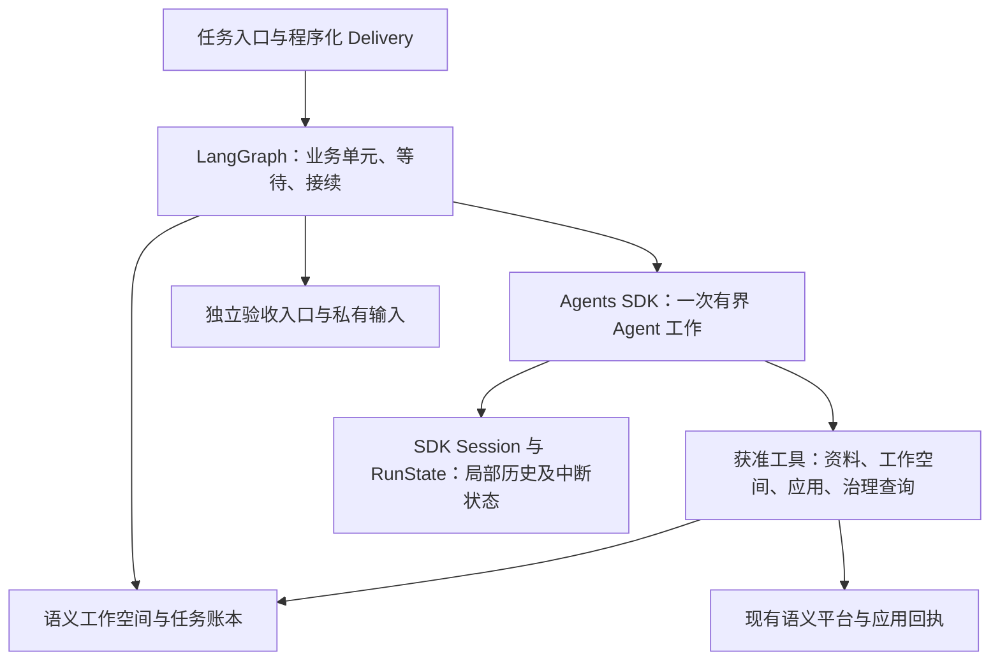

# v5：LangGraph＋OpenAI Agents SDK 方案评估

日期：2026-10-27。状态：**官方文档与当前仓库合同评估；未安装候选 SDK、未调用真实模型、未完成运行或语义验收。**

2026-10-28 补充：本文保留 Agents SDK 的方案评估。用户后续暂定 Codex harness，并要求前置功能验证，见 [v5 改造计划](../delivery/implementation-plans/2026-10-28-v5-langgraph-codex-migration-plan.md)。本文的 SDK 优先建议为 10 月 27 日判断；Agents SDK 保留为实际缺口出现后的备选，最终采用仍须功能证据。

用户在[五方案比较](2026-10-27-v5-agent-runtime-comparison.md)后提出 DSH 仍处早期版本，要求重点评估 OpenAI SDK 构建方案。本文继续将 SDK 理解为 **OpenAI Agents SDK**。当时 LangGraph 已确认，执行层尚待选择，未授权更换模型；归属 [R5.0-001](../requirements/requirements-v5.0.md#r5-0-001)，并承接 R5.0-002／004／006／007 的工作空间、应用、验收与计量要求。

## 1. 结论

**建议将 LangGraph＋Python OpenAI Agents SDK 提升为优先验证方案。** 它适合把通用 Agent 循环交给库，把业务控制留在本项目 Python 代码中。相比围绕独立 CLI／运行时建立控制桥接，预计可减少进程、会话协议和运行时内部组合的适配责任；这是接口结构上的判断，尚非已测维护收益。[SDK 的责任边界](https://developers.openai.com/api/docs/guides/agents/sdk)。

该建议有一个实际前提：**当前 GLM 路由必须能够承接需要的能力。** 使用 Agents SDK 不等于改用 OpenAI 模型；基础调用兼容也不等于原生压缩、工具加载和全部运行行为兼容。[官方模型边界](https://developers.openai.com/api/docs/guides/agents/models)。

若使用获准的 OpenAI 原生模型路径，该方案的上下文能力可以沿官方实现验证；若继续当前 GLM，先核对压缩与控制的实际支持。需要大量自建上下文管理时，应与 Deep Agents 比较完整实现成本。DSH 保留为定制备选，不因开发预览标签直接判为不可用。

## 2. 如何看待成熟度

本次可以确认的是：SDK 已有公开的 Agent／Runner、函数工具、MCP、会话、流式运行、可恢复状态及观察接口，应用可以围绕这些接口集成，无需依赖某个 CLI 的内部启动树。[SDK](https://developers.openai.com/api/docs/guides/agents/sdk)、[运行](https://developers.openai.com/api/docs/guides/agents/running-agents)、[MCP 与观察](https://developers.openai.com/api/docs/guides/agents/integrations-observability)。

不能由“OpenAI 官方”推导长期兼容承诺、低故障率或所有扩展同样成熟。基础循环、SandboxAgent、模型后端特有能力要分开验证；锁定实际 Python 包版本，并通过一次有界接入核对公开接口。本文没有发布历史、故障率或长期支持数据，不给出无依据的成熟度评分。

## 3. 建议构建方式

一个就绪业务单元由 LangGraph 发起一次 SDK 工作；Agent 可以在内部多次读材料、调用工具、修正结果，不将每次工具调用都提升为外层图节点。它返回业务结果引用、需澄清事项或可恢复问题，外层据此推进。长等待单元仍使用此前验证过的独立运行边界。

| 层 | 具体职责 |
| --- | --- |
| LangGraph／任务控制 | 单元就绪、业务依赖、澄清等待、用户控制、合法验收交接；机械 Delivery 不需要常驻 LLM。 |
| Agent／Runner | 模型与工具循环、结构化结果、事件、局部上下文和必要的有界委派。 |
| 现有工具与服务 | 源资料读取、业务工作空间、直接应用、原操作对账和受治理查询；SDK 接入不改变授权合同。 |
| 持久记录 | 工作空间保存业务内容；SDK session 保存局部历史；RunState 保存可恢复中断；LangGraph checkpoint 保存业务执行位置。 |

首个实现只需一个具体 SDK 接入，不先建设五运行时通用框架。已有私有 MCP 可由 SDK 客户端通过 stdio／streamable HTTP 连接，不必开放成托管远程 MCP。优先复用当前有效工具合同。[SDK MCP 接入](https://developers.openai.com/api/docs/guides/agents/integrations-observability)。

数据库句柄、授权身份和账本依赖可放入 SDK 的本地 run context，由工具代码读取；它们不必跟随业务提示反复进入模型上下文。模型需要的业务事实则通过获准输入和工具提供。[本地 context 与模型上下文](https://developers.openai.com/api/docs/guides/agents/define-agents)。

SDK 的 handoff 会转交对话控制，agents-as-tools 则保留调用者责任。本方案的跨业务单元调度由 LangGraph 承担；只有单元内部确需局部助手时再使用 agents-as-tools，不默认增加一层全项目 LLM Manager。[委派语义](https://developers.openai.com/api/docs/guides/agents/orchestration)。

## 4. 会不会又变成自己写 Agent 优化

**只用普通 `Agent`，仍需自己组织不少长任务策略；采用 SDK 现成能力可以减少这部分工作，但不能宣称与完整 harness 自动等价。**

| 能力 | 现成部分 | 本项目仍需做的事 |
| --- | --- | --- |
| 模型／工具循环 | Agent／Runner、函数工具、结构化输出、流式运行。 | 定义有界目标、工具权限和可恢复业务结果。 |
| 会话与暂停接续 | Session 管历史；中断结果可转为 RunState 并序列化。 | 持久保存引用、接回原业务单元；处理进程突发退出时已发生的副作用。 |
| 文件与 Skills | SandboxAgent 提供执行环境接入；默认含文件、shell、compaction，Skills／Memory 按需启用。 | 装载获准材料、选择需要的能力，维持生产与独立验收隔离。 |
| 长上下文 | 官方提供自动、阈值和显式阶段压缩示例。 | 验证模型路径支持，记录压缩成本，保留可重新读取的实际业务依据。 |
| 大工具结果 | 可以通过文件和工具按需读取。 | 本轮未确认其具有与 Deep Agents 等价的默认自动结果外置；需要验证或复用项目产物引用能力。 |
| 运行观察 | SDK 内建 tracing，结果暴露调用记录与 usage。 | 对接任务事件和真实费用账本；明确 trace 导出配置，不把 trace 当作预算准入。 |

能力依据：[Agent 定义](https://developers.openai.com/api/docs/guides/agents/define-agents)、[状态](https://developers.openai.com/api/docs/guides/agents/results)、[SandboxAgent](https://developers.openai.com/api/docs/guides/agents/sandboxes)、[压缩示例](https://developers.openai.com/cookbook/examples/agents_sdk/building_reliable_agents_memory_compaction)、[tracing](https://developers.openai.com/api/docs/guides/agents/integrations-observability)。

本项目有长期材料阅读与产物维护需求，验证应覆盖 SandboxAgent 所提供的这些实际能力，不能只跑一轮普通 Agent 问答。简单判断仍可使用普通 Agent；这属于同一 SDK 的能力选择，不是新增另一套运行框架。若现有获准工具已满足某项文件操作，就不为形式完整再引入沙箱能力。

业务命题、决定和应用结果继续写入语义工作空间；SDK 的 Memory 或压缩摘要不成为第二套业务权威。官方示例本身也区分当前工作压缩与跨任务经验记忆；持续业务内容应保持可查原件。[Memory／Compaction 示例](https://developers.openai.com/cookbook/examples/agents_sdk/building_reliable_agents_memory_compaction)。

## 5. 当前模型路径是首要验证点

仓库 [glm-flash-low.yaml](../../modeling_team/model-profiles/glm-flash-low.yaml) 为各角色声明 `glm-direct / glm-5.3-flash / low`；[model_routing.py](../../modeling_team/model_routing.py) 将它映射到 GLM 的 Responses 端点。该代码事实给 SDK 接入提供了起点，但不是今天端点可用性或完整兼容的实测。

| 路径 | 评估 |
| --- | --- |
| 当前 GLM Responses 路由 | 优先保持，核对工具调用、结构化输出、实际 effort、流式错误、usage 和续接；不静默换协议或模型。 |
| OpenAI 原生 Responses | 若另获模型及 API 费用授权，原生压缩和 SDK 高级能力更直接匹配文档；仍需本项目实际验证。 |
| 当前 DSH Messages 路由 | 不是把同一 URL 填入 Responses 客户端即可；需要独立 provider 适配或明确选择现有 Responses 路径。 |
| 当前 `openai-codex` 路由 | 仓库将其绑定到 Codex 的订阅登录，不能当作普通 SDK API key 直接继承。若改用 OpenAI API，需要对应凭据与预算授权。 |

官方的 `Compaction()` 示例使用服务端压缩；Responses 的 `context_management` 与 `/responses/compact` 有专门合同。**第三方提供名为 Responses 的端点，不证明它实现这些合同。** 若 GLM 不支持，需要评估显式摘要／历史管理的最小实现及成本，不能将该工作隐藏在“兼容 OpenAI”里。[压缩合同](https://developers.openai.com/api/docs/guides/compaction)、[SDK 模型能力边界](https://developers.openai.com/api/docs/guides/agents/models)。

当前仓库还有一个确定的接入边界：[deepseek_provider_proxy.py](../../modeling_team/deepseek_provider_proxy.py) 的 `do_POST` 只接受 `/responses`，其他路径返回 404。因此沿用现有代理时，独立 `/responses/compact` 不能原样使用；同一 `/responses` 请求内的服务端压缩参数是否被 GLM 支持，仍需真实验证。本轮不扩展代理，也不据此判定所有压缩方式都不可用。

OpenAI 官方 SDK quickstart 使用 API key；本文不据此修改现有模型、凭据或金额授权。[Quickstart](https://developers.openai.com/api/docs/guides/agents/quickstart)。

## 6. 暂停、预算与恢复的实际边界

SDK 文档支持运行中断后从 state 接续，Python 的 `to_state()` 提供中断快照。但取消流、保存会话和 LangGraph checkpoint 都不等于远端停止计费，更不等于任意进程崩溃后的工具效果只发生一次。[运行与取消](https://developers.openai.com/api/docs/guides/agents/running-agents)、[状态序列化](https://developers.openai.com/api/docs/guides/agents/results)。

本项目的最小接入仍需完成三件事。2026-10-28 核对修正：控制语义以 [R4.4-002／003 的 2026-10-22 最新口径](../requirements/requirements-v4.4.md#r4-4-002)为准，覆盖此前逐请求截断与忙碌取消建议：

1. **回合准入与结算**：复用现有 [provider 代理](../../modeling_team/deepseek_provider_proxy.py)及任务账本的用量来源，覆盖压缩、子 Agent 和重试；不另建 SDK 费用主账。新原生 activity 开始前检查预算，已开始 activity 的内部后续自然完成并记录尾差；不能把整项业务任务视为一个无限长回合，也不用 `max_turns` 代替金额预算。
2. **业务暂停与在途处理**：新输入及暂停／停止即时入队，目标 activity 自然结束后处理，确认停稳前不升级状态；禁止新的未获准回合，保存可恢复状态并记录在途结果。恢复沿原工作单元和 budget_ref；缺用量保留未知。SDK 的 activity 边界须在候选验证中明确映射，不直接套用 Codex 的协议身份。
3. **应用效果恢复**：沿用 [direct_execution.py](../../modeling_team/direct_execution.py) 的原操作身份及回执。平台写入成功、SDK／图状态未保存时先对账，不让两层各自盲目重试。

不因 SDK 具有 guardrail 或人工审批能力而增加逐批审批，也不把可修正工具错误变成整个目标永久终止。独立验收继续使用单独输入、权限与运行状态。

## 7. 足以决定下一步的有界验证

不先重写整个 Team，也不重复已完成的 [LangGraph 机制实验](../delivery/test-docs/2026-10-27-v5-langgraph-risk-validation.md)。首先锁定 SDK 版本，以当前获准模型和一组既有工具验证：

| 验证 | 决定性证据 |
| --- | --- |
| 模型与工具合同 | 实际 provider／模型／effort 正确；一轮工具调用、结构化结果和 usage 完整；第三方不支持的能力明确暴露。 |
| 上下文能力 | 大材料与工具结果可按引用读取；一次真实压缩／等价摘要后条件、例外和出处可恢复；记录额外用量。 |
| 控制与接续 | 忙碌时输入／控制先排队，当前 activity 自然结束，下一回合受控；在途结果和尾差不丢；沿原身份恢复；写后崩溃不重复应用。 |
| 方法与成本 | 采用同一业务目标和独立评价，统计全部往返、输入／输出、压缩、重试和宿主介入；不以短样例成功代替完整建模质量。 |

如果前三项能以少量公开 API 接入成立，就有理由进入第一条真实建模链。若 GLM 路径要求大规模重建上下文优化，则优先拿 Deep Agents 的同条件结果对照；若主要问题是工具／状态合同，先修最窄接入层，不再扩大框架选型。

**本方案仍是直接以 Python 组合运行策略的候选；最新验证顺序见文首补充，Agent 最终选型未确认。** 本次没有新增运行授权、启动收费测试或修改生产代码；官方能力说明与架构推断均不计为运行 PASS。
