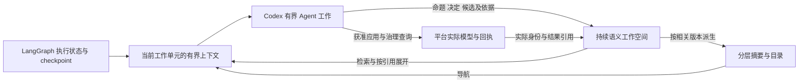

# 建模 Team 长短期记忆方案调研与 v5 适配建议

日期：2026-10-28。状态：初步调研与方案建议；用户已确认登记为 [R5.0-008 建模 Team 长短期记忆与上下文压缩专项研究](../requirements/requirements-v5.0.md#r5-0-008)。本文作为专项输入，研究待深化；未据此确认最终选型、实现、检索质量或净降耗通过。

2026-10-30 更新：本轮自主研发已采用本文建议的最小组合用于功能闭环：既有 PostgreSQL
版本工作空间、身份／文字检索与精确展开、Codex 原生上下文及带依赖／实际模型版本的
派生总览。项目跨任务、变化和分叉接续已有公开有界证据，见
[核心收口](../delivery/records/2026-10-30-v5-core-closure.md)。这不是完整增强记忆选型或
净降耗通过；下文外部产品比较仍为 2026-10-28 的调研快照，未在本轮重新核验其在线现状。

后续实证：[共享记忆有界验证](../delivery/test-docs/2026-10-28-v5-shared-memory-validation.md)已验证
两个真实 Agent 对同一版本记录发生冲突后合并、先提交内容保留，以及新消费者仅从记忆答题，
独立评价 6/6 PASS。该实证只覆盖既有工作空间按 ID／版本读取的路径，不覆盖相互矛盾的来源、
资料撤回、未知位置检索、摘要刷新或净降耗，不改变本文其余候选方案的研究状态。

**结论：可以借鉴现有 Agent 记忆实现，为建模 Team 提供“有界当前上下文＋可查询的持续业务记录”。最贴合当前方向的组合是 LangGraph 执行状态、Codex 局部上下文管理、PostgreSQL 语义工作空间，以及摘要导航和按需读取。** 优先复用已确认的 v5 方向，先以身份／关键词／显式引用建立可靠回查，再依据实际漏召回增加向量检索；首版不需要完整接入另一套自动抽取业务事实的记忆平台。

归属需求为 [R5.0-008](../requirements/requirements-v5.0.md#r5-0-008)，关联 [R5.0-001／002／005／006／007](../requirements/requirements-v5.0.md)，并承接 [R4.3-030](../requirements/requirements-v4.3.md#r4-3-030) 的有界上下文与降耗目标。方法依据为[语义工作空间设计](../delivery/designs/2026-10-26-ontoweave-modeling-methodology-design.md)；执行方向沿[现有 v5 改造计划](../delivery/implementation-plans/2026-10-28-v5-langgraph-codex-migration-plan.md)。下文的适配结论是本项目建议，不是这些产品的通用性能排名。

## 1. 先区分保存、检索和上下文压缩

短期与长期主要区别在**使用范围**，不在于是否写磁盘。会话 checkpoint 即使持久化，仍可只是某个 thread 的短期执行记忆；跨 thread、跨 run 的业务知识才需要独立的长期存储和查询入口。[LangGraph 记忆概览](https://docs.langchain.com/oss/python/concepts/memory)。

| 能力 | 解决的问题 | 自身不能保证的结果 |
| --- | --- | --- |
| 保存完整记录 | 历史原文、判断和回执不随会话结束消失 | 保存下来不等于模型会找到、会正确使用 |
| 检索 | 在大量记录中找到当前相关内容 | 相似度高不等于含义等价，Top K 不代表信息完整 |
| 压缩／裁剪 | 降低当前推理携带的历史量 | 摘要可能遗漏条件；删除后无法凭向量恢复原文 |
| 执行 checkpoint | 知道程序推进到哪里、哪些工作待接续 | 不自动压缩模型历史，也不是业务认知的唯一权威 |
| 提示缓存 | 复用相同输入前缀的计算 | 不减少逻辑上下文大小，不替代长期查询 |

因此，目标应是**把较少的相关信息送入当前推理，同时保留完整、可定位的依据**。一份不断增长的总摘要或一份全量历史注入，都不能单独实现这个目标。

## 2. 常见实现方式

| 方式与代表实现 | 短期／长期机制 | 可以借鉴的部分 | 对建模 Team 的适用限制 |
| --- | --- | --- | --- |
| 滑动窗口、工具结果裁剪、滚动摘要 | 当前上下文只留近期消息、必要状态及较早历史的摘要 | 先移出大段工具结果，保留当前未决工作和原件入口 | 只保留最近 N 条容易丢早期约束；反复摘要会积累遗漏。Claude 的 context editing 明确区分工具结果清理与摘要压缩。[官方说明](https://platform.claude.com/docs/en/build-with-claude/context-editing) |
| LangGraph checkpoint＋Store | checkpoint 保存 thread 状态；Store 用 namespace／key 保存跨会话文档，可接持久后端 | 执行接续与跨会话业务记录分开；支持有界工作单元 | Store 提供存取基础，不会自动定义命题、冲突、版本或授权；不应再复制一份业务权威。[长期记忆](https://docs.langchain.com/oss/python/langchain/long-term-memory)、[持久化](https://docs.langchain.com/oss/python/langgraph/persistence) |
| 文件记忆与按需读取：Claude Memory、OpenClaw | 文件承载长期记录；小目录／摘要常驻，正文按需搜索、展开；OpenClaw 可结合关键词和向量召回 | “小入口＋可查原文”；把保存和注入分开 | 多 Agent 并发编辑、权限投影和业务版本需另行处理，不能给所有角色共享整份记忆。[Claude Memory](https://platform.claude.com/docs/en/agents-and-tools/tool-use/memory-tool)、[OpenClaw Memory](https://docs.openclaw.ai/concepts/memory) |
| Letta／MemGPT 的分层记忆 | 经典 V1 方案有核心 blocks 与外部历史／归档；当前 Agent SDK 文档采用 Git 支持的 MemFS，少量 system 文件常驻，其余按文件树读取 | 区分常驻信息和外部记忆；版本化内容与共享入口 | 新旧 SDK 机制有差异，不能混写成一个接口；共享仍需本项目权限和更新基线。Git 方案不是当前 PostgreSQL 工作空间的必要替代。[当前 Memory](https://docs.letta.com/agent-sdk/memory)、[V1 stateful agents](https://docs.letta.com/v1-sdk/concepts/stateful-agents) |
| Mem0 的事实抽取记忆 | 对消息调用 LLM 抽取事实／偏好，再按用户、Agent 或 run 范围保存和检索，也可选择原文写入 | 捕获有长期价值的决定；显式区分原文与抽取物 | 逐条抽取增加模型调用；业务命题可能含条件、例外与争议，不能把抽取结果直接升级为确认语义。当前 add 文档描述 additive／ADD-only，不应套用旧版本自动更新消冲突的假设。[Add Memory](https://docs.mem0.ai/core-concepts/memory-operations/add) |
| Graphiti／Zep 的时态图记忆 | 从 episode 增量形成实体、关系及时间信息，结合全文、向量和图关系检索 | 关系导航、历史适用性、来源定位 | 另行抽取会增加开销和一致性责任；抽取图不能替代我们实际应用的本体，也不能代替 Agent 的含义判断。[Graphiti 概览](https://help.getzep.com/graphiti/getting-started/overview) |
| 程序经验记忆：OpenAI Agents SDK 官方示例 | compaction 承接当前运行；memory 保存可复用工作经验；正式成果保留在有依据的产物中 | 将操作经验与业务结论分开，避免记忆成为影子事实库 | 示例不证明当前 provider、Codex 接入或 Team 已支持相同接口；只借鉴其职责分工。[Memory and Compaction 示例](https://developers.openai.com/cookbook/examples/agents_sdk/building_reliable_agents_memory_compaction) |

这些方式可以组合。向量数据库、Redis、PostgreSQL、文件系统是存储或索引选择；单独选定它们，并未解决“记什么、何时更新、谁能读、读多少”。

## 3. 当前已有基础和主要缺口

源码核对基线为 `1edb162a88c14e2c24140ce9537b19b23e148515`。工作区的其他未提交变更保持独立；下表不把未提交 v5 草稿计作已交付能力。GitNexus 索引落后当前基线 518 个提交，本轮依据当前文件与工具目录核对，不声称具有当前图索引覆盖。

| 当前基础 | 实际可复用内容 | 仍需补齐的记忆能力 |
| --- | --- | --- |
| [Delivery](../../modeling_team/delivery.py) | `yield_delivery.active_decisions` 已记录决定、依据及替代关系；决策包和阶段换线程可承接当前状态；`read_delivery_artifact` 支持按引用、JSON 路径和字节范围补读 | 所核对的入口以已知引用、当前状态和账本为主，尚不是按业务主题发现跨工作单元内容的统一入口 |
| [工作展台](../../modeling_team/work_board.py) | 当前工作、未决协作、历史版本与分页读取 | 卡片描述工作进度，不能独自承担完整业务命题、解释和表达覆盖 |
| [交接材料](../../modeling_team/handoff_materials.py) | 按接收者授权的不可变材料、目录、分段读取和续读 | 已知 material_id 时可读；还需要从业务问题发现获准记录与片段 |
| [Modeling 角色指令](../../modeling_team/agent-packages/modeling/instructions.md)与[语义查询](../../backend/app/services/semantic_context_query.py) | 已有模型的实际受治理检索、IRI 展开，以及保留候选取舍理由的要求 | 未应用判断、被否决方案、澄清依据和未决问题不都属于已应用模型，需由工作空间承接 |
| [v5 需求](../requirements/requirements-v5.0.md) | R5.0-002 已规定材料、命题、决定、定义引用、工作单元和跨会话接续；005 规定分层摘要及新鲜度 | 本次建议细化其存取与上下文使用方式，不另创第二套业务知识库 |

Codex 官方配置提供自动压缩阈值等上下文管理选项，实际接入仍须按现有 P0 验证 provider 路径、原件补读和全部用量。[OpenAI Docs 配置参考](https://learn.chatgpt.com/docs/config-file/config-reference)。启用这些配置不等于整个 Team 自动获得共享长期记忆。

## 4. 建议的职责结构

| 内容 | 保存位置与权威 | 进入当前上下文的方式 |
| --- | --- | --- |
| 当前任务、范围、未决问题、相关决定和必要依赖 | 工作空间的实际业务记录 | bootstrap 主动带入当前工作所必需内容；不能全部寄希望于相似度召回 |
| 执行位置、等待、请求／操作身份、预算绑定 | LangGraph 状态与既有操作／预算账本，各自为准 | 程序投影当前必要状态；未知写入用原身份对账 |
| 获准材料、完整命题、解释、候选取舍和修订 | PostgreSQL 语义工作空间；原材料保留原定位和修订 | 按本层目标检索，先看短预览，需要时下钻 |
| 已应用定义和关系 | 平台实际模型；工作空间只保存实际引用和候选变化 | 复用受治理语义查询、精确 IRI 读取 |
| 项目／主题／单元摘要 | 可重建的派生视图 | 用于导航；带覆盖和适用版本，精确判断回到实际依据 |
| 通用操作经验 | 经过适当确认的 Skill／经验条目 | 仅在相关任务加载，不混入客户业务事实 |

例如，假设资料写着“仅已验收的安装资产计入现场统计，试运行资产除外”。长期记录必须保留“仅”“已验收”“除外”及适用场景，不能只留下“安装资产归属现场”。上层摘要可以只提示“存在统计条件与试运行例外”，但必须能展开到完整命题、解释和原文。此例为说明机制的假设，不是当前业务事实。

父级整合读取直接子单元的对外结果、共享定义和跨单元规则；不能只靠向量 Top K 找到若干相关段落，就宣布全部范围完整。

## 5. 一次记忆写入和读取如何工作

### 5.1 写入

Agent 正常完成一个有意义的分析阶段时，同时返回完整命题、解释／决定、相关定义引用及未决项。程序保存身份、内容版本、实际材料定位和更新基线；不为每条工具事件再调用一个“记忆 Agent”。原始材料与回执保留，索引只是可重建的查询投影。

当前已知必要字段可沿 R5.0-002 设计：对象身份／类型、内容修订、所属工作单元、完整陈述、来源引用与修订、适用范围、认知状态、替代关系，以及相关实际模型引用。应用与验收状态继续由它们自己的回执维护，不合并成一个“已完成”标签。

并发更新遵守原更新基线；冲突返回实际差异，让 Agent 重读并合并含义。新资料不天然比旧资料更可信，时间戳和相似度也不能决定业务冲突。摘要不得回写成自身的事实依据。

### 5.2 读取

1. **先限定获准范围。** 绑定项目、当前角色、获准材料和内容版本；跨 run 复用仍受本次授权约束。摘要及其检索索引也必须按允许的来源构建／选择，不能先合成越权摘要再删字段。
2. **已知身份直接读取。** 对象 ID、IRI、工作单元、原文引用、未决项和操作回执，优先精确查找；预算和未知写入不能靠语义搜索判断。
3. **未知位置再检索。** 首版使用标题、术语、全文和显式引用；条件需要时沿支撑／依赖／替代关系有界展开。中文词语和精确标识须分别覆盖，PostgreSQL 普通全文排名不应被称为 BM25。
4. **检索只返回有界预览。** 包含命中正文、身份／修订、当前／历史适用性、来源入口、已省略范围和续查方式；不能只有一个标题或路径。
5. **Agent 按需读完整依据。** 展开命题、相关决定或原材料段落；发现截断、过期、冲突时继续读取或保留缺口。没有命中不等于不存在。
6. **只把本次必要内容装入上下文。** 关键约束与已知未决项主动携带，历史日志和较大原文留在外部。压缩或新线程从这些实际记录接续。

示意接口可以是 `search_workspace(query, scope, kinds, limit)` 与 `read_workspace(record_id, revision, selection)`，并沿用材料读取和平台治理接口；具体名称不是本次确定的 API。namespace 是组织方式，服务端权限仍需逐次生效。

PostgreSQL 中的业务记录保持一个主写入口。若 LangGraph Store 便于工具接入，可以适配同一工作空间的存取，或承载明确的派生索引；不把同一命题分别写入业务表和另一份可独立修改的记忆 Store。

若身份／全文检索经实际问题暴露出术语改写导致的漏召回，再增加分段 embedding，与关键词结果融合、去重后返回。向量对应具体片段及修订，保留父段落和全文入口；不要用一个长文平均向量替代全部细节。首版不默认增加 LLM rerank 或后台全库重写。

### 5.3 压缩与更新

上下文到达压力或自然工作边界时，优先复用 harness 的压缩和既有补读能力。切换前保存仍有效的决定与理由；新上下文装入当前目标、约束、相关版本和待办，不重贴全项目历史，也不重放已成功操作。保留完整工具调用／结果配对及在途状态。

材料、决定、模型或权限发生相关变化时，记录受影响摘要的适用性；阅读或有价值的阶段再合并刷新。必要例外、否定、未知和冲突不能因低频而淘汰。正文保留、上下文移出和索引删除是不同操作。

索引或摘要暂时不可用时，给出准确限制，并允许沿原引用读取和安全推进；重要业务记录无法持久化时，准确保留未交付状态。可恢复的记忆问题不应变成整个 run 永久失败。

## 6. 与现有授权及独立验收的边界

生产、Delivery／Host 私有记录和独立验收资料沿现有权限分开。不能把宿主全局记忆、完整共享聊天或隐藏问题／答案导入 Modeling 的长期库，也不能因摘要省字就绕过材料权限。

独立验收继续以冻结目标和真实受治理模型读取为准。生产工作空间中的解释和候选不能用来补全实际模型读不到的答案；摘要辅助消费单独评价。换模型、换线程或恢复 checkpoint 不创建新预算，也不替代写入对账。

## 7. 如何验证查询效果和净降耗

先复用[改造计划 P0 V5](../delivery/implementation-plans/2026-10-28-v5-langgraph-codex-migration-plan.md)的真实压缩与补读验证，再在 P1—P3 的相应业务范围内评价记忆使用；不另建只有本次输出格式才通过的一次性验收器。

| 场景 | 必须看到的结果 |
| --- | --- |
| 长材料中间／尾部有关键条件 | 压缩后能定位并正确使用，不能只验证首尾预览 |
| 同一概念跨单元复用，并有低频否定／例外 | 解释、引用和组合规则保持，不能只检查相似词命中 |
| 新旧决定冲突、资料撤回、模型被外部修改 | 当前／历史／待核对清楚；不按“最新一条”自动定真伪 |
| 换线程或恢复，存在待对账应用 | 沿原身份核对；不会因为摘要遗漏而重复写入 |
| 权限变化或隐藏验收资料可被搜索 | 未授权正文、摘要、标识和计数均不泄露；独立侧仍无法修改生产 |
| 摘要过期、索引滞后或检索返回不完整 | 准确披露并能沿原件继续；不宣称完整，也不无故结束 run |

对照至少区分：现有接续方式、结构化记录＋身份／关键词检索、再增加向量检索。匹配业务范围、材料、模型／effort 和评价条件；依次验证新增机制，不把同时换模型得到的差异归因于记忆。

记录证据召回、关键业务判断、上下文大小、累计模型输入／输出、补读次数、压缩／摘要／抽取／embedding／rerank 成本、索引开销、墙钟和宿主介入。主指标是同等质量下的完整任务总开销，不能只看一次 prompt 变短、缓存率提高或模型调用转移。外部 Host 原始用量单列，任务金额按现行账本口径处理。

本机历史上已有 2026-09-08 agentmemory 的 67 条记录／24 题小样本试验：逐条 LLM 压缩与原文预览混合检索的 Top-5 命中分别为 13／24 与 12／24，回答正确分别为 11／24 与 10／24；成功逐条压缩额外使用 183,757 token。原文组回答阶段更费 token，整体权衡仍取决于后续查询次数。该历史记录支持先测量总成本，**不证明两种方式质量等价，也不是 Team 的效果实验**。原始本地报告位于 `/home/yangxiang/.agentmemory/reports/2026-09-08-hybrid-evaluation.md`；本轮核对了该保留报告，未复验在线服务配置。

## 8. 建议的落地顺序

1. **P0 复用原功能验证。** 核对真实 harness 压缩、大工具结果的原件保留、压缩后回查及用量归属；已有接口够用就沿用。
2. **P1 做出最小长期记忆闭环。** 与 R5.0-002 一起实现持久业务记录、版本和依据、按 ID／关键词查询、按引用展开，以及当前工作上下文组装。换会话能继续原工作是首个目标。
3. **P2／P3 按业务增长增加导航。** P2 验证跨单元及分层读取，P3 沿 R5.0-005 实施有覆盖与适用性说明的层级摘要；依据实际漏召回添加向量融合。效果和费用分别验证。

优先借鉴文件记忆的按需读取、LangGraph 的状态／长期存储分工、Letta 的常驻／外部记忆区分及 Graphiti 的时间与来源意识。Mem0 式自动抽取和完整时态图平台保留为有实际需求后的选项。当前最有价值的改动是让已形成的业务判断成为可定位、可修订、可复用的记录，并用它们约束每次上下文；具体降耗幅度仍需同条件验证。
