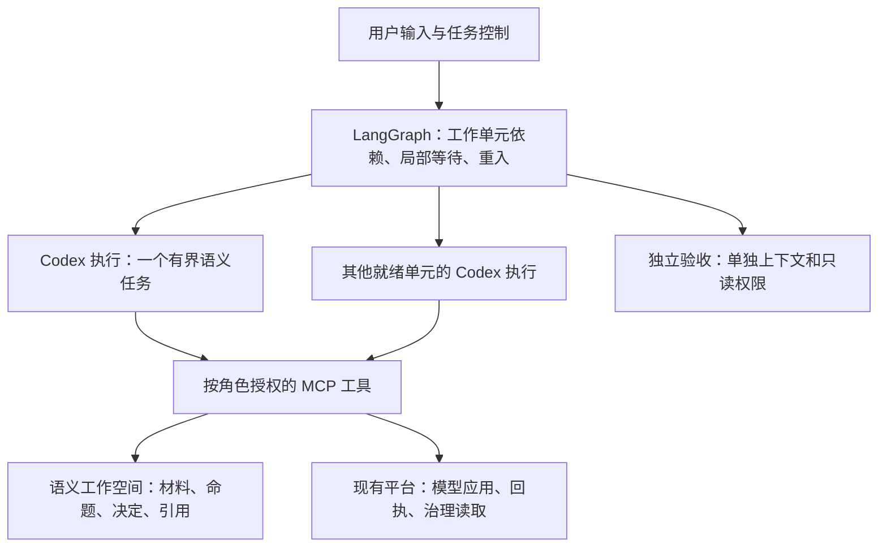

# v5：LangGraph＋Codex harness 适配评估

日期：2026-10-28。状态：**官方资料、当前接入代码与本机协议 schema 已核对；未安装候选 Python SDK、未运行模型或验证 v5 业务链。**

用户要求重新调研 Codex harness 是否适合本任务。本文归属 [R5.0-001](../requirements/requirements-v5.0.md#r5-0-001)，承接[建模方法](../delivery/designs/2026-10-26-ontoweave-modeling-methodology-design.md)、[五方案比较](2026-10-27-v5-agent-runtime-comparison.md)和 [Agents SDK 评估](2026-10-27-v5-openai-agents-sdk-assessment.md)。LangGraph 已确认；执行器尚未选定，本次没有新增收费运行授权。

## 1. 结论与选择依据

**Codex harness 适合承担 v5 的有界 Agent 执行，建议将其最小接入原型排在下一轮验证的首位。** 组合为 LangGraph＋官方 Python Codex SDK／app-server＋获准 MCP 工具。Deep Agents 保留主要对照；OpenAI Agents SDK 在需要更直接控制 Python 内部运行策略时仍有价值。

这一建议基于当前项目的具体条件：已经有 Codex／GLM Responses 接入和业务 MCP 工具；本次重写的主要对象是业务协作、持久认知和恢复责任；用户希望复用现成 Agent 优化，尚没有必须修改 harness 核心循环的需求。因此先核对能否保留已有执行能力、缩小本项目适配责任，比先更换全部执行基础更有依据。这是验证顺序建议，不是性能、维护收益或最终选型结论。

OpenAI 已明确将 Codex harness 作为可嵌入应用的 Agent 运行时，并以业务应用连接自有 MCP 工具为例说明职责划分；适用范围包含研究和运营工作。[官方定位](https://developers.openai.com/blog/codex-as-a-platform)。对 OntoWeave 而言，仍须以自己的建模语义与独立验收判断适配效果。

## 2. 应使用哪一层接口

| 接口 | 本任务中的位置 |
| --- | --- |
| `codex exec` | 适合一次性脚本；不是需要长期事件、用户补充与细粒度控制的首选入口。 |
| **Python Codex SDK：`openai-codex`** | 优先评估。官方提供同步和异步客户端，连接本地 app-server；发布包绑定 Codex CLI 运行时版本，可在 Python LangGraph 节点中使用。SDK 是否覆盖全部必需控制调用，仍以锁定包的实测为准。 |
| **Codex app-server** | 生命周期协议权威；SDK 未覆盖的必要功能可以直接调用该协议。应用需要保留进程管理，但不应重复手写 SDK 已承担的传输与事件解析。 |
| 修改／分叉 Codex 核心 | 目前没有必要；只有公开接口无法满足已证实需求时再评估维护代价。 |

[Codex SDK 文档](https://learn.chatgpt.com/docs/codex-sdk)确认 Python SDK 为稳定发布，并绑定运行时依赖。这与 **OpenAI Agents SDK** 是不同产品：前者控制现成 Codex harness，后者让应用组合 Agent 运行能力。不能因为 OntoWeave 使用 Python 就排除 Codex，也不能把 Codex 的订阅登录直接当作 Agents SDK 的 API 凭据。

## 3. 对应建模方法的职责划分

图中的两个执行分支只说明可并发调度，不规定固定 Agent 数或“一单元一永久进程”。一个运行时进程是否复用，取决于角色配置与隔离边界；工作单元身份不等于 Codex thread 身份。

| 方法中的工作 | Codex 承担 | LangGraph／工作空间／平台承担 |
| --- | --- | --- |
| 阅读材料、保留条件与例外、判断语义复用 | 按建模 Skill 做推理、调用工具、形成候选及理由；相关方法活动可以在同一有界任务中合并。 | 保存稳定内容身份、版本与来源，提供下一次按需读取。 |
| 子单元并行、共享定义、父级整合 | 返回拆解或整合判断，通过共同业务记录协作。 | 调度就绪单元，保存长期依赖与澄清；无关单元继续。 |
| 用户补充与资料变化 | 处理新的获准信息，修订受影响判断。 | 决定接续入口与受影响范围；按实际状态选原 thread 或新上下文，不复制整段项目历史。 |
| 模型应用与实际读取 | 使用获准提交／查询工具，解释返回结果。 | 绑定执行身份、原子应用与对账；工作空间候选不得冒充已应用模型。 |
| 长期总览、独立验收 | 按各自有界目标生成总览或评价。 | 保持摘要引用与新鲜度；验收使用独立上下文与权限，不能从生产 thread 分叉后声称独立。 |

跨业务单元的长期协作由外层调度与工作空间承接。Codex 原生子 Agent 可在确有需要时服务局部工作，但不必启用，也不让其另建一套全项目调度。业务等待结束当前有界执行并留下可接续结果，避免用持续模型轮询维持等待。

## 4. 可复用能力与实际边界

| 能力 | 已核对的依据 | 仍由本项目保证的内容 |
| --- | --- | --- |
| 角色提示 | 本机稳定 schema 含 `baseInstructions`、`developerInstructions`；现有适配器已经显式设置。 | 实际提示应只含角色和获准输入；还需控制自动加载的项目指令、Skills、记忆与插件。 |
| 工具接入与裁剪 | 官方支持 MCP 工具白名单；配置具有具体能力开关。 | 服务端授权、实际可见工具和可读资源；不能仅靠提示禁止越权。 |
| 上下文处理 | 官方有压缩阈值、压缩提示和单工具输出历史预算配置。 | 重要条件、例外与来源可补读；被裁剪内容不因此变成已审阅内容。 |
| 结构化返回与控制 | 本机稳定 schema 有 `outputSchema`；app-server 有启动、steer、interrupt、resume 与用量事件。 | 结构正确不等于语义正确；取消回执不等于远端零费用或业务副作用撤回。 |
| 历史接续 | harness 保存自身会话，支持恢复。 | LangGraph checkpoint、语义工作空间、实际模型仍各有职责；恢复先核对版本与应用回执。 |

[配置合同](https://learn.chatgpt.com/docs/config-file/config-reference)与 [app-server 协议](https://learn.chatgpt.com/docs/app-server)提供这些能力。表中的配置说明不代表已在 `0.165.0`＋当前模型组合下验证全部效果。

### 4.1 工具裁剪有现成教训，应直接复用

[delivery.py](../../modeling_team/runtimes/delivery.py)记录：此前本机 `0.161.0` 接受顶层 `default_tools_enabled=false`，但忽略该无效配置，原生工具仍进入模型请求。修复采用逐能力关闭，并捕获实际出站请求核对工具集合。本轮读取了这段代码，没有重跑该历史实验。

因此，v5 不应照搬 [codex.py](../../modeling_team/runtimes/codex.py)中同名顶层配置并把 RPC 成功当作权限证明。当前官方文档中的 `apps.<id>.default_tools_enabled` 是应用连接器范围配置，不是关闭所有原生工具的总开关。原生能力、MCP 白名单和实际授权需要各按合同设置。

这不意味着为本轮另建一套隔离框架；复用已有隔离与出站检查，针对选定版本核对必要差异即可。

### 4.2 MCP 可作为首选，避免无必要地依赖实验接口

`thread/start.dynamicTools` 与 `item/tool/call` 在官方文档中仍标为实验接口，需要 `experimentalApi`。本机 `0.165.0` 的普通导出不含 `dynamicTools`，实验导出才包含，与文档一致。[动态工具合同](https://learn.chatgpt.com/docs/app-server#dynamic-tool-calls-experimental)。

本项目已有业务 MCP 工具，可以先通过该路径接入。只有直接回调应用函数确实更简单时才采用动态工具，并锁定对应协议版本。没有必要为验证 Codex 同时实现两条完整工具通路。

## 5. GLM 与压缩：不能沿用过于笼统的限制判断

现有 [glm-flash-low.yaml](../../modeling_team/model-profiles/glm-flash-low.yaml)绑定 `glm-direct / glm-5.3-flash / low`；[Codex 配置投影](../../modeling_team/runtimes/codex.py)使用 `wire_api=responses`；[provider 代理](../../modeling_team/deepseek_provider_proxy.py)已有 GLM Responses 端点和请求计量。这些是当前源码事实，不是本次真实连接或完整兼容证据。

官方配置明确区分 provider 的 `remote_compaction=unsupported` 与 `v2`：前者使用本地压缩，后者经 Responses 发送压缩触发。因此，**不能因为某 provider 不支持远端压缩，就直接推导必须自己重写 Codex 的历史摘要能力。** 本地压缩指 harness 管理该流程，不代表离线或不调用模型；实际调用与费用仍须核对。[provider 压缩配置](https://learn.chatgpt.com/docs/config-file/config-reference)。

当前代理只接受 `/responses`。若选定 Codex 版本走其他路径，需要先确认具体请求；如果走本地压缩或兼容的同端点路径，就不预先扩展代理。不得把 Agents SDK 某条压缩路径的限制直接移植为 Codex 的限制。

仍需核对真实模型的工具循环、结构化输出、effort、流式错误、压缩后补读和用量。官方也明确：Chat Completions 可用或一次文本响应成功，不等于完整 Responses 行为兼容。[网关兼容合同](https://learn.chatgpt.com/docs/enterprise/gateway-compatibility)。

## 6. 不能从旧适配器体积推导新方案代价

当前 [codex.py](../../modeling_team/runtimes/codex.py)除 app-server 接入外，还包含旧角色启动、Examiner 子运行、权限隔离、模型配置、消息派发、Protocol 检索门、预算观察和清理。这些具体职责可从 `_launch_acceptance_child_impl`、`_initialize`、`_complete_retrieval_gate_item_locked`、`control_budget` 等入口辨认。

v5 的最小接入只需围绕当前任务形成四项责任：

1. 构造角色输入、实际模型配置和获准工具环境。
2. 绑定业务工作单元与执行 thread／turn，启动并接收类型化结果。
3. 转发必要事件、用户补充和中断，并处理可恢复错误。
4. 关联原预算、真实用量及平台操作身份；复用既有请求准入和应用对账。

官方 SDK 可能减少传输代码，但不会自动消除进程、配置、计费和恢复衔接。特别是用量通知属于结果观察，不能替代每次请求前的预算准入；同一个 turn 内的后续工具循环、重试与压缩也须纳入原账本。

与前轮方案相比，Codex 的优势是复用已有运行能力与本项目接入经验；Agents SDK 的优势是直接以 Python 组合运行策略；Deep Agents 的优势是预组装能力与 LangGraph 生态衔接。若后续必须频繁修改每次模型请求前的历史选择、摘要算法或调用策略，公开配置是否足够就成为 Codex 的实际选择条件。开放源码本身不证明分叉维护便宜。

## 7. 下一轮只验证会改变选择的内容

不重复已经完成的 LangGraph 并行／恢复机制实验，不先重写整个 Team。锁定 Python SDK 及其实际 CLI 版本，沿现有模型和工具做一个有界执行单元，重点观察：

| 验证项 | 决定什么 |
| --- | --- |
| 实际提示、工具与模型身份 | 能否以公开配置满足角色边界；以模型出站请求和真实工具调用为证据。 |
| 大结果、一次压缩及补读 | 现成上下文能力是否适用于当前 GLM；关键业务条件和来源是否保留，全部额外调用是否计量。 |
| 补充、停止、接续与应用回执 | 新接入能否与原预算、LangGraph 和平台对账配合；不把暂停当成零费用或自动回滚。 |
| 同范围独立语义评价与实际改动量 | 是否完成同一任务，是否真的减少本项目维护工作；不能只比较适配器行数。 |

若公开 SDK／协议加少量接入即可完成上述工作，就有理由以 Codex 推进第一条 v5 业务链。若必须大改核心才能完成当前需求，再按已暴露的问题选择 Deep Agents 或 Agents SDK；不为五个候选同时建设通用执行平台。

## 8. 本轮证据范围

- 当前 CLI 实际版本：`codex-cli 0.165.0`。本轮只读取版本，没有执行升级。
- 已执行 `codex app-server generate-json-schema` 的普通与 `--experimental` 导出，并检查关键字段。原始文件与摘要在 gitignored 的 `workspaces/v5-codex-harness-assessment/`，摘要记录相关文件哈希。
- 在线官方资料访问日期为 2026-10-28；SDK 的稳定发布与运行时绑定来自文档，本轮未安装或运行该 Python 包。
- 没有调用真实模型、启动生产任务、修改运行时代码或变更预算。schema 检查仅证明本机协议形状，不证明工具权限、模型质量、压缩效果或恢复行为通过。

**研究判断：适合，优先验证最小接入；执行层最终选择与真实运行验收仍未完成。**
