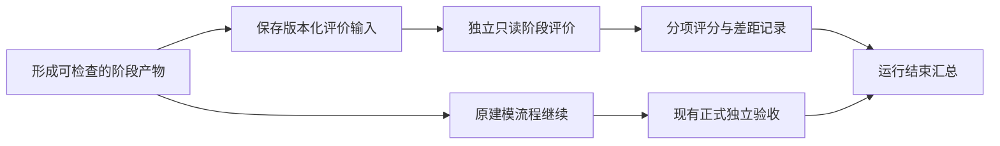

# 建模过程评分与阶段诊断可行性评估

日期：2026-11-02 开始调研，2026-11-03 定稿。

初次评估状态（登记前）：评估完成，建议采用最小试点；当时未登记、未实施或运行评分。
后续确认（2026-11-03）：用户同意并要求登记与细化，已形成
[R5.0-011](../requirements/requirements-v5.0.md#r5-0-011)。下文保留当时评估与建议语境，
当前权威范围和审阅状态以该需求条目为准；仍未实施或运行评分。
源码核对基线：`aaa0b621a258abf832c3442e39ab1a7121e86537`；收尾时复核了
`80a8859` 的预算接续入口及记录增量，本文所述阶段评价入口边界未变化。

## 评估问题

在 CQ 生成、业务切片、局部建模与跨切片整合等有意义的阶段，保存固定版本的产物，
交给独立评价 Agent 分析与预期效果的差距；每次运行结束提供整体诊断，支持手动停用。
评价对象可以是单个工作单元，也可以是多个工作单元的组合。

## 1. 结论

**需求合理，当前 v5 具备实现基础，适合定位为可关闭的过程诊断工具。**
它能帮助回答：缺口最早在哪个阶段可见、哪些方法实际有效、修模是否解决了问题、
局部成果组合后是否仍成立。建议提供“分项评分＋证据＋差距＋覆盖范围”，
并在运行结束汇总，而不是让一个总分承担全部判断。

关键约束如下：

1. **阶段完成触发观察，不增加分数审批门。** 首期旁路运行，诊断失败或低分不自动阻塞、
   修模或重试生产；原授权、应用完整性与正式独立验收继续按现行合同执行。
2. **评价对象是固定版本的语义成果。** 可以是一组 CQ、一份切片方案、单个工作单元、
   多个相关单元及其共享规则，不要求一条执行节点对应一次评价。
3. **评分依据要先明确。** 用户目标、获准原材料、业务确认和阶段质量准则共同构成依据。
   生成的 CQ 只是待评价成果之一，不能反过来成为业务完整性的唯一答案。
4. **接入可行性较高，评分有效性仍须验证。** 有独立 Agent 不等于判断可靠；需要用
   已知缺陷和人工复核校准，再证明它能减少定位与返工成本。

依据现有代码，最小增量主要是里程碑声明、阶段输入与报告合同、可选触发与总览；
无需重写建模编排或先建设新的评价平台。以上属于可行性判断，不是精确工期承诺。

## 2. 为什么有价值，以及现有能力边界

现有方法已要求父级主动检查跨单元整体规则，明确“局部通过、图连通、子任务完成”
不能证明组合成立。[R5.0-003](../requirements/requirements-v5.0.md#r5-0-003)、
[方法设计 §8](../delivery/designs/2026-10-26-ontoweave-modeling-methodology-design.md)
本就支持这种评价范围。

近期 [Demo 复盘](2026-11-02-demo-glm-repeat-retrospective.md)记录了方法已供给，
但关联、职责和接口表达仍要多轮公开反馈才补齐，以及自查／独立报告过早接受的情况。
因此，阶段诊断可以帮助定位“何时已有足够证据发现缺口”。这不自动证明某阶段是
最终失败的根因，也不意味着再加一次相同配置的 Judge 就能解决漏判。

注意时效：复盘中的分页覆盖和报告纠错问题已有后续修复，当前代码包含读取区间合并、
正文覆盖检查及独立侧自身上下文纠错；[修复记录](../delivery/records/2026-11-02-v5-demo-retest-fixes.md)
仍区分工程结果与真实语义验证。历史反例用于说明需求价值，不当作当前缺陷重新登记。

| 能力 | 当前核对结果 | 本需求的增量 |
| --- | --- | --- |
| 工作空间、来源和对象版本 | `SemanticWorkspace` 已保存内容、来源、依赖、单元、版本及部分模型基线 | 将评分引用绑定这些对象；不另建一套语义事实库 |
| 工作树与多单元范围 | `WorkPlan` 已保存父子、依赖、目标及重入信息 | 评价范围支持一个或多个单元，不能只按单节点切分 |
| 命名观察快照 | `RunSnapshots` 已保存工作对象、checkpoint、执行及模型版本引用 | 在有意义的产物提交点保存评价输入；目前没有通用自动评分接线 |
| 生产自查 | `unit_checks.py` 明确由原工作单元执行，属于生产自查 | 可作为被观察的声明；不能冒充独立评价 |
| 正式独立评价 | `cli.evaluate` 使用独立上下文、冻结材料、治理读取，且要求 `handoff_ready` | 中间阶段不能直接调用现有正式入口；需单独的阶段用途与输入／结果合同，复用底层执行能力 |
| 读取覆盖与报告验证 | `acceptance.py` 核对来源、修订、字符范围及按配置要求的实际正文 | 复用适用的证据检查；CQ／切片评价不能强制要求尚未存在的实际模型 |
| 自定义 CQ | R5.0-010 已区分题目就绪、模型可回答性及实际执行 | 新增“生成的题目质量”评价，不能与“模型答对多少题”混成一个指标 |

源码入口：[工作空间](../../modeling_team/v5/src/ontoweave_modeling/semantic_workspace.py)、
[工作树](../../modeling_team/v5/src/ontoweave_modeling/work_plan.py)、
[快照](../../modeling_team/v5/src/ontoweave_modeling/snapshots.py)、
[单元自查](../../modeling_team/v5/src/ontoweave_modeling/unit_checks.py)、
[独立入口](../../modeling_team/v5/src/ontoweave_modeling/cli.py)、
[读取与报告合同](../../modeling_team/v5/src/ontoweave_modeling/acceptance.py)。

## 3. 应在哪里打点

建议按“成果已形成可检查版本”触发，不按工具次数、计时心跳或 Agent 回答结束触发。
当前执行图的 `model` 回合可能包含多个业务活动；S0—S9 是业务方法，不能机械地当作
现成的一组独立运行节点。自然回合结束只表示可以消费新的输入，不证明业务阶段完成。

| 观察点 | 评价输入与范围 | 关键问题 | 首期建议 |
| --- | --- | --- | --- |
| CQ 初版或实质修订 | 目标、原材料、整组 CQ、已确认口径和未知 | 是否覆盖主要业务诉求、条件／例外和跨单元问题；问题是否可判断、有依据；是否只是大量近义题 | 纳入 |
| 切片方案形成 | 业务范围、材料分配、工作树、共享定义与依赖 | 有没有遗漏范围；是否割裂完整规则；每片职责与对外结果是否清楚；共享和整合责任是否明确 | 纳入 |
| 局部语义成果收口 | 单元来源、命题去向、候选或实际定义、未决项 | 条件与例外是否保真；身份、粒度、关系是否正确；自报完成是否有实际证据 | 有定位需要时再加入 |
| 跨切片整合形成 | 相关单元集合、共享定义、整体规则、组合场景，必要时实际治理读取 | 上下游能否衔接；共享口径是否相容；跨单元约束是否成立；是否存在没有责任人的连接缺口 | 纳入，且不能由局部分数替代 |
| 运行结束或有界收口 | 所有适用阶段结果、未评范围、正式验收引用、耗时与用量 | 哪些环节好、哪里需要改、首次与修订后表现如何、还不知道什么 | 生成汇总，默认不再调用一个总结 Agent |

“通过后打点”建议理解为生产方声明成果可供检查，而不是分数合格后才允许下一步。
失败但已经产生有意义产物的阶段也应保留观察；提前停止时，未到达阶段显示“未到达”，
评价失败显示“评价未完成”，关闭显示“已停用”，均不折算成零分或通过。

阶段不一定严格串行。一项跨单元评价可以同时选择 A、B、C 的相容版本，即使它们
不属于同一个直接父节点；同时记录组合规则和整合责任。相关输入变化后旧结果保留，
但不再冒充当前结论。只有实质变化或显式复评才产生新评价，普通读取和状态轮询不触发。

## 4. 跨切片评价怎样才能有效

例如安装切片和结算切片都各自完整，仍可能出现：安装侧认为“施工完成”就结束，
而结算侧需要“验收通过且已签收”。评价应追踪这些条件在两个切片中的具体表达与引用，
检查正常路径、缺少签收和验收失败的情况。不能只检查图上有没有一条边。

另一个例子是安装、返修和配件补偿共同受合同年度额度限制。各片局部正确仍可能
合计超限；评价需要一起核对合同身份、年度边界、金额单位、计入时间与合计规则。
这些规则必须来自材料或确认，评价 Agent 不能按常识自行新增。

组合评价采用“相关单元＋连接含义＋整体规则＋反例”。大任务按相关业务组有界检查，
上层核对全范围遗漏与组合约束，按需下钻原证据；不默认比较所有切片两两组合，也
不要求一个上下文通读所有细节。父级保留尚未分配的范围，避免只看已经存在的依赖边，
反而漏掉本应存在却从未建出的连接。

## 5. 如何评分和判断是否满意

### 评价基准

开始评价前固定本范围的目标、来源、已确认决定、评分准则及其版本。标准可以随需求
变化修订，但要保留旧标准和适用范围；不能看到结果之后倒改标准以求高分。

CQ 评价尤其需要区分：题目本身清楚、有价值；材料是否足以确定答案；最终模型能否
回答。缺少业务依据的题可以很有价值，但答案仍是待确认。不能用自己生成的问题和
自己生成的答案互相证明业务完整性。[R5.0-010](../requirements/requirements-v5.0.md#r5-0-010)
已规定这一边界。

### 分项尺度

建议先用有描述锚点的 **0—4 分**，每个阶段再提供对应的具体例子；不追求百分制精度。

| 分数／状态 | 含义 |
| --- | --- |
| 0 | 有证据表明未满足核心目标，或与依据明显冲突 |
| 1 | 存在重大缺口，无法支持本阶段主要用途 |
| 2 | 部分满足，仍有影响使用的明确缺口 |
| 3 | 在声明范围和证据内满足约定要求 |
| 4 | 满足要求，且关键边界、例外与组合反例均有充分验证 |
| 未验证 | 证据不足、读取未完成或标准未确定，不编造分数 |
| 不适用 | 本范围确不适用，记录理由并与未验证区分 |

4 分不奖励更多节点、更长文字、更多切片或超范围建模。关键缺陷单列，不能被其他
维度高分抵消。若证据只支持一部分范围，只能给局部结果；不能外推为全阶段满意。

每次输出至少包含：评价对象及版本、预期、逐项分数、支持和反对证据、具体差距、
影响范围、未验证部分及建议优先改进项。程序检查范围／版本／读取和报告格式，
Agent 判断业务含义；已返回正文仍不等于已经理解。

整体报告优先给阶段矩阵、首次／修订后变化、关键缺陷和覆盖范围。例如“CQ 3、切片 3、
整合 1”应明确指出整合存在重大问题，而不是平均后宣称整体良好。这里的数字只是
说明展示方式，不是对现有运行的评分。首期不必设置统一加权总分；若后续需要排序，
应先校准权重，并始终同时展示覆盖分母和关键缺陷。

### 校准与局限

独立性首先是独立上下文、只读权限、独立标准和证据判断。换一个 Agent 或换模型
都不能保证没有共同盲区。LLM Judge 的位置、篇幅与自我偏好等偏差已有研究记录，
但该研究的聊天偏好一致性不能直接外推为本体语义评分准确率。
[一手论文](https://arxiv.org/abs/2306.05685)

建议用少量已保存的“较好／已知缺陷／证据不全”产物校准，由人工复核关键判断；
比较方案时尽量隐藏生产模型和配置身份，必要时交换展示顺序核对。初期不需要多 Judge
投票。对同一输入的分数变化先检查评价波动，不直接宣布流程改善。

## 6. 最小实现建议

这是一条可选观察支路，新增四类最小能力：

1. **阶段声明和固定输入。** 复用工作空间提交与工作树变更，在生产方明确提交阶段成果时
   记录里程碑、目标范围、产物引用和版本。程序不根据一段“已完成”自然语言猜阶段。
   早期可先由 Host 手动选择已有产物评价，再接自动触发。
2. **阶段评价用途。** 复用原生执行器、只读材料、适用的治理读取及报告校验，提供区别于
   正式验收的阶段输入和报告。不要为复用函数而删掉正式 `evaluate` 的交接资格条件，
   也不要把已有生产 `check-unit` 改名当作独立评价。
3. **可选调度与记录。** 固定输入后可异步评价；同一范围、产物版本和评分准则复用结果。
   记录评价模型／提示版本、用量、时间及失败。结果首期只给用户／复盘者，不自动回灌
   生产进行修模，以便观察原流程；日后如增加即时反馈，需要单独定义其授权和实验条件。
4. **简洁汇总。** 先生成 JSON 原件和可读 Markdown，聚合已有评分和验收结果即可。
   不以前端仪表盘、通用插件框架或新数据库为落地前提。

对单次评价，最小绑定为：任务与运行、里程碑、相关单元集合、来源／产物版本、
评分准则版本；涉及实际模型时再绑定各本体修订。报告附评价配置、证据、差距和用量。
具体字段在正式设计时再确定，本文不宣称已有相应配置或接口。

### 快照与异步读取的真实限制

现有观察快照注明各组件分别读取，**不是跨存储原子快照**；默认保存模型引用也不是
历史 RDF 数据备份。CQ／切片文件或工作空间内容可固定版本后异步读；涉及实际模型
则必须使用匹配修订的受治理读取，或已有且可验证的历史数据证据。

如果评分时模型已变化且原版本不可读，应标为目标变化／未验证，重新评价新版本时
使用新身份，不能拿当前模型补成过去阶段的结果。历史材料不足时不能从最终模型
倒推当时切片质量；也不为评分先建设完整时光回放或自动 fork 系统。

正式验收的隐藏题、答案和私有诊断不作为生产可读阶段反馈。快照是 Host 私有观察，
交给阶段评价前只投影本范围获准内容；正式验收仍独立读取它自己的冻结目标和材料。

## 7. 开关与成本

建议第一版只提供一个明确的过程评价总开关，启用时选择所需观察点。开发实验可在
任务配置中明确开启；后续真实使用由用户手动关闭。开关是本需求的建议，并非现有功能。

关闭后不再创建新的阶段评价或专用抓取任务，未启动的评价标记取消；已开始调用按
现有自然回合控制结束，保留实际费用和结果。重新开启只观察后续事件，历史补评由
用户明确选择，避免静默补跑。原业务日志、应用安全与已有正式验收的要求分别保留；
停止过程评分不自动取得停止正式验收的授权。

首期以 CQ、切片方案、跨切片整合三个观察点为目标；确实形成的稳定成果版本各评一次。
这不是固定轮次硬门，重入和实质修订需单独记录。未形成该阶段或未变化时不调用，
不为每个切片、每次工具调用全量评分。

费用按实际调用汇总：评价输入／输出、必需读取、失败／纠错及实际墙钟占用都记录。
托管阶段评价计入原任务的获准调用及预算并单列，不能当作免费 Host 工作；若是另行
授权的离线研发／复盘，则单独记账，不混入生产收益。外部 Host 用量沿现行规则单列，
未知用量保持未知，不擅自增加预算。

历史 Demo 复盘记录中，独立评价约占已知托管估算费用的 39.11%，说明评价本身可能
成为明显成本项；这是特定历史运行的观察，**不是新增功能的费用预测**。应比较完整
任务的质量、返工、Host 介入和总成本，不能只比较生产 Agent token。
[历史成本范围](2026-11-02-demo-glm-repeat-retrospective.md)

## 8. 推荐推进与验收方式

**先校准诊断是否有用，再接自动打点。** 第一轮复用少量有固定阶段证据的历史材料，
验证能否检出已知遗漏、切片割裂及“局部正确但组合失败”。如果当时产物没有保留，
如实标记无法回放，后续在获准的新任务中采集。读取合同已经修复的能力直接复用，
不把重复审计或整个历史问题清单变成首轮准备门。

下一步在一个获准真实任务中启用三个观察点，保持生产方法不变，结束时给用户一页
整体情况；随后再判断是否值得加入局部收口等更细观察点。关闭功能也应在同类配置中
验证：没有新增评价调用，没有等待评分的生产依赖，既有业务结果与必要验收路径保持。

| 验证层次 | 要证明什么 | 不能代替什么 |
| --- | --- | --- |
| 工程合同 | 触发版本正确、重放不重复评分、权限适当、关闭生效、目标变化不混用、失败准确呈现 | 不证明语义分数可靠 |
| 评分有效性 | 人工复核的已知缺陷能否检出、误报是否可接受、证据不足能否拒绝猜分、组合缺陷是否单列 | 不证明完整客户业务质量 |
| 流程优化效果 | 在可比业务范围、来源和评价条件下，是否缩短定位／返工、减少 Host 介入，同时保住质量 | 不以分数上涨证明净降耗或因果关系 |

诊断归因应先记录“最早观察到的缺口及证据”，再区分捕获、解释、表达、组合或读取
问题；最终失败仍使用既有 modeling-quality、platform-contract、collaboration/routing、
runtime/infrastructure 四类。评价调用失败和材料不足不能被算作建模质量零分。

如后续批准登记，建议作为 **v5 可选过程评价** 的独立条目，关联 R5.0-001／002／003／
006／007／010；006 保留正式验收，007 承接可观察性和效果衡量。当前只完成评估，
不预先占用编号、不修改现有验收门，也不视为真实建模或新增费用的授权。

## 9. 来源与本次验证边界

- [R5.0 权威需求](../requirements/requirements-v5.0.md)：核对工作空间、递归与组合、
  评价隔离、计量、自定义 CQ 及当前验证边界。
- [语义工作空间方法](../delivery/designs/2026-10-26-ontoweave-modeling-methodology-design.md)：
  核对 §5、§8、§11 及 S0—S9 的业务步骤含义；本文是建议，未修改该设计。
- [v5 使用说明](../../modeling_team/v5/README.md)及 §2 链接源码：确认既有能力和阶段入口缺口。
- [Demo 复盘](2026-11-02-demo-glm-repeat-retrospective.md)与
  [后续修复](../delivery/records/2026-11-02-v5-demo-retest-fixes.md)：说明现实需求及避免把
  已修工程缺口当成当前问题；本次没有重跑这些运行或独立重验历史语义结论。
- [LangSmith 官方中间步骤评价文档](https://docs.langchain.com/langsmith/evaluate-on-intermediate-steps)：
  支持从执行记录分别评价中间结果，结合程序评价与 LLM 评价。仅用于核对方法可行性；
  不因此建议引入 LangSmith 服务，也不证明本项目已接入。
- [Zheng 等，Judging LLM-as-a-Judge（2023）](https://arxiv.org/abs/2306.05685)：
  支持将模型评分视为有偏差的代理判断；本报告未将该论文实验准确率移植到建模任务。

本次只做需求、源码和文档静态核对，以及外部一手资料查阅。GitNexus 索引核对时落后
当时 HEAD 590 个提交，未重建，采用定向源码阅读；没有声称调用图覆盖。
未启动建模、评分、服务或业务模型写入；未运行后端／前端／v5 测试。
已检查本文件 17 处本地链接（11 个不同目标）、显式需求锚点、代码块闭合及空白格式，
未发现问题。文档验证限于本文件及所引用源码入口，不建立新的运行或语义 PASS。
