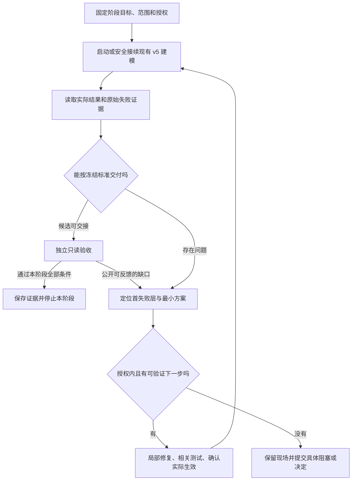

# 有界自主演进工作流评估

- 日期：2026-11-05（Asia/Singapore）
- 状态：评估完成，建议开展一个有界试点；方案未经实施或独立设计审阅，不构成建模启动、费用追加或后台任务授权。
- 用户问题：在用户无法持续跟进时，能否让 Agent 围绕阶段目标反复建模、发现问题、制定方案和修复，直到达标或遇到真正阻塞；如何防止应用演化偏移。
- 核查范围：当前权威需求、v5 工作流与宿主操作合同、近期保留交付证据、官方长期 Agent 与评价方法资料。
- 代码观察基线：`f1ae179`，工作树另有正在修改的 v5 执行／交付代码和文档。本文按所读文件解释能力，不假设这些未提交修改已经通过测试或进入运行进程。
- 证据边界：静态检查及已有证据核对；未启动建模、评价器或服务，未重跑工程测试，未读取隐藏题／答案或私有评分正文；未接管现有任务、修改其他人的工作树改动或更新权威需求与优化台账。下文历史运行结果是当前需求／交付记录记载，不是本次重新作出的独立语义裁决。

## 1. 判断与建议

可行，值得试点。建议将“用户确定阶段目标、Agent 连续完成目标内的建模与工程修复、独立侧验证实际结果”做成有界工作流。用户主要决定业务目标和重大取舍，常规诊断、方案选择、修复、测试与接续交给 Agent。

主要风险是错误反馈推动错误优化：如果完成标准只看流程状态、题集分数或测试通过，Agent 可能持续增加编排机制，却没有改善实际模型与消费效果。长时间运行会放大这一风险。阶段目标不清、评价漏检和边界可被执行方自行改写，比 Agent 是否空闲更值得优先解决。

建议采用**阶段授权＋短任务接续＋独立结果验证**。阶段内可连续自主行动；每个阶段有固定业务范围、不可自行放宽的完成标准、明确预算和有效期。达标后停止；下一阶段只有已获预授权时才继续。自主程度应随真实成功证据扩大。

对“Agent 多数空闲”的说明：本次未统计运行利用率，不能给出其原因比例。现有合同明确包含正常依赖等待、HITL、预算关闭和等待显式接续；这些状态需要分别解释。提高忙碌率不构成收益。更有用的指标是合格交付率、用户介入次数、到合格交付的时间和完整成本。

## 2. 当前基础与证据

当前主归属为 [R5.0-001](../requirements/requirements-v5.0.md#r5-0-001)／007 的运行控制与效果验证；内部建模沿 003／004，独立评价沿 006，专职团队沿 012。降耗方向继续遵守 [R4.3-030](../requirements/requirements-v4.3.md#r4-3-030)。本建议不静默替换现行优先级：先让质量与交付约束成立，再比较同条件成本；跨轮研发成本与单次建模运行效果分开。

| 已核查内容 | 证据 | 对本方案的含义 |
| --- | --- | --- |
| v5 已有工作空间、暂停／接续、来源修订、应用对账、冻结独立评价等入口 | [v5 runbook](../../skills/modeling-dev-loop/references/v5-runbook.md)、[README](../../modeling_team/v5/README.md) | 可以复用现有执行链，不需先建设通用工作流产品 |
| 生产流可以停在等待、可恢复问题或 handoff_ready；独立评价由另一显式入口执行 | [flow.py](../../modeling_team/v5/src/ontoweave_modeling/flow.py) 的 compile／advance；[cli.py](../../modeling_team/v5/src/ontoweave_modeling/cli.py) 的 evaluate | 单次生产循环不等于跨轮的诊断、改代码、验证、采用和再次建模闭环；需要补齐宿主侧阶段推进责任 |
| 最新专职团队真实任务未闭环 | [11 月 5 日运行记录](2026-11-05-demo-flow-repair-validation.md)：工程回归记载 433 项通过；真实整合受 contribution_shared_conflict 阻塞，模型 revision 0，正式独立评价尚未执行 | 工程通过不能替代真实交付；扩大无人值守前应验证当前通路。该合同失败不能直接推导模型语义能力差 |
| 独立报告也有漏检实例 | [11 月 2 日交付记录](../delivery/records/2026-11-02-v5-multiview-method-repair.md)“首次独立报告的证据复核”：35/35 PASS 后实际关系与属性读取发现不一致 | 独立上下文本身不足以保证裁判正确；需要以真实证据和已知正反例校准 |
| 已有跨轮优化跟踪 | [优化台账](../delivery/modeling-retrospectives/optimization-tracker.md)、[复盘技能](../../skills/modeling-retrospective/SKILL.md) | 新阶段引用既有问题与原预期，不再创建平行需求／优化状态。未确认建议先留在本文 |
| 金额控制在自然回合边界生效，存在在途尾差 | R5.0-001 F4、007 F5 与 11 月 5 日记录 | 不能承诺精确到分的实时截断；跨 run 不清零，用量未知不按零处理 |

以上支持“具备可复用基础”，不证明已有可靠的无人值守工程演进系统。本次只查看相关入口，没有全面审计全仓库的所有调度器，也没有验证后台服务持续运行能力。

## 3. 可选方式

| 方式 | 用户负担 | 主要代价 | 建议 |
| --- | --- | --- | --- |
| 每次失败都报方案、等待用户批准 | 仍需频繁理解技术问题 | 进度依赖用户，难以满足本次诉求 | 仅用于真正改变业务或授权的决定 |
| 阶段内自主推进，重大偏离时升级 | 开始时确认目标，阶段结束或例外时处理 | 必须先约定完成标准与边界 | **推荐作为当前试点** |
| 长期开启，自行发现目标并修改产品方向 | 表面介入很少 | 目标漂移、评价自证、成本与范围扩大难控制 | 当前证据不足以支持 |

## 4. 风险与最小控制方式

下列风险等级是结合当前证据的定性判断，不是测量出的发生概率。

| 风险 | 具体表现与依据 | 最小控制方式 | 残余风险 |
| --- | --- | --- | --- |
| 高：目标与架构漂移 | 为解决交接问题不断增加守卫、角色和平台功能，真实建模价值没有增加；现行 AGENTS 已要求 T0 复核与限制扩展 | 每项改动关联当前阶段验收缺口；新增业务能力、改变平台／本体边界或放宽目标须用户决定；其他发现进入待办 | 目标本身遗漏用户需求仍需阶段抽样反馈 |
| 高：验收自证与共同误判 | 同一思路生产、修复并判定正确；已有独立报告漏检事实 | 验收上下文、只读权限、冻结输入与生产分离；直接读取实际模型；复用少量已确认正反例验证能识别错误 | 换模型或增加评审人数也不能保证消除相关错误 |
| 高：对固定 Demo 过拟合 | 重复调到同一题集通过，遇到新表述、例外或跨切片问题失效 | 公开反馈用于修复；保留未向生产暴露的验收内容；后续以新场景／变体验证泛化。已暴露题目只称回归材料 | 同一业务范围内的保留题仍不能代表所有客户业务 |
| 高：改规则求通过 | 删除失败题、缩小范围、放宽裁判或修改自己的授权和停止条件 | 目标、预算授权、主冻结标准和私有材料置于开发执行方可写范围之外；提议变更与实际生效分开 | 只靠提示不能提供可靠边界，需复用实际隔离与权限能力 |
| 中高：重复消耗但没有进展 | 反复改措辞、重跑、修包装，没有更多有效表达或可验证原因 | 每次试验保留假设、原失败、实际变化与结果；无新证据时不重复同条件运行；阶段预算／期限／停滞条件共同收口 | 单次效果受随机性影响，不能一次失败就否定方案 |
| 中高：回归及资源损坏 | 当前工作树已有其他修改；共享服务重启、未知写入重放可能影响别的任务 | 独立分支／工作树，单一代码和运行资源责任方；相关测试后采用；未知写入沿原身份对账；部署单独核对当前授权 | Git 回退不等于 RDF／数据库状态回退，必要时需显式恢复方案 |
| 中高：能力上限被当成流程缺陷 | 推理质量不足被反复用提示补丁或新编排掩盖；当前某些失败实际属于合同层 | 先定位四类首失败层；必要时在已授权模型集合内做一次有界对照，记录质量、时间和成本，无法区分就保留未知 | 闭环不能保证给定模型具备完成目标的能力 |
| 中：上下文与诊断记录漂移 | 长会话摘要把猜测记成事实、遗漏用户边界或原失败 | 每次接续读取固定阶段合同、当前代码身份、真实状态与精确证据；已确认事实、假设和未决分开 | 来源与记录本身仍可能不完整，不能靠更长记忆解决全部问题 |

一个具体漂移例子：公开材料中的某项条件没有进入模型，合法修复是查明它丢在来源理解、表达、应用还是检索，并修复对应环节。直接给平台新增该 Demo 专属回答分支，或从验收中去掉该条件，都会让分数改善而产品偏离。公开试验应同时观察这类变更。

## 5. 一次确认的阶段约定

启动前准备一页可审阅的阶段约定。复用权威需求，不把用户描述自动扩展成新的产品范围。

| 字段 | 应明确的内容 |
| --- | --- |
| 目标 | 用户可观察的结果，例如固定业务来源能完整建模并支持约定消费问题 |
| 范围与依据 | 需求版本、公开来源版本、业务目标、实际 Project／Ontology 范围；未决业务含义及其影响 |
| 完成标准 | 所属 L0／L1／L2 层级，必须满足的条件与独立证据；质量与效率分别判定 |
| 可自主修改 | 与目标内已证实问题直接相关的代码、提示、测试、常规配置；允许的资源与部署范围 |
| 保留决定 | 业务定义／范围、重大兼容性变化、主验收标准、权限、预算追加、对外发布及控制边界 |
| 执行额度 | 稳定预算引用、获准模型与 effort、截止条件、自然回合尾差处理；历史授权不自动外推 |
| 停滞与结束 | 什么算新进展、什么情形暂停检查、达标后何时停止、哪个后续阶段已预授权 |
| 用户通知 | 只在阶段结果、真正需要决定或重大异常时提醒；普通进展生成简报 |

常规实现设计不逐项等待用户；具有兼容性或架构重大影响的方案可以先由独立工程审阅把问题缩小，最后只交给用户仍需其裁决的取舍。技术问题必须带推荐方案、效果和代价，不能把堆栈转发给用户当作决策材料。

目标和评分标准冻结不表示裁判永远不能修正。发现评价器实现与既定标准不符时，应单列缺陷、保留原报告，验证修正后能识别已确认正反例；必要时用同一修正版本重评基线与候选，不能把裁判版本变化当作产品收益。改变标准含义、题目分母或接受范围必须另作显式决定。同范围追加遗漏覆盖沿 R5.0-006 F4 保留原题与原报告。

## 6. 运行结构：复用内部建模循环，补齐外部推进

内部 v5 团队继续负责业务来源理解、CQ、建模、自查、应用与受治理读取。外层宿主侧只承担跨轮的阶段推进：选择当前真实阻塞、安排技术定位与修复、检查版本生效、安排独立验证及判断是否仍有授权内待办。

这是职责划分，不要求新增三个常驻模型或再建立一套 Delivery。机械观察和等待由程序完成；有新结果、新输入、异常或既定期限到达时才唤起需要推理的任务。正常依赖等待不反复调用 LLM。

工程实现者只获得获准公开反馈、失败定位和相关材料；最终验收者不参与生产、续跑或修复。若某验收者参与了这些动作，就换新的独立验收上下文。外层阶段监督者可以接收评价资格与结论，但不把私有题／答案交给修复方。

真正的后台持续执行需要独立存活的宿主进程、持久状态及已验证的接续入口；不能依赖当前对话一直打开，也不能在没有实际安排执行者时声称“已经后台监控”。首版只接已有命令和状态，避免重写 Agent 运行框架。

### 每次迭代的最小记录与行为

1. 读取阶段约定、当前版本、预算与上一条未解决问题；原问题已解决时才选下一个目标内问题。
2. 从真实建模／消费失败定位首层：modeling-quality、platform-contract、collaboration/routing、runtime/infrastructure；不以某个错误标签替代具体原因。
3. 写一条可检验假设：“证据是什么，改变哪里，预期哪个实际行为改善，如何发现退步”。尽量一次改变一个可解释因素，不要求把紧密关联修复人为拆碎。
4. 选择最小处理：模型问题回原建模责任方；提示歧义修权威提示；实现偏差修代码；合理业务未知保留或沿 HITL 澄清。守卫阻断先做既有 T0 复核，不能自动删除必要保护。
5. 代码修改在隔离工作树完成，执行相关检查；涉及后端／前端时按仓库要求测试、重启和核对端点。共享服务有其他活跃任务时先协调单一部署时点，不在其运行中任意切换依赖。
6. 确认当前进程实际采用修复。优先同 run 安全接续；冻结提示／上下文不兼容时，明确迁移或新 start 的授权与成本，不能直接热改旧证据。
7. 复测原失败及受影响业务结果；需要正式语义结论时独立评价实际模型。失败原件保留，无新证据不原样重试。
8. 将“问题→假设→变更→验证→采用／撤回”追加到既有运行记录，关联原需求／优化项。实际通过并适合保留的改动按仓库约定提交；代码回退和模型数据恢复分别处理。

最终阶段结论绑定实际代码、提示、来源、模型修订和评价身份。工程检查通过只证明对应工程范围；过程评分、生产自查和独立最终语义结论分别展示。

## 7. 停止、局部等待与用户负担

| 情形 | 行动 |
| --- | --- |
| 阶段全部条件有证据满足 | 收口并停止；只在下一阶段已明确获准时继续 |
| 可恢复技术错误，有下一项授权内动作 | 自动定位、修复、验证、接续，不为普通错误逐次请示 |
| 一个业务含义或外部依赖未决 | 持久等待该部分，完成不依赖它的获准工作；答复与原请求关联 |
| 目标／业务／权限／重大兼容性必须改变 | 先形成具体方案、依据与影响，再请用户裁决；不自行扩大授权 |
| 预算关闭、授权到期或用户暂停 | 停止新增付费工作，按自然回合边界停稳并对账；已授权的安全核查和证据整理继续 |
| 写入结果未知 | 暂停受影响写入，沿原操作身份查明，不能换 run 重放；其他安全工作可继续 |
| 证据显示持续停滞或修复反复引入同类问题 | 暂停昂贵重复运行，做一次有界原因复核；仍无可检验下一步时报告停滞及所需条件 |

“进展”可包括目标缺口减少、原失败不再出现、实际覆盖增加、一个关键竞争解释被证据排除。增加提交、提示长度、调用数或总分不自动算进展。

首个试点可约定“连续两次围绕同一失败的修复验证均未改善，也没有新因果证据”触发停滞复核。这只是待确认的阶段检查点示例，不是自动判定失败、永久关闭 run 的平台硬门，也不恢复金额模式下默认三轮上限。一次复核足以发现有依据的下一步时，在既有授权内继续。

用户只需处理少量具体决定。简报可固定为：**实际完成了什么；距离目标还差什么；Agent 已自行处理什么；本阶段耗时与用量；有没有需要用户决定的事项。** 技术原件留在链接中。没有决定时明确写“无需操作”，不把每次诊断都推给用户。

需要决定时提供：“出现什么业务影响／为什么现有授权不能处理／推荐哪个选项／代价和延期是什么”。用户不需要先理解解析器、路由或数据库内部原因。业务真值缺失仍需要用户或另行授权的业务负责人，不能由技术 Agent 为避免打扰而编造；测试代答只沿其明确授权范围并标明构造来源。

## 8. 推荐的首个试点

建议用已有 Demo 和完整获准来源，先验证一个单业务任务的闭环。阶段目标草案：

> 在固定业务范围和独立评价标准下，自主完成建模、发现问题、局部修复、实际应用与受治理消费验证；技术推进不需要用户逐次催促或给出修复步骤，最终得到有证据的 L1 结论，并保留全部失败、干预、时间与用量。

这里的自主指宿主推进与修复也由获准 Agent 完成；宿主修复仍计作研发／干预记录，不把它冒称为模型团队本身已经无需补位。

首个阶段内先取得 L0 运行闭环，再取得本阶段约定的 L1 实际质量结论。L0 完成单独记载，不因 L1 尚未达标抹去；L1 也不能用工程 PASS 或无效独立报告代替。

独立侧复用已有确认缺陷与合格目标做少量裁判校准，重点验证能识别已知漏项／错误关联。校准不建设新的通用验收框架，也不作为全面审计推迟已授权的首次真实建模；真实开始继续遵守 20 分钟规则。遇到无法形成可信判定的事项保持 PARTIAL。

下一阶段才验证 L2：用修复后的固定代码、同来源／配置／评价条件做预先约定的独立复跑，不能只统计成功的一轮，或每次修代码后都重新起算成功率。两次完整运行可以作为小试点的复现门槛示例，不能当成统计可靠性保证。之后再在额外获准的新场景或变体上检查泛化，并比较净成本。

首版需要明确一个**阶段累计金额上限和最长有效期**，额度按任务实际范围确定。最新 3 CNY 任务未到验收的记录说明，不能未经估算便承诺原默认额度足够覆盖工程演进与重验。本文不替用户指定或追加金额。

先保持一个业务任务及稳定 budget_ref；生产、独立评价、失败、恢复和获准辅助调用连续累计。外部 Host 用量单列，不计任务金额或扣账；研发与复盘另列，不能将它们转移出去后宣称整体更省。若后续扩展到多个任务，需要一次明确阶段授权及任务额度分配，不自动为每个新 run 再生成一份默认 3 元。

试点完成后观察四组结果：

- **质量**：完整目标是否真实满足，已知错误能否被发现；保留质量未验证与明确失败的区别。
- **用户负担**：需要用户技术介入的次数及原因，业务决定次数与工程救火次数分开。
- **稳定性**：成功、失败、接续与回退情况，完整分母和版本条件。
- **成本**：到达合格结果的总墙钟、托管用量、研发及 Host 单列消耗；没有合格结果时只报观察值。

只要无法判断产品真实变好了，就不扩大无人值守范围。达到当前阶段即停止，不因为还剩预算继续找新功能。

## 9. 最小落地范围与尚需验证之处

建议后续设计只补三项：阶段约定与授权绑定、宿主侧可持久接续的推进入口、阶段结果及例外简报。问题、运行、代码与证据继续引用现有文档／记录，避免多个相互矛盾的状态源。是否需要少量新增状态字段，以实现时发现的真实接续缺口为准。

首版不需要新增管理 UI、多机调度、自动生成产品路线、通用治理平台或多层审批。当前专职团队及独立验收职责保持，不通过减少必要角色或改写业务标准换取忙碌率与分数。

后续若采用此方向，应在 v5 权威需求中明确登记宿主侧持续演进的增量及授权边界，沿 R5.0-001／007 接续，涉及预算的差异关联 R4.4-002；不把它未经确认写成 R5.0-012 已有目标。正式设计若要求独立审阅，应保留该检查点；本研究文档本身没有获得设计 PASS。

仍待真实验证：宿主异常退出后的准确接续；工程修复是否减少用户救火；默认团队能否完成当前全部语义目标；验收能否可靠区分已知好坏目标；连续运行是否改善完整成本与交付率。当前静态材料不能回答这些效果问题。

## 10. 外部资料与适用边界

资料访问日期均为 2026-11-05。以下为官方方法资料，只为方案提供参考，不证明 OntoWeave 已具备其效果。

- [Anthropic：Effective harnesses for long-running agents](https://www.anthropic.com/research/effective-harnesses-for-long-running-agents)，2025-11-26。其工程实验强调跨会话进度记录、增量任务与真实端到端检查，指出仅靠上下文压缩仍会提前宣告完成或留下难以接续的状态。本文据此建议持久阶段记录和小步验证；不照搬其功能清单规模或固定启动检查。
- [Anthropic：Demystifying evals for AI agents](https://www.anthropic.com/research/demystifying-evals-for-ai-agents)，2026-01-09。区分执行轨迹与环境中的真实结果，并讨论多次试验、不同裁判及模型裁判校准。本文据此强调实际模型读回与评价可靠性；本项目的独立隔离要求来自自身权威合同。
- [Anthropic：Building effective agents](https://www.anthropic.com/research/building-effective-agents)，2024-12-19。评价—优化循环适用于标准清楚且迭代价值可测的任务，建议从简单可组合模式开始，并为自主运行定义停止条件。文章已提示其工具生态信息存在时效变化；本文只引用工作模式原则，不依据它推荐当前 SDK 或重做现有架构。

本方案的阶段权限表、停滞复核与首个试点为结合本仓库约束作出的设计建议，尚无本项目实验结果证明其能消除漂移或保证收敛。

## 11. 采用 Skill 形态的建议

2026-11-05 用户进一步询问是否建议采用 Skill。建议采用一个薄的、项目级的宿主入口 Skill，例如 `project-evolution`；本轮仅补充方案，没有创建或启用该 Skill。

Skill 适合保存稳定的推进方法：读取阶段目标与授权、选择当前最有价值的缺口、安排建模／诊断／工程修复、核对独立验证、判断继续或停止、形成用户简报。阶段的业务资料、具体目标、预算、当前状态和失败历史放在独立运行记录中，通过引用提供；不把不断增长的运行日志和每次业务目标写进 SKILL.md。

| 承载位置 | 职责 |
| --- | --- |
| 宿主入口 Skill | 定义决策方法、职责边界、异常升级及停止规则，按需选用现有流程 |
| 每阶段的目标／授权记录 | 保存固定范围、通过标准、允许操作、预算引用和有效期；变更沿真实用户决定生效 |
| 现有命令与运行程序 | 执行建模、状态持久化、等待、接续、应用对账和计量；若需会话关闭后运行，由实际存活的宿主执行者保障 |
| 原需求、运行与验证记录 | 保存当前事实、变更和证据，供新上下文准确接续；不以聊天摘要代替 |

复用关系如下，不复制或整包加载已有 Skill：

- `modeling-dev-loop`：已授权建模的启动、监督、安全接续及独立验收组织。新入口不创建第二条运行控制链。
- `modeling-retrospective`：核对已有优化效果，从真实证据定位原因和后续缺口。
- `requirement-delivery`：在实际需要工程变更时，按本次授权与变更规模选择适用的交付和验证范围，保留必要独立验收；不对每次小修机械重走全部设计审批。

Skill 可以调用脚本，但文件本身不会持续执行，也不能保证会话退出或进程崩溃后自动唤醒。第一版可先由一个活跃宿主会话加载此 Skill，验证阶段闭环是否有效；如果试点要求关闭会话后仍自主工作，则持久宿主执行与恢复必须同时有真实验证，不能把安装 Skill 当作后台能力已交付。

反漂移的约束不能全部寄托于同一个可修改提示。执行 Agent 可在授权内修改技术提示和实现，但阶段目标、主验收标准、预算授权及权限／停止边界不能由它自行放宽；执行入口 Skill 中涉及这些边界的修改，应作为控制合同变化单列决定。一般文字澄清不扩大成逐次审批。

推荐先实现“薄 Skill＋阶段约定模板＋复用现有运行能力”，只在实际缺少后台接续能力时补必要执行程序。成效以真实闭环、用户介入减少和没有降低质量为准；Skill 格式检查通过不等于自主运行通过。

## 12. 主 Agent 的有界上下文与长期监督

2026-11-05 用户进一步明确：主 Agent 要长时间监督，应仅处理关键信息，避免上下文膨胀。建议将主 Agent 作为按事件执行的决策角色，持续观察交给程序；用“当前状态＋本次变化＋未决决定”驱动短段决策上下文。一个逻辑任务可以持续数天，但不必由一条不断追加的聊天历史承载。

### 12.1 现有依据与当前接口边界

这与 [R4.3-030 F1—F3](../requirements/requirements-v4.3.md#r4-3-030) 的程序监督、最小充分输入、阶段短线程一致；[R5.0-001 F3／F6／F7](../requirements/requirements-v5.0.md#r5-0-001) 延续了无变化不唤醒模型、无需常驻 Delivery LLM、执行身份与任务状态分离的方向。不是另立一套监督框架。

本次静态读取发现：[CLI status](../../modeling_team/v5/src/ontoweave_modeling/cli.py) 返回 semantic_starts、work、control、source_changes 和 units；[TaskControl.view](../../modeling_team/v5/src/ontoweave_modeling/control.py) 返回持久控制正文，包含消息集合；[TeamChannel.board](../../modeling_team/v5/src/ontoweave_modeling/team.py) 列出相关工作请求，revision 参数用于卡片版本选择，不是全局消息增量游标。因此不应每次把这些原始结果直接送进主 Agent，更不能假定已有 CLI 就等于具备有界决策输入。以上仅描述所读接口，不是本次测得的主 Agent token 消耗或完整调度审计。

### 12.2 信息在进入模型前筛选

程序读取原状态、保留完整事件和证据，在模型调用前比较实际变化。没有需要推理的变化时继续等待，不调用主 Agent。不能先把完整日志送入主上下文，再要求模型“只关注重点”；让主 Agent 定期调用 status 并反复收到“仍在运行”，也会累积工具历史。

| 信息 | 默认处理 |
| --- | --- |
| 用户新要求、授权／预算变化、版本或资源绑定变化 | 及时登记并进入相关决策包；忙碌时沿自然回合边界处理 |
| 新阻塞、失败层改变、未知写入、观察失效或已约定期限到达 | 保留首因、对象、影响和所需决定；不能因事件未预见而丢弃 |
| 工作完成、修复验证结果、独立验收结论、依赖真正满足 | 提交结果摘要、适用版本、未验证项和原件引用 |
| 进度百分比、普通心跳、日志增长、同状态重复消息 | 程序保存／更新展示，默认不触发主 Agent |
| 未变化的全部历史、完整源码／diff／测试输出、业务资料全集 | 保留外部原件，具体判断需要时按范围读取 |

去重按同一对象与事件身份进行，不能仅凭错误字符串相同合并不同故障。重复事件可以归并次数及最新状态，但未解决问题不能因“已经报告过”而消失；影响范围扩大、逾期或状态反转仍须重新呈现。不把事件压缩当作已读、已消费或已完成。已授权且步骤确定的机械接续可由程序执行，异常或新判断再交回 Agent。

### 12.3 决策包的最小充分内容

每次默认提供一份可快速阅读的当前投影，而非累加历次简报：

- **目标与边界**：阶段身份、当前完成条件、仍有效的用户约束和授权。
- **当前事实**：代码／提示／模型版本，工作状态、待决事项、预算及在途／未知写入状态。
- **本次变化**：实际发生什么、首失败或成果、影响哪项完成条件。
- **待决定事项**：需要选择的下一动作；普通完成且无需推理时可不唤醒。
- **依据与限制**：原件引用、诊断依据、未验证项、内容截止点及是否还有未展示部分。

例如，“修复已提交”还不足以决定恢复；应说明原失败定向复测结果、当前进程是否已采用、是否有未知写入和剩余阻塞。摘要不能只有结论和哈希，也不能把缺证据写成通过。保持源忠实度、授权、未决决定和不确定状态优先于长度目标。

业务事实解释和根因分析可由获准的专项执行者产生；程序负责真实字段、版本与结果投影，不擅自作语义裁决。主 Agent 检查足够的依据后决定下一步，必要时有界补读，避免每次重复全部调查。

### 12.4 分离详细工作与阶段决策

主上下文默认只加载薄的演进 Skill、阶段约定和当前决策包。诊断／修复任务在独立工作上下文中按需加载相关 Skill、源码、日志和业务材料；不要因为调用某个 Skill，就把其所有 references 和全过程回灌主会话。

专项任务的返回约定为：结果、原因及把握、适用版本、修改与验证范围、未解决项、建议下一动作、证据位置。完整调查和大段工具输出留在外部记录。主 Agent 可检查相关差分和证据，不要求逐项重做执行者工作；最终语义验收继续由独立侧完成，私有题／答案不得通过压缩摘要流回生产。

常规状态收集使用程序即可，不为了压缩轮询结果再常驻一个 LLM 监控者。若诊断确需独立 Agent，其任务应有明确终点与有界返回，并计入完整成本；不能只把主 Agent 的 token 转移出去后称为节省。

### 12.5 短段上下文与可靠交接

只发增量仍会随时间增长。完成一个问题处理或进入清晰阶段边界后，主 Agent 保存决定与当前待办，结束本段推理；后续需要时由新上下文从原任务记录接续。保留有效决定的理由、已排除的方案及其证据引用，避免重新踩入旧失败；历史详细经过按需展开。

接续时核对原目标／授权、当前代码与模型、未决请求、真实在途操作和下一动作。程序状态来自权威记录，Agent 摘要只作导航。未完成工具调用、未知副作用或仍运行的建模线程不能因切换主上下文而被重复派发；先接回原执行或沿原身份对账。主上下文更换不自动重启生产 run，不清零预算，不计作新的语义建模开始，也不继承不匹配版本的 PASS。

切换应依据实际上下文增长和自然交接点，不为每个微小事件强制创建新会话，不依赖任意固定调用次数硬拒绝。第一版可设决策包与补读的软目标并观察真实 token，超出时按当前决策拆分或分页，不截断关键边界。新上下文的加载、交接和补读成本需一并计算；平台压缩作为补充，不作为控制膨胀的唯一办法。

### 12.6 最小验证范围

沿现有观察／状态通路做最小投影与接续验证，不先建立新的监控平台。需要证明：

1. 等待期间状态无实质变化，不反复产生主 Agent 推理或工具消息；程序仍能发现实际异常、用户输入与既定期限。
2. 运行历史增长时，主决策输入主要由当前相关状态和未决事项决定；增加真正的未决问题可以合理增加输入，不能追求无条件恒定长度。
3. 更换主上下文后不丢用户约束、不重复应用、不重做已验证工作，未知状态保持未知。
4. 关键事件、验收失败和缺证据不会因摘要或去重被遗漏；独立质量与实际交付约束不降低。
5. 分别报告主 Agent 的输入、唤醒、补读与切换，以及生产／诊断／验收的成本转移；外部 Host 按既有规则单列。缓存率、摘要字数和主上下文变短不独立证明全任务收益。

外部参考：[Anthropic：Effective context engineering for AI agents](https://www.anthropic.com/research/effective-context-engineering-for-ai-agents)，2025-09-29，2026-11-05 访问。文章讨论按需加载、外部记录、上下文压缩和独立工作上下文；本节的事件条件、任务边界与验证要求依据当前仓库合同作适配建议，尚未实现或做真实降耗对照。
