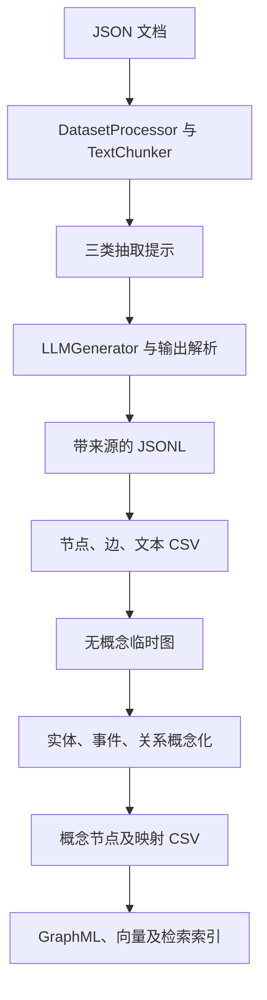

# AutoSchemaKG：实体、事件抽取与概念化 Schema 归纳

## 1. 阅读范围与版本

- 仓库：<https://github.com/HKUST-KnowComp/AutoSchemaKG>
- 源码快照：`d0a1666ae6621806faf814504c73678de4e809f2`
- 调研日期：2026-10-23；许可证：MIT，以该快照 LICENSE 为准。
- 论文：[AutoSchemaKG: Autonomous Knowledge Graph Construction through Dynamic Schema Induction from Web-Scale Corpora](https://arxiv.org/abs/2505.23628)。论文提出的方法与后续仓库工程演进分开说明。
- 本文依据核心构图、概念生成、转换和模型调用代码静态分析；没有执行模型推理、部署 Neo4j 或复现论文指标。

## 2. 项目究竟生成什么

AutoSchemaKG 的主要目标是从大量文本构建可检索的知识图谱，并在没有预先编写领域类别表的情况下，为实体、事件和关系生成抽象概念。项目中的 schema 更接近一组动态归纳的概念类型与映射，不等同于自动生成完整 OWL 公理体系。

它把知识组织为几个层次：

| 层次 | 实际表示 | 作用 |
| --- | --- | --- |
| 文本 | 原始片段、元数据、Text 节点 | 记录抽取来源 |
| 实体 | 字符串名称及 Entity 类型 | 承载具体对象或概念 |
| 事件 | 描述事件的简单句，类型为 Event | 保留动作、过程及事件间关系 |
| 关系 | 两个节点之间的关系名称及属性 | 表示联系、时序、因果等 |
| 概念 | Concept 节点；关系上的 concepts 属性 | 连接具体知识与抽象语义 |

事件与普通实体分开，是该方法的重要特点。只抽名词之间的关系容易丢失过程；事件句可以成为独立节点，再连接参与者及其他事件。另一方面，事件句本身不是结构化的完整事件模型：参与角色、论元、时间、条件等能否保留，仍取决于抽取结果。

## 3. 完整构建调用链

主入口是 `KnowledgeGraphExtractor`，配置由 `ProcessingConfig` 提供。

主要方法依次包括 `run_extraction()`、`convert_json_to_csv()`、`generate_concept_csv_temp()`、`create_concept_csv()`、`convert_to_graphml()`，随后可以生成数值 ID、embedding 和 FAISS 索引。哪些步骤实际执行，由调用示例或外部脚本决定，不应把一个类的所有方法理解为一次自动运行。[S1]

### 3.1 文档准备与分片

输入文档包含 `id`、`text`、`metadata`。`DatasetProcessor` 按文档索引将数据分给多个 shard，再切分文档。语言筛选依据 `metadata.lang` 与提示词支持语言；未给语言时默认为 `en`。

默认 `chunk_size=8192` 是**字符预算，不是 token 数**。`TextChunker.split_text()` 先按空格拆词，再累加长度，重叠区按末尾若干词近似保留。这个实现对空格分词语言更直接；连续中文或超长单词不会因为字符预算自动被切成更小词。因此，“有中文提示词”与“中文分块严格受预算约束”是两件事。[S1] [S2]

`deduplicate_text` 的集合在每次 `create_sample_chunks()` 内初始化，表示当前文档内的片段去重，不能据此宣称已经完成全语料语义去重。

### 3.2 三类抽取不是互相对话的 Agent

默认提示词包含：

| 抽取键 | 输出形态 | 语义 |
| --- | --- | --- |
| `entity_relation` | `Head / Relation / Tail` | 实体之间的关系 |
| `event_entity` | `Event / Entity[]` | 事件与参与实体 |
| `event_relation` | `Head / Relation / Tail` | 事件之间的时序或因果 |

事件提示要求每个事件表达成独立简单句，事件间关系提示列出 before、after、同时、因果等表达。三类任务共享原文，但 `run_extraction()` 中按 `result_keys` 循环调用 `process_stage()`，没有看到“前一角色提出计划、后一角色协商修改”的机制。这里主要是受程序控制的多次抽取。[S1] [S3]

`ProcessingConfig` 支持同时替换提示词文件与结果 schema 文件。初始化时要求两者配套，并检查一对一三元组结构或一对多数组结构。这种 schema 是输出结构合同，与归纳出来的领域概念 schema 需要区分。

### 3.3 输出修复与结果保留

`LLMGenerator` 封装 API 和本地模型调用，可并发处理批次；输出处理包含 JSON 修复、结构转换或 schema 校验，具体取决于传入的验证函数。不能把所有调用都概括为严格 schema constrained decoding。

`prepare_result_dict()` 保留：

- 文档 ID、原始片段和元数据；
- 每类任务的结构化结果 `*_dict`；
- 对应模型原始结果 `*_output`；
- 开启记录时的 `*_usage`。

输出文件扩展名是 `.json`，内容由逐行 `json.dumps(...)` 写入，实际为 JSONL。每条写完 `flush()`，便于观察长任务进度。保留原文和原始输出，使后续转换错误与模型抽取错误可以分别定位。[S1] [S4]

## 4. 概念是怎样生成的

`generate_concept()` 先读取临时图和待概念化的节点／关系列表，分别建立 entity、event、relation 批次。

- **事件概念化**：输入事件句，生成描述该事件类型或相关抽象概念的短语。
- **实体概念化**：输入实体名称，并加入图邻居形成的上下文。
- **关系概念化**：输入关系名称，生成更抽象的关系概念。

默认英文提示要求尽可能提供至少三个、处于不同抽象层次的短语。代码用逗号分割结果并转小写。这是开放概念生成，不是通过既有本体目录验证类别合法性。[S3] [S5]

当前快照对实体上下文采样至多一个前驱和一个后继，并将邻居名称与关系拼成短上下文。其取舍很清楚：减少单个概念生成请求的上下文长度，但结果可能受到随机邻居选择影响。它没有把整个实体邻域或所有原文定义送给模型。

### 4.1 概念如何进入图

`all_concept_triples_csv_to_csv()` 将实体／事件与概念映射写成 `has_concept` 边；Concept ID 是对概念文本加 `_concept` 后进行 SHA-256。关系概念写入原关系边的 `concepts` 字段。[S6]

因此，在这一实现里：

1. 概念标签可以充当跨知识点的语义桥梁。
2. 同一元素可关联多个概念。
3. 不同抽象层次的短语，并不会自动变成 `rdfs:subClassOf` 层级。
4. `has_concept` 也不能不经定义就等价为 OWL 类归属。
5. 没有在该主链中发现 domain/range、互斥类、基数限制或 OWL 推理闭环。

这是理解项目“自动生成 schema”最关键的边界。

## 5. 跨文本组织、身份与来源

JSON 到 CSV 转换保存实体／事件节点、关系边、文本节点和指向文本的 `Source` 边。文本节点采用内容哈希；概念采用概念文本哈希。实体在 CSV 层主要由名称组织。[S6] [S7]

这些 ID 机制提供可重复的文本／名称标识，但**哈希不是实体消歧**。两个同名对象是否同一实体，以及不同名称是否同一对象，不能仅靠字符串 ID 得到可靠答案。文本来源边也不等同于对每条关系保留精确句子级证据与置信度。

## 6. 并发、恢复和成本

并行主要分为三个层次：文档 shard、概念 shard、模型批次／线程池。`ProcessingConfig` 分别提供 triple 和 concept 的 shard 参数、批大小与 `max_workers`。这是数据并行，不是 Agent 动态创建或协作式规划。

概念分片函数在切分前调用 `random.shuffle(data)`。从函数本身看，若多个进程未共享一致的随机种子或排序，不应假定它们的概念 shard 必然互不重叠；这是需要运行环境一起核对的实现条件。[S5]

示例 `run_full_pipeline.sh` 包含作者机器的绝对路径，不能原样当作通用启动命令。配置中存在 `resume_from` 等字段，也不应仅凭字段名称宣称所有阶段都支持完整、幂等的断点续跑：需检查其调用链是否消费该配置。

成本来源可以拆为：每文本块多类抽取、每节点／关系概念生成、embedding 与建索引。抽象概念会增加一次与图元素数量相关的模型处理阶段；它并非只在首次生成少量 schema 时付费。

## 7. 评测与限制

仓库提供 `EvaluateKGC`、`EvaluateFactuality`、`EvaluateGeneralTask` 等研究评测目录，测试目录也覆盖检索器、prompt template、embedding、索引器等。论文报告大规模构图、类型语义对齐和下游问答实验；这些指标不能替代形式本体一致性、复杂规则正确性或行业语义验收。

静态阅读得到的主要边界：

- 图谱中的开放关系需要额外的语义规范化才能形成稳定关系词表。
- 事件句有利于保存过程，但不同表述的同一事件仍可能拆成多个节点。
- 概念生成依赖模型先验和有限邻居上下文，无法仅凭输出结构保证语义正确。
- JSON 修复解决格式问题，不验证来源是否真的支持关系。
- 当前链路没有表现为完整的本体版本合并与迁移系统。

## 8. 源码索引与推荐阅读顺序

| 来源 | 文件／符号 | 重点 |
| --- | --- | --- |
| [S1] | `triple_extraction.py`：`KnowledgeGraphExtractor`、`DatasetProcessor`、`TextChunker` | 主流程、分块、结果持久化 |
| [S2] | `triple_config.py`：`ProcessingConfig` | 默认值与工程控制面 |
| [S3] | `triple_extraction_prompt.py` | 三种关系抽取和概念化提示 |
| [S4] | `llm_generator.py`、输出验证模块 | 模型适配、并发、格式处理 |
| [S5] | `concept_generation.py`：`generate_concept` | 图邻居上下文和概念生成 |
| [S6] | `concept_to_csv.py` | 概念如何落实为节点和边 |
| [S7] | `json_to_csv.py` | 实体、事件、文本和来源的物理表示 |

[S1]: https://github.com/HKUST-KnowComp/AutoSchemaKG/blob/d0a1666ae6621806faf814504c73678de4e809f2/atlas_rag/kg_construction/triple_extraction.py
[S2]: https://github.com/HKUST-KnowComp/AutoSchemaKG/blob/d0a1666ae6621806faf814504c73678de4e809f2/atlas_rag/kg_construction/triple_config.py
[S3]: https://github.com/HKUST-KnowComp/AutoSchemaKG/blob/d0a1666ae6621806faf814504c73678de4e809f2/atlas_rag/llm_generator/prompt/triple_extraction_prompt.py
[S4]: https://github.com/HKUST-KnowComp/AutoSchemaKG/blob/d0a1666ae6621806faf814504c73678de4e809f2/atlas_rag/llm_generator/llm_generator.py
[S5]: https://github.com/HKUST-KnowComp/AutoSchemaKG/blob/d0a1666ae6621806faf814504c73678de4e809f2/atlas_rag/kg_construction/concept_generation.py
[S6]: https://github.com/HKUST-KnowComp/AutoSchemaKG/blob/d0a1666ae6621806faf814504c73678de4e809f2/atlas_rag/kg_construction/concept_to_csv.py
[S7]: https://github.com/HKUST-KnowComp/AutoSchemaKG/blob/d0a1666ae6621806faf814504c73678de4e809f2/atlas_rag/kg_construction/utils/json_processing/json_to_csv.py
