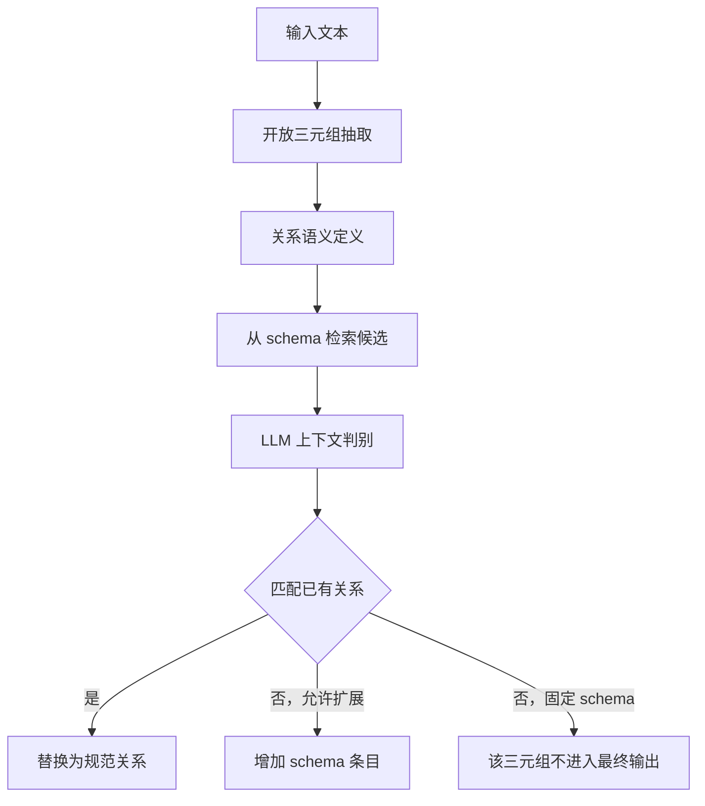

# EDC：Extract–Define–Canonicalize 的关系建模实现

## 1. 阅读范围与版本

- 仓库：<https://github.com/clear-nus/edc>
- 固定快照：`02aad17e2fc1e9845c84746b384e7fd3160edc1a`
- 调研日期：2026-10-23；许可证：MIT。
- 论文：[Extract, Define, Canonicalize: An LLM-based Framework for Knowledge Graph Construction](https://aclanthology.org/2024.emnlp-main.548/)，EMNLP 2024。
- 已静态阅读框架、抽取器、关系定义器、归一化器、schema 检索器、解析函数与关键提示词；未运行模型或复现基准。

## 2. 核心问题：关系名称不能代表稳定语义

开放信息抽取容易从相似语句生成不同谓词，例如 bought、purchased、acquired。反过来，一个谓词在不同上下文中也可能有不同含义。EDC 将“找到关系”与“把关系归入规范词表”拆开，在两者之间增加自然语言定义。

核心表示是：

- 三元组：`[subject, relation, object]`，三个元素主要是字符串。
- Schema：`relation_name -> natural_language_definition` 的字典。
- 规范化结果：原三元组保留头尾，只替换中间的关系名称。

这里的 schema 不是完整类体系，没有通过该表示直接声明 OWL 类、domain/range、逻辑公理或复杂事件参数。README 明确说明当前实现聚焦关系规范化；实体类型等属于后续扩展方向。[S1]

## 3. 三阶段主流程

`run.py` 负责命令行配置，`EDC.extract_kg()` 控制全过程；每轮依次调用 `oie()`、`schema_definition()`、`schema_canonicalization()`。不是让多个自治 Agent 自行决定下一步，模块与顺序均由程序固定。[S2] [S3]

### 3.1 Extract：保留开放表达空间

`Extractor.extract()` 将输入文本、few-shot 示例和提示模板组合成请求。初轮不把整个目标 schema 塞进上下文，从而避免大词表挤占文本空间。后续 refinement 才加入相关实体和关系提示。

输出通过 `parse_raw_triplets()` 解析。它扫描配对方括号、调用 `ast.literal_eval()`，收集满足基本形状的条目。它并非 JSON Schema 验证器，部分混合列表也有兼容处理。解析失败的片段可以被跳过，所以“最终列表为空”不一定表示原文确实没有关系。[S4]

### 3.2 Define：把关系含义外显出来

`SchemaDefiner.define_schema()` 从抽取三元组中取出关系集合，将文本、三元组和关系名单一起交给模型。提示要求定义能泛化到其他实体，并注意主语与宾语顺序。

结果按 `关系名: 定义` 解析成字典。若某些关系缺少定义，代码记录 debug 信息，没有在该函数内自动补齐。定义在这里承担两种职责：为 embedding 提供更丰富的语义文本，为后续 LLM 判断提供显式对照。[S5]

### 3.3 Canonicalize：先召回，再判断

`SchemaCanonicalizer` 初始化时编码目标 schema 的每个关系定义。

`retrieve_similar_relations()` 对查询关系的定义编码，与候选向量矩阵做点积排序，默认取前五项。某些 embedding 模型会自行归一化，但这一函数本身表达的是向量点积，不能不加条件地写成“严格余弦相似度”。[S6]

`llm_verify()` 随后构造一道选择题，输入包括：原文、待归一化三元组、其关系定义、候选关系与定义，以及“以上都不是”。匹配后只替换三元组的谓词。API 路径限制很短的回答，解析时读取首字符作为选项，因此依赖模型遵守输出约定。

这个设计将向量检索用于减少候选规模，把最终语义判断留给上下文中的 LLM；相似度最高的关系不会无条件成为答案。

## 4. 两种 schema 工作模式

| 模式 | 初始 schema | 无法匹配时 | 实际用途边界 |
| --- | --- | --- | --- |
| Target Alignment | 已有关系词表及定义 | 返回空结果，最终过滤 | 输出必须使用既定关系 |
| Self Canonicalization / enrichment | 可为空或不完整 | 将新关系和定义加入字典 | 在处理过程中长出规范词表 |

`canonicalize(..., enrich=True)` 将新关系即时写入 `schema_dict` 和 embedding 字典。因此，后续三元组会看到之前的归一化选择；处理顺序可能影响最终词表。这是一种在线、贪心式扩展，不是全语料统一聚类后进行最优命名。[S6]

另一个细节：如果关系名称已经出现在 schema 中，代码直接返回该三元组，跳过定义判别。这提高了效率，但意味着该分支没有检查同名关系在新上下文里是否出现语义漂移。

## 5. 迭代 refinement 如何组织上下文

`construct_refinement_hint()` 使用上一轮结果和原文构造下一轮提示：

1. 从原文再次抽取实体。
2. 合并新实体与上一轮实体。
3. 保留上一轮关系。
4. 通过 `SchemaRetriever` 检索与当前文本相关的关系定义。
5. 可选地加入上一轮中实际抽到该关系的文本／三元组示例。
6. 用这些提示重新执行开放抽取，再重新定义和归一化。

这里有两种不同检索任务：归一化阶段是“关系定义找相似关系”；refinement 阶段是“原文找可能出现的关系”。两者不应混为一个 embedding 查询。[S2] [S7]

总轮数由 `refinement_iterations + 1` 决定，没有基于质量指标自动收敛的停止器。示例采样含随机选择，复现时需同时考虑模型采样与程序随机性。

## 6. 产物与可观察性

每轮写入 `iterN/`：

| 文件 | 内容 |
| --- | --- |
| `result_at_each_stage.json` | 输入、实体提示、关系提示、开放三元组、定义、候选及规范化结果 |
| `canon_kg.txt` | 每个输入对应的非空规范化三元组列表 |

阶段 JSON 中保留了源码拼写 `schema_canonicalizaiton`；候选信息被转成字符串保存。消费产物时应按实际格式处理，而非假定全部字段都是标准化嵌套 JSON。[S2]

输出目录若已经存在，主流程会退出；这是防覆盖行为，不是自动断点恢复。保存阶段结果有助于回看错误在哪一步发生，但默认未输出 RDF/OWL，也没有完整实体 ID、来源 span 或版本化图数据库事务。

## 7. 模型适配与运行条件

配置将 OIE、定义、归一化验证、实体抽取及 schema 检索分开，可以分别指定模型。框架缓存已加载模型，并尝试在不再需要时释放资源。参考配置使用较早的 GPT/Mistral 和 embedding 模型，运行依赖包含 Transformers、SentenceTransformers 等。[S3]

需要注意几处静态实现条件：

- `is_model_openai()` 通过模型名是否包含 `gpt` 分流，不是通用的 provider registry。
- 缺少关系定义时，某些 enrichment 路径直接按键读取定义，存在触发缺键错误的可能；未动态复现。
- 非 OpenAI 的 canonicalization 模型加载分支值得单独检查：调用 `load_model(..., "sts")` 后按模型／tokenizer 二元组使用，与其他生成路径的 `hf` 模式不一致；不能据此保证任意本地配置即插即用。
- `verification_result[0]` 假定响应非空，格式恢复不是一个完整的多轮修复协议。

这些是固定快照的阅读发现，不能把它们提升为所有版本均有的运行故障。[S2] [S4] [S6]

## 8. 评测与能力边界

论文和仓库使用 WebNLG、REBEL、Wiki-NRE 等关系抽取数据；`evaluate/` 提供与参考三元组比较的脚本。结果关注构图／关系抽取，不等于评测完整 ontology 的概念覆盖、层级正确性或形式一致性。

主要机制可以独立理解为：开放生成保持召回，定义提供语义解释，候选检索降低上下文负担，选择题判别完成规范化，迭代提示补充遗漏。

主要边界：实体消歧、指代消解、长文切分、类别归纳、事件实体化（reification）、逻辑约束并非这一核心实现的完整职责。模型生成的定义本身也可能错误，不能当作事实验证证据。

## 9. 源码阅读索引

| 来源 | 文件／符号 | 阅读目的 |
| --- | --- | --- |
| [S1] | README | 作者声明的范围与实验模式 |
| [S2] | `EDC` | 阶段衔接、refinement、输出 |
| [S3] | `run.py` | 模型和模板配置 |
| [S4] | `llm_utils.py` | 解析和 provider 判断 |
| [S5] | `SchemaDefiner` | 自然语言关系定义 |
| [S6] | `SchemaCanonicalizer` | 候选召回、LLM 判别及扩展 |
| [S7] | `SchemaRetriever` | 原文到相关关系的检索 |
| [S8] | `sc_template.txt` | 归一化判别协议 |

[S1]: https://github.com/clear-nus/edc/blob/02aad17e2fc1e9845c84746b384e7fd3160edc1a/README.md
[S2]: https://github.com/clear-nus/edc/blob/02aad17e2fc1e9845c84746b384e7fd3160edc1a/edc/edc_framework.py
[S3]: https://github.com/clear-nus/edc/blob/02aad17e2fc1e9845c84746b384e7fd3160edc1a/run.py
[S4]: https://github.com/clear-nus/edc/blob/02aad17e2fc1e9845c84746b384e7fd3160edc1a/edc/utils/llm_utils.py
[S5]: https://github.com/clear-nus/edc/blob/02aad17e2fc1e9845c84746b384e7fd3160edc1a/edc/schema_definition.py
[S6]: https://github.com/clear-nus/edc/blob/02aad17e2fc1e9845c84746b384e7fd3160edc1a/edc/schema_canonicalization.py
[S7]: https://github.com/clear-nus/edc/blob/02aad17e2fc1e9845c84746b384e7fd3160edc1a/edc/schema_retriever.py
[S8]: https://github.com/clear-nus/edc/blob/02aad17e2fc1e9845c84746b384e7fd3160edc1a/prompt_templates/sc_template.txt
