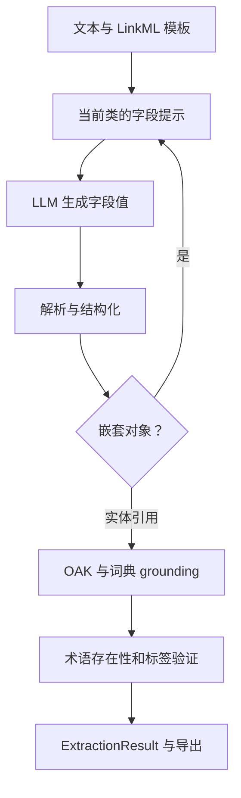

# OntoGPT：LinkML 驱动的递归抽取与本体实体对齐

## 1. 阅读范围与版本

- 仓库：<https://github.com/monarch-initiative/ontogpt>
- 源码快照：`9224d33f84cce7097c3519e1d9f0e2be46cec056`
- 调研日期：2026-10-23；仓库 LICENSE 为 BSD 3-Clause；个别模板另有元数据许可声明。
- 相关论文：[SPIRES / Structured Prompt Interrogation and Recursive Extraction of Semantics](https://doi.org/10.1093/bioinformatics/btae104)。
- 本文重点分析默认 SPIRES 抽取引擎、LinkML 模板、OAK grounding、术语验证与导出。其他实验引擎不作为默认能力依据；未执行模型或下载完整生物医学本体。

## 2. 建模定位：按照已有模型生成知识实例

OntoGPT 的核心不是从零发现完整类别体系，而是让已有的 LinkML 数据模型控制抽取过程，再把文本中的实体名称映射到已有本体标识符。它同时处理两种约束：输出对象要符合模板的字段和嵌套结构；对象中引用的术语应尽量来自指定本体。

例如药物机制模板先定义 `DrugMechanismSet`、`DrugMechanism`、`MechanismLink`，再定义疾病、药物、生物实体、谓词所对应的本体来源。输入文本产生该模型的实例。模板中的 `is_a` 是模板作者提供的继承；抽取一份药物文本不会自动训练出新的全局药物分类体系。[S1] [S2]

| 模型元素 | 代码中的用途 | 不应混淆的概念 |
| --- | --- | --- |
| LinkML class | 决定一个对象的字段与继承 | 不一定是从原文新发现的 OWL 类 |
| slot / attribute | 字段、范围、基数、嵌套方式 | 不等于无约束自然语言关系 |
| `annotations.prompt`、description | 生成字段说明 | 是抽取指导，不是事实验证器 |
| `id_prefixes` | 限定实体标识符命名空间 | 前缀合法不代表 ID 存在 |
| `annotations.annotators` | 指定 OAK 术语匹配来源 | 匹配还可能失败或选错词义 |
| `AUTO:` | 未归一化实体的本地占位标识 | 不能视为外部本体正式术语 |

## 3. 核心流程与模块

`KnowledgeEngine` 管理模板加载、`SchemaView`、模型客户端、字典、annotator、mapper、标签与缓存。`SPIRESEngine.extract_from_text()` 负责文本抽取；`get_completion_prompt()`、`parse_completion_payload()` 和 `ground_annotation_object()` 分别处理提示、解析和对象中的实体归一化。模型调用集中在 `LLMClient`，当前实现使用 LiteLLM。[S1] [S3] [S4]

### 3.1 将 Schema 编译成局部提示

`get_completion_prompt()` 使用 `class_induced_slots()` 获取当前类的有效字段。字段描述优先使用 prompt annotation，再使用字段 description 等信息；枚举范围会列出允许值。被 `prompt.skip` 标记的字段不参与抽取。

这个过程每次围绕一个 class 展开，避免把整个嵌套模型原封不动塞进上下文。模板既是输出结构，也是提示词的配置源；更改字段说明会直接改变模型看到的抽取任务。

### 3.2 递归不是多个 Agent 协商

`_parse_line_to_dict()` 根据字段的 range 和 inlined 设置判断结果是否是嵌套对象。若需要递归，会把当前字段的一段文本作为下一次子类抽取的输入，调用 `_extract_from_text_to_dict()`。默认 `recurse=True`；复杂子类同样触发递归。某些简单双字段对象在非递归配置下可按分隔符拆成字典。

因此运行中的层级来自**模型结构**，而不是由一个 planner 自由规划角色。外层提取集合、内层提取记录、再内层提取机制链，均由代码和 schema 决定。子抽取常常基于父抽取生成的摘要片段，遗漏的信息未必能在后续层级自行恢复。[S1]

### 3.3 解析与合并的实际行为

解析器兼容字典、代码围栏、键值行、续行和部分格式偏差。字段名会转小写、空格转下划线，必要时尝试去掉复数后缀。多值字段通常按分号拆分。无法匹配 schema 的行会记录警告并跳过；必填字段出现空值则可能抛错。

这是一套容错解析策略，不代表所有供应商调用都使用严格 constrained decoding。能够解析的输出仍可能漏项或包含原文没有支持的事实。

长文本可按句窗口或字符窗口处理。两种配置同时启用时，当前代码后生成的字符分块会覆盖前面的句分块结果。跨块对象合并时，列表去重、标量采用后续非空值覆盖等策略；它不对两个不一致标量做语义裁决。结果中的原始 completion 字段也不应被理解为所有分块调用的完整审计日志。[S1] [S3]

## 4. Grounding：从名称到已有本体 ID

设计上优先要求 LLM 给出名称，再由确定的本体访问接口做 ID 对齐，降低直接让模型编造 CURIE 的风险。实际输入也可能已经含有 CURIE，代码仍有针对已有标识符的处理路径。

`normalize_named_entity()` 和相关 grounding 方法依次利用类范围、词典、名称变体及 OAK annotator：

1. 判断字段是否引用 schema class；普通字符串范围保持普通值。
2. 处理已有 CURIE、命名空间大小写、单复数、括号内外文本等变体。
3. 尝试本地 dictionary；部分匹配需要满足重叠比例。
4. 从 class 的 `annotators` annotation 创建 OAK adapter，对名称进行实体标注或查找。
5. 优先完整文本或精确标签匹配，按实现选择可用候选。
6. 校验 ID 前缀、模式和值集；前缀不符合时可经 mapper 寻找目标命名空间中的对应项。
7. 未匹配到术语时，若配置了 `auto_prefix`，生成本地占位 ID；否则保留未规范化文本。[S3]

这里有三个不同问题：候选是否存在、是否符合允许的本体范围、是否表达当前上下文的正确词义。前两个可借助本体接口检查，第三个仍依赖名称与上下文质量。当前主流程常取首个可接受 grounding 结果，不是跨本体的全局联合消歧求解。

### 4.1 模板中真正可复用的表达能力

`templates/drug.yaml` 展示了一个明确的领域模型：

- `DrugMechanism` 有 disease、drug 和 mechanism_links 等字段。
- `MechanismLink` 是 subject、predicate、object 三元结构，三个范围各有定义。
- `Disease` 指向 MESH、MONDO；`Drug` 指向 DRUGBANK、CHEBI、MESH。
- `Predicate` 指向 RO、MI、BIOLINK 等关系词汇来源。
- `references`、`source_text` 等字段可通过 `prompt.skip` 交给程序填充。

因此不仅实体名称可以对齐，关系名称也可作为一个有标识符的对象进行 grounding。具体模板支持哪些本体、是否有可用 adapter，要以该模板和运行环境为准，不能把一个模板的配置泛化到全部模板。[S2]

## 5. 第二道验证：术语存在与标签匹配

当前 `validate_terms=True`；`SPIRESEngine` 利用抽取深度保证通常在最外层结果完成后统一验证，而不是每一层递归都重复验证。`TermValidator` 结合 LinkML term validator 的接口、标签缓存和 schema 中实体范围，遍历实体引用并产生验证报告。[S1] [S5]

主要结果包括有效、替换、未解决、标签不一致、跳过。若 ID 无效或标签不符，验证器会尝试找到能替代的精确标签项，并同步修改对象引用与 named_entities。

必须保留一个实现边界：当 adapter 不可用、无法验证或找不到替代项时，报告可能出现 `SKIPPED`、`UNRESOLVED`、`LABEL_DIFFERS`。这说明“启用了验证”并不等价于“输出每个 ID 都已被成功验证且含义正确”。README 的概括应与具体 validation 结果一起理解。验证也不检查“药物是否真的治疗该疾病”这样的事实关系。

## 6. 结果、导出与来源

`ExtractionResult` 封装 extracted_object、named_entities、输入及模型相关结果，并可附术语验证信息。span 功能根据名称在原文中定位出现位置，但实体对齐后的词义正确性不能仅凭字符串命中证明。

CLI 支持 YAML、JSON、JSONL、表格、KGX、Turtle、OWL 等多种输出。应分别理解两个语义导出器：

- `RDFExporter` 将 Pydantic 对象转换为 LinkML 生成的 dataclass，再通过 `rdflib_dumper` 按 schema 输出 RDF。
- `OWLExporter` 同样转换对象，并调用 `linkml_owl.OWLDumper`，结合模板映射输出 OWL 文档及 named entity 公理。[S6] [S7]

**支持 OWL 序列化不等于自动归纳 OWL 设计。** 输出中的形式化语义依赖模板及 LinkML-OWL 映射；默认抽取引擎没有一个自主发现类互斥、基数限制和复杂类表达式的 ontology engineer Agent。

## 7. 工程组织、评估与边界

LiteLLM 客户端集中处理 provider、模型名、凭据兼容、缓存和不支持参数的调整。模板和引擎分离，使同一模板能够用于不同模型；缓存也能减少重复提示调用，但不能保证跨模型版本结果一致。[S4]

仓库有解析、grounding、模板、客户端、导出等测试和领域样例。本文只检查相关实现与测试目录，没有运行这些测试，也没有复现论文抽取指标。测试覆盖的结构正确性与外部本体可访问性、领域抽取质量应分别评价。[S8]

当前仓库还提供 Agent Skills，教外部 coding agent 如何选择模板、运行抽取和排查错误。这是外围使用方式；SPIRES 本身仍是 schema 驱动的程序流程，不能因为提供 skills 就描述为多 Agent 建模系统。

主要成本来自递归调用数量、长文本分块、本体加载与 grounding 接口访问。主要误差来源包括父层压缩丢失信息、字段解析丢弃、同名术语误匹配、模板缺少必要字段，以及多个片段对同一标量提供不同值。

## 8. 固定版本源码索引

- [S1：SPIRES 引擎](https://github.com/monarch-initiative/ontogpt/blob/9224d33f84cce7097c3519e1d9f0e2be46cec056/src/ontogpt/engines/spires_engine.py)
- [S2：药物机制 LinkML 模板](https://github.com/monarch-initiative/ontogpt/blob/9224d33f84cce7097c3519e1d9f0e2be46cec056/src/ontogpt/templates/drug.yaml)
- [S3：KnowledgeEngine 与 grounding](https://github.com/monarch-initiative/ontogpt/blob/9224d33f84cce7097c3519e1d9f0e2be46cec056/src/ontogpt/engines/knowledge_engine.py)
- [S4：LLM 客户端](https://github.com/monarch-initiative/ontogpt/blob/9224d33f84cce7097c3519e1d9f0e2be46cec056/src/ontogpt/clients/llm_client.py)
- [S5：术语验证](https://github.com/monarch-initiative/ontogpt/blob/9224d33f84cce7097c3519e1d9f0e2be46cec056/src/ontogpt/validation/term_validator.py)
- [S6：RDF 导出](https://github.com/monarch-initiative/ontogpt/blob/9224d33f84cce7097c3519e1d9f0e2be46cec056/src/ontogpt/io/rdf_exporter.py)
- [S7：OWL 导出](https://github.com/monarch-initiative/ontogpt/blob/9224d33f84cce7097c3519e1d9f0e2be46cec056/src/ontogpt/io/owl_exporter.py)
- [S8：测试目录](https://github.com/monarch-initiative/ontogpt/tree/9224d33f84cce7097c3519e1d9f0e2be46cec056/tests)

[S1]: https://github.com/monarch-initiative/ontogpt/blob/9224d33f84cce7097c3519e1d9f0e2be46cec056/src/ontogpt/engines/spires_engine.py
[S2]: https://github.com/monarch-initiative/ontogpt/blob/9224d33f84cce7097c3519e1d9f0e2be46cec056/src/ontogpt/templates/drug.yaml
[S3]: https://github.com/monarch-initiative/ontogpt/blob/9224d33f84cce7097c3519e1d9f0e2be46cec056/src/ontogpt/engines/knowledge_engine.py
[S4]: https://github.com/monarch-initiative/ontogpt/blob/9224d33f84cce7097c3519e1d9f0e2be46cec056/src/ontogpt/clients/llm_client.py
[S5]: https://github.com/monarch-initiative/ontogpt/blob/9224d33f84cce7097c3519e1d9f0e2be46cec056/src/ontogpt/validation/term_validator.py
[S6]: https://github.com/monarch-initiative/ontogpt/blob/9224d33f84cce7097c3519e1d9f0e2be46cec056/src/ontogpt/io/rdf_exporter.py
[S7]: https://github.com/monarch-initiative/ontogpt/blob/9224d33f84cce7097c3519e1d9f0e2be46cec056/src/ontogpt/io/owl_exporter.py
[S8]: https://github.com/monarch-initiative/ontogpt/tree/9224d33f84cce7097c3519e1d9f0e2be46cec056/tests
