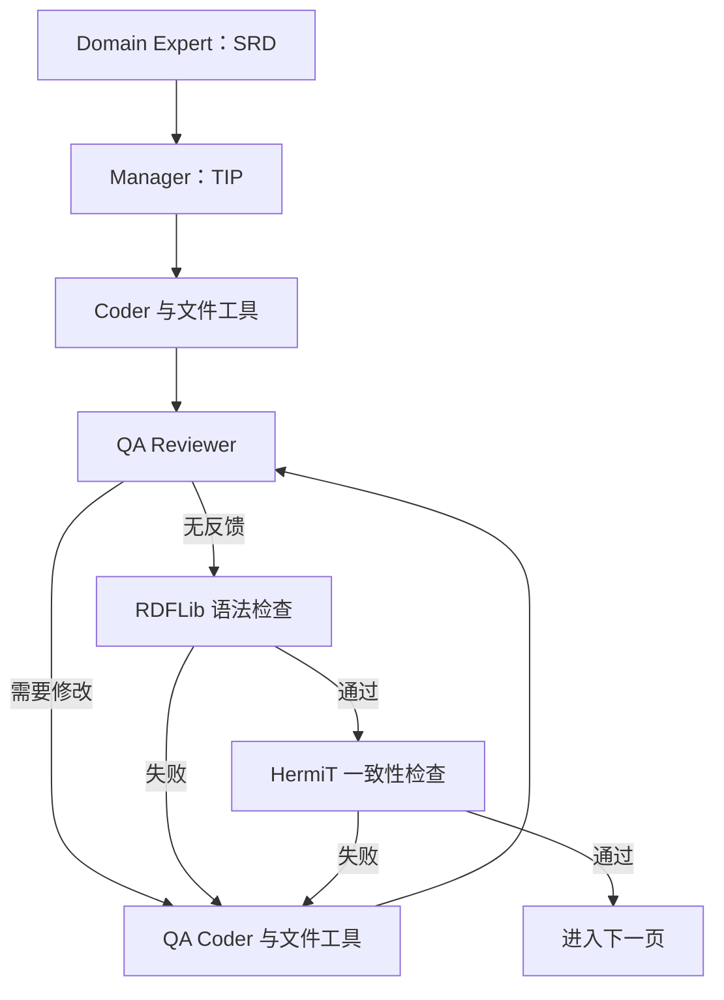

# Towards Automated Ontology Generation：需求、计划、TTL 编写与验证 Agent

## 1. 阅读范围与版本

- 仓库：<https://github.com/brains-group/towards_automated_ontology_generation>
- 源码快照：`aa2fb01f56574e1fc36420318bb86f0364c72945`
- 调研日期：2026-10-23。
- 相关论文：<https://arxiv.org/abs/2604.23090>。
- 许可边界：该快照根目录未见 LICENSE；本文将其列为**公开研究代码**，不把可公开阅读直接等同于具有明确开源许可证。
- 本文静态检查 LangGraph 主流程、文件编辑工具、语法和一致性验证、CQ 评估。未运行模型、Java 推理器或合同评测，不报告复现成绩。

## 2. 它与普通三元组抽取的区别

该项目围绕保险合同，把领域语义需求转成 OWL/RDF 的 Turtle 文件。输出同时包含类、属性、限制等模式内容，以及合同中的事实实例。Agent 被要求使用 ontology design patterns，包括角色、事件参与、数量、时间区间和状态建模。[S1]

任务由 competency questions（CQ，能力问题）约束：本体需要支持回答哪些问题，决定要引入哪些概念、关系和事实。CQ 在生成阶段是设计输入，在评估阶段又被转成 SPARQL，以检验图是否可用。二者相关但不是同一个验证步骤。

示意上，“某角色在某时间满足某条件”不是仅写一条宽泛关系；Manager 会被提示考虑事件或关联节点，把参与者、时间、条件分别挂到该节点。代码中的 reification 主要指这种 n 元关系对象化／模式设计，不应一律理解成 RDF 标准 `rdf:Statement` 四元组表示。

## 3. Agent 的职责与交接物

| 角色或节点 | 接收 | 产生 | 是否直接修改 TTL |
| --- | --- | --- | --- |
| CQ 准备 | 合同文本 | 按页组织的问题与期望答案 | 否 |
| Domain Expert | 当前页与 CQ | Semantic Requirements Document，SRD | 否 |
| Manager | SRD、当前页、CQ、已有本体快照 | Technical Implementation Plan，TIP | 否 |
| Coder | TIP、当前页、已有本体 | 文件工具调用 | 是 |
| QA Reviewer | TIP、当前页、本体及历史反馈 | 结构化 QA 状态与问题列表 | 否 |
| QA Coder | 质量反馈或验证错误、本体 | 定向文件修复 | 是 |
| Syntax / Semantics | TTL 文件 | 机器可解析的验证结果 | 否 |

主程序要求提供 `--contract`、`--cqs`、`--ontology-out`。CQ JSON 是事先准备的输入；主生成图并不会在每一页自动运行 CQ 生成器。[S1] [S2]

## 4. 建模知识如何在中间文档中组织

### 4.1 SRD：保留语义，不提前写 Turtle

`domain_expert_node()` 的提示要求生成 JSON 形态的 SRD，字段覆盖：

- 核心概念及类型，例如 Entity、Role、Event、State、Attribute。
- 主谓宾关系，以及 when / unless 等限定条件。
- if / then / else 业务规则。
- ISO 8601 时长、日期、货币金额。
- 状态集合与状态转移，包括 trigger 和 guard。
- 每个 CQ 对应的支持信息，以及假设。

提示给列表设置数量上限，以压缩交接内容。实际代码把模型回答作为字符串保存到 `requirements_doc`，未在此处用 Pydantic 或 JSON Schema 强制校验 SRD。因此“提示中有 JSON schema”与“程序已经验证 JSON 符合 schema”需要区分。[S1]

### 4.2 TIP：把语义要求转换成建模决策

Manager 根据 SRD 和已有 TTL 快照决定复用、扩展或创建哪些类与属性，列出范围、层级、约束和设计模式，并把 CQ 映射到所需类与 ODP。

这一阶段是自然语言／Markdown 计划，不是一个经过类型检查的变更 AST。它降低 Coder 同时理解业务和设计本体的负担，但计划本身仍由 LLM 生成。代码没有实现独立的 ODP 模板库匹配器或确定性的计划编译器。

### 4.3 Coder：模式和实例都要写入

Coder 提示明确区分类与个体、对象属性与数据属性，并提醒避免把日期和整数错误建为类。它要求先补充模式，再填入事实，复用现有类属性，并通过属性连接关联节点及其参与者。

Coder 只绑定 `write_file_with_range`、`append_to_file`。代码读取带行号的本体快照，模型通过工具编辑文本。QA Coder 则拥有更多读、查、插入、删除工具。这里的持久化单位是 TTL 文本行，不是 RDF 图事务或经过一致性检查的原子 patch。[S1] [S3]

## 5. 协作不是自由讨论，而是有状态图

`OrchestratorState` 共享当前页、CQ、输出路径、SRD、TIP、reflection、质量反馈、语法错误、一致性错误、计数器和消息列表。消息 reducer 用特殊 `__CLEAR__` 标记重置缓存，防止上一轮 Coder 的工具对话持续污染后续角色上下文。[S1]

`build_graph()` 固定控制路由，工具循环由 `tools_condition` 判断；并不存在由 Manager 动态增删 Agent 或自由选择整个拓扑的能力。LLM 决定工具参数和内容，程序决定阶段与返回路径。

编译时使用 `MemorySaver`。每页设置独立 thread ID，长程共同状态主要是逐页累积的 TTL 文件。MemorySaver 是进程内 checkpoint；它本身不是持久数据库，也不等同于重启后可恢复所有 Agent 状态。

## 6. 三种验证分别解决什么

### 6.1 QA Review：模型审阅建模质量

`QAReview` 用 Pydantic 定义 `QA_PASSED` / `CHANGES_REQUIRED` 和反馈列表，模型通过 structured output 返回结果。审阅对照计划、当前页和已有本体，关注缺失概念、错误关系、未实例化及 CQ 支持；反馈再次交给 QA Coder。

这是语义审阅但仍是 LLM 判断，不是形式证明。反复修改时还可生成 reflection 帮助修复。当前 `MAX_QA_CYCLES=20`；达到上限时 QA 节点返回空反馈并继续语法检查。因此“完成流程”不能证明模型审阅确实通过。论文、早期版本中的次数设置不能直接套用到该快照。[S1]

### 6.2 Syntax Check：Turtle 能否被解析

`verify_rdf_syntax()` 用 RDFLib 解析文件。失败时返回错误、行列信息及附近文本，帮助 QA Coder 做局部修复。它能发现 Turtle 标点、前缀、字面量等语法问题，不判断类是否选错或合同条件是否遗漏。[S4]

### 6.3 Semantics Check：OWL 一致性与特定异常

当前活动实现先把 Turtle 转 RDF/XML，再经 Owlready2 加载，在独立 World 中调用 HermiT。它检查推理不一致、不可满足类等，并额外检查部分关系属性问题。文件里还保留旧 Pellet 实现，但不能把旧函数当成当前主调用路径。[S4]

错误统一转成结构化结果供修复。Java、依赖或推理器启动失败也会落入错误路径，所以“semantics_check 出错”不总是本体逻辑矛盾。本文没有发现主流程执行 SHACL 验证。

一致性只表示这些公理没有在当前推理器下导出相应冲突；不保证事实真实、模型充分、CQ 可答。业务 if/then 规则能否被忠实表达，也取决于最终选择的 OWL 表达，不是把自然语言规则写入注释即可执行。

## 7. 增量处理与实际实现细节

主程序通过 PyMuPDF 按页提取文本，逐页运行图；每页状态重新初始化，但读取同一个持续增长的 TTL。没有 OCR 或版面重建就会受到 PDF 文本顺序影响；跨页事实能否合并依赖已有本体快照及模型理解。

若输出文件不存在，主程序写入前缀；若存在，则继续在它上面工作。但没有按文档内容哈希和已完成页构建幂等 ingestion 记录，重新运行相同合同可能重复追加或再次修改。完整 TTL 被读入多处提示，图增大后上下文和调用成本也增大。

静态检查还发现几处需注意的实现事实：[S1]

- 初始化文件和 Coder 提示给出的示例默认命名空间不同；应检查实际产物是否混用。
- Coder 提示同时存在“一次 append 生成所需内容”和“逐步添加”的表述，约束并非完全一致。
- 图里定义了 `clear_qa_coder_msgs`，但 QA Coder 正常结束的路由直接进入 QA Review，未经过这个节点。
- `MAX_SYNTAX_CHECKS` 等常量的存在不等于所有错误循环都由该常量限制；整体还有 LangGraph recursion limit，默认 10000。
- `_retry_invoke()` 对调用异常重试三次，未看到完整的退避、成本预算、持久任务队列或并行合同调度层。

这些是本快照的静态观察，不是已运行复现的缺陷报告。

## 8. CQ 评估与其他评估路径

评估流程将 CQ 和本体信息交给 LLM 生成 SPARQL，解析和执行后，再由 LLM 对照期望答案判断结果。可重试生成／修复查询。因此测到的是本体内容、查询生成能力、执行成功率和裁判判断的组合，不能直接视为纯粹 ontology correctness。[S5]

实现中的失败处理还可能对“已有查询结果但最后没成功”的情况给部分分值；阅读输出时要结合评分分支，而不只看平均分。仓库另有向量或 RAG 评估路径，它们反映文本／检索可用性，与 OWL 一致性、SPARQL 可回答性分别对应不同问题。

本项目最清楚展示的研究机制，是显式交接 SRD→TIP→TTL、以 CQ 约束建模、把 LLM 审阅与机器验证拆成不同反馈来源。公开代码更接近面向特定保险合同的研究原型，不能仅凭角色齐全就推断已具备通用领域生产平台能力。

## 9. 固定版本源码索引

- [S1：Agent 状态、提示、控制图与主程序](https://github.com/brains-group/towards_automated_ontology_generation/blob/aa2fb01f56574e1fc36420318bb86f0364c72945/agents/multi_agent.py)
- [S2：项目说明与流程入口](https://github.com/brains-group/towards_automated_ontology_generation/blob/aa2fb01f56574e1fc36420318bb86f0364c72945/README.md)
- [S3：文件编辑工具](https://github.com/brains-group/towards_automated_ontology_generation/blob/aa2fb01f56574e1fc36420318bb86f0364c72945/tools/file_management.py)
- [S4：RDF 与 OWL 检查](https://github.com/brains-group/towards_automated_ontology_generation/blob/aa2fb01f56574e1fc36420318bb86f0364c72945/tools/syntax_checks.py)
- [S5：CQ 与 SPARQL 评估](https://github.com/brains-group/towards_automated_ontology_generation/blob/aa2fb01f56574e1fc36420318bb86f0364c72945/agents/eval.py)

[S1]: https://github.com/brains-group/towards_automated_ontology_generation/blob/aa2fb01f56574e1fc36420318bb86f0364c72945/agents/multi_agent.py
[S2]: https://github.com/brains-group/towards_automated_ontology_generation/blob/aa2fb01f56574e1fc36420318bb86f0364c72945/README.md
[S3]: https://github.com/brains-group/towards_automated_ontology_generation/blob/aa2fb01f56574e1fc36420318bb86f0364c72945/tools/file_management.py
[S4]: https://github.com/brains-group/towards_automated_ontology_generation/blob/aa2fb01f56574e1fc36420318bb86f0364c72945/tools/syntax_checks.py
[S5]: https://github.com/brains-group/towards_automated_ontology_generation/blob/aa2fb01f56574e1fc36420318bb86f0364c72945/agents/eval.py
