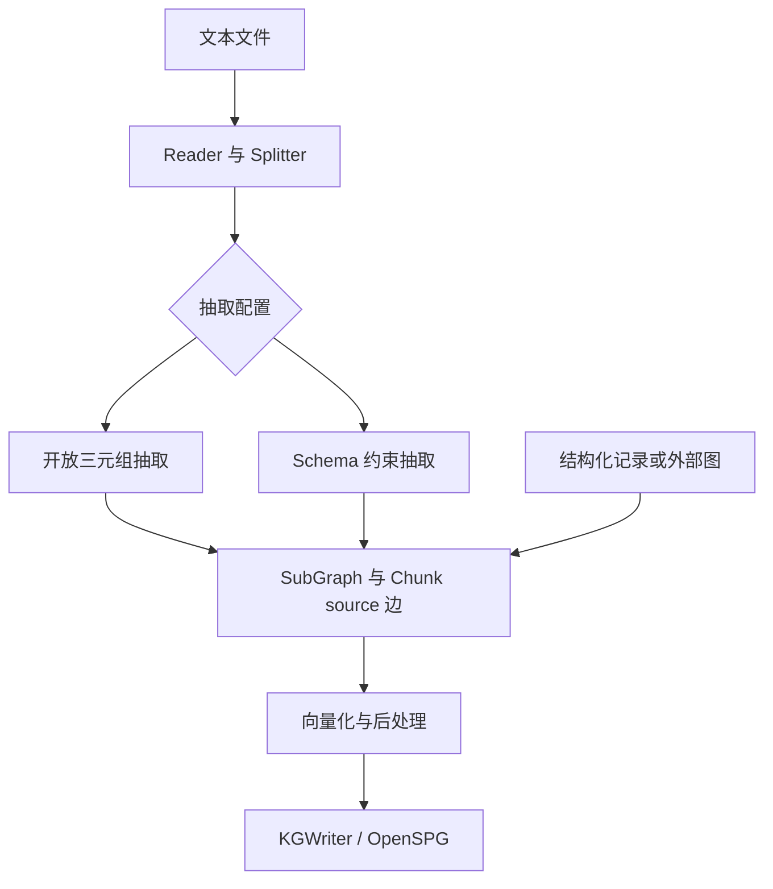

# KAG：Schema 约束构图、文本互索引与逻辑形式求解

## 1. 阅读范围与版本

- 仓库：<https://github.com/OpenSPG/KAG>
- 源码快照：`fdab15b3929d2ee40dfcdd388f90233096a6afc9`
- 调研日期：2026-10-23；许可证：Apache-2.0。
- 论文：[KAG: Boosting LLMs in Professional Domains via Knowledge Augmented Generation](https://arxiv.org/abs/2409.13731)。
- 本文检查 Python Builder、Schema prompt、图后处理、Writer 和 Solver 的关键路径。OpenSPG 服务端是另一个仓库，本文没有把其完整存储、规则引擎和管理平台源码一并审计；未部署服务或复现问答指标。

## 2. 建模定位与表示层

KAG 把结构化业务记录、非结构化文本和领域模式组织到 OpenSPG 的图与索引中，再通过混合检索、计算和语言推理回答问题。其重点是领域知识建设及使用，而不是默认从零发现一套 OWL 本体。

项目同时支持 schema-free 与 schema-constrained 构建。这里的 schema-free 不表示程序完全没有任何类型信息：`SchemaFreeExtractor` 也加载项目 schema，利用已知类型处理抽取结果，并用 `Others` 容纳没有匹配类型的节点。[S1] [S2]

| 表示 | 实现内容 | 角色 |
| --- | --- | --- |
| SPG 类型 | Entity、Concept、Event 及属性、关系定义 | 规定领域对象的结构 |
| Node | id、name、label、properties | 具体图节点 |
| Edge | 两端 ID 与类型、label、properties | 图上的连接 |
| SubGraph | nodes、edges 与子图标识 | 单个构建组件的交换对象 |
| Chunk | 原始文本块与元信息 | 证据及文本检索单元 |
| 其他索引 | Outline、Summary、KnowledgeUnit、AtomicQuery、Table 等组件 | 不同粒度的召回入口 |

这些类型和索引来自不同组件配置。仓库包含某种 extractor，不等于所有项目默认都同时构建全部索引。[S3] [S4]

## 3. Builder 的组织方式

`DefaultUnstructuredBuilderChain` 将 reader、splitter、extractor、vectorizer、post_processor、writer 串接起来；`DefaultStructuredBuilderChain` 则以 mapping 开始，把已有结构化记录映射成图。`DomainKnowledgeInjectChain` 允许注入外部图。[S5]

组件通过 ABC 注册名和配置实例化，`>>` 表达处理链。默认非结构化链有按 chunk 的 ThreadPoolExecutor 并发，并可根据已处理 chunk key 跳过已有结果。若走异步 extractor，同一阶段中也能并发独立 LLM 请求。它是可配置工作流，不是各角色自由协商的本体生成 Agent 群。

## 4. Schema-free 抽取：开放关系与已有类型并存

`SchemaFreeExtractor` 的主要步骤为：[S1]

1. 用标题和内容组成 passage，执行实体识别。
2. 如配置 external_graph，合入外部实体识别结果；按名称去重。
3. 根据项目 schema 处理实体属性，形成初始子图。
4. 把实体 name/category 列表交给三元组抽取提示。
5. 另一次调用生成实体 official_name。
6. 合并实体、三元组、标准名称连接和来源 Chunk。

实体携带 description 和 semanticType。三元组关系被 `to_camel_case()` 转成边名；若三元组中的端点不在前面的实体列表中，会补建 Others 节点。开放关系并没有在这一分支中全部映射到一个固定谓词字典。

名称标准化的结果也不是直接销毁原节点。若 official_name 与原名不同，代码建立标准名节点，并添加 `OfficialName` 边。这保留了原表达与规范表达的联系，但与把两个节点合并成唯一 ID 是不同策略。

异步 `_ainvoke()` 在 NER 之后，用 `asyncio.gather()` 并发执行关系抽取和名称标准化。表格 chunk 可分流到 TableExtractor。

**静态实现细节：**同步 `_invoke()` 当前把 `triples_extraction(...)` 包成了单元素 tuple，再传给期望三元组列表的组图函数；异步分支直接使用列表。两条路径在这一快照并不完全等价，可能影响关系组装。本文没有运行该路径，故将其记录为需关注的源码行为，而不宣称已经复现运行故障。

## 5. Schema-constrained 抽取如何落到代码

### 5.1 从 Schema 生成 prompt

`SPGPrompt` 通过 `SchemaClient.load()` 读取项目模式。`create_prompt_schema()` 遍历选定类型，把属性、目标类型、描述和多值约束转为提示中的 schema。某些内部字段、Chunk 和 `isA` 等会被忽略；并非服务端所有 schema 语义都原样送给 LLM。[S6]

响应解析器处理 JSON，检查 category 是否属于 schema，并要求 properties 中存在 name，再去掉描述性括号、整理属性名。此处实现的是输出过滤和结构转换，不是 OWL 推理或完整数据约束验证。

### 5.2 实体、事件和关系分别抽取

`SchemaConstraintExtractor` 支持 NER、标准名、关系、事件四类 prompt。关系或事件 prompt 未配置时，对应方法返回空列表；仅创建这个 extractor 不会自动获得完整事件建模能力。[S2]

关系输出采用五项结构：主体名、主体类型、谓词、客体名、客体类型。事件输出与实体记录一样，经属性递归转换进入图。业务场景可提供不同 prompt，默认 prompt 通过场景名称和 fallback 机制寻找。

### 5.3 对象属性递归转节点，基本属性保留为值

`parse_nodes_and_edges()` 查询属性的目标类型。若目标不是 BASIC_TYPES，属性值被当成对象记录递归解析，建立节点与连接；基本值作为 properties 保留。这是 schema 控制图结构的关键部分。

当前代码生成转换后的临时属性字典，但加入节点时仍保留原始 properties，源码注释也说明对象属性可能同时保留一份原始值。因此，产物可同时存在“嵌套属性值”和“展开的节点／边”，不宜假设每条对象属性只有一种表示。

之后 `postprocess_graph()` 按 `(id, name, label)` 合并重复节点，并更新属性字典。若同键属性不同，普通字典覆盖不等于语义冲突消解。

## 6. 文本互索引到底连接了什么

`assemble_sub_graph_with_chunk()` / `add_chunk_to_graph()` 为当前子图节点添加指向 Chunk 的 `source` 边，再把 Chunk 的标题、内容和元信息加入图。图节点可回到产生它的原文，文本检索也可与图检索结合。[S1] [S2]

当前所读代码主要是**节点到 chunk 的来源联系**，不能直接声称每条事实边都保存了精确句子区间或逐字证据。一个节点由多个事实构成时，source 边提供的是较粗粒度文本支持。

知识与文本双表示能够保留三元组抽取遗漏的条件、解释和细节，但问答时取回原文不等于图中的每个事实已被验证。

## 7. 对齐、合并和持久化的边界

### 7.1 KAGAligner 本身不是全局实体消歧器

`KAGAligner.invoke()` 对输入子图的节点、边做列表去重合并。Node 相等比较 name、label 和 properties；它没有在这个类中执行 LLM 语义对齐或向量聚类。项目文档中的更广义“概念语义对齐”不能仅由这个类名推断已实现全部流程。[S7]

### 7.2 PostProcessor 添加相似连接

`KAGPostProcessor.filter_invalid_data()` 丢弃没有 ID 或 label 的节点，对未知类型改为 Others，并过滤空边名。其相似链接逻辑使用节点名称向量，在指定类型中查 top-1，分数超过阈值且 ID 不同则添加相似边；可对外部图允许类型执行相同链接。[S8]

注意构造参数 `similarity_threshold` 的实际默认值为 `None`，只有显式提供时 `_invoke()` 才启用相似链接，尽管 docstring 提到 0.9。该逻辑添加关联边，并没有自动将相似节点判定成逻辑上的同一实体。阈值决定的是检索分数过滤，不是形式化等价证明。

### 7.3 Writer 与 checkpoint

`KGWriter` 将 SubGraph 交给 OpenSPG 客户端执行 upsert/delete；部分非字符串属性在标准化阶段序列化成 JSON。checkpoint 记录输入 key，避免再次写同一个处理项，并减少把大 embedding 全部写进 checkpoint。[S9]

这提供构建恢复的工程机制，但不意味着有文档级 schema 版本迁移、所有推理结果的撤销传播或全局事件溯源。相关能力若依赖 OpenSPG 服务端，需要继续阅读服务端实现。

## 8. Solver 的协作与逻辑形式

Solver 与 Builder 要分开理解：Builder 组织知识，Solver 规划怎样查询和计算已有知识。`deep_thought.yaml` 配置了逻辑形式静态 planner、混合检索 executor、Python 数学 executor、deduce executor、output executor 和带引用的 generator。[S10]

`KAGLFStaticPlanner` 让 LLM 生成 Task；Task 带 executor、arguments、parents 等信息。`KAGStaticPipeline` 将任务放入 context，按依赖关系分组执行；同组可通过 asyncio 并发。任务记忆和结果交给下游，必要时根据父任务上下文改写子查询。[S11]

这类协作是“问题分解→有依赖的执行任务→结果汇总”。程序选择 executor、管理 DAG 和上下文，LLM 产生计划与部分推断。所谓 logical form 不应直接等同于 OWL description logic：它主要服务于检索、计算及问答控制，最终结论也可能使用语言模型推断。

仓库另有 iterative pipeline 和 MCP executor 等变体，具体是否启用取决于配置。本文不把多个不同 pipeline 的能力拼成一个固定默认执行路径。

## 9. 工程与评估观察

KAG 的可读实现材料包括各类 reader/splitter、领域 prompt、供给链等结构化示例、组件单测及 open_benchmark。论文和 README 的性能指标是作者在特定任务与配置下的报告，不代表任意 schema、语料和模型的建模准确率。

需要分别评价：schema 是否表达领域、抽取是否覆盖原文、名称是否正确规范化、source 是否足以追溯、服务端写入是否一致、问答是否答对。单一 QA 分数不能分离这些误差。

## 10. 固定版本源码索引

- [S1：SchemaFreeExtractor](https://github.com/OpenSPG/KAG/blob/fdab15b3929d2ee40dfcdd388f90233096a6afc9/kag/builder/component/extractor/schema_free_extractor.py)
- [S2：SchemaConstraintExtractor](https://github.com/OpenSPG/KAG/blob/fdab15b3929d2ee40dfcdd388f90233096a6afc9/kag/builder/component/extractor/schema_constraint_extractor.py)
- [S3：图数据结构](https://github.com/OpenSPG/KAG/blob/fdab15b3929d2ee40dfcdd388f90233096a6afc9/kag/interface/common/model/sub_graph.py)
- [S4：抽取组件目录](https://github.com/OpenSPG/KAG/tree/fdab15b3929d2ee40dfcdd388f90233096a6afc9/kag/builder/component/extractor)
- [S5：默认 Builder 链](https://github.com/OpenSPG/KAG/blob/fdab15b3929d2ee40dfcdd388f90233096a6afc9/kag/builder/default_chain.py)
- [S6：SPG Schema prompt](https://github.com/OpenSPG/KAG/blob/fdab15b3929d2ee40dfcdd388f90233096a6afc9/kag/builder/prompt/spg_prompt.py)
- [S7：KAGAligner](https://github.com/OpenSPG/KAG/blob/fdab15b3929d2ee40dfcdd388f90233096a6afc9/kag/builder/component/aligner/kag_aligner.py)
- [S8：PostProcessor](https://github.com/OpenSPG/KAG/blob/fdab15b3929d2ee40dfcdd388f90233096a6afc9/kag/builder/component/postprocessor/kag_postprocessor.py)
- [S9：KGWriter](https://github.com/OpenSPG/KAG/blob/fdab15b3929d2ee40dfcdd388f90233096a6afc9/kag/builder/component/writer/kg_writer.py)
- [S10：Solver 配置](https://github.com/OpenSPG/KAG/blob/fdab15b3929d2ee40dfcdd388f90233096a6afc9/kag/solver/pipelineconf/deep_thought.yaml)
- [S11：Task 调度](https://github.com/OpenSPG/KAG/blob/fdab15b3929d2ee40dfcdd388f90233096a6afc9/kag/solver/pipeline/kag_static_pipeline.py)

[S1]: https://github.com/OpenSPG/KAG/blob/fdab15b3929d2ee40dfcdd388f90233096a6afc9/kag/builder/component/extractor/schema_free_extractor.py
[S2]: https://github.com/OpenSPG/KAG/blob/fdab15b3929d2ee40dfcdd388f90233096a6afc9/kag/builder/component/extractor/schema_constraint_extractor.py
[S3]: https://github.com/OpenSPG/KAG/blob/fdab15b3929d2ee40dfcdd388f90233096a6afc9/kag/interface/common/model/sub_graph.py
[S4]: https://github.com/OpenSPG/KAG/tree/fdab15b3929d2ee40dfcdd388f90233096a6afc9/kag/builder/component/extractor
[S5]: https://github.com/OpenSPG/KAG/blob/fdab15b3929d2ee40dfcdd388f90233096a6afc9/kag/builder/default_chain.py
[S6]: https://github.com/OpenSPG/KAG/blob/fdab15b3929d2ee40dfcdd388f90233096a6afc9/kag/builder/prompt/spg_prompt.py
[S7]: https://github.com/OpenSPG/KAG/blob/fdab15b3929d2ee40dfcdd388f90233096a6afc9/kag/builder/component/aligner/kag_aligner.py
[S8]: https://github.com/OpenSPG/KAG/blob/fdab15b3929d2ee40dfcdd388f90233096a6afc9/kag/builder/component/postprocessor/kag_postprocessor.py
[S9]: https://github.com/OpenSPG/KAG/blob/fdab15b3929d2ee40dfcdd388f90233096a6afc9/kag/builder/component/writer/kg_writer.py
[S10]: https://github.com/OpenSPG/KAG/blob/fdab15b3929d2ee40dfcdd388f90233096a6afc9/kag/solver/pipelineconf/deep_thought.yaml
[S11]: https://github.com/OpenSPG/KAG/blob/fdab15b3929d2ee40dfcdd388f90233096a6afc9/kag/solver/pipeline/kag_static_pipeline.py
