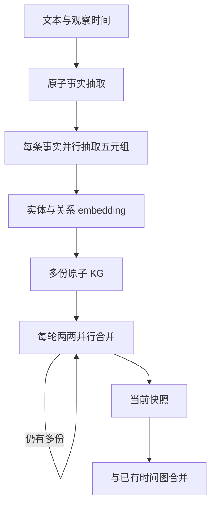

# iText2KG、ATOM 与 C-Unseen：增量归并、原子事实和时间图

## 1. 阅读范围与版本

- 仓库：<https://github.com/AuvaLab/itext2kg>
- 源码快照：`840aba2c89d2f00c84c6b1da4c1c0b6637fa8d5d`
- 调研日期：2026-10-23；许可证：Apache-2.0。
- 论文：[iText2KG](https://arxiv.org/abs/2409.03284)、[ATOM](https://arxiv.org/abs/2510.22590)、[C-Unseen](https://arxiv.org/abs/2608.26870)。
- 当前仓库已整合数条研究线。本文分别分析 `itext2kg_star`、`atom`，并简述作为下游分析模块的 `c_unseen`；未执行 LLM、embedding 或论文基准。

## 2. 三代方法不能合并成一条流程

| 实现 | 输入与关键步骤 | 主要输出 |
| --- | --- | --- |
| iText2KG | 文本片段→实体→关系→纠正遗漏→跨片段归并 | 增量实体关系图 |
| iText2KG_Star | 文本片段→直接关系抽取→从端点派生实体→归并 | 简化构建的图 |
| ATOM | 文本→原子事实→并行时间五元组→成对合并 | 带观察时间及有效时间的图 |
| C-Unseen | 已有时间图快照→稀有关系／子图→跨快照印证 | 标记弱信号的图及解释 |

它们共享部分结构化输出工具，但模型、匹配代码和时间字段并不完全相同。它们主要构建属性图；开放生成的实体 label 与关系 name 不是一个已验证的 OWL 本体。

## 3. iText2KG：先统一实体，再增量累积关系

`iText2KG.build_graph()` 处理 sections。首个 section 建立初始实体、关系集合；后续 section 先抽实体、对齐已有实体，再抽关系、对齐已有关系。末尾还可以与传入的 existing_knowledge_graph 合并。[S1]

### 3.1 DocumentsDistiller 是可选前置步骤

`DocumentsDistiller.distill()` 接受 documents、自定义 Pydantic 输出模型和 IE_query，对多份文本做结构化提炼，再组合返回对象。它不固定为某一种事实 schema；输出结构由调用方给定。[S2]

提炼能统一输入样式、去掉无关内容，也可能丢失条件和上下文。它是语义压缩过程，不能视为无损文本解析；主 build_graph 也不会因为有 Distiller 类就自动对所有输入运行它。

### 3.2 实体向量同时编码名称和类型

旧 iText2KG 路径分别对 entity name 和 label 生成 embedding，再加权组合，常见默认是名称 0.6、标签 0.4。目的在于区分同名但不同类型的实体，例如语言名与动物名。[S1] [S3]

`Matcher.find_match()` 优先名称和 label 精确匹配，否则用余弦相似度寻找超过阈值的最相似项。实体匹配成功时使用候选实体；关系匹配成功时主要改关系名及其 embedding，端点仍需单独更新。这里做的是表达归一化，不是学习类层级或公理。

### 3.3 “幻觉纠正”的真实含义

`iRelationsExtractor.extract_relations()` 检查关系两端是否在给定实体集合中。若缺失，先生成端点 embedding，再调用匹配器以 0.5 阈值寻找近似实体。[S4]

这一检查只能说明“端点不在前面那份实体清单里”，不证明端点一定是幻觉：也可能是实体抽取漏了。匹配器找不到超过阈值的候选会保留原对象，所以实现也不是保证所有未知端点被强制替换。

`extract_verify_and_correct_relations()` 找出没有关系的实体，再提示模型补抽，默认最多三轮孤立实体处理。孤立实体也可能本来就没有文本支持的关系；补抽提高覆盖机会，但不能自动保证新增关系真实。

当前循环重新计算孤立实体时使用该轮 corrected_relationships，未始终使用已累计的全部关系，因此“已经在之前轮次连接的实体”可能再次被视为未覆盖。该观察来自静态代码，未运行复现。

### 3.4 Star 的简化

`iText2KG_Star` 使用 `SimpleDirectiRelationsExtractor` 一次提取关系及端点，从端点集合得到实体；随后跨 section 做同样的名称／向量归并。它省掉独立 NER 与孤立实体追补，但只出现于文本、没有进入任何抽取关系的实体也可能不出现在图中。[S5]

## 4. ATOM：先拆原子事实，再处理小图

ATOM 把长文本拆成尽量自包含、只表达一个知识点的 atomic fact。实体全称、时间和必要上下文应在事实句里保留，以减少后续独立抽取无法解指代的问题。这是由 prompt 和 LLM 完成的分解，原子性不是由逻辑规则严格证明。[S6]

API 上，`extract_atomic_facts(texts, observation_timestamp, domains)` 与 `build_graph(atomic_facts, obs_timestamp, ...)` 是两个独立方法。build_graph 接收已经得到的事实列表，不会自动把任意长文先切成推荐大小。README 的“小块有利于抽取”描述不是 build_graph 内部自动严格执行的分块保证。

### 4.1 五元组与两个时间维度

模型抽取 subject、predicate、object、t_start、t_end。代码再给关系补充 t_obs：

- `t_obs`：这条信息被观察／摄入所对应的时间。
- `t_start`：事实开始有效的时间。
- `t_end`：事实结束有效的时间。

RelationshipProperties 把三类时间都保存成列表，并保留 atomic_facts、domains 和 embedding。未知时间可为空；字符串通过 dateutil 解析成时间戳，解析失败的值会跳过并记录警告。[S6] [S7]

提示要求将“某人不再担任某职位”的结束陈述转成相同肯定关系，填写结束时间。于是开始任职和离任信息能归到同一主体／谓词／客体上。这依赖模型正确识别否定结束语义，不是代码对任意否定逻辑的通用推导。

### 4.2 域标签是可选元数据

`extract_atomic_facts` 的 domains 参数表示可选领域类别列表；非空时使用 DomainedAtomicFact 输出，让事实附 domain。`build_graph` 中的 domains 则是与 atomic_facts 一一对齐的标签列表，并检查数量一致。两个同名参数的使用层次不同。

在本文所读 build_graph 中，标签被挂到关系上；没有看到它在该函数内根据领域自动删除不相关事实。外部脚本或调用方的筛选行为应与核心 API 区分。[S6]

## 5. ATOM 的归并算法逐步拆解

### 5.1 实体归并

`_batch_match_entities()` 先做 name+label 精确匹配，再对剩余实体计算余弦相似度矩阵，为每个新实体选最高分候选，达到阈值则替换。主 build_graph 默认 `ent_threshold=0.8`；实体向量默认名称权重 0.8、标签权重 0.2，与旧 iText2KG 的 0.6/0.4 不同。[S6] [S8]

这不是全局一对一最优匹配。尽管精确匹配阶段会排除部分已使用候选，向量阶段对每一行独立取 argmax，多个实体仍可能选中同一个候选；类别也没有在此处作为严格不可跨越的约束，而是 embedding 的一部分。

### 5.2 关系名称归并

`_batch_match_relationships()` 比较关系名称向量，超过阈值就把一侧关系改成另一侧名称。该名称归一化不要求相同端点或时间；端点和时间在后续判断中才参与事实是否同一。

主 build_graph 默认关系阈值 0.7，但低层 merge 方法的默认值可为 0.8；阅读实验参数时必须检查实际调用层，不能只找一个函数默认值。[S6] [S8]

### 5.3 相同事实合并时间与来源

Relationship 的普通相等比较只检查端点和关系名，不比较时间。若匹配为相同三元组，代码将 t_obs、t_start、t_end 和 atomic_facts 追加到已有关系中。

当前追加主要是列表 extend，而不是完整的时间区间代数。多个开始／结束时间并不自动建立一一配对的多段区间，也没有在这一逻辑里检测所有互斥事实。对“离任后重新任职”的多周期情形，不能只凭有两个时间列表就宣称已建立完整时态推理。

### 5.4 并行归并的工程实现

`parallel_atomic_merge()` 每轮把小图两两配对，通过 ThreadPoolExecutor 合并，奇数剩余图带到下一轮，直到只剩一份。每轮结果按 `as_completed()` 收集，不保证保留提交次序。[S6]

相似匹配选择某侧的名称作为规范名称，且阈值归并未必满足结合律。因此，合并树和完成次序可能影响规范标签及局部结果，不能把并行化描述为天然顺序无关的集合并集。

## 6. 需要保留的源码边界

以下均为该快照的静态观察，未通过运行验证：[S7] [S8]

- matcher 先执行关系匹配，再用实体映射更新关系端点。若端点只有在更新后才变成相同，当前轮可能未立即合并其时间列表。
- 匹配代码复制列表但不深拷贝内部对象；关系重命名和时间追加可能影响传入图对象。
- 关系合并代码追加了时间和 atomic_facts，未同样合并 domains，因此域标签可能不完整地传到规范边。
- `__eq_with_timestamps__()` 仍访问 `properties.timestamps`，而 ATOM 当前模型实际定义 t_obs/t_start/t_end；该辅助方法与模型字段存在不一致，主 matcher 主要用普通相等比较。
- 名称会转小写；类型和关系名的清洗正则主要保留英文字母、数字。非拉丁 label 可能失真；支持任意 LLM 并不等于所有语言的规范化规则都相同。
- 没有调用 LLM 的 merge 阶段降低了模型判断开销，同时将归并正确性更多交给 embedding、阈值和字符串规则。相似关系不必语义等价，反义／不同粒度关系尤其不能仅据向量分数证明等价。

## 7. 持久化、并发与来源

`KnowledgeGraph.to_json()` / `from_json()` 支持图结构保存，embedding 可另存 NPZ；配置 kg_store_dir 后，Atom 按观察时间写快照，并可写 merged 图。仓库也有 Neo4j storage 接口。[S6] [S7]

atomic_facts 是 LLM 生成的自包含事实句，并非原文 span。它提供可读的中间证据，但若事实分解时改写错误，后续图的 atomic_facts 也会重复该错误。主模型没有自动记录每个字词到原 PDF 坐标的映射。

`LangchainOutputParser` 使用 with_structured_output 和 abatch，按 provider 配置分批、估算 token、重试和退避。部分 async 方法内部仍使用 `time.sleep()`，因此不能单凭 async API 就推断等待阶段全部非阻塞。provider 限额配置也只是该快照内置值，不应视为服务商实时配额。[S9]

## 8. C-Unseen：在已有图上寻找弱信号

`CUnseen.process_snapshot()` 先运行 RareElementsDetector，再在有历史快照时运行 WeakSignalAlerter。多快照入口按列表顺序处理，历史列表来自此前所有快照。[S10]

当前 detector 实际把整个快照的编号三元组交给 LLM，返回 rare_indices 和分组解释；范围合法的索引被标为 rare。它不是简单的“出现次数少于某阈值”，而是让模型结合快照的主要叙事判断语义上的异常或新动向。[S11]

alerter 构造与历史稀有事实有关的连接上下文，要求判断跨时间印证，记录弱信号解释，并用 already_corroborated 标志避免相同稀有证据反复触发。可保存提示、响应和标记 trace。[S12]

这是知识图谱上的下游发现任务，不负责建立通用 ontology。整快照 prompt 的规模、上游实体／关系归并质量、LLM 对“罕见但有意义”的判断都会影响结果。README 的提升比例属于作者实验报告，本文未做同模型同数据的复测。

## 9. 固定版本源码索引

- [S1：旧 iText2KG 主流程](https://github.com/AuvaLab/itext2kg/blob/840aba2c89d2f00c84c6b1da4c1c0b6637fa8d5d/itext2kg/itext2kg_star/itext2kg.py)
- [S2：DocumentsDistiller](https://github.com/AuvaLab/itext2kg/blob/840aba2c89d2f00c84c6b1da4c1c0b6637fa8d5d/itext2kg/documents_distiller/documents_distiller.py)
- [S3：旧 Matcher](https://github.com/AuvaLab/itext2kg/blob/840aba2c89d2f00c84c6b1da4c1c0b6637fa8d5d/itext2kg/itext2kg_star/graph_matching/matcher.py)
- [S4：关系检查与孤立实体补抽](https://github.com/AuvaLab/itext2kg/blob/840aba2c89d2f00c84c6b1da4c1c0b6637fa8d5d/itext2kg/itext2kg_star/irelations_extraction/irelations_extractor.py)
- [S5：Star 主流程](https://github.com/AuvaLab/itext2kg/blob/840aba2c89d2f00c84c6b1da4c1c0b6637fa8d5d/itext2kg/itext2kg_star/itext2kg_star.py)
- [S6：Atom 主流程](https://github.com/AuvaLab/itext2kg/blob/840aba2c89d2f00c84c6b1da4c1c0b6637fa8d5d/itext2kg/atom/atom.py)
- [S7：ATOM 数据模型目录](https://github.com/AuvaLab/itext2kg/tree/840aba2c89d2f00c84c6b1da4c1c0b6637fa8d5d/itext2kg/atom/models)
- [S8：ATOM GraphMatcher](https://github.com/AuvaLab/itext2kg/blob/840aba2c89d2f00c84c6b1da4c1c0b6637fa8d5d/itext2kg/atom/graph_matching/matcher.py)
- [S9：结构化调用与批处理](https://github.com/AuvaLab/itext2kg/blob/840aba2c89d2f00c84c6b1da4c1c0b6637fa8d5d/itext2kg/llm_output_parsing/langchain_output_parser.py)
- [S10：CUnseen 编排](https://github.com/AuvaLab/itext2kg/blob/840aba2c89d2f00c84c6b1da4c1c0b6637fa8d5d/itext2kg/c_unseen/c_unseen.py)
- [S11：稀有事实检测](https://github.com/AuvaLab/itext2kg/blob/840aba2c89d2f00c84c6b1da4c1c0b6637fa8d5d/itext2kg/c_unseen/rare_elements_detector/detector.py)
- [S12：弱信号检测](https://github.com/AuvaLab/itext2kg/blob/840aba2c89d2f00c84c6b1da4c1c0b6637fa8d5d/itext2kg/c_unseen/weak_signal_alerter/alerter.py)

[S1]: https://github.com/AuvaLab/itext2kg/blob/840aba2c89d2f00c84c6b1da4c1c0b6637fa8d5d/itext2kg/itext2kg_star/itext2kg.py
[S2]: https://github.com/AuvaLab/itext2kg/blob/840aba2c89d2f00c84c6b1da4c1c0b6637fa8d5d/itext2kg/documents_distiller/documents_distiller.py
[S3]: https://github.com/AuvaLab/itext2kg/blob/840aba2c89d2f00c84c6b1da4c1c0b6637fa8d5d/itext2kg/itext2kg_star/graph_matching/matcher.py
[S4]: https://github.com/AuvaLab/itext2kg/blob/840aba2c89d2f00c84c6b1da4c1c0b6637fa8d5d/itext2kg/itext2kg_star/irelations_extraction/irelations_extractor.py
[S5]: https://github.com/AuvaLab/itext2kg/blob/840aba2c89d2f00c84c6b1da4c1c0b6637fa8d5d/itext2kg/itext2kg_star/itext2kg_star.py
[S6]: https://github.com/AuvaLab/itext2kg/blob/840aba2c89d2f00c84c6b1da4c1c0b6637fa8d5d/itext2kg/atom/atom.py
[S7]: https://github.com/AuvaLab/itext2kg/tree/840aba2c89d2f00c84c6b1da4c1c0b6637fa8d5d/itext2kg/atom/models
[S8]: https://github.com/AuvaLab/itext2kg/blob/840aba2c89d2f00c84c6b1da4c1c0b6637fa8d5d/itext2kg/atom/graph_matching/matcher.py
[S9]: https://github.com/AuvaLab/itext2kg/blob/840aba2c89d2f00c84c6b1da4c1c0b6637fa8d5d/itext2kg/llm_output_parsing/langchain_output_parser.py
[S10]: https://github.com/AuvaLab/itext2kg/blob/840aba2c89d2f00c84c6b1da4c1c0b6637fa8d5d/itext2kg/c_unseen/c_unseen.py
[S11]: https://github.com/AuvaLab/itext2kg/blob/840aba2c89d2f00c84c6b1da4c1c0b6637fa8d5d/itext2kg/c_unseen/rare_elements_detector/detector.py
[S12]: https://github.com/AuvaLab/itext2kg/blob/840aba2c89d2f00c84c6b1da4c1c0b6637fa8d5d/itext2kg/c_unseen/weak_signal_alerter/alerter.py
