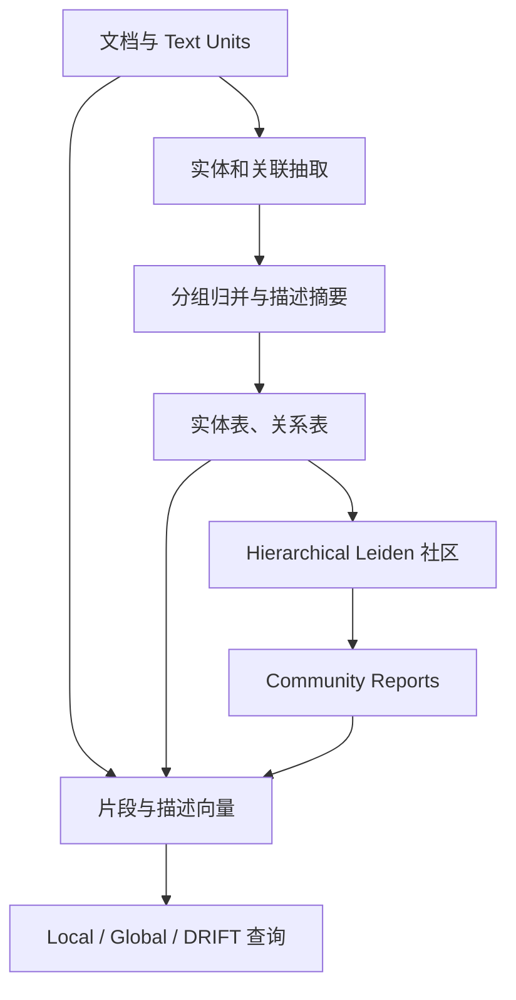

# Microsoft GraphRAG：实体关联图、层级社区与报告索引

## 1. 阅读范围与版本

- 仓库：<https://github.com/microsoft/graphrag>
- 源码快照：`c600ff80b77b9b62c47d539a3ac9569e95d8949b`
- 调研日期：2026-10-23；许可证：MIT。
- 原始论文：[From Local to Global: A Graph RAG Approach to Query-Focused Summarization](https://arxiv.org/abs/2404.16130)。
- 当前仓库已采用多包布局，主要代码路径为 `packages/graphrag/graphrag/`；旧文章中的根级 `graphrag/` 路径不一定适用。
- 本文检查标准索引、Fast 索引、图合并、社区报告、更新和查询入口。未执行 LLM、索引任务或论文复现。

## 2. 建模目标是建立可用于回答问题的语料索引

Microsoft GraphRAG 把语料转换为实体与关系、层级社区、社区报告及向量索引。它尤其重视需要跨大量文档归纳主题的问题，避免只能召回若干与问题字面相近的片段。

这里的社区层级不是 ontology taxonomy。社区表示图上联系较密的节点集合；某个社区包含另一个社区，不意味着前者是后者的上位概念，也不意味着能输出 `rdfs:subClassOf`。

默认关系记录的核心是 source、target、description、weight 和来源 text_unit_ids，而没有一个必须属于正式本体谓词表的 predicate 字段。因此，它更接近**带文本描述的实体关联图**，不能简单等同于严格的主谓宾知识库。[S1] [S2]

## 3. 标准索引的实际工作流

`PipelineFactory` 中标准流程依次加载文档、创建 text units、建立文档表、extract_graph、finalize_graph、可选 claims、communities、最终 text units、community reports、text embeddings。[S3]

输出由 table provider 管理，不应把底层某种文件格式当成建模算法本身。逻辑上包括 documents、text_units、entities、relationships、communities、community_reports 和可选 covariates；配置允许另外保存 raw_entities、raw_relationships，便于比较抽取和摘要前后的内容。[S1]

## 4. LLM 怎样抽实体和关系

### 4.1 实体类型与输出格式

`GraphExtractor._process_document()` 把输入文本和 entity_types 填入 extraction prompt。默认 prompt 让模型输出两类分隔记录：[S2] [S4]

- entity：名称、类型、描述。
- relationship：主体、客体、关系描述、关系强度。

类型列表由配置提供；可以定制 prompt，prompt tuning 也可辅助生成领域、语言、类型和样例。但这类自动提示生成主要是抽取配置生成，不是一个会自动审核、版本化和推理复杂公理的 ontology learning 系统。

默认提示要求英文输出。想判断某个多语言语料实验的行为，需要检查实际使用的 prompt，而不能只根据底层模型支持中文就认定输出规范完全一致。

### 4.2 Gleaning 是补抽

初次回答后，代码可继续要求模型补充遗漏实体／关系。达到 max_gleanings 上限或模型不再返回继续标志时停止。当前默认 max_gleanings 为 1。[S2] [S5]

它是同一次文档抽取对话中的补抽，不是独立验证 Agent。模型声明没有遗漏，并不能证明召回完整；补抽生成的描述也可能重复或互相矛盾。

### 4.3 容错解析

`_process_result()` 按记录和字段分隔符解析，实体名、类型、关系两端转为大写并清理。关系强度无法解析成数字时使用 1.0。字段数量和记录标记不符的内容不会正常入表；抽取调用异常通过错误回调记录并返回空表。[S2]

entity_types 主要通过 prompt 约束。该解析器不会对每个生成类型执行一套完整的形式化 schema membership 验证，也不验证描述是否被原文逐字支持。

## 5. 归并与实体消歧的实际程度

`_merge_entities()` 按 `(title, type)` 分组，将描述、text unit ID 收集为列表，并统计出现频率；`_merge_relationships()` 按 `(source, target)` 分组，合并描述、来源并累加强度。孤立端点关系随后被过滤。[S6]

这不是以全局 ID 和上下文联合消歧为核心的实体链接器。大小写和清理能减少表面差异，但别名不一定合并，同名不同对象也可能被混合。实体 type 在初始分组中参与键，关系两端仍主要使用 title，需要特别注意同名多类型情形。

`get_summarized_entities_relationships()` 再调用 LLM 汇总描述：关系摘要按 source/target 回连，实体摘要按 title 回连。它把多段描述压缩成便于检索和呈现的文本，不是对矛盾事实逐项裁决，也没有在默认边模型中保留独立有效期。

关系 weight 是抽取的关联强度累积，不应解释为经过统计校准的事实置信度。多处重复出现、抽取提示偏好和模型评分尺度都会影响它。

## 6. 层级社区如何形成

`cluster_graph()` 使用 hierarchical Leiden，对关系网络形成多层分区，并保留 community ID、level、parent 和成员节点。[S7]

聚类前将两端按词序规范化成无向关系，并对反向重复保留最后一条；可配置只使用最大连通分量。随后把权重边列表送入 Leiden，传入最大社区规模和随机种子。

几个语义边界很重要：

- 社区层级表达网络聚集，而不是概念的 is-a 层级。
- 方向在聚类阶段被消除；这有利于发现关联群，但不保留所有业务关系的方向语义。
- 若只保留最大连通分量，较小独立知识群可能不参与这一步聚类。
- 种子控制算法随机性，不保证上游 LLM 抽取和摘要完全可重现。

## 7. Community Report 是第二层知识压缩

`create_community_reports()` 准备节点、边以及可选 claim 的表格上下文，按 token 预算选择内容。模型输出 title、summary、rating、rating_explanation、findings，报告中可引用数据记录 ID。[S8] [S9]

这些引用指向索引记录，进而可关联原文；它们不是外部事实核验。rating 也是报告提示定义的影响评分，不是图中事实的真实性概率。

一个需要区分论文概念与本快照的细节：社区摘要代码提供层级 context builder，但当前 `summarize_communities()` 先在 `reports` 尚为空时构造全部 level_contexts，之后才逐层生成报告。因此，不能直接宣称这个函数在每一层都消费了刚生成的下层报告。需要阅读具体 context builder、调用配置和实际输出，才能判断层级压缩的实际效果。[S10]

报告将复杂局部图压缩成可供全局问题检索的文本，是 GraphRAG 的重要建模选择。与此同时，摘要可能遗漏低频条件，或者在合并描述时引入额外推断；保留原始表和 text units 对理解产物很重要。

## 8. Claims 是独立可选通道

claim extractor 可生成主体、客体、类型、状态、开始／结束日期、说明和 source_text，并写入 covariates。默认 extract_claims.enabled 为 false。[S5] [S11]

claims 可以进入社区报告和查询上下文，但它们没有让普通 relationships 自动获得 Graphiti 式的事实失效机制。模型给出的 TRUE/FALSE/其他状态也是抽取结果，不能当成独立验证器已经核实的真值。

## 9. FastGraphRAG 具体省掉了什么

Fast 工作流使用 `extract_graph_nlp`、`prune_graph` 和 `create_community_reports_text`。`build_noun_graph()` 用 NLP 名词短语抽取器生成节点，将同一个 text unit 中共现的名词短语连接成边；可使用 PMI 调整共现权重。[S3] [S12]

Fast 图中的边表示共现关联，不是 LLM 抽出的明确业务谓词。实体类型统一为 NOUN PHRASE，description 可为空；后续社区报告主要依靠文本上下文。

所以 Fast 不是“完全同样的语义图，只是运行更快”。它更换了构图依据，减少 LLM 抽图成本，同时改变边的含义和可解释程度。

## 10. 查询模式如何消费这些产物

| 模式 | 主要入口 | 所用知识形态 |
| --- | --- | --- |
| Local | local_search | 召回相关实体，组合关系、文本和社区等局部上下文 |
| Global | global_search | 社区报告分批 map，相关结果 reduce 成答案 |
| DRIFT | drift_search | 利用社区背景启动，再展开局部问题和后续搜索 |
| Basic | basic_search | 文本向量检索基线 |

GlobalSearch 显式用 semaphore 限制并发 map 调用，再汇总输出。DRIFT 有 action/state 等控制结构。这些是查询阶段的组织方式，不表示索引阶段有一组自治 Agent 协商 ontology。[S13]

## 11. 增量索引与一致性限制

Factory 为 StandardUpdate 和 FastUpdate 定义了更新链：先构建 delta，再合并文档、实体关系、text units、claims、社区、报告和向量，并清理状态。[S3]

实体更新 `_group_and_resolve_entities()` 根据 title 对齐旧新 ID，保留首个 type，合并描述和 text_unit_ids；degree 在该函数中取已有值，源码留有重新计算的 TODO。这与初次实体抽取按 title+type 分组存在差别。[S14]

后续更新 workflow 会重新汇总描述。支持增量索引不意味着语义上的全量真值维护：当前观察到的是名称分组和索引产物合并，不是对历史冲突、事实撤销和有效时间的统一演算。

## 12. 评估与阅读边界

原论文关注跨语料问题的摘要和回答质量。即便回答更全面，也不能直接推出图实体归一化、关系类型或本体公理质量更高。阅读项目时应分别查看抽取表、归并前后描述、社区分区、报告来源和最终回答。

当前多包仓库把模型、缓存、输入、分块、存储和向量接口拆开；这有利于替换工程组件，但本文只核对与建模直接相关的调用链，没有审计全部 provider、存储后端和服务层。

## 13. 固定版本源码索引

- [S1：extract_graph workflow](https://github.com/microsoft/graphrag/blob/c600ff80b77b9b62c47d539a3ac9569e95d8949b/packages/graphrag/graphrag/index/workflows/extract_graph.py)
- [S2：GraphExtractor](https://github.com/microsoft/graphrag/blob/c600ff80b77b9b62c47d539a3ac9569e95d8949b/packages/graphrag/graphrag/index/operations/extract_graph/graph_extractor.py)
- [S3：PipelineFactory](https://github.com/microsoft/graphrag/blob/c600ff80b77b9b62c47d539a3ac9569e95d8949b/packages/graphrag/graphrag/index/workflows/factory.py)
- [S4：默认抽取提示](https://github.com/microsoft/graphrag/blob/c600ff80b77b9b62c47d539a3ac9569e95d8949b/packages/graphrag/graphrag/prompts/index/extract_graph.py)
- [S5：默认参数](https://github.com/microsoft/graphrag/blob/c600ff80b77b9b62c47d539a3ac9569e95d8949b/packages/graphrag/graphrag/config/defaults.py)
- [S6：表格归并](https://github.com/microsoft/graphrag/blob/c600ff80b77b9b62c47d539a3ac9569e95d8949b/packages/graphrag/graphrag/index/operations/extract_graph/extract_graph.py)
- [S7：社区划分](https://github.com/microsoft/graphrag/blob/c600ff80b77b9b62c47d539a3ac9569e95d8949b/packages/graphrag/graphrag/index/operations/cluster_graph.py)
- [S8：社区报告 workflow](https://github.com/microsoft/graphrag/blob/c600ff80b77b9b62c47d539a3ac9569e95d8949b/packages/graphrag/graphrag/index/workflows/create_community_reports.py)
- [S9：报告提示](https://github.com/microsoft/graphrag/blob/c600ff80b77b9b62c47d539a3ac9569e95d8949b/packages/graphrag/graphrag/prompts/index/community_report.py)
- [S10：分层报告执行](https://github.com/microsoft/graphrag/blob/c600ff80b77b9b62c47d539a3ac9569e95d8949b/packages/graphrag/graphrag/index/operations/summarize_communities/summarize_communities.py)
- [S11：ClaimExtractor](https://github.com/microsoft/graphrag/blob/c600ff80b77b9b62c47d539a3ac9569e95d8949b/packages/graphrag/graphrag/index/operations/extract_covariates/claim_extractor.py)
- [S12：名词共现构图](https://github.com/microsoft/graphrag/blob/c600ff80b77b9b62c47d539a3ac9569e95d8949b/packages/graphrag/graphrag/index/operations/build_noun_graph/build_noun_graph.py)
- [S13：查询实现目录](https://github.com/microsoft/graphrag/tree/c600ff80b77b9b62c47d539a3ac9569e95d8949b/packages/graphrag/graphrag/query/structured_search)
- [S14：增量实体合并](https://github.com/microsoft/graphrag/blob/c600ff80b77b9b62c47d539a3ac9569e95d8949b/packages/graphrag/graphrag/index/update/entities.py)

[S1]: https://github.com/microsoft/graphrag/blob/c600ff80b77b9b62c47d539a3ac9569e95d8949b/packages/graphrag/graphrag/index/workflows/extract_graph.py
[S2]: https://github.com/microsoft/graphrag/blob/c600ff80b77b9b62c47d539a3ac9569e95d8949b/packages/graphrag/graphrag/index/operations/extract_graph/graph_extractor.py
[S3]: https://github.com/microsoft/graphrag/blob/c600ff80b77b9b62c47d539a3ac9569e95d8949b/packages/graphrag/graphrag/index/workflows/factory.py
[S4]: https://github.com/microsoft/graphrag/blob/c600ff80b77b9b62c47d539a3ac9569e95d8949b/packages/graphrag/graphrag/prompts/index/extract_graph.py
[S5]: https://github.com/microsoft/graphrag/blob/c600ff80b77b9b62c47d539a3ac9569e95d8949b/packages/graphrag/graphrag/config/defaults.py
[S6]: https://github.com/microsoft/graphrag/blob/c600ff80b77b9b62c47d539a3ac9569e95d8949b/packages/graphrag/graphrag/index/operations/extract_graph/extract_graph.py
[S7]: https://github.com/microsoft/graphrag/blob/c600ff80b77b9b62c47d539a3ac9569e95d8949b/packages/graphrag/graphrag/index/operations/cluster_graph.py
[S8]: https://github.com/microsoft/graphrag/blob/c600ff80b77b9b62c47d539a3ac9569e95d8949b/packages/graphrag/graphrag/index/workflows/create_community_reports.py
[S9]: https://github.com/microsoft/graphrag/blob/c600ff80b77b9b62c47d539a3ac9569e95d8949b/packages/graphrag/graphrag/prompts/index/community_report.py
[S10]: https://github.com/microsoft/graphrag/blob/c600ff80b77b9b62c47d539a3ac9569e95d8949b/packages/graphrag/graphrag/index/operations/summarize_communities/summarize_communities.py
[S11]: https://github.com/microsoft/graphrag/blob/c600ff80b77b9b62c47d539a3ac9569e95d8949b/packages/graphrag/graphrag/index/operations/extract_covariates/claim_extractor.py
[S12]: https://github.com/microsoft/graphrag/blob/c600ff80b77b9b62c47d539a3ac9569e95d8949b/packages/graphrag/graphrag/index/operations/build_noun_graph/build_noun_graph.py
[S13]: https://github.com/microsoft/graphrag/tree/c600ff80b77b9b62c47d539a3ac9569e95d8949b/packages/graphrag/graphrag/query/structured_search
[S14]: https://github.com/microsoft/graphrag/blob/c600ff80b77b9b62c47d539a3ac9569e95d8949b/packages/graphrag/graphrag/index/update/entities.py
