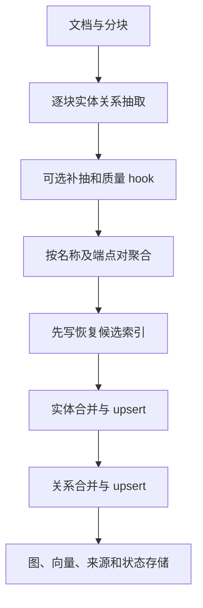

# LightRAG：实体／关系双索引、描述合并与可维护的知识构建

## 1. 阅读范围与版本

- 仓库：<https://github.com/HKUDS/LightRAG>
- 源码快照：`aaebfe1bb8d55deb6a4304d357a3bf4c92fcd40a`
- 调研日期：2026-10-23；许可证：MIT。
- 原始论文：[LightRAG: Simple and Fast Retrieval-Augmented Generation](https://arxiv.org/abs/2410.05779)。
- 当前代码已远超初版论文规模，增加了 JSON 抽取、来源跟踪、恢复和多种工程扩展。本文重点阅读 `lightrag.py`、`operate.py`、prompt、storage 接口和重建逻辑；未审计所有服务端、前端、多模态 parser 与数据库后端，未运行模型或论文实验。

## 2. 建模目标和知识表示

LightRAG 从文本抽取实体和关系，合并成图，并对实体、关系和原文片段建立向量索引。查询时区分低层关键词与高层关键词，分别检索具体实体及更抽象的关系／主题信息，再组合上下文回答。

默认构图不是正式 ontology induction：实体 type 多为抽取标签，关系以 keywords 和 description 承载语义，没有默认构建类层级、属性 domain/range、互斥公理和 OWL 推理器。[S1] [S2]

| 记录 | 关键内容 | 建模含义 |
| --- | --- | --- |
| 实体 | entity_name、entity_type、description、source_id、file_path | 按规范名称组织的对象与描述 |
| 关系 | src_id、tgt_id、keywords、description、weight、source_id | 两端之间的综合语义联系 |
| 文本块 | content、full_doc_id、chunk_order_index、tokens 等 | 原文和抽取单元 |
| 来源跟踪 | entity_chunks、relation_chunks | 每个图对象的完整来源 chunk 集合 |
| 文档构建记录 | doc_status、full_entities、full_relations | 进度、候选对象与恢复入口 |

## 3. 从文档到图的分层组织

外层 `LightRAG` 对象管理配置、存储生命周期、插入、查询和删除；具体抽取、合并与检索函数集中在 `operate.py`。KV、Vector、Graph、DocStatus 使用不同接口，不能把它理解成只往一个图数据库写三元组。[S1] [S3]

当前分块配置支持策略化扩展，旧的顶层 chunk_token_size 等参数仍有兼容覆盖逻辑。实际片段大小需要结合 addon_params、策略和环境变量检查；不宜把初版固定参数当成该快照唯一分块方式。

## 4. 抽取提示、结构化输出与质量控制

### 4.1 两种输出路径

`extract_entities()` 根据 entity_extraction_use_json 选择 JSON 模式或文本分隔记录模式。二者使用相应 prompt profile，并共享实体类型规范化等处理。[S2] [S4]

文本模式的实体记录有四个字段：标记、名称、类型、描述；关系记录有五个字段：标记、主体、客体、关键词、描述。与一些旧 GraphRAG 风格教程不同，当前文本关系记录没有额外的模型生成 weight 字段，解析时设为 1.0。

名称经 normalize_entity_name 清理；类型转小写、去空格，遇到逗号列表只取首个非空类型，并拒绝非法结构字符等值。描述为空的记录被丢弃；关系两端相同的自环被跳过。

这些检查主要保证记录可处理，不代表实体确实出现于原文，也不保证关系描述真实。entity_types_guidance 是 prompt 指导，不是一套经过形式推理的全局类体系。

### 4.2 Gleaning 当前只额外执行一次

尽管参数名叫 entity_extract_max_gleaning，当前 extract_entities 实现判断它是否大于零，然后最多执行一次补抽，而不是循环运行该数字指定的次数。补抽还受组合输入 token 上限保护，超过预算可被跳过。[S2]

补抽与初次抽取同键的实体／关系相比，代码倾向保留 description 更长的版本。更长只是启发式选择，不能视为更正确或证据更充分。

### 4.3 可插入的 validator

`kg_extraction_validator` 是可选 hook，接收 chunk key、实际送给抽取器的文本和候选节点／边字典，返回修订后的两份字典。同步和异步返回都可处理，程序检查返回结构。[S2]

hook 位于模型抽取之后、多模态系统节点注入之前。核心不会因为存在 hook 接口就替调用方实现事实校验；未配置时该步骤不改变结果。它也不是一个默认启动的审阅 Agent。

## 5. 实体合并：名称是主要身份键

`_merge_nodes_then_upsert(entity_name, ...)` 按规范实体名读取已有节点，把本轮与已有描述、类型、来源、文件路径合并。[S2]

类型通过 Counter 选择高频项；已有类型通常作为一个已有值参与，而不是保留全部历史分类投票分布。这个操作压缩成一个 entity_type，并不生成多继承类型体系。

描述先去重，再根据时间戳和长度等规则组织，交给 `_handle_entity_relation_summary()`。该函数根据描述数量与 token 预算直接拼接、调用一次摘要，或分组摘要后再次合并。只有一个描述时通常直接返回。

主要边界是名称身份：不同别名未必自动成为同一个实体，同名不同义对象可能进入同一个合并槽。默认流程中未看到 Graphiti 那样完整的候选实体检索→身份属性→模糊判断→LLM 消歧链。LLM 摘要能综合描述，但不等于可靠的实体 identity resolution。

## 6. 关系建模的关键事实：按无向端点对聚合

`merge_nodes_and_edges()` 把每条边的两端排序，使用排序后的 tuple 作为聚合键；`collect_kg_merge_candidates()` 同样明确把关系候选规范为无向 pair。[S2]

所以同一对实体间的多个表述，通常合入一条边的 description 和 keywords，而不是按“主体、正式谓词、客体”分别保留多条有向关系。方向、因果、角色等信息可以仍在描述里，但图结构本身没有独立编码所有这些区别。

例如甲雇用乙、乙向甲报告，可能形成同一端点对上的综合描述。若只导出两端和一个关键词，可能进一步丢失语义。理解 LightRAG 产物时，description 是知识内容的重要组成部分。

### 6.1 权重、关键词和端点补全

`_merge_edges_then_upsert()` 合并关键词集合及描述，按新来源累加 weight，避免简单重放已有 source 时重复累加；同时让权重至少反映真实来源数。更大的已有手工权重可被保留。因此 weight 主要是证据数量／重要性相关的检索属性，不是概率置信度。

关系处理阶段可以创建缺失端点节点，保证边能接入图。这也是为什么恢复候选集合需要包含“仅由关系出现的实体”，不能只记录 NER 产生的节点。

## 7. 来源完整列表与图上显示字段分开

节点／边的 source_id 使用分隔字符串，可能受最大来源数量限制。`entity_chunks`、`relation_chunks` 另存完整 chunk_ids，供维护与删除使用。[S2]

当前代码明确区分：跟踪行不存在时可以从旧图属性回填；跟踪行存在但为空时，它是权威的空集合，不能再把图上已截断或已过期来源重新填回来。这种细节对删除后的恢复尤其重要。

file_path 也可能截断并出现占位信息；因此展示字段不足以替代完整来源索引。source_id 指向 chunk，而不是对每条关系内部每个子句做独立 span 引用。

## 8. 并发合并、恢复与删除

### 8.1 分阶段写入

当前 merge 分为三个阶段：[S2]

1. 在 full_entities/full_relations 持久化可能被修改的完整候选集合并 flush。
2. 并发合并所有实体。
3. 并发合并所有关系，必要时补端点。

候选集合是恢复线索，不是“这些对象已写入成功”的证明。提前写它，是为了即使图或向量写到一半失败，清理／重试也有机会找到可能留下的对象。

实体更新按实体名加 keyed lock；关系更新按排序后的两端取得锁，并通过 semaphore 限制并发。这保护共享对象的读改写，不能直接等同于跨 KV、图、向量存储的一次数据库事务。

### 8.2 从剩余证据重建

`rebuild_knowledge_from_chunks()`、`_rebuild_single_entity()`、`_rebuild_single_relationship()` 使用仍存活的来源及抽取缓存重建图对象。外层提供按文档、实体、关系删除的入口，并有状态和恢复记录。[S1] [S2]

因此删除文档不能只删 full_docs：其他文档可能仍支持同一个实体或关系，需要更新来源、描述、向量与图。具体失败恢复保障仍取决于存储后端能力和所用操作路径，本文没有做故障注入测试。

与 Graphiti 的区别在于：这主要是**来源和构建生命周期维护**。模型记录中的 timestamp 多用于抽取和合并排序，不能把它当作事实生效／失效双时间字段；本流程没有自动从新陈述推断旧事实何时结束的统一时态机制。

## 9. 双层检索具体怎样执行

`get_keywords_from_query()` 等函数产生 high_level_keywords 与 low_level_keywords。`_perform_kg_search()` 按模式选择入口：[S2] [S3]

| 模式 | 检索路径 |
| --- | --- |
| local | 低层关键词→实体向量→相关边及文本 |
| global | 高层关键词→关系向量→相关实体及文本 |
| hybrid | 合并 local 和 global 两路 |
| mix | 图检索加原始 chunk 向量检索 |
| naive | 以文本 chunk 向量检索为主 |
| bypass | 不走通常的知识检索上下文 |

本快照 QueryParam 的默认 mode 为 mix。这里 global 的含义是关系／主题检索，**不是 Microsoft GraphRAG 的社区报告 map-reduce**。

实体向量文本包含名称与描述；关系向量文本包含关键词、两端和描述。检索结果还需要去重、token 截断、挑选关联 chunk，再组装给生成模型。图结构用于补充相互联系的证据，而大量细节仍保存在可读描述与原文中。

## 10. 协作方式与可验证边界

当前代码可以将 extract 等角色调用路由到相应模型函数，具有缓存、并发、取消、截断统计和可插拔质量 hook。这些是程序分阶段调用模型，不是默认的自治多 Agent 建模团队。

描述摘要本身有 map-reduce 形态，但对象是同一实体／关系的一组描述；不能把这个机制与全语料社区报告混为一谈。摘要降低上下文成本，也会压缩细节并把潜在冲突揉合成文字。

评估应分别检查实体重名、别名拆分、无向关系合并、来源保留、重建后内容和检索回答。论文中的回答质量或效率结果不能单独证明图具备正式本体建模能力。本文未运行相关测试，所有实现结论限定于所列快照和函数。

## 11. 固定版本源码索引

- [S1：LightRAG 配置、存储和操作入口](https://github.com/HKUDS/LightRAG/blob/aaebfe1bb8d55deb6a4304d357a3bf4c92fcd40a/lightrag/lightrag.py)
- [S2：抽取、合并、重建与查询核心](https://github.com/HKUDS/LightRAG/blob/aaebfe1bb8d55deb6a4304d357a3bf4c92fcd40a/lightrag/operate.py)
- [S3：查询参数与存储抽象](https://github.com/HKUDS/LightRAG/blob/aaebfe1bb8d55deb6a4304d357a3bf4c92fcd40a/lightrag/base.py)
- [S4：提示与 profile 配置](https://github.com/HKUDS/LightRAG/blob/aaebfe1bb8d55deb6a4304d357a3bf4c92fcd40a/lightrag/prompt.py)
- [S5：测试目录](https://github.com/HKUDS/LightRAG/tree/aaebfe1bb8d55deb6a4304d357a3bf4c92fcd40a/tests)

[S1]: https://github.com/HKUDS/LightRAG/blob/aaebfe1bb8d55deb6a4304d357a3bf4c92fcd40a/lightrag/lightrag.py
[S2]: https://github.com/HKUDS/LightRAG/blob/aaebfe1bb8d55deb6a4304d357a3bf4c92fcd40a/lightrag/operate.py
[S3]: https://github.com/HKUDS/LightRAG/blob/aaebfe1bb8d55deb6a4304d357a3bf4c92fcd40a/lightrag/base.py
[S4]: https://github.com/HKUDS/LightRAG/blob/aaebfe1bb8d55deb6a4304d357a3bf4c92fcd40a/lightrag/prompt.py
[S5]: https://github.com/HKUDS/LightRAG/tree/aaebfe1bb8d55deb6a4304d357a3bf4c92fcd40a/tests
