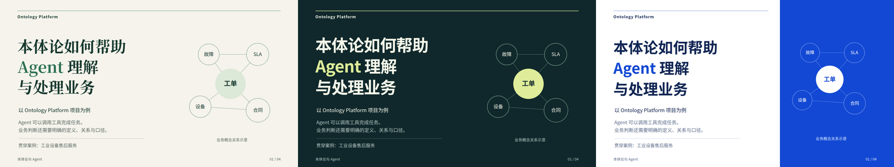

# 本体论与 Agent：第一部分网页演示

依据 2026-10-12 文字草稿第 1—4 页制作：封面、Agent 任务流程、SLA 业务口径与已有方法，共四页，预计讲解约六分钟。

**建议先看深色演讲版**。三个版本都增加了解释文字、分步路径动画与 SLA 指标切换，适合浏览器全屏放映。

## 打开成品

直接在浏览器打开 [总入口](index.html)，或者选择以下版本；每份网页都是完整四页。

| 版本 | 网页 | PDF |
| --- | --- | --- |
| 深色演讲版 | [打开](keynote.html) | [静态 PDF](keynote.pdf) |
| 商务编辑版 | [打开](editorial.html) | [静态 PDF](editorial.pdf) |
| 蓝白简报版 | [打开](blue.html) | [静态 PDF](blue.pdf) |

## 操作

- `→`、空格、PageDown：下一步；本页展示完成后进入下一页。
- `←`、PageUp：上一步。
- `A`：显示本页全部内容；Home／End：跳到第一页／最后一页。
- `F`：切换全屏；`N`：查看原稿讲解备注；Esc：关闭备注。
- 第 3 页点击“首次响应／恢复服务”，切换所关注的业务事件。
- `E`：进入文字编辑；点击文字修改，再点击左上方“完成编辑”。
- `Ctrl+S`：下载当前修改后的 HTML。修改也会保存在当前浏览器中。
- 移动鼠标可显示底部控制栏；支持横向滑动与鼠标滚轮导航。

网页内嵌了 Noto 中文字体，可离线打开。参考文献中的外部链接需要联网；本地案例摘要随文件提供。

## 内容与边界

新增说明来自原稿正文及讲解备注。任务、业务关系和 SLA 问题均为教学示意；计时起点、暂停、空值和适用合同口径仍须业务确认。SLA 切换只解释指标差异，不输出实际工单的达标结论。

四种方法保留各自分工与关注点；常见文档 RAG、本体等方法可以组合。没有新增产品能力、真实运行结果或验收结论。

PDF 显示每页的全部内容，文字可选择；动画、点击交互和现场编辑保留在 HTML 中。

## 配套文件

- [社区 skills 对比](skills-comparison.md)：四个代表方案、选型依据、查询时的社区信号与上游链接。
- [原稿第一部分](source-draft-part1.md)：第 1—4 页原文，内部案例链接调整为包内路径。
- [讲解备注](speaker-notes.json)：原稿备注与来源。
- [案例摘要](references/scenario-brief.md)：原稿引用的工业服务场景输入摘要。
- [第三方说明](THIRD-PARTY-NOTICES.txt)：Frontend Slides 的 MIT 声明，以及嵌入字体的 OFL 声明。
- `previews/`：三种版本的逐页 1920×1080 PNG。

## 检查

12 页已逐页渲染并检查越界、文字容器与表格重叠；三份 4 页 PDF 经 Poppler 渲染核对。离线打开、键盘导航、逐步展示、备注、SLA 切换、编辑保存与修改版下载通过检查。1280×720 和手机视口均保持固定 16:9。

制作采用 [Frontend Slides](https://github.com/zarazhangrui/frontend-slides) 的单文件网页方法，以及本地 `presentations` 的内容与排版检查指南。
